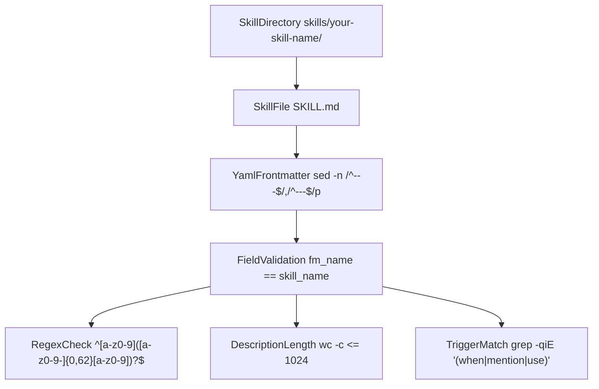
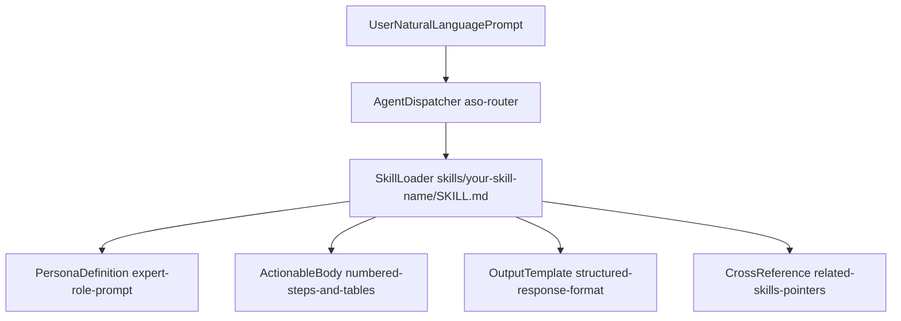

<!-- source: DeepWiki mcp.deepwiki.com · repo Eronred/aso-skills · page 2.3 Authoring & Validating Skills · fetched 2026-10-26 -->

# Authoring & Validating Skills

<details>
<summary>Relevant source files</summary>

The following files were used as context for generating this wiki page:

- [AGENTS.md](AGENTS.md)
- [CLAUDE.md](CLAUDE.md)
- [CONTRIBUTING.md](CONTRIBUTING.md)
- [validate-skills.sh](validate-skills.sh)

</details>


## Purpose & Scope

This section defines the technical specifications, structural requirements, and automated validation checks for authoring and maintaining agent skills within the `aso-skills` repository. Every skill functions as an autonomous unit of execution conforming to the Agent Skills open standard [AGENTS.md:3](), residing in dedicated directories under `skills/` [AGENTS.md:8](), and evaluated programmatically via [validate-skills.sh:1-79]().

---

## SKILL.md Frontmatter Specification & Naming Rules

Every skill must include a valid YAML frontmatter block at the very top of its `SKILL.md` file [CONTRIBUTING.md:11-20](). The frontmatter controls agent discovery, routing intent, and version tracking [AGENTS.md:22-27]().

### Frontmatter Schema

```yaml
---
name: skill-name
description: When the user wants to [action]. Also use when the user mentions "[trigger phrases]". For [related task], see [other-skill].
metadata:
  version: 1.0.0
---
```
*(Sources: [AGENTS.md:18-25](), [CONTRIBUTING.md:13-20]())*

### Validation Constraints and Rules

*   **`name` field:** Must strictly match the parent directory name [CONTRIBUTING.md:23](). It must be lowercase, use hyphens for word separation, avoid consecutive hyphens, and be between 1 and 64 characters long [AGENTS.md:20](), [CONTRIBUTING.md:24](). The exact regex enforced during validation is `^[a-z0-9]([a-z0-9-]{0,62}[a-z0-9])?$` [validate-skills.sh:37]().
*   **`description` field:** Must not exceed 1024 characters [AGENTS.md:21](), [validate-skills.sh:54-57](). It drives agent discovery by containing explicit trigger keywords, scoped intent patterns (`when`, `mention`, `use`), and boundary cross-references (`For X, see Y skill`) [AGENTS.md:27](), [CONTRIBUTING.md:16](), [validate-skills.sh:58-61]().
*   **`metadata` field:** Houses operational properties such as semantic versioning (`version: 1.0.0`) [AGENTS.md:22-24](), [CONTRIBUTING.md:17-19]().


*Figure 1: Natural Language Space to Code Entity Space mapping the directory authoring structure to validation checks executed by `validate-skills.sh`.*

Sources: [AGENTS.md:18-28](), [CONTRIBUTING.md:11-29](), [validate-skills.sh:22-62]()

---

## Authoring Structure & Output Templates

Beyond frontmatter, skills must adhere to specific formatting and content patterns to ensure reliable agent execution [AGENTS.md:29-35]().

### Internal Document Layout

1.  **Role Definition:** The content must begin with an explicit persona declaration, such as `You are an expert in...` [CONTRIBUTING.md:26]().
2.  **Instructional Body:** Utilizes direct, actionable second-person writing, comparative tables, numbered sequences, and code blocks [AGENTS.md:31-33](). Filler text and hedging language are strictly prohibited [AGENTS.md:34]().
3.  **Structured Output Format:** Defines deterministic markdown or JSON output schemas that the agent must produce upon completing the skill workflow [CONTRIBUTING.md:27]().
4.  **Cross-References:** Concludes with a dedicated section mapping related capabilities to adjacent skill units [CONTRIBUTING.md:28]().
5.  **Line Count Limits:** Individual `SKILL.md` files must remain under 500 lines [AGENTS.md:8](), [CONTRIBUTING.md:7](), [validate-skills.sh:65-69](). Optional detailed reference documents can be split off into a `references/` subdirectory [AGENTS.md:9](), [CONTRIBUTING.md:8]().


*Figure 2: Natural Language Space to Code Entity Space mapping execution loading from agent dispatch to structural components inside `SKILL.md`.*

Sources: [AGENTS.md:8-9](), [AGENTS.md:31-35](), [CONTRIBUTING.md:6-29]()

---

## Validation Mechanics (`validate-skills.sh`)

Automated verification is handled by the `validate-skills.sh` shell script at the repository root [CONTRIBUTING.md:47-49](). Contributors must execute this script locally and achieve zero errors before submitting pull requests [CONTRIBUTING.md:42]().

### Script Execution Flow and Checks

The script iterates through all subdirectories in `skills/` [validate-skills.sh:12](), executing the following verification steps:

1.  **Existence Check:** Verifies that a `SKILL.md` file exists within `skills/<skill_name>/` [validate-skills.sh:16-20]().
2.  **Frontmatter Extraction:** Uses `sed` to isolate content between the opening and closing `---` delimiters [validate-skills.sh:23]().
3.  **Name Validation:** Confirms the presence of the `name:` field [validate-skills.sh:26-29]() and asserts that its string value matches the parent directory name exactly [validate-skills.sh:30-33]().
4.  **Pattern & Format Validation:** Evaluates the name against strict alphanumeric and hyphen rules [validate-skills.sh:37-45]() and scans for forbidden consecutive hyphens (`--`) [validate-skills.sh:41-44]().
5.  **Description Analysis:** Checks for the presence of the `description:` field [validate-skills.sh:48-51](), ensures character length is under 1024 [validate-skills.sh:53-57](), and issues a warning if trigger words (`when`, `mention`, `use`) are absent [validate-skills.sh:58-61]().
6.  **Line Count Metrics:** Counts total lines using `wc -l` and triggers a warning if the file exceeds 500 lines [validate-skills.sh:65-69]().
7.  **Exit Status:** Aggregates error counts (`ERRORS`) and returns an exit code of `1` if any hard errors are detected, blocking faulty contributions [validate-skills.sh:75-79]().

Sources: [validate-skills.sh:1-79]()

---

## Contribution & Pull Request Workflow

Adding or updating skills follows a standardized Git branching and verification lifecycle [CONTRIBUTING.md:39-43]().

### Workflow Steps

1.  **Branch Creation:** Fork the repository and create a feature or fix branch following naming conventions such as `feature/skill-name` or `fix/skill-name-desc` [AGENTS.md:48](), [CONTRIBUTING.md:41]().
2.  **Authoring / Modification:** Create or edit `skills/<skill-name>/SKILL.md` maintaining character limits and formatting requirements [CONTRIBUTING.md:6-37](). Commit changes using conventional commit prefixes (`feat(skill-name): ...` or `fix(skill-name): ...`) [AGENTS.md:46]().
3.  **Local Validation:** Run the test suite via terminal [CONTRIBUTING.md:42], [CONTRIBUTING.md:47-49]():
    ```bash
    bash validate-skills.sh
    ```
4.  **Pull Request Submission:** Ensure validation outputs zero errors, then open a pull request against the main repository [CONTRIBUTING.md:42-43]().

Sources: [AGENTS.md:44-48](), [CONTRIBUTING.md:39-51]()

---

