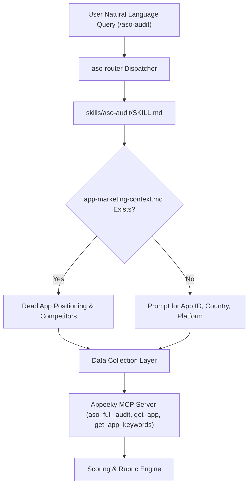
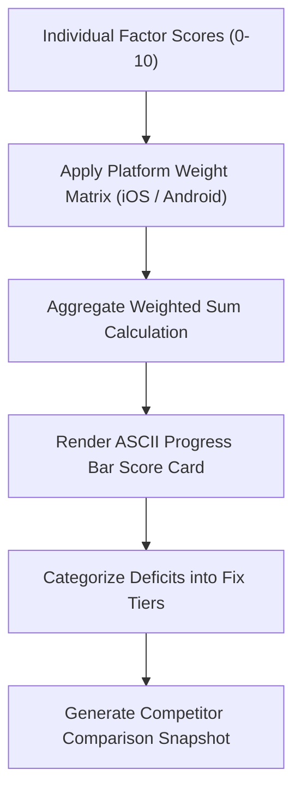
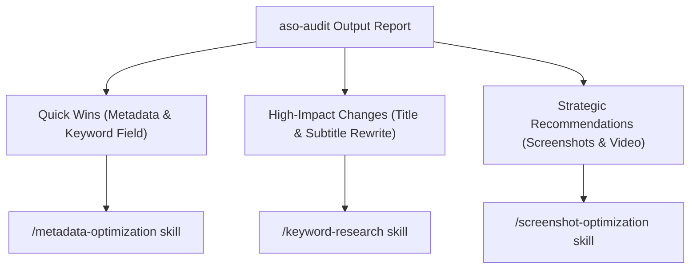

<!-- source: DeepWiki mcp.deepwiki.com · repo Eronred/aso-skills · page 3.1 aso-audit: Scoring Framework · fetched 2026-10-26 -->

# aso-audit: Scoring Framework

<details>
<summary>Relevant source files</summary>

The following files were used as context for generating this wiki page:

- [reference/aso-audit.mdx](reference/aso-audit.mdx)
- [skills/aso-audit.mdx](skills/aso-audit.mdx)
- [skills/aso-audit/SKILL.md](skills/aso-audit/SKILL.md)

</details>


## Purpose and Scope

The `aso-audit` skill [skills/aso-audit/SKILL.md:2-3]() is a core diagnostic engine within the `aso-skills` repository [reference/aso-audit.mdx:7](). Its primary purpose is to evaluate an App Store or Google Play listing across ten weighted factors, compute an aggregate 0–100 health score [reference/aso-audit.mdx:7](), and output a structured, tiered remediation plan [reference/aso-audit.mdx:87-102](). This wiki page documents the scoring framework, data ingestion flow, factor weighting rubrics, and output generation mechanics.

---

## 1. Execution Flow & Data Ingestion

When an agent invokes `/aso-audit` [reference/aso-audit.mdx:12](), it initiates a structured assessment lifecycle defined in `skills/aso-audit/SKILL.md` [skills/aso-audit/SKILL.md:12-28](). The engine first checks for shared project state (`app-marketing-context.md`) [skills/aso-audit/SKILL.md:14]() to bypass redundant prompts regarding app positioning and target audience [reference/aso-audit.mdx:24]().


*Sources: [skills/aso-audit/SKILL.md:12-28](), [reference/aso-audit.mdx:12-42](), [reference/aso-audit.mdx:116-125]()*

If the Appeeky MCP Server is available, the audit fetches live telemetry through dedicated tool bindings: `aso_full_audit`, `get_app`, `get_app_keywords`, and `get_keyword_metrics` [reference/aso-audit.mdx:120-125](). If disconnected, the skill falls back to user-provided metadata strings [skills/aso-audit/SKILL.md:28]().

*Sources: [skills/aso-audit/SKILL.md:12-28](), [reference/aso-audit.mdx:116-130]()*

---

## 2. The Ten Weighted Factors & Rubric

The scoring framework evaluates ten distinct listing attributes [reference/aso-audit.mdx:47-61](). Each factor is scored on an absolute `0–10` scale and multiplied by its corresponding platform weight to derive the aggregate score [skills/aso-audit/SKILL.md:32](). Note that weightings and evaluations differ slightly between iOS and Android (e.g., the Keyword Field and Subtitle are iOS-exclusive, whereas Description weight scales up on Android) [reference/aso-audit.mdx:39-41]().

| Factor | Weight (iOS / Android) | Core Evaluation Criteria | File Reference |
| :--- | :--- | :--- | :--- |
| **Title** | 20% / 20% | Primary keyword presence, 30-character limit utilization, brand/keyword balance, readability [reference/aso-audit.mdx:51](). | `[reference/aso-audit.mdx:51]()` |
| **Subtitle** | 15% / 0% (iOS only) | Secondary non-repeating keywords, value proposition clarity, character usage [reference/aso-audit.mdx:52](). | `[reference/aso-audit.mdx:52]()` |
| **Keyword Field** | 15% / 0% (iOS only) | Uniqueness, no spaces after commas, singular forms, 100-character budget usage [reference/aso-audit.mdx:53](). | `[reference/aso-audit.mdx:53]()` |
| **Description** | 5% / 15% | First-3-line hook, benefit framing, keyword density (Android), formatting, CTA [reference/aso-audit.mdx:54](). | `[reference/aso-audit.mdx:54]()` |
| **Ratings & Reviews** | 10% / 10% | Overall rating value, review recency, sentiment trajectory, developer response rate [reference/aso-audit.mdx:55](). | `[reference/aso-audit.mdx:55]()` |
| **Screenshots** | 10% / 10% | Slot utilization (10/10), top features in first 3 slots, readable text overlays, consistency [reference/aso-audit.mdx:56](). | `[reference/aso-audit.mdx:56]()` |
| **App Preview Video** | 5% / 5% | Presence, 3-second hook, 15–30s runtime, sound-off readability (captions) [reference/aso-audit.mdx:57](). | `[reference/aso-audit.mdx:57]()` |
| **Category** | 5% / 5% | Primary and secondary category selection optimality for discoverability [reference/aso-audit.mdx:58](). | `[reference/aso-audit.mdx:58]()` |
| **Localization** | 5% / 5% | Metadata and keyword adaptation for regional target markets [reference/aso-audit.mdx:59](). | `[reference/aso-audit.mdx:59]()` |
| **Ratings Momentum** | 10% / 10% | Directional trend of rating volume and sentiment over time [reference/aso-audit.mdx:60](). | `[reference/aso-audit.mdx:60]()` |

*Sources: [reference/aso-audit.mdx:47-61](), [skills/aso-audit/SKILL.md:34-137]()*

---

## 3. Score Card & Output Generation

Once individual factor scores are computed, `skills/aso-audit/SKILL.md` aggregates them into an overall weighted score from `0` to `100` [skills/aso-audit/SKILL.md:32](). The output is rendered as an ASCII text block containing a visual progress bar breakdown alongside granular diagnostic data [reference/aso-audit.mdx:68-85]().


*Sources: [skills/aso-audit/SKILL.md:32](), [reference/aso-audit.mdx:68-102]()*

The rendered score card follows this structural template:

```text
Overall ASO Score: [X]/100

Title:              [X]/10  ████████░░
Subtitle:           [X]/10  ██████░░░░
Keyword Field:      [X]/10  ████░░░░░░
Description:        [X]/10  ████████░░
Screenshots:        [X]/10  ██████████
Preview Video:      [X]/10  ██░░░░░░░░
Ratings & Reviews:  [X]/10  ████████░░
Icon:               [X]/10  ████████░░
Keyword Rankings:   [X]/10  ██████░░░░
Conversion Signals: [X]/10  ████░░░░░░
```
*Sources: [skills/aso-audit/SKILL.md:143-155](), [reference/aso-audit.mdx:73-85]()*

*Sources: [skills/aso-audit/SKILL.md:138-155](), [reference/aso-audit.mdx:68-85]()*

---

## 4. Prioritized Fix Tiers & Downstream Routing

To prevent user overwhelm, the audit framework translates numerical deficits into three chronological remediation tiers and connects directly to specialized execution skills [reference/aso-audit.mdx:87-102](), [reference/aso-audit.mdx:145-150]().

1. **Quick Wins — Implement Today:** Changes requiring zero code deployments or App Review submissions (e.g., updating iOS Keyword Fields, tweaking Promotional Text, or responding to negative reviews) [reference/aso-audit.mdx:87-89](), [reference/aso-audit.mdx:134]().
2. **High-Impact Changes — This Week:** Moderate-effort metadata rewrites (titles, subtitles) and major hook optimizations [reference/aso-audit.mdx:91-93]().
3. **Strategic Recommendations — This Month:** Long-term asset production, such as screenshot overhauls, video production, or rating-recovery campaigns [reference/aso-audit.mdx:95-97]().


*Sources: [reference/aso-audit.mdx:87-98](), [reference/aso-audit.mdx:145-150](), [skills/aso-audit/SKILL.md:173-179]()*

*Sources: [reference/aso-audit.mdx:87-102](), [skills/aso-audit/SKILL.md:157-179]()*

---

