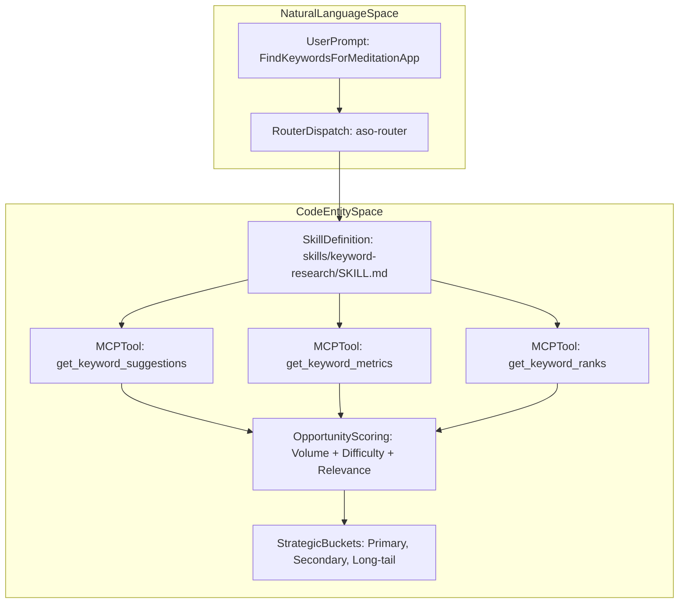
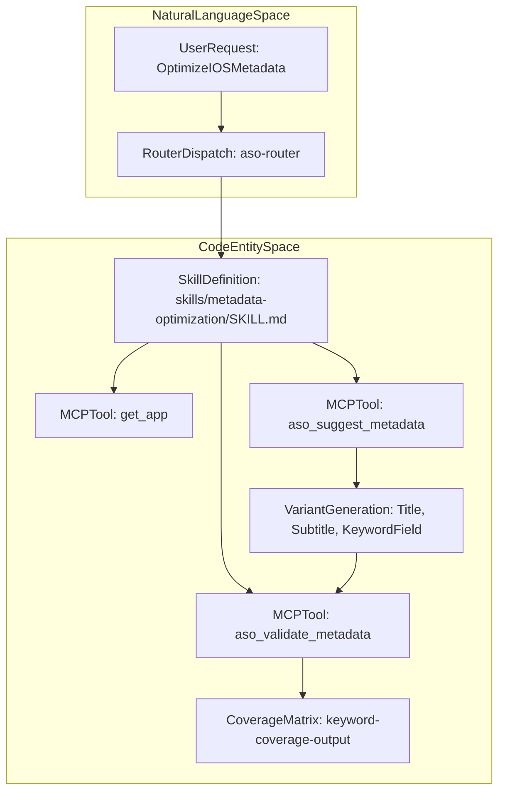

<!-- source: DeepWiki mcp.deepwiki.com · repo Eronred/aso-skills · page 3.2 keyword-research & metadata-optimization · fetched 2026-10-26 -->

# keyword-research & metadata-optimization

<details>
<summary>Relevant source files</summary>

The following files were used as context for generating this wiki page:

- [guides/appeeky-mcp.mdx](guides/appeeky-mcp.mdx)
- [guides/keyword-workflow.mdx](guides/keyword-workflow.mdx)
- [guides/launch-checklist.mdx](guides/launch-checklist.mdx)
- [reference/ab-test-store-listing.mdx](reference/ab-test-store-listing.mdx)
- [reference/keyword-research.mdx](reference/keyword-research.mdx)
- [reference/metadata-optimization.mdx](reference/metadata-optimization.mdx)
- [skills/keyword-research/SKILL.md](skills/keyword-research/SKILL.md)
- [skills/metadata-optimization/SKILL.md](skills/metadata-optimization/SKILL.md)

</details>


## Purpose and Scope

This page covers the technical implementation, scoring rubrics, and data flows for the core organic growth skills: `keyword-research` and `metadata-optimization`. These skills operate as a sequential pipeline to discover high-value App Store and Google Play keywords, score them using multi-signal evaluation models, group them into strategic tiers, and transform them into platform-compliant metadata variants (`title`, `subtitle`, `keyword-field`, and `description`).

Sources: `skills/keyword-research/SKILL.md:1-10`, `skills/metadata-optimization/SKILL.md:1-12`, `guides/keyword-workflow.mdx:7-21`

---

## Keyword Research Engine

The keyword research skill expands initial seed terms into candidate pools, evaluates them against volume, difficulty, relevance, and intent signals, and computes an Opportunity Score [reference/keyword-research.mdx:47-69].

### Research Phases

1. **Seed Expansion (`Phase 1`)**: Takes 3–5 seed keywords and expands them using Apple Search Suggestions, competitor keyword indexing, category analysis, and synonym generation [skills/keyword-research.mdx:22-44].
2. **Keyword Evaluation (`Phase 2`)**: Evaluates candidates across search volume (1–100), difficulty (1–100), relevance (1–100), intent, and current app rank [skills/keyword-research.mdx:45-56].
3. **Opportunity Scoring (`Phase 3`)**: Computes a normalized score balancing search volume, inverted difficulty, and relevance [reference/keyword-research.mdx:57-65].
4. **Keyword Grouping (`Phase 4`)**: Allocates keywords into strategic tiers: Primary (top 5–7), Secondary (ranks 8–20), Long-tail, and Aspirational [reference/keyword-research.mdx:67-69, skills/keyword-research.mdx:74-92].

### Scoring Mathematical Models

Depending on the specific execution context, the opportunity score is calculated via weighted linear combination or multiplicative normalization:

```text
Opportunity Score = (Volume × 0.4) + ((100 − Difficulty) × 0.3) + (Relevance × 0.3)
```
Alternatively, in normalized form:
```text
Opportunity Score = Volume × (1 − Difficulty) × Relevance  [normalized 0–100]
```

Sources: `skills/keyword-research/SKILL.md:20-69`, `reference/keyword-research.mdx:47-65`

### MCP Integration for Keyword Intelligence

The skill relies on specific Model Context Protocol (MCP) tool endpoints to retrieve live search data:

| MCP Tool | Function | Cited File Range |
|---|---|---|
| `get_keyword_suggestions` | Autocomplete-based keyword candidates for seed terms | `reference/keyword-research.mdx:122-122` |
| `get_keyword_metrics` | Search volume and difficulty scores | `reference/keyword-research.mdx:123-123` |
| `get_keyword_ranks` | Current App Store rankings across apps | `reference/keyword-research.mdx:124-124` |
| `get_app_keywords` | Keywords current app and competitors rank for | `reference/keyword-research.mdx:125-125` |

Sources: `reference/keyword-research.mdx:118-126`, `skills/keyword-research/SKILL.md:20-44`

---

## Metadata Optimization Engine

Once keywords are selected, the metadata optimization skill structures copy to maximize search indexing and conversion rates [skills/metadata-optimization.mdx:8-10].

### Platform Character Limits & Indexing Rules

| Platform | Field | Character Limit | Indexed for Search? | Role & Constraints |
|---|---|---|---|---|
| **iOS** | Title | 30 chars | ✅ Yes | Highest keyword weight; brand + primary keyword |
| **iOS** | Subtitle | 30 chars | ✅ Yes | Secondary keyword weight; benefit-driven |
| **iOS** | Keyword Field | 100 chars | ✅ Yes | Hidden; comma-separated, **no spaces** after commas |
| **iOS** | Description | 4,000 chars | ❌ No | Conversion focus; first 170 chars crucial |
| **Android** | Title | 30 chars | ✅ Yes | Highest keyword weight |
| **Android** | Short Description | 80 chars | ✅ Yes | Visible on listing card |
| **Android** | Full Description | 4,000 chars | ✅ Yes | Keyword density (2–3%) matters |

Sources: `skills/metadata-optimization.mdx:22-40`, `reference/metadata-optimization.mdx:51-76`

### Copywriting Rules & Field Constraints

- **No Repeated Keywords**: Apple and Google index unique terms independently; repeating words across title, subtitle, and keyword field wastes character budgets [skills/metadata-optimization.mdx:78-79].
- **Singular Forms**: Use singular forms in the iOS keyword field (e.g., `tracker` instead of `trackers`) because the platform automatically indexes plurals [skills/metadata-optimization.mdx:80].
- **No Space Padding**: In the iOS 100-character keyword field, commas must be immediately followed by the next term without whitespace (`term1,term2,term3`) [skills/metadata-optimization.mdx:78].

Sources: `skills/metadata-optimization.mdx:77-85`, `reference/metadata-optimization.mdx:152-159`

### MCP Tools for Metadata Validation

| MCP Tool | Purpose | Cited File Range |
|---|---|---|
| `aso_validate_metadata` | Checks proposed metadata for rule violations, character overruns, and keyword repetition | `reference/metadata-optimization.mdx:146-146` |
| `aso_suggest_metadata` | Generates keyword-optimized metadata variants based on target keywords | `reference/metadata-optimization.mdx:147-147` |
| `get_app` | Fetches current app metadata for before/after comparisons | `reference/metadata-optimization.mdx:148-148` |

Sources: `reference/metadata-optimization.mdx:142-149`

---

## End-to-End Data Flow & Code Entity Mapping

The transition from user intent to actionable keyword research and metadata generation involves bridging natural language commands with internal skill definitions and MCP tool execution modules.

### Diagram: Keyword Research and Scoring Pipeline



Sources: `skills/keyword-research/SKILL.md:1-142`, `reference/keyword-research.mdx:47-126`

### Diagram: Metadata Optimization and Validation Architecture



Sources: `skills/metadata-optimization/SKILL.md:1-171`, `reference/metadata-optimization.mdx:108-149`

---

