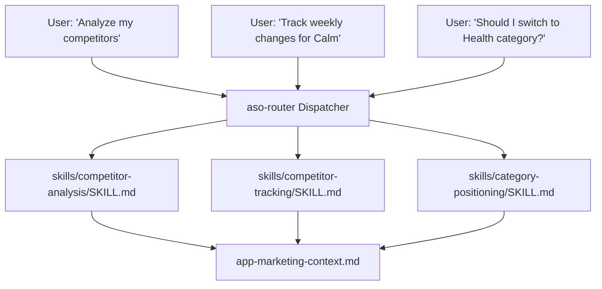
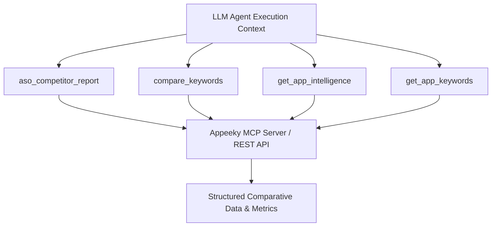

<!-- source: DeepWiki mcp.deepwiki.com · repo Eronred/aso-skills · page 3.3 Competitor Analysis & Positioning · fetched 2026-10-26 -->

# Competitor Analysis & Positioning

<details>
<summary>Relevant source files</summary>

The following files were used as context for generating this wiki page:

- [index.mdx](index.mdx)
- [reference/competitor-analysis.mdx](reference/competitor-analysis.mdx)
- [skills/category-positioning/SKILL.md](skills/category-positioning/SKILL.md)
- [skills/competitor-analysis.mdx](skills/competitor-analysis.mdx)
- [skills/competitor-analysis/SKILL.md](skills/competitor-analysis/SKILL.md)
- [skills/competitor-tracking/SKILL.md](skills/competitor-tracking/SKILL.md)

</details>


## Purpose and Scope

This page documents the technical architecture, execution flow, and analytical models used by the competitor intelligence and positioning skills within `aso-skills`. Specifically, this covers three core Markdown agent skills and reference documentation: `competitor-analysis` [skills/competitor-analysis/SKILL.md:1-163](), `competitor-tracking` [skills/competitor-tracking/SKILL.md:1-185](), and `category-positioning` [skills/category-positioning/SKILL.md:1-135](), along with the corresponding Mintlify reference documentation [reference/competitor-analysis.mdx:1-150](). 

These modules provide automated keyword gap detection, creative teardowns, market position mapping, category strategy, and ongoing surveillance across up to five rival applications using live data fetched via Model Context Protocol (MCP) integrations.

Sources: [skills/competitor-analysis/SKILL.md:1-163](), [skills/competitor-tracking/SKILL.md:1-185](), [skills/category-positioning/SKILL.md:1-135](), [reference/competitor-analysis.mdx:1-150]()

---

## 1. Skill Invocation & Dispatch Architecture

Users interact with the competitive intelligence layer either through direct skill invocation (`/competitor-analysis`, `/competitor-tracking`, `/category-positioning`) or by routing natural language intents via the global router. 

The following diagram maps natural language user queries to their underlying file-system execution targets and skill definitions:


*Diagram 1: Natural Language Space to Code Entity Space routing for competitive intelligence.*

Sources: [reference/competitor-analysis.mdx:9-25](), [skills/competitor-analysis/SKILL.md:1-19](), [skills/competitor-tracking/SKILL.md:1-27](), [skills/category-positioning/SKILL.md:1-19]()

---

## 2. MCP Tool Integration & Data Pipeline

When an agent executes `competitor-analysis` or `competitor-tracking`, it queries external endpoints through specialized tool bindings defined in the system's registry. 

The data flow connects agent prompts to specific backend API functions, fetching automated reports, side-by-side keyword matrices, and app intelligence metrics:


*Diagram 2: Data retrieval pipeline mapping agent tools to backend API responses.*

The underlying tools fetch specific analytical vectors:
* `aso_competitor_report`: Generates an automated side-by-side comparison of metadata, rankings, and ratings [reference/competitor-analysis.mdx:127]().
* `compare_keywords`: Cross-references ranking tables between the user's app and specified competitor IDs [reference/competitor-analysis.mdx:128]().
* `get_app_intelligence`: Pulls estimated downloads, monthly revenue, and growth signals [reference/competitor-analysis.mdx:129]().

Sources: [reference/competitor-analysis.mdx:123-130](), [skills/competitor-tracking/SKILL.md:28-32]()

---

## 3. Analysis Framework & Dimensions

The `competitor-analysis` skill [skills/competitor-analysis/SKILL.md:1-163]() structures its evaluation across six distinct analytical dimensions. Agents execute these checks sequentially or selectively based on user focus parameters (`focus: keywords | creative | positioning | all`) [reference/competitor-analysis.mdx:41-43]().

### Metadata and Keyword Gap Matrix
The engine compares character utilization, keyword density, and title/subtitle weighting. Keyword gaps are categorized into three distinct sets:
1. **Gaps**: Keywords where competitors rank in the top 20, but the user is unranked [reference/competitor-analysis.mdx:54]().
2. **Unique Advantages**: Defensive moats where the user ranks and competitors do not [reference/competitor-analysis.mdx:55]().
3. **Outranked Keywords**: Shared target terms where competitors occupy superior ranking positions [reference/competitor-analysis.mdx:56]().

| Dimension | Implementation Details | Source Files |
|---|---|---|
| **Creative Teardown** | Evaluates screenshot counts (target: 10), first-slot hooks, text overlay strategies, and video runtimes [reference/competitor-analysis.mdx:59-61]() | [reference/competitor-analysis.mdx:59-61](), [skills/competitor-analysis/SKILL.md:66-84]() |
| **Ratings & Reviews** | Diffs star averages, 30-day trends, developer response rates, and top user complaints/praise [reference/competitor-analysis.mdx:63-65]() | [reference/competitor-analysis.mdx:63-65](), [skills/competitor-analysis/SKILL.md:85-100]() |
| **Growth Signals** | Compares estimated downloads/revenue, update frequency, In-App Events, Custom Product Pages, and Apple Search Ads (ASA) presence [reference/competitor-analysis.mdx:67-69]() | [reference/competitor-analysis.mdx:67-69](), [skills/competitor-analysis/SKILL.md:101-112]() |

Sources: [reference/competitor-analysis.mdx:45-70](), [skills/competitor-analysis/SKILL.md:31-122]()

---

## 4. Category Positioning & Strategic Choice

Category positioning (`skills/category-positioning/SKILL.md`) evaluates primary and secondary category assignments on iOS and Google Play [skills/category-positioning/SKILL.md:8-39](). 

### Category Selection Scoring Factors
When an agent evaluates alternative categories, it scores candidates against six core metrics:
* **Truth Fit**: Evaluates whether the app violates store guidelines regarding misrepresentation [skills/category-positioning/SKILL.md:57]().
* **Competitive Density**: Counts the number of active top-100 apps directly competing [skills/category-positioning/SKILL.md:58]().
* **Top App Strength**: Determines if category leaders are vulnerable or fortified [skills/category-positioning/SKILL.md:59]().
* **Average #1 Downloads**: Pulls daily download requirements via `get_downloads_to_top` [skills/category-positioning/SKILL.md:60]().
* **Audience Match**: Calculates conversion viability for category browsers [skills/category-positioning/SKILL.md:61]().
* **Featuring Activity**: Assesses Apple/Google editorial curation frequency [skills/category-positioning/SKILL.md:62]().

Sources: [skills/category-positioning/SKILL.md:1-135]()

---

## 5. Ongoing Surveillance & Automated Tracking

The `competitor-tracking` skill [skills/competitor-tracking/SKILL.md:1-185]() provides recurring delta-based intelligence rather than one-time snapshots [skills/competitor-tracking/SKILL.md:12-20]().

### Weekly Delta Workflow
Agents parse weekly diffs across metadata strings, keyword movements, rating velocity, and chart positions using the following recurring schema [skills/competitor-tracking/SKILL.md:34-90]():

```bash
# Example weekly check execution flow via Appeeky REST endpoints
curl -s "https://api.appeeky.com/v1/apps/$APP_ID" \
  -H "X-API-Key: $KEY" | jq '.data | {title, subtitle, rating, reviewCount}'
```
*[skills/competitor-tracking/SKILL.md:151-153]()*: Pulls current metadata state to diff against historical records stored in the project context.

Sources: [skills/competitor-tracking/SKILL.md:1-185]()

---

