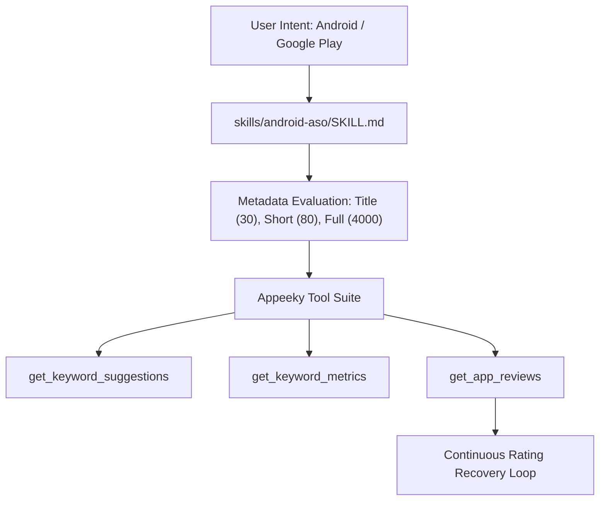
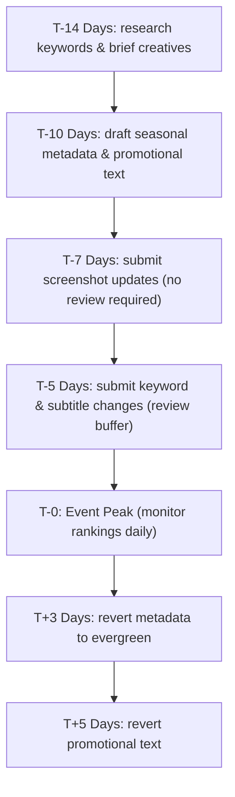
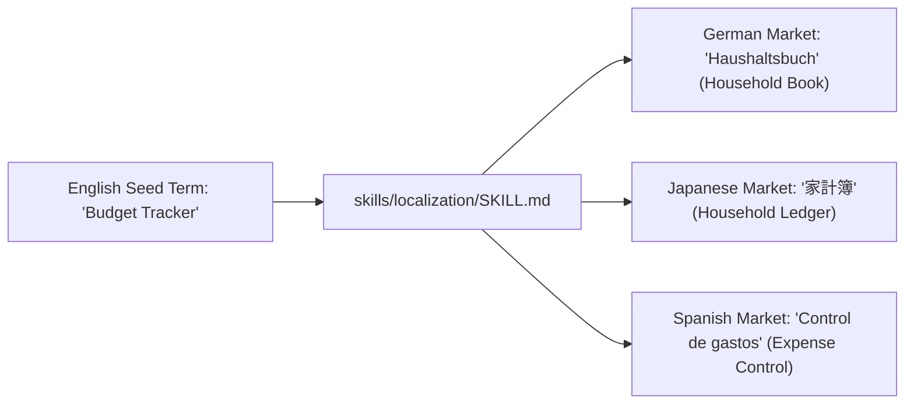

<!-- source: DeepWiki mcp.deepwiki.com · repo Eronred/aso-skills · page 3.4 Platform & Seasonal Variants · fetched 2026-10-26 -->

# Platform & Seasonal Variants

Relevant source files

The following files were used as context for generating this wiki page:

- [reference/android-aso.mdx](reference/android-aso.mdx)
- [reference/localization.mdx](reference/localization.mdx)
- [reference/seasonal-aso.mdx](reference/seasonal-aso.mdx)
- [skills/android-aso/SKILL.md](skills/android-aso/SKILL.md)
- [skills/localization/SKILL.md](skills/localization/SKILL.md)
- [skills/seasonal-android.mdx](skills/seasonal-android.mdx)
- [skills/seasonal-aso/SKILL.md](skills/seasonal-aso/SKILL.md)

This leaf page details the mechanics, operational rules, and data frameworks for platform-specific optimization (**Android ASO / Google Play**), time-sensitive keyword capture (**Seasonal ASO**), and cross-border expansion (**App Store Localization**). It bridges natural language user intent regarding platform differences, calendar holidays, and international markets to the respective agent skill definitions and tool integrations.

---

## 1. Google Play Signals & Architecture (`android-aso`)

Google Play's search and discovery algorithm differs fundamentally from Apple's App Store. The primary architectural distinction is that Google Play indexes the **entire 4,000-character full description**, features no hidden keyword field, and utilizes continuous, non-resetting ratings [skills/android-aso/SKILL.md:10-19]().

### Metadata Rules & Field Weighting

| Field | Character Limit | Indexed | Weight / Behavior |
| :--- | :--- | :--- | :--- |
| **Title** | 30 chars [skills/android-aso/SKILL.md:30]() | Yes [skills/android-aso/SKILL.md:30]() | Highest algorithmic weight [skills/android-aso/SKILL.md:30](); lead with brand or primary keyword. |
| **Short Description** | 80 chars [skills/android-aso/SKILL.md:31]() | Yes [skills/android-aso/SKILL.md:31]() | High weight [skills/android-aso/SKILL.md:31](); primary hook visible on search results [skills/android-aso/SKILL.md:53](). |
| **Full Description** | 4,000 chars [skills/android-aso/SKILL.md:32]() | Yes [skills/android-aso/SKILL.md:32]() | Medium weight [skills/android-aso/SKILL.md:32](); opening 167 characters appear above the fold [reference/android-aso.mdx:50](). |
| **Feature Graphic** | 1024×500px [skills/android-aso/SKILL.md:22]() | N/A | Required graphic asset displayed at top of listing when no video is present [skills/android-aso/SKILL.md:101-103](). |

### Continuous Ratings & Recovery Strategy
Unlike iOS, Google Play ratings are **never reset per version update** [skills/android-aso/SKILL.md:19](). Every historical rating contributes to the public average [skills/android-aso/SKILL.md:112](). Developers must execute rating recovery via active review management:
1. Respond directly to 1–3 star reviews to trigger algorithmic boosts [skills/android-aso/SKILL.md:115]().
2. Utilize the Play In-App Review API (`ReviewManager.requestReviewFlow()`) to prompt users at moments of high satisfaction [skills/android-aso/SKILL.md:120-123]().
3. Track sentiment via `get_app_reviews` [reference/android-aso.mdx:37]().

*Sources: [skills/android-aso/SKILL.md:1-25](), [reference/android-aso.mdx:9-38]()*.

---

## 2. Seasonal Aso & Keyword Calendars (`seasonal-aso`)

Seasonal optimization captures short-lived search traffic surges tied to calendar holidays, cultural events, or viral trends [skills/seasonal-aso/SKILL.md:10](). 

### US Seasonal Calendar & Lead Times

| Event | Peak Window | Recommended Lead Time | Key Focus |
| :--- | :--- | :--- | :--- |
| **New Year** | Dec 26 – Jan 7 [skills/seasonal-aso/SKILL.md:20]() | Submit by Dec 21 [skills/seasonal-android.mdx:46]() | Resolutions, habits, fresh starts [skills/seasonal-aso/SKILL.md:20]() |
| **Valentine's Day** | Feb 1–14 [skills/seasonal-aso/SKILL.md:21]() | Submit by Jan 27 [skills/seasonal-android.mdx:47]() | Couples, gifts, romance [skills/seasonal-aso/SKILL.md:21]() |
| **Back to School** | Jul 15 – Sep 10 [skills/seasonal-aso/SKILL.md:25]() | Submit by Jul 10 [skills/seasonal-android.mdx:48]() | Study, planners, student tools [skills/seasonal-aso/SKILL.md:25]() |
| **Halloween** | Oct 1–31 [skills/seasonal-aso/SKILL.md:26]() | Submit by Sep 25 [skills/seasonal-android.mdx:49]() | Spooky themes, costumes [skills/seasonal-aso/SKILL.md:26]() |
| **Christmas** | Dec 1–26 [skills/seasonal-aso/SKILL.md:28]() | Submit by Nov 24 [skills/seasonal-android.mdx:50]() | Holiday planning, gifts, family [skills/seasonal-aso/SKILL.md:28]() |

### Metadata Swap Lifecycle
Because metadata changes require 1–3 days to index and Apple App Review requires buffer time, execution follows strict sequencing managed by `skills/seasonal-aso/SKILL.md` [skills/seasonal-aso/SKILL.md:14]():

*Sources: [skills/seasonal-aso/SKILL.md:74-85](), [skills/seasonal-android.mdx:43-69]*.

### Promotional Text as an Instant Lever
The iOS promotional text field (170 characters) updates **instantly without requiring App Review** [reference/seasonal-aso.mdx:39](). For non-calendar trending moments (viral news or short-lived cultural surges), agents restrict changes exclusively to promotional text via `get_trending_keywords` and revert within 3 to 7 days [reference/seasonal-aso.mdx:58-60]().

*Sources: [skills/seasonal-aso/SKILL.md:1-141](), [reference/seasonal-aso.mdx:1-64](), [skills/seasonal-android.mdx:1-129]*.

---

## 3. App Store Localization & International Markets (`localization`)

Expanding across international borders requires independent keyword discovery per country rather than literal translations of English seed terms [reference/localization.mdx:46](). 

### Market Prioritization Framework
Markets are categorized into actionable ROI tiers within `skills/localization/SKILL.md` [skills/localization/SKILL.md:20-40]():

- **Tier 1 Markets (Highest ROI):** United States (`en-US`), United Kingdom (`en-GB`), Germany (`de-DE`), Japan (`ja`), France (`fr-FR`), South Korea (`ko`), China (`zh-Hans`), Brazil (`pt-BR`), Canada (`en-CA`), Australia (`en-AU`) [skills/localization/SKILL.md:24-35]().
- **Tier 2 Markets (High Potential):** Spain (`es-ES`), Italy (`it`), Netherlands (`nl`), Sweden (`sv`), Mexico (`es-MX`), India (`en-IN`), Indonesia (`id`), Turkey (`tr`), Saudi Arabia (`ar-SA`) [skills/localization/SKILL.md:39]().

### The Keyword Translation Pitfall
Literal translation fails because search habits vary drastically across cultures. For example, translating "budget tracker" directly yields near-zero volume in Germany or Japan:

*Sources: [reference/localization.mdx:46-47](), [skills/localization/SKILL.md:68-83]*().

### Localization Asset Checklist
When executing `/localization`, the agent builds per-locale packages covering:
1. **Title & Subtitle:** 30 characters each, populated with localized search terms [skills/localization/SKILL.md:59-60]().
2. **Keyword Field (iOS):** Completely distinct 100-character strings researched locally [skills/localization/SKILL.md:61]().
3. **Descriptions:** Culturally adapted narratives maintaining persuasive architecture [skills/localization/SKILL.md:112-115]().
4. **Screenshots & Video:** Translated text overlays, adjusted currency/date formats, and right-to-left (RTL) layout adaptations for Arabic/Hebrew locales [reference/localization.mdx:54]().

*Sources: [reference/localization.mdx:1-59](), [skills/localization/SKILL.md:1-166]*.

---

