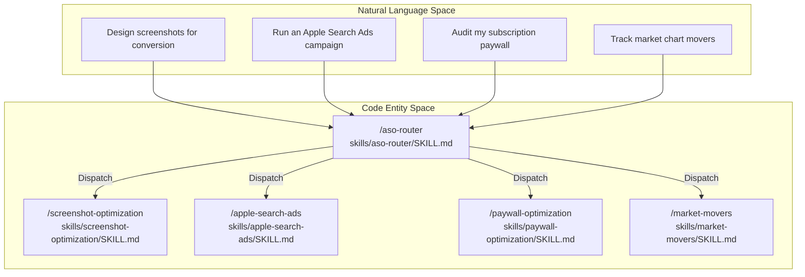
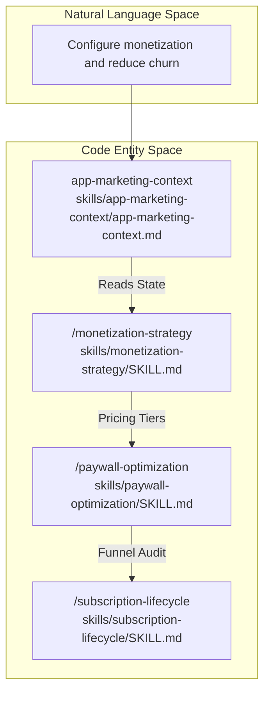

<!-- source: DeepWiki mcp.deepwiki.com · repo Eronred/aso-skills · page 4 Creative, Growth & Revenue Skills · fetched 2026-10-26 -->

# Creative, Growth & Revenue Skills

Relevant source files

The following files were used as context for generating this wiki page:

- [introduction.mdx](introduction.mdx)
- [reference/skills-overview.mdx](reference/skills-overview.mdx)

This section provides a high-level overview of the non-core skill families within the `aso-skills` library [introduction.mdx:7-13](). While ASO Core handles organic metadata and keyword foundations, these extended skill groups cover visual conversion assets, user acquisition channels, revenue and paywall mechanisms, analytics and recovery workflows, and market intelligence briefings [introduction.mdx:40-61]().

For deep technical details, scoring rubrics, and output templates, refer to the respective child pages:
- [Creative Assets](#4.1) — screenshot-optimization, app-preview-video, app-icon-optimization, custom-product-pages, app-store-featured, app-clips.
- [Growth & User Acquisition](#4.2) — app-launch, apple-search-ads, ua-campaign, in-app-events, creator-ugc-marketing, referral-program, web-to-app-funnel, press-and-pr.
- [Revenue & Retention](#4.3) — monetization-strategy, paywall-optimization, subscription-lifecycle, retention-optimization, onboarding-optimization, rating-prompt-strategy, review-management.
- [Analytics, Testing & Recovery](#4.4) — asc-metrics, app-analytics, ab-test-store-listing, attribution-setup, crash-analytics, app-rejection-recovery.
- [Market Intelligence](#4.5) — market-movers, market-pulse and competitor-tracking briefing skills and their data sources.

Sources: [introduction.mdx:7-61](), [reference/skills-overview.mdx:43-134]()

---

## Skill Dispatch Architecture: Natural Language to Code Entities

The following diagram bridges "Natural Language Space" to "Code Entity Space" by mapping user intents to specific skill file paths and command structures within the repository.

Sources: [introduction.mdx:24-25](), [reference/skills-overview.mdx:11-37]()

---

## 4.1 Creative Assets

The creative assets group focuses on optimizing visual conversion rates across app store listings. Skills in this category provide design briefs, text overlay copy strategies, and testing frameworks for store assets [reference/skills-overview.mdx:71-89]().

Key capabilities covered in the child page include:
- **`screenshot-optimization`**: 10-slot screenshot frameworks with visual hierarchy, caption copy, and competitive audits [reference/skills-overview.mdx:71-73]().
- **`app-preview-video`**: Script templates, beat-by-beat structures, and Apple/Google Play technical specifications [reference/skills-overview.mdx:74-76]().
- **`app-icon-optimization`**: Icon design principles, category differentiation, and A/B testing plans [reference/skills-overview.mdx:77-79]().
- **`custom-product-pages`**: Apple CPP audience segmentation strategies tied to paid advertising funnels [reference/skills-overview.mdx:80-82]().

For details, see [Creative Assets](#4.1).

Sources: [reference/skills-overview.mdx:71-89]()

---

## 4.2 Growth & User Acquisition

User acquisition and launch orchestration skills manage the journey from pre-launch anticipation to scaled paid and organic growth channels [introduction.mdx:51]().

Core workflows include:
- **`app-launch`**: Comprehensive 8-week pre-launch to post-launch timeline with daily operational checklists [reference/skills-overview.mdx:94-96]().
- **`apple-search-ads` & `ua-campaign`**: Paid acquisition frameworks spanning keyword match types, campaign structures, and budget allocation across networks [reference/skills-overview.mdx:97-102]().
- **`creator-ugc-marketing` & `press-and-pr`**: Earned and creator-driven acquisition playbooks, including pitch templates and TikTok/Instagram UGC briefs [reference/skills-overview.mdx:103-111]().

For details, see [Growth & User Acquisition](#4.2).

Sources: [reference/skills-overview.mdx:94-111]()

---

## Revenue Pipeline Integration

The following diagram illustrates how app marketing context flows into monetization and retention skills to generate optimized revenue models and user lifecycles.

Sources: [introduction.mdx:40-41](), [reference/skills-overview.mdx:116-129]()

---

## 4.3 Revenue & Retention

Maximizing LTV requires aligning pricing tiers, paywall conversion funnels, onboarding flows, and churn prevention mechanisms [introduction.mdx:53-54](). 

Key focus areas:
- **`monetization-strategy`**: Category benchmarks, trial structures, and pricing tier optimization [reference/skills-overview.mdx:117-119]().
- **`paywall-optimization`**: 7-element paywall audits and funnel diagnostics for tools like Superwall and RevenueCat [reference/skills-overview.mdx:123-125]().
- **`subscription-lifecycle` & `retention-optimization`**: Dunning campaigns, win-back flows, activation milestones, and habit loops [reference/skills-overview.mdx:120-122, 126-128]().

For details, see [Revenue & Retention](#4.3).

Sources: [reference/skills-overview.mdx:116-129]()

---

## 4.4 Analytics, Testing & Recovery

Measurement and recovery skills ensure continuous monitoring of store performance, attribution accuracy, crash triage, and rejection mitigation [introduction.mdx:57]().

Highlights include:
- **`asc-metrics`**: Integration with App Store Connect data via Appeeky Connect [introduction.mdx:57]().
- **`ab-test-store-listing`**: Hypothesis-to-interpretation workflows for store experiments.
- **`app-rejection-recovery`**: Guideline violation diagnosis and appeal templates.

For details, see [Analytics, Testing & Recovery](#4.4).

Sources: [introduction.mdx:57](), [reference/skills-overview.mdx:43-134]()

---

## 4.5 Market Intelligence

Market intelligence skills provide continuous surveillance of store trends, category movements, and competitor activity [introduction.mdx:59-60]().

Included skills:
- **`market-movers`**: Surfacing chart gainers, losers, and new entries [reference/skills-overview.mdx:134-135]().
- **`market-pulse`**: Comprehensive weekly briefing aggregation.
- **`competitor-tracking`**: Ongoing monitoring of target app metadata and ranking shifts.

For details, see [Market Intelligence](#4.5).

Sources: [introduction.mdx:59-60](), [reference/skills-overview.mdx:134-135]()

---

