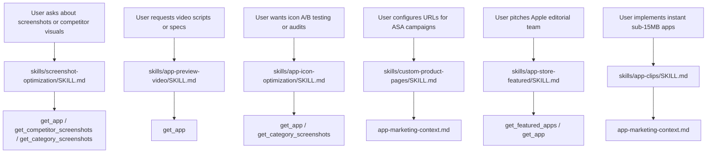
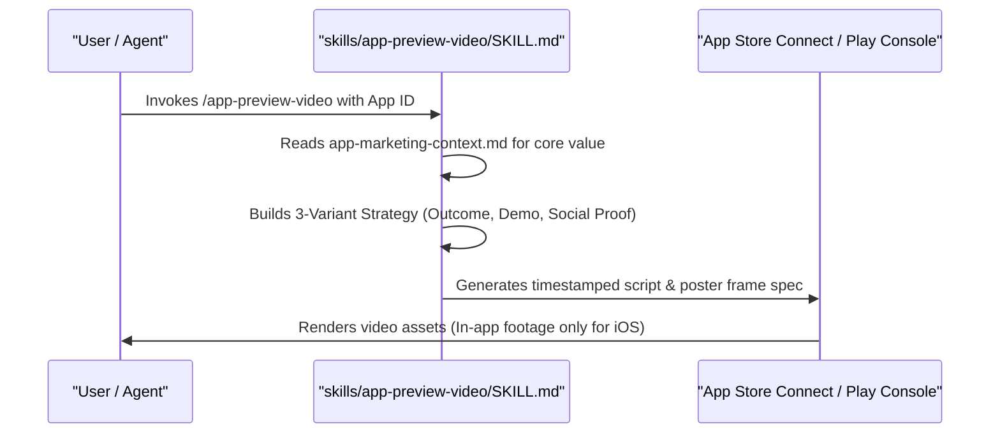
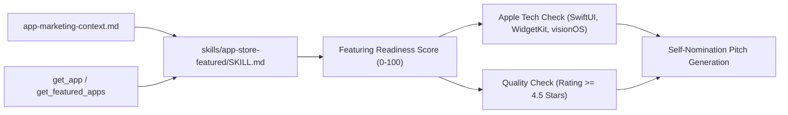

<!-- source: DeepWiki mcp.deepwiki.com · repo Eronred/aso-skills · page 4.1 Creative Assets · fetched 2026-10-26 -->

# Creative Assets

<details>
<summary>Relevant source files</summary>

The following files were used as context for generating this wiki page:

- [reference/app-icon-optimization.mdx](reference/app-icon-optimization.mdx)
- [reference/app-preview-video.mdx](reference/app-preview-video.mdx)
- [reference/app-store-featured.mdx](reference/app-store-featured.mdx)
- [reference/screenshot-optimization.mdx](reference/screenshot-optimization.mdx)
- [skills/app-clips/SKILL.md](skills/app-clips/SKILL.md)
- [skills/app-icon-optimization/SKILL.md](skills/app-icon-optimization/SKILL.md)
- [skills/app-preview-video/SKILL.md](skills/app-preview-video/SKILL.md)
- [skills/app-store-featured/SKILL.md](skills/app-store-featured/SKILL.md)
- [skills/custom-product-pages/SKILL.md](skills/custom-product-pages/SKILL.md)
- [skills/screenshot-optimization.mdx](skills/screenshot-optimization.mdx)
- [skills/screenshot-optimization/SKILL.md](skills/screenshot-optimization/SKILL.md)

</details>


## Purpose and Scope

The Creative Assets skill group provides a programmatic framework within `aso-skills` to plan, audit, script, and optimize visual and interactive elements across the App Store and Google Play Store. These components—encompassing static imagery, dynamic video previews, iconography, segmented landing variants, lightweight micro-experiences, and editorial pitches—dictate top-of-funnel conversion rates and discoverability. 

The scope covers six leaf skills:
- `screenshot-optimization`: 10-slot layout frameworks, text overlay rules, and competitor audits [skills/screenshot-optimization/SKILL.md:1-167]().
- `app-preview-video`: Beat-by-beat scripting, platform specifications, and rejection avoidance [skills/app-preview-video/SKILL.md:1-142]().
- `app-icon-optimization`: Icon clarity, color contrast, and A/B test setups via Product Page Optimization [skills/app-icon-optimization/SKILL.md:1-170]().
- `custom-product-pages`: URL-driven variant generation for targeted campaigns and Apple Search Ads [skills/custom-product-pages/SKILL.md:1-151]().
- `app-store-featured`: Editorial readiness scoring, self-nomination workflows, and In-App Event calendars [skills/app-store-featured/SKILL.md:1-213]().
- `app-clips`: Sub-15MB micro-app design, discovery cards, and seamless full-app handoffs [skills/app-clips/SKILL.md:1-163]().

---

## Natural Language Space to Entity Mapping

The following diagram bridges natural language intents expressed by users to the specific skill definitions and MCP data retrieval functions within the codebase.


Sources: [skills/screenshot-optimization/SKILL.md:1-167](), [skills/app-preview-video/SKILL.md:1-142](), [skills/app-icon-optimization/SKILL.md:1-170](), [skills/custom-product-pages/SKILL.md:1-151](), [skills/app-store-featured/SKILL.md:1-213](), [skills/app-clips/SKILL.md:1-163](), [reference/app-icon-optimization.mdx:30-36](), [reference/app-store-featured.mdx:30-36](), [reference/screenshot-optimization.mdx:30-37]()

---

## Core Visual Assets: Screenshots, Videos, and Icons

Static screenshots, preview videos, and icons act as the primary conversion drivers on product pages, responsible for up to 80% of download decisions within the first 3 to 6 seconds of user evaluation [reference/screenshot-optimization.mdx:49]().

### Screenshot Optimization Architecture
The `screenshot-optimization` skill enforces a strict 10-slot framework where every image serves a designated conversion role [skills/screenshot-optimization/SKILL.md:31-67]():

| Slot | Role | Focus Strategy |
|---|---|---|
| **1** | The Hook | Answer "What does this app do and why should I care?" via benefit headline + core UI [skills/screenshot-optimization/SKILL.md:31-40]() |
| **2–3** | Core Value | Showcase the two most compelling features visible without scrolling [skills/screenshot-optimization/SKILL.md:46-48]() |
| **4–7** | Feature Showcase | One feature per slot using the formula `[Benefit Headline] + [Feature UI] + [Supporting Detail]` [skills/screenshot-optimization/SKILL.md:50-54]() |
| **8–9** | Trust & Differentiation | Social proof, awards, press mentions, and unique advantages [skills/screenshot-optimization/SKILL.md:56-60]() |
| **10** | Call to Action | Recap of primary benefits or trial triggers ("Start your free trial") [skills/screenshot-optimization/SKILL.md:62-66]() |

Additionally, because Apple's semantic search indexes text visible within images, text overlays function doubly as organic keyword targets and human conversion hooks [reference/screenshot-optimization.mdx:11-13]().

### App Preview Video Execution
The `app-preview-video` skill governs 15–30 second MP4/MOV assets [skills/app-preview-video/SKILL.md:26-31]() structured around a rigorous beat-by-beat timeline:


Sources: [skills/app-preview-video/SKILL.md:1-142]()

### Iconography and Contrast
The `app-icon-optimization` skill evaluates icons against category norms and physical device constraints (60x60pt search rendering) [skills/app-icon-optimization/SKILL.md:18-25](). It requires high contrast across both light and dark system modes to prevent icons from washing out against white or black UI backgrounds [skills/app-icon-optimization/SKILL.md:27-34]().

Sources: [skills/screenshot-optimization/SKILL.md:1-167](), [skills/app-preview-video/SKILL.md:1-142](), [skills/app-icon-optimization/SKILL.md:1-170](), [reference/screenshot-optimization.mdx:1-62]()

---

## Advanced Discovery & Segmentation: CPPs and App Clips

Beyond the default product page, growth teams use Custom Product Pages (CPPs) and App Clips to tailor acquisition funnels.

### Custom Product Pages (CPP) Implementation
CPPs allow developers to generate up to 35 alternate URLs, each featuring distinct screenshots, preview videos, and promotional text geared toward specific audience segments or ad channels [skills/custom-product-pages/SKILL.md:10-18]().

- **What can change:** Promotional text (170 chars), up to 10 screenshots per device size, up to 3 preview videos [skills/custom-product-pages/SKILL.md:61-65]().
- **What cannot change:** App name, subtitle, keywords field, description, icon, age rating, price, or IAPs [skills/custom-product-pages/SKILL.md:67]().
- **ASA Integration:** CPP URLs are assigned directly to Apple Search Ads (ASA) ad groups via Creative Sets to match keyword themes with hyper-targeted visuals [skills/custom-product-pages/SKILL.md:108-119]().

### App Clips Lightweight Architecture
The `app-clips` skill handles sub-15MB micro-apps designed for instant launch without full installation [skills/app-clips/SKILL.md:10-29](). 

- **Discovery:** App Clips appear in App Store search results as independent cards below the main app, featuring an "Open" action button [skills/app-clips/SKILL.md:50-52]().
- **Handoff:** Post-value delivery uses `SKOverlay` to transition users smoothly to the full app binary [skills/app-clips/SKILL.md:79-88]():
  ```swift
  let config = SKOverlay.AppClipConfiguration(position: .bottom)
  let overlay = SKOverlay(configuration: config)
  overlay.present(in: windowScene)
  ```
- **Experience Routing:** Configured via URL patterns (`https://yourdomain.com/clip/[experience]`) inside App Store Connect [skills/app-clips/SKILL.md:70-75]().

Sources: [skills/custom-product-pages/SKILL.md:1-151](), [skills/app-clips/SKILL.md:1-163]()

---

## Editorial Featuring and Readiness

The `app-store-featured` skill audits an app against Apple's strict editorial criteria to maximize the likelihood of securing placements like "App of the Day" or "Today Tab Stories" [skills/app-store-featured/SKILL.md:20-48]().

### Featuring Readiness Scoring Pipeline
The readiness assessment evaluates design execution, modern technology adoption, and stability metrics:


Sources: [skills/app-store-featured/SKILL.md:12-84](), [reference/app-store-featured.mdx:30-48]()

### Self-Nomination Structure
When submitting to `developer.apple.com/contact/app-store/promote/`, the skill outputs a structured pitch emphasizing [skills/app-store-featured/SKILL.md:94-108]():
1. **One-sentence hook** establishing unique value [skills/app-store-featured/SKILL.md:102]().
2. **Apple technology adoption** (e.g., SwiftUI, Live Activities, visionOS support) [skills/app-store-featured/SKILL.md:104]().
3. **Developer story and timing rationale** tied to seasonal moments or OS releases [skills/app-store-featured/SKILL.md:105-106]().

Sources: [skills/app-store-featured/SKILL.md:1-213](), [reference/app-store-featured.mdx:1-74]()

---

