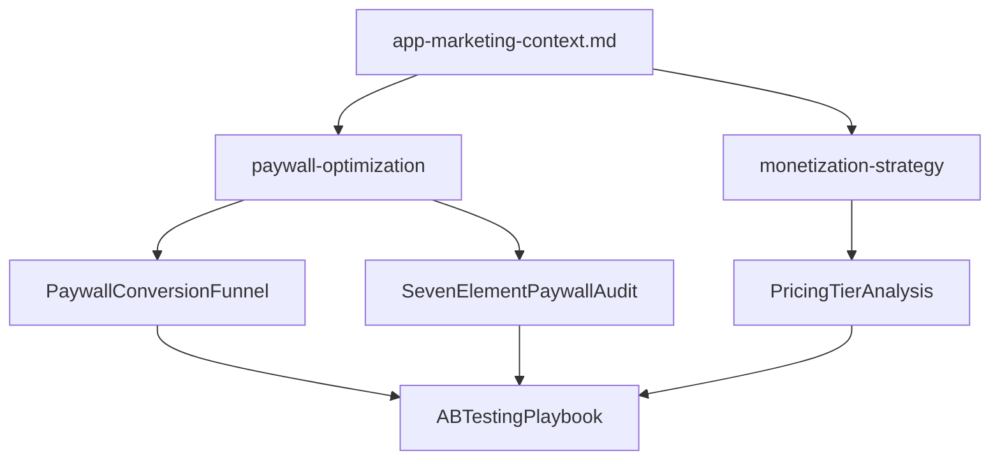
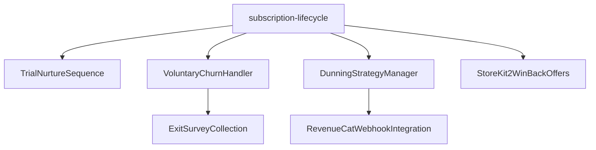

<!-- source: DeepWiki mcp.deepwiki.com · repo Eronred/aso-skills · page 4.3 Revenue & Retention · fetched 2026-10-26 -->

# Revenue & Retention

Relevant source files

The following files were used as context for generating this wiki page:

- [reference/monetization-strategy.mdx](reference/monetization-strategy.mdx)
- [reference/retention-optimization.mdx](reference/retention-optimization.mdx)
- [reference/review-management.mdx](reference/review-management.mdx)
- [skills/monetization-strategy/SKILL.md](skills/monetization-strategy/SKILL.md)
- [skills/onboarding-optimization/SKILL.md](skills/onboarding-optimization/SKILL.md)
- [skills/paywall-optimization/SKILL.md](skills/paywall-optimization/SKILL.md)
- [skills/rating-prompt-strategy/SKILL.md](skills/rating-prompt-strategy/SKILL.md)
- [skills/retention-optimization/SKILL.md](skills/retention-optimization/SKILL.md)
- [skills/review-management/SKILL.md](skills/review-management/SKILL.md)
- [skills/subscription-lifecycle/SKILL.md](skills/subscription-lifecycle/SKILL.md)

## Purpose & Scope

The Revenue & Retention skill group encompasses a collection of specialized Markdown agent skills focused on monetizing mobile applications, optimizing paywall conversions, managing the subscription lifecycle, retaining users through activation and habit formation, and governing user ratings and reviews (`skills/paywall-optimization/SKILL.md:2-3` [skills/paywall-optimization/SKILL.md:2-3](), `skills/subscription-lifecycle/SKILL.md:2-3` [skills/subscription-lifecycle/SKILL.md:2-3](), `skills/onboarding-optimization/SKILL.md:2-3` [skills/onboarding-optimization/SKILL.md:2-3]()). This page documents the architectural flow, data schemas, diagnostic rubrics, and operational frameworks utilized by these skills.

Sources: `skills/paywall-optimization/SKILL.md:1-6` [skills/paywall-optimization/SKILL.md:1-6](), `skills/subscription-lifecycle/SKILL.md:1-6` [skills/subscription-lifecycle/SKILL.md:1-6]()

---

## 1. Monetization & Paywall Architecture

The monetization and paywall optimization subsystem handles pricing model selection, paywall timing, trial structuring, and A/B testing frameworks (`skills/paywall-optimization/SKILL.md:10-11` [skills/paywall-optimization/SKILL.md:10-11](), `skills/monetization-strategy/SKILL.md:8-10` [skills/monetization-strategy/SKILL.md:8-10]()). 

### Paywall Diagnostic Funnel
When invoked via `paywall-optimization`, the agent evaluates four conversion stages:
1. App open to paywall view (Healthy: 60–95%, Red Flag: <50%) (`skills/paywall-optimization/SKILL.md:26-28` [skills/paywall-optimization/SKILL.md:26-28]())
2. Paywall view to CTA tap (Healthy: 25–45%, Red Flag: <15%) (`skills/paywall-optimization/SKILL.md:29` [skills/paywall-optimization/SKILL.md:29]())
3. CTA tap to purchase confirm (Healthy: 70–90%, Red Flag: <50%) (`skills/paywall-optimization/SKILL.md:30` [skills/paywall-optimization/SKILL.md:30]())
4. Trial start to paid conversion (Healthy: 25–60%, Red Flag: <15%) (`skills/paywall-optimization/SKILL.md:31` [skills/paywall-optimization/SKILL.md:31]())

### 7-Element Paywall Audit Rubric
The paywall audit scores components on a 1–5 scale (`skills/paywall-optimization/SKILL.md:37` [skills/paywall-optimization/SKILL.md:37]()):
* **Headline**: Outcome-driven copy (`skills/paywall-optimization/SKILL.md:39` [skills/paywall-optimization/SKILL.md:39]())
* **Value props**: 3–5 benefit-led bullet points (`skills/paywall-optimization/SKILL.md:40` [skills/paywall-optimization/SKILL.md:40]())
* **Social proof**: Ratings, review counts, or testimonials (`skills/paywall-optimization/SKILL.md:41` [skills/paywall-optimization/SKILL.md:41]())
* **Plan picker**: Annual default selection with savings framing (`skills/paywall-optimization/SKILL.md:42` [skills/paywall-optimization/SKILL.md:42]())
* **Price anchoring**: Monthly equivalent breakdown (`skills/paywall-optimization/SKILL.md:43` [skills/paywall-optimization/SKILL.md:43]())
* **Trust elements**: "Cancel anytime", restore button (`skills/paywall-optimization/SKILL.md:44` [skills/paywall-optimization/SKILL.md:44]())
* **CTA**: Single primary action button (`skills/paywall-optimization/SKILL.md:45` [skills/paywall-optimization/SKILL.md:45]())

Title: "Paywall and Monetization Execution Flow"

Sources: `skills/paywall-optimization/SKILL.md:12-48` [skills/paywall-optimization/SKILL.md:12-48](), `reference/monetization-strategy.mdx:7-21` [reference/monetization-strategy.mdx:7-21]()

---

## 2. Subscription Lifecycle & Churn Management

The `subscription-lifecycle` skill models the subscriber journey from trial activation through voluntary churn, involuntary dunning failure, and win-back campaigns (`skills/subscription-lifecycle/SKILL.md:8-19` [skills/subscription-lifecycle/SKILL.md:8-19]()).

### Subscription Stages & Benchmarks
| Stage | Key Metric | Benchmark Target |
|---|---|---|
| Trial | Trial-to-paid conversion | 25–40% (`skills/subscription-lifecycle/SKILL.md:26` [skills/subscription-lifecycle/SKILL.md:26]()) |
| Retention | Month 1 renewal rate | > 70% (`skills/subscription-lifecycle/SKILL.md:27` [skills/subscription-lifecycle/SKILL.md:27]()) |
| Churn | Monthly churn rate | < 5% good, < 2% excellent (`skills/subscription-lifecycle/SKILL.md:29` [skills/subscription-lifecycle/SKILL.md:29]()) |
| Recovery | Dunning recovery rate | > 30% (`skills/subscription-lifecycle/SKILL.md:32` [skills/subscription-lifecycle/SKILL.md:32]()) |

### Dunning & Involuntary Churn Strategy
Involuntary churn accounts for 20–40% of subscription cancellations (`skills/subscription-lifecycle/SKILL.md:116` [skills/subscription-lifecycle/SKILL.md:116]()). The dunning sequence handles payment retries over a 14-day grace period:
* **Day 0–3**: Silent automatic platform retries (Apple/Google) (`skills/subscription-lifecycle/SKILL.md:122-123` [skills/subscription-lifecycle/SKILL.md:122-123]())
* **Day 7**: In-app "Update payment method" banner trigger (`skills/subscription-lifecycle/SKILL.md:124` [skills/subscription-lifecycle/SKILL.md:124]())
* **Day 10**: Push notification alert (`skills/subscription-lifecycle/SKILL.md:125` [skills/subscription-lifecycle/SKILL.md:125]())
* **Day 14**: Grace period termination and subscription suspension (`skills/subscription-lifecycle/SKILL.md:126` [skills/subscription-lifecycle/SKILL.md:126]())

Title: "Subscription Lifecycle and Win-Back Architecture"

Sources: `skills/subscription-lifecycle/SKILL.md:21-34` [skills/subscription-lifecycle/SKILL.md:21-34](), `skills/subscription-lifecycle/SKILL.md:116-142` [skills/subscription-lifecycle/SKILL.md:116-142]()

---

## 3. Retention & Onboarding Optimization

Retention is governed by `retention-optimization` and `onboarding-optimization`, focusing on reducing time-to-value during Day 0 and structuring habit loops for Days 1–30 (`skills/retention-optimization/SKILL.md:8-11` [skills/retention-optimization/SKILL.md:8-11](), `skills/onboarding-optimization/SKILL.md:8-11` [skills/onboarding-optimization/SKILL.md:8-11]()).

### Activation Framework
Activation is defined as the first moment a user extracts real value, distinct from mere account creation (`skills/onboarding-optimization/SKILL.md:14` [skills/onboarding-optimization/SKILL.md:14()]). The onboarding audit maps every screen into three categories:
* **Required**: Mandatory for basic execution (`skills/onboarding-optimization/SKILL.md:47` [skills/onboarding-optimization/SKILL.md:47]())
* **Value-adding**: Directly drives the user toward the activation event (`skills/onboarding-optimization/SKILL.md:47` [skills/onboarding-optimization/SKILL.md:47]())
* **Friction only**: Candidate for immediate removal or deferral (`skills/onboarding-optimization/SKILL.md:47` [skills/onboarding-optimization/SKILL.md:47]())

### Push Notification Cadence
For Day 1–7 habit formation, the notification schedule emphasizes value delivery over generic re-engagement:
* **Day 1**: Welcome + quick actionable tip (`skills/retention-optimization/SKILL.md:99` [skills/retention-optimization/SKILL.md:99]())
* **Day 3**: Value reminder / data ready (`skills/retention-optimization/SKILL.md:100` [skills/retention-optimization/SKILL.md:100]())
* **Day 5**: Social proof metrics (`skills/retention-optimization/SKILL.md:101` [skills/retention-optimization/SKILL.md:101]())
* **Day 7**: Streak and habit progress summary (`skills/retention-optimization/SKILL.md:102` [skills/retention-optimization/SKILL.md:102]())

Sources: `skills/onboarding-optimization/SKILL.md:10-50` [skills/onboarding-optimization/SKILL.md:10-50](), `skills/retention-optimization/SKILL.md:36-67` [skills/retention-optimization/SKILL.md:36-67]()

---

## 4. Reputation & Rating Management

The `rating-prompt-strategy` and `review-management` skills manage in-app prompt triggers and review sentiment response workflows (`skills/rating-prompt-strategy/SKILL.md:8-11` [skills/rating-prompt-strategy/SKILL.md:8-11](), `skills/review-management/SKILL.md:8-11` [skills/review-management/SKILL.md:8-11]()).

### Pre-Prompt Survey Filter Pattern
To prevent negative 1–2 star ratings on public stores, agents implement a pre-prompt survey flow:
1. Check session thresholds (e.g., sessions ≥ 3, days since install ≥ 3, no recent crash) (`skills/rating-prompt-strategy/SKILL.md:80-84` [skills/rating-prompt-strategy/SKILL.md:80-84]()).
2. Present in-app query: `"Are you enjoying [App Name]?"` (`skills/rating-prompt-strategy/SKILL.md:93` [skills/rating-prompt-strategy/SKILL.md:93]()).
3. If user selects **"Yes, love it!"** → Trigger native review controller (`SKStoreReviewRequest` or Play In-App Review API) (`skills/rating-prompt-strategy/SKILL.md:97` [skills/rating-prompt-strategy/SKILL.md:97]()).
4. If user selects **"Not really"** → Divert to internal feedback form, blocking native prompt activation (`skills/rating-prompt-strategy/SKILL.md:98` [skills/rating-prompt-strategy/SKILL.md:98]()).

### The HEAR Response Framework
Negative review responses are structured using the HEAR framework (`skills/review-management/SKILL.md:70` [skills/review-management/SKILL.md:70]()):
* **Hear**: Acknowledge the specific issue (`skills/review-management/SKILL.md:71` [skills/review-management/SKILL.md:71]()).
* **Empathize**: Validate user frustration (`skills/review-management/SKILL.md:72` [skills/review-management/SKILL.md:72]()).
* **Act**: State resolution status or fix version (`skills/review-management/SKILL.md:73` [skills/review-management/SKILL.md:73]()).
* **Resolve**: Provide direct support contact channel (`skills/review-management/SKILL.md:74` [skills/review-management/SKILL.md:74]()).

Sources: `skills/rating-prompt-strategy/SKILL.md:88-100` [skills/rating-prompt-strategy/SKILL.md:88-100](), `skills/review-management/SKILL.md:70-75` [skills/review-management/SKILL.md:70-75]()

---

