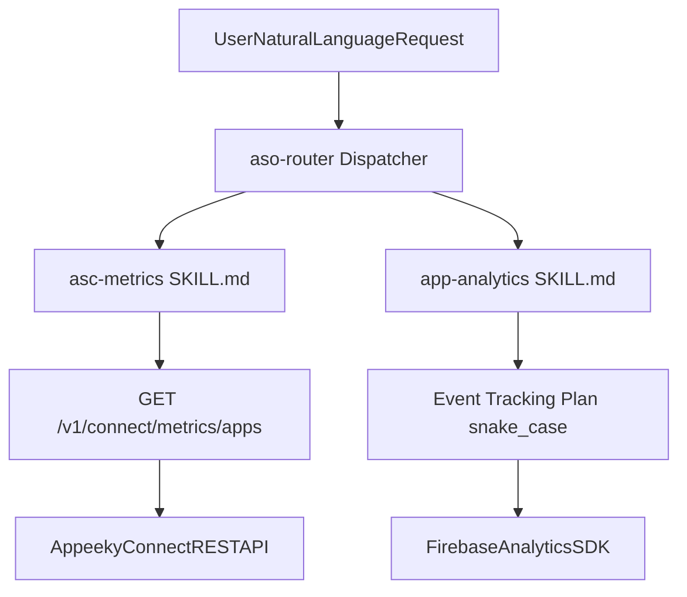
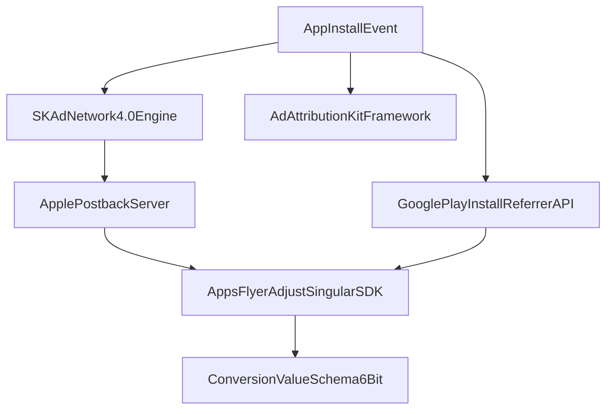

<!-- source: DeepWiki mcp.deepwiki.com · repo Eronred/aso-skills · page 4.4 Analytics, Testing & Recovery · fetched 2026-10-26 -->

# Analytics, Testing & Recovery

<details>
<summary>Relevant source files</summary>

The following files were used as context for generating this wiki page:

- [reference/app-analytics.mdx](reference/app-analytics.mdx)
- [skills/ab-test-store-listing/SKILL.md](skills/ab-test-store-listing/SKILL.md)
- [skills/app-analytics/SKILL.md](skills/app-analytics/SKILL.md)
- [skills/app-rejection-recovery/SKILL.md](skills/app-rejection-recovery/SKILL.md)
- [skills/asc-metrics/SKILL.md](skills/asc-metrics/SKILL.md)
- [skills/attribution-setup/SKILL.md](skills/attribution-setup/SKILL.md)
- [skills/crash-analytics/SKILL.md](skills/crash-analytics/SKILL.md)

</details>


The scope of this page covers six specialized operational skill units designed to measure app performance, optimize store conversion, handle privacy-compliant attribution, monitor stability, and recover from app review rejections. These skills span `asc-metrics`, `app-analytics`, `ab-test-store-listing`, `attribution-setup`, `crash-analytics`, and `app-rejection-recovery`.

---

## 1. Performance Metrics & App Analytics

App analytics combines first-party App Store Connect (ASC) data with in-app telemetry to evaluate acquisition, retention, and monetization funnels. 

### First-Party ASC Data Synchronization

Official App Store Connect data is synchronized via Appeeky Connect API endpoints, bypassing third-party estimations to provide exact download, revenue, IAP, subscription, and trial metrics `[skills/asc-metrics/SKILL.md:8-10]`. 

```
GET /v1/connect/metrics/apps
GET /v1/connect/metrics?from=YYYY-MM-DD&to=YYYY-MM-DD
GET /v1/connect/metrics/apps/:appId?from=YYYY-MM-DD&to=YYYY-MM-DD
```
*Sources: `[skills/asc-metrics/SKILL.md:31-47]()`*

### Analytics Stack & KPI Framework

To establish structured measurement, the system outlines an essential analytics stack consisting of App Store Connect, Firebase Analytics, Mixpanel/Amplitude, RevenueCat, Adjust/AppsFlyer, and Firebase Crashlytics `[skills/app-analytics/SKILL.md:20-32]`. 

Core KPI evaluations encompass:
- **Acquisition:** Impressions, Tap-Through Rate (TTR), Conversion Rate (`[reference/app-analytics.mdx:39-47]()`).
- **Retention:** Day 1 (target >35%), Day 7 (target >20%), Day 10/30 (target >10%) (`[reference/app-analytics.mdx:48-56]()`).
- **Revenue:** ARPU, Trial-to-Paid (target 40–60%), LTV, Churn Rate (`[reference/app-analytics.mdx:57-65]()`).

### Diagram: Analytics Data Flow to Code Entities


*Sources: `[skills/asc-metrics/SKILL.md:27-50]`, `[skills/app-analytics/SKILL.md:20-132]`, `[reference/app-analytics.mdx:1-36]()`*

---

## 2. Store Listing A/B Testing & Optimization

Product page optimization tests visual and creative assets to maximize conversion rates from store impressions to downloads.

### Apple Product Page Optimization (PPO) vs Custom Product Pages (CPP)

- **PPO (Product Page Optimization):** Native A/B testing via App Store Connect supporting up to 3 variants for app icons, screenshots, and app preview videos against organic traffic `[skills/ab-test-store-listing/SKILL.md:22-41]`. Requires a minimum 90% statistical confidence level `[skills/ab-test-store-listing/SKILL.md:37]`.
- **CPP (Custom Product Pages):** Up to 35 tailored pages per app featuring unique screenshots, videos, and promotional text linked directly from specific ad campaigns or URLs `[skills/ab-test-store-listing/SKILL.md:42-55]`.

### Test Design & Sample Sizing

Tests require rigorous hypothesis formulation (`If we [change], then [metric] will [improve] because [reason]`) and sufficient sample sizes `[skills/ab-test-store-listing/SKILL.md:78-84]`. Daily impressions dictate duration:
- `<1000` daily impressions require 30–90 days.
- `1000–5000` daily impressions require 14–30 days.
- `5000+` daily impressions require 7–14 days `[skills/ab-test-store-listing/SKILL.md:121-125]`.

*Sources: `[skills/ab-test-store-listing/SKILL.md:1-194]()`*

---

## 3. Attribution & Measurement Stacks

Attribution setups manage privacy-preserving frameworks like SKAdNetwork (SKAN 4.0), AdAttributionKit (AAK), and Mobile Measurement Partners (MMPs) such as AppsFlyer, Adjust, Singular, and Branch `[skills/attribution-setup/SKILL.md:1-16]`.

### SKAdNetwork 4.0 & Conversion Value Schemas

SKAN 4 utilizes hierarchical source IDs, three postback windows (0–2 days, 3–7 days, 8–35 days), and 6-bit fine / 2-bit coarse conversion values `[skills/attribution-setup/SKILL.md:32-41]`. A robust subscription conversion value schema front-loads signal into Window 1:
- `0`: Install only `[skills/attribution-setup/SKILL.md:57]`
- `1–5`: Onboarding completed `[skills/attribution-setup/SKILL.md:58]`
- `6–15`: Activation event completed `[skills/attribution-setup/SKILL.md:59]`
- `16–30`: Trial started `[skills/attribution-setup/SKILL.md:60]`
- `31–45`: Paywall viewed `[skills/attribution-setup/SKILL.md:61]`
- `46–63`: Subscription purchased `[skills/attribution-setup/SKILL.md:62]`

### Diagram: Attribution Architecture Mapping


*Sources: `[skills/attribution-setup/SKILL.md:20-114]()`*

---

## 4. Stability & Crash Analytics

Crash rates directly impact App Store ranking algorithms, featuring eligibility, user ratings, and retention metrics `[skills/crash-analytics/SKILL.md:10-18]`. Targets mandate crash-free sessions $>99.5\%$ and crash-free users $>99\%$ `[skills/crash-analytics/SKILL.md:19]`.

### Crashlytics Implementation & Priority Scoring

Integration relies on Firebase Crashlytics initialization in Swift and Kotlin `[skills/crash-analytics/SKILL.md:32-70]`:
```swift
FirebaseApp.configure()
Crashlytics.crashlytics().record(error: error)
Crashlytics.crashlytics().setCustomValue(userId, forKey: "user_id")
```
*Sources: `[skills/crash-analytics/SKILL.md:43-58]()`*

Triage utilizes a weighted priority score (`Priority Score = Crash Frequency × Affected Users × User Segment Weight`) to classify issues from critical P0 launches down to P3 rare occurrences `[skills/crash-analytics/SKILL.md:76-84]`. Phased rollouts across App Store Connect (7-day rollouts: 1% to 100%) and Google Play Console mitigate blast radiuses `[skills/crash-analytics/SKILL.md:133-138]`.

*Sources: `[skills/crash-analytics/SKILL.md:1-181]()`*

---

## 5. App Rejection & Review Recovery

When apps or updates are rejected by Apple App Review or Google Play Review, the `app-rejection-recovery` skill classifies guideline violations and structures appeals or resubmissions `[skills/app-rejection-recovery/SKILL.md:1-11]`.

### Rejection Taxonomy & Resolution Center Template

Apple guideline violations map to specific functional buckets:
- **Guideline 2.1:** Performance / completeness (crashes, missing demo accounts) `[skills/app-rejection-recovery/SKILL.md:29]`
- **Guideline 2.3.x:** Accurate metadata and screenshot parity `[skills/app-rejection-recovery/SKILL.md:30]`
- **Guideline 3.1.1 & 3.1.2:** In-app purchase and subscription requirements `[skills/app-rejection-recovery/SKILL.md:32-33]`
- **Guideline 4.3:** Design spam and duplication (the most common and difficult rejection) `[skills/app-rejection-recovery/SKILL.md:37,67]`
- **Guideline 5.1.1:** Privacy, data collection, and ATT prompt alignment `[skills/app-rejection-recovery/SKILL.md:39]`

Responses submitted to the Resolution Center must acknowledge the guideline without argument, detail specific binary or metadata adjustments, reference the exact build number, and supply demo credentials `[skills/app-rejection-recovery/SKILL.md:102-136]`.

*Sources: `[skills/app-rejection-recovery/SKILL.md:1-141]()`*

---

