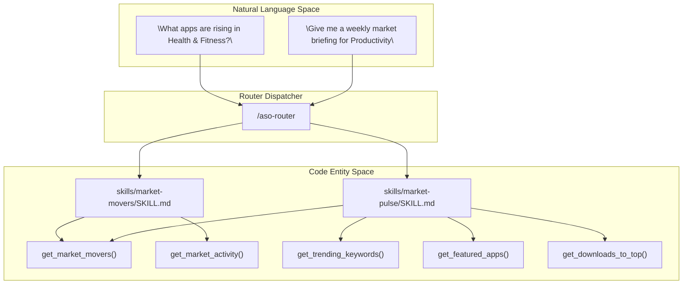
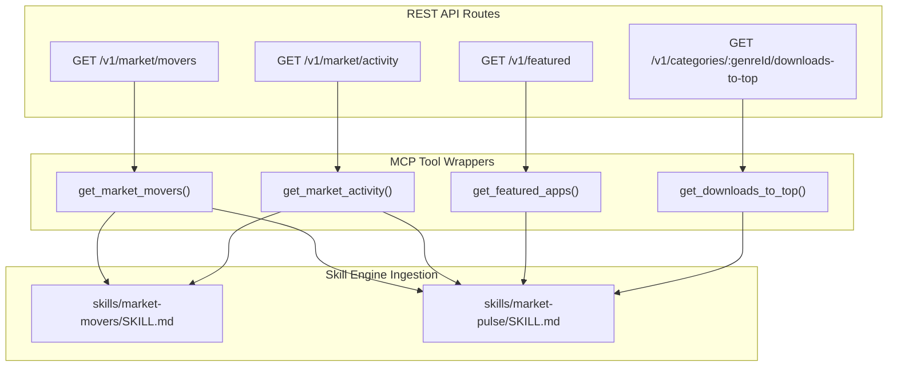

<!-- source: DeepWiki mcp.deepwiki.com · repo Eronred/aso-skills · page 4.5 Market Intelligence · fetched 2026-10-26 -->

# Market Intelligence

Relevant source files

The following files were used as context for generating this wiki page:

- [reference/market-movers.mdx](reference/market-movers.mdx)
- [reference/market-pulse.mdx](reference/market-pulse.mdx)
- [skills/market-intelligence.mdx](skills/market-intelligence.mdx)
- [skills/market-movers/SKILL.md](skills/market-movers/SKILL.md)
- [skills/market-pulse/SKILL.md](skills/market-pulse/SKILL.md)
- [tools/integrations/appeeky-market.md](tools/integrations/appeeky-market.md)

## Purpose and Scope

The Market Intelligence module within `aso-skills` provides automated briefing, rank tracking, and market pulse analysis for App Store Optimization (ASO) professionals and developers. This page covers the architectural design, operational parameters, data flow, and underlying API/MCP integrations for the core briefing skills: `/market-movers` [reference/market-movers.mdx:1-12]() and `/market-pulse` [reference/market-pulse.mdx:1-13](), as well as their integration with the Appeeky Market Intelligence endpoints [tools/integrations/appeeky-market.md:1-5]().

Sources: [reference/market-movers.mdx:1-12](), [reference/market-pulse.mdx:1-13](), [tools/integrations/appeeky-market.md:1-5]()

---

## 1. Architecture of Briefing Skills

The market intelligence skill group consists of two primary Markdown Agent Skills located in the `skills/` directory:
- `market-movers`: Focuses on discrete chart rank fluctuations, identifying top gainers, top losers, new entries, and apps dropping out of the top 100 [skills/market-movers/SKILL.md:1-6]().
- `market-pulse`: Provides an aggregated cross-signal market briefing combining chart movements, trending keywords, Apple featuring data, new category releases, and download thresholds [skills/market-pulse/SKILL.md:1-6]().

Both skills ingest shared context from `app-marketing-context.md` if available [skills/market-movers/SKILL.md:14-14](), [skills/market-pulse/SKILL.md:14-14](), and fall back to user prompts or default parameters (e.g., US market, top-free charts, all categories) [reference/market-movers.mdx:27-43](), [reference/market-pulse.mdx:27-39]().

Sources: [skills/market-movers/SKILL.md:1-6](), [skills/market-pulse/SKILL.md:1-6](), [skills/market-movers/SKILL.md:14-14](), [skills/market-pulse/SKILL.md:14-14](), [reference/market-movers.mdx:27-43](), [reference/market-pulse.mdx:27-39]()

---

## 2. Natural Language to Code Entity Space

The following diagram bridges natural language intents (entered via agent prompts or `/aso-router`) to the concrete skill files and Model Context Protocol (MCP) execution functions.

Sources: [reference/market-movers.mdx:9-21](), [reference/market-pulse.mdx:9-21](), [skills/market-movers/SKILL.md:20-28](), [skills/market-pulse/SKILL.md:19-31]()

---

## 3. Data Sources & Appeeky REST/MCP Mapping

The market intelligence skills rely on the Appeeky Market Intelligence API backend (`https://api.appeeky.com`) [tools/integrations/appeeky-market.md:1-5](). Data is queried via REST endpoints using `X-API-Key` headers or through MCP tool calls [tools/integrations/appeeky-market.md:5-6]().

### Endpoint to MCP Function Mapping

| REST Endpoint | MCP Tool Name | Consuming Skills | Description |
|---|---|---|---|
| `GET /v1/market/movers` | `get_market_movers` [tools/integrations/appeeky-market.md:18]() | `market-movers`, `market-pulse` [tools/integrations/appeeky-market.md:20]() | Compares recent chart snapshots (every 6h) for gainers/losers [tools/integrations/appeeky-market.md:10-12](). |
| `GET /v1/market/activity` | `get_market_activity` [tools/integrations/appeeky-market.md:43]() | `market-movers`, `market-pulse` [tools/integrations/appeeky-market.md:45]() | Chronological feed of significant movements (3+ ranks) [tools/integrations/appeeky-market.md:35-37](). |
| `GET /v1/categories/:genreId/top` | `get_category_top` [tools/integrations/appeeky-market.md:64]() | `market-movers`, `market-pulse` [tools/integrations/appeeky-market.md:66]() | Category-scoped top free/paid/grossing charts [tools/integrations/appeeky-market.md:57-58](). |
| `GET /v1/featured` | `get_featured_apps` [tools/integrations/appeeky-market.md:124]() | `market-pulse` [tools/integrations/appeeky-market.md:126]() | App Store Today tab, App/Game of the Day, and collections [tools/integrations/appeeky-market.md:117-118](). |
| `GET /v1/new-releases` | `get_new_releases` [tools/integrations/appeeky-market.md:141]() | `market-pulse` [tools/integrations/appeeky-market.md:143]() | Recent app launches from Apple RSS [tools/integrations/appeeky-market.md:133-135](). |
| `GET /v1/categories/:genreId/downloads-to-top` | `get_downloads_to_top` [tools/integrations/appeeky-market.md:89]() | `market-pulse` [tools/integrations/appeeky-market.md:91]() | Estimated daily download thresholds for top ranks [tools/integrations/appeeky-market.md:81-83](). |

Sources: [tools/integrations/appeeky-market.md:10-145](), [skills/market-movers/SKILL.md:20-28](), [skills/market-pulse.mdx:131-145]()

---

## 4. Execution Data Flow and Analysis Frameworks

When a user triggers `/market-movers` or `/market-pulse`, the agent follows a rigid execution lifecycle:

1. **Context Resolution:** Reads `app-marketing-context.md` to identify the user's target app, category ID (e.g., `6013` for Health & Fitness), and country code [skills/market-movers/SKILL.md:14-14](), [skills/market-pulse/SKILL.md:14-14](), [tools/integrations/appeeky-market.md:77]().
2. **Parallel Tool Invocation:** Dispatches MCP requests to fetch live snapshots (`get_market_movers`, `get_market_activity`, `get_trending_keywords`, `get_featured_apps`, etc.) [skills/market-pulse/SKILL.md:19-31]().
3. **Data Aggregation & Analysis:**
   - **Drivers Analysis:** Evaluates rank changes against external factors (Apple featuring, seasonal keywords, ad spends) [skills/market-movers/SKILL.md:50-53]().
   - **Opportunity Scoring:** Identifies weak competitors (top losers) as entry vectors [skills/market-movers/SKILL.md:62-65]().
   - **Threat Detection:** Flags sudden new entries in top tiers [skills/market-movers/SKILL.md:74-77]().
4. **Formatting Output:** Renders the report into one of three requested structures: Quick Summary (bullet points / Slack alert format), Detailed Report (full markdown tables), or Competitive Focus [reference/market-movers.mdx:86-106](), [reference/market-pulse.mdx:43-117]().

Sources: [skills/market-movers/SKILL.md:12-92](), [skills/market-pulse/SKILL.md:12-114](), [reference/market-movers.mdx:86-106](), [reference/market-pulse.mdx:43-117]()

---

