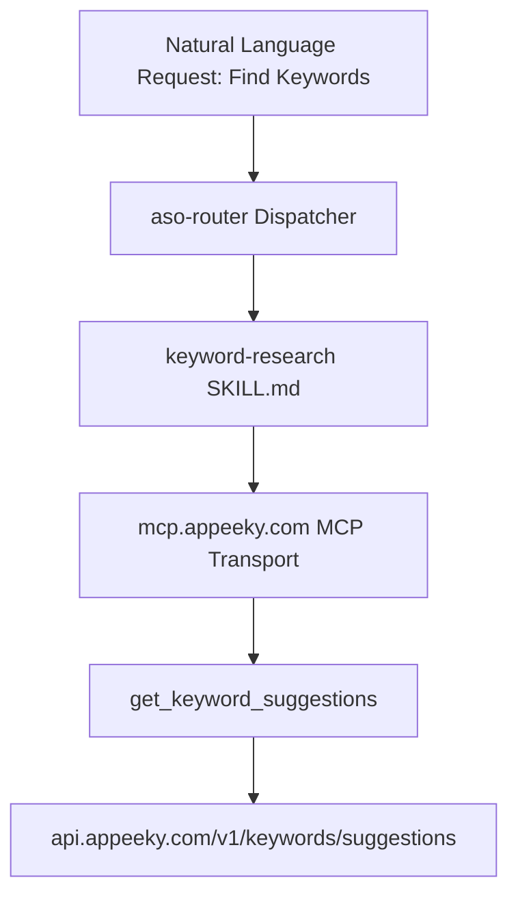
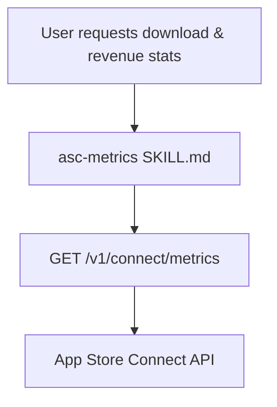

<!-- source: DeepWiki mcp.deepwiki.com · repo Eronred/aso-skills · page 5 Data Integrations & Tool Registry · fetched 2026-10-26 -->

# Data Integrations & Tool Registry

Relevant source files

The following files were used as context for generating this wiki page:

- [.claude-plugin/marketplace.json](.claude-plugin/marketplace.json)
- [README.md](README.md)
- [skills/aso-router/SKILL.md](skills/aso-router/SKILL.md)
- [tools/REGISTRY.md](tools/REGISTRY.md)
- [tools/integrations/appeeky.md](tools/integrations/appeeky.md)

This page provides a high-level overview of how ASO skills obtain live data, mapping natural language requests to structured API endpoints and MCP transport layers. For deeper technical specifics, refer to the child pages:
- [Appeeky MCP Server & REST Endpoints](#5.1)
- [App Store Connect & Appeeky Connect](#5.2)
- [Third-Party Integrations](#5.3)

Sources: [tools/REGISTRY.md:1-15]()

---

## 5.1 Appeeky MCP Server & REST Endpoints

ASO skills interface with real-time app intelligence through the Appeeky integration layer, which supports both a Model Context Protocol (MCP) server (`mcp.appeeky.com`) for AI agents like Claude Code and Cursor, and a REST API (`api.appeeky.com`) for direct queries [README.md:18-20](), [tools/integrations/appeeky.md:5-33](). Authentication is handled via API keys passed in request headers (`X-API-Key` or Bearer tokens) [tools/integrations/appeeky.md:9-33]().

The tool registry (`tools/REGISTRY.md`) maps specific ASO skills to designated tool families—such as app metadata lookup, keyword metrics, competitor intelligence, and market tracking [tools/REGISTRY.md:53-92]().

*Figure 1: Natural Language to Code Entity Space mapping for keyword queries.*

Sources: [README.md:18-20](), [tools/REGISTRY.md:53-92](), [tools/integrations/appeeky.md:5-33](), [skills/aso-router/SKILL.md:8-31]()

---

## 5.2 App Store Connect & Appeeky Connect

First-party financial, sales, and download metrics are synchronized directly from App Store Connect (ASC) using Appeeky Connect integration endpoints [tools/REGISTRY.md:47-52](). These endpoints provide exact data rather than market estimates, feeding metrics directly into analytics-focused skills like `asc-metrics` [tools/REGISTRY.md:51](), [tools/REGISTRY.md:76]().

*Figure 2: Natural Language to Code Entity Space mapping for first-party sales synchronization.*

Sources: [tools/REGISTRY.md:47-52](), [tools/REGISTRY.md:76]()

---

## 5.3 Third-Party Integrations

In addition to App Store Connect and Appeeky intelligence, advanced growth and performance skills integrate telemetry from third-party services like Firebase (for crash analytics and stability metrics) and RevenueCat (for subscription lifecycles, paywall conversion, and churn tracking). These telemetry sources provide the underlying context for diagnostic and optimization skills such as `crash-analytics` and `paywall-optimization` [tools/REGISTRY.md:83-89]().

Sources: [tools/REGISTRY.md:83-89]()

---

