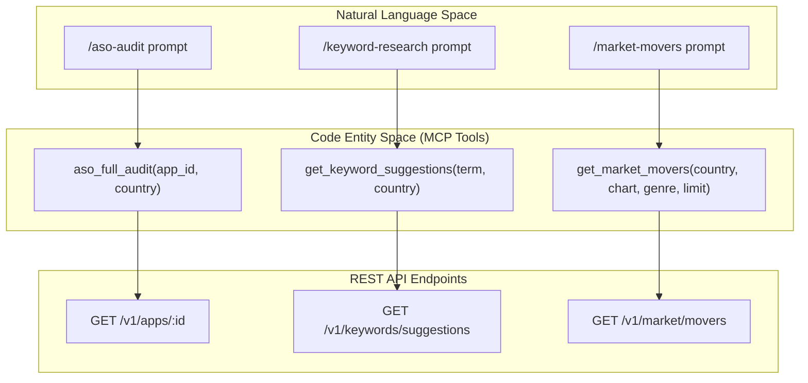
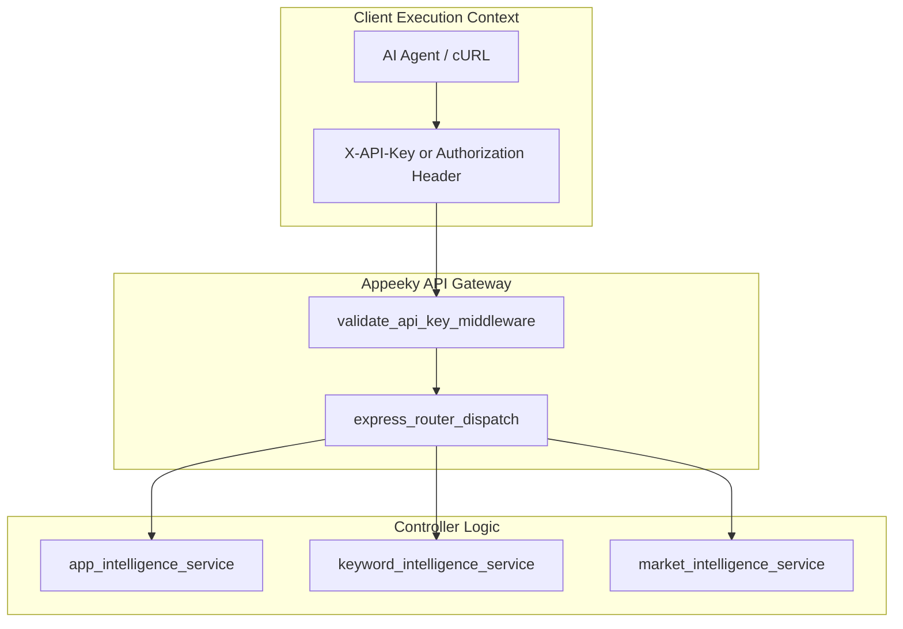

<!-- source: DeepWiki mcp.deepwiki.com · repo Eronred/aso-skills · page 5.1 Appeeky MCP Server & REST Endpoints · fetched 2026-10-26 -->

# Appeeky MCP Server & REST Endpoints

Relevant source files

The following files were used as context for generating this wiki page:

- [guides/appeeky-mcp.mdx](guides/appeeky-mcp.mdx)
- [guides/keyword-workflow.mdx](guides/keyword-workflow.mdx)
- [guides/launch-checklist.mdx](guides/launch-checklist.mdx)
- [reference/ab-test-store-listing.mdx](reference/ab-test-store-listing.mdx)
- [skills/market-movers/SKILL.md](skills/market-movers/SKILL.md)
- [skills/market-pulse/SKILL.md](skills/market-pulse/SKILL.md)
- [tools/integrations/appeeky-aso.md](tools/integrations/appeeky-aso.md)
- [tools/integrations/appeeky-keywords.md](tools/integrations/appeeky-keywords.md)
- [tools/integrations/appeeky-market.md](tools/integrations/appeeky-market.md)
- [tools/integrations/appeeky.md](tools/integrations/appeeky.md)

## Purpose and Scope

This document details the configuration, authentication headers, transport mechanisms, and specific tool families provided by the Appeeky Model Context Protocol (MCP) server (`https://mcp.appeeky.com`) and REST API (`https://api.appeeky.com`) [tools/integrations/appeeky.md:5-7] [guides/appeeky-mcp.mdx:13](). These integrations supply live App Store and Google Play telemetry—such as keyword rankings, search volumes, review sentiment, chart movements, and automated audit rubrics—to the `aso-skills` agent framework.

Sources: `guides/appeeky-mcp.mdx:1-25` [guides/appeeky-mcp.mdx:1-25](), `tools/integrations/appeeky.md:1-12` [tools/integrations/appeeky.md:1-12]()

---

## Authentication & Transport Protocols

The Appeeky infrastructure supports two primary communication channels:

1. **REST API (`https://api.appeeky.com`)**: Accessed via standard HTTP requests requiring an API key passed in the `X-API-Key` header [tools/integrations/appeeky.md:5-11]().
2. **MCP Server (`https://mcp.appeeky.com/mcp`)**: Accessed via the Model Context Protocol using HTTP/SSE transports, accepting either an `Authorization: Bearer` header with an API key or OAuth authentication for select clients like Claude Desktop [guides/appeeky-mcp.mdx:13-30,48]().

| Transport | Base URL | Auth Header Format | Supported Clients |
| :--- | :--- | :--- | :--- |
| **REST** | `https://api.appeeky.com` | `X-API-Key: apk_...` [tools/integrations/appeeky.md:5-11]() | Direct HTTP / cURL / Custom scripts |
| **MCP** | `https://mcp.appeeky.com/mcp` | `Authorization: Bearer apk_...` [guides/appeeky-mcp.mdx:48-51]() | Cursor, Claude Code, Windsurf, VS Code / Copilot [guides/appeeky-mcp.mdx:40-149]() |
| **MCP (OAuth)** | `https://mcp.appeeky.com` | OAuth Token (Managed) [guides/appeeky-mcp.mdx:100-109]() | Claude Desktop [guides/appeeky-mcp.mdx:99-109]() |

Sources: `tools/integrations/appeeky.md:1-17` [tools/integrations/appeeky.md:1-17](), `guides/appeeky-mcp.mdx:11-30,151-162` [guides/appeeky-mcp.mdx:11-30,151-162]()

---

## Client Configuration Reference

AI coding agents and editor environments require explicit configuration files to establish connection with the Appeeky MCP server. 

### Configuration Paths by Editor

* **Cursor**: `.cursor/mcp.json` (project root or `~/.cursor/mcp.json` globally) [guides/appeeky-mcp.mdx:63-65]()
* **Claude Code**: `~/.claude/settings.json` [guides/appeeky-mcp.mdx:81]()
* **Claude Desktop**: Managed natively via **Settings → Integrations** (OAuth flow) [guides/appeeky-mcp.mdx:100-106]()
* **Windsurf**: `~/.codeium/windsurf/mcp_config.json` [guides/appeeky-mcp.mdx:111]()
* **VS Code / Copilot**: `.vscode/mcp.json` (Workspace Agent Mode) [guides/appeeky-mcp.mdx:129-131]()

Sources: `guides/appeeky-mcp.mdx:40-162` [guides/appeeky-mcp.mdx:40-162]()

---

## Tool Families & REST Endpoints

The Appeeky integration organizes capabilities into four core tool families: App Intelligence, Keyword Intelligence, Market Intelligence, and ASO Automation.

### 1. App Intelligence Family
Handles core metadata retrieval, user reviews, download/revenue estimates, and global chart tracking.

* **Get App Metadata**: `GET /v1/apps/:id?country=us` | MCP: `get_app(app_id, country)` [tools/integrations/appeeky.md:42-45]()
* **App Intelligence Report**: `GET /v1/apps/:id/intelligence?country=us` | MCP: `get_app_intelligence(app_id, country)` [tools/integrations/appeeky.md:73-76]()
* **User Reviews**: `GET /v1/apps/:id/reviews?country=us&sort=mostRecent&limit=50` | MCP: `get_app_reviews(app_id, country, sort, limit)` [tools/integrations/appeeky.md:91-95]()
* **App Keywords**: `GET /v1/apps/:id/keywords?country=us` | MCP: `get_app_keywords(app_id, country)` [tools/integrations/appeeky.md:105-109]()
* **Country Rankings**: `GET /v1/apps/:id/country-rankings?chart=top-free` | MCP: `get_country_rankings(app_id, chart)` [tools/integrations/appeeky.md:130-133]()
* **Search Apps**: `GET /v1/search?q=meditation&country=us&limit=20` | MCP: `search_apps(query, country, limit)` [tools/integrations/appeeky.md:164-167]()

Sources: `tools/integrations/appeeky.md:35-170` [tools/integrations/appeeky.md:35-170]()

### 2. Keyword Intelligence Family
Provides search volume calculations, difficulty scoring, Apple Search autocomplete suggestions, and gap analysis.

* **Keyword Suggestions**: `GET /v1/keywords/suggestions?term=meditation&country=us` | MCP: `get_keyword_suggestions(term, country)` [tools/integrations/appeeky.mdx:15-18]()
* **Keyword Metrics**: `GET /v1/keywords/metrics?keyword=meditation&country=us` | MCP: `get_keyword_metrics(keyword, country)` [tools/integrations/appeeky.mdx:55-58]()
* **Keyword Rankings**: `GET /v1/keywords/ranks?keyword=meditation&country=us` | MCP: `get_keyword_ranks(keyword, country)` [tools/integrations/appeeky.mdx:89-92]()
* **Keyword Comparison**: `GET /v1/keywords/compare?appId1=...&appId2=...` | MCP: `compare_keywords(app_id_1, app_id_2, country)` [tools/integrations/appeeky.mdx:103-106]()
* **Trending Keywords**: `GET /v1/keywords/trending?country=us&days=7` | MCP: `get_trending_keywords(country, days, limit)` [tools/integrations/appeeky.mdx:121-124]()
* **Track Keyword**: `POST /v1/keywords/track` | MCP: `track_keyword(keyword, country)` [tools/integrations/appeeky.mdx:139-145]()

Sources: `tools/integrations/appeeky-keywords.md:8-148` [tools/integrations/appeeky-keywords.md:8-148]()

### 3. Market Intelligence Family
Monitors macro-level category charts, download benchmarks to reach top tiers, featuring lists, and breakout market movers.

* **Market Movers**: `GET /v1/market/movers?country=us&chart=top-free&genre=all` | MCP: `get_market_movers(country, chart, genre, limit)` [tools/integrations/appeeky.md:15-18]()
* **Market Activity**: `GET /v1/market/activity?country=us&chart=top-free` | MCP: `get_market_activity(country, chart, genre, limit)` [tools/integrations/appeeky.md:40-43]()
* **Category Top**: `GET /v1/categories/:genreId/top?country=us` | MCP: `get_category_top(genre_id, country, chart, limit)` [tools/integrations/appeeky.md:61-64]()
* **Downloads to Top**: `GET /v1/categories/:genreId/downloads-to-top` | MCP: `get_downloads_to_top(genre_id, country, chart)` [tools/integrations/appeeky.md:86-89]()
* **Featured Apps**: `GET /v1/featured?country=us` | MCP: `get_featured_apps(country)` [tools/integrations/appeeky.md:121-124]()
* **New Releases**: `GET /v1/new-releases?country=us&maxDays=7` | MCP: `get_new_releases(country, max_days)` [tools/integrations/appeeky.md:138-141]()

Sources: `tools/integrations/appeeky-market.md:8-178` [tools/integrations/appeeky-market.md:8-178]()

### 4. ASO Automation Tool Family (MCP Exclusive)
Composite tools optimized for agent invocation during deep-dive audits and metadata generation workflows.

* `aso_full_audit(app_id, country)` — Comprehensive 0-100 ASO health audit with multi-factor breakdown [tools/integrations/appeeky-aso.md:16]().
* `aso_validate_metadata(title, subtitle, keyword_field, platform)` — Validates character counts, repetition, and syntax rules [tools/integrations/appeeky-aso.md:48]().
* `aso_suggest_metadata(app_id, target_keywords, country)` — Generates conservative, balanced, and aggressive metadata variants [tools/integrations/appeeky-aso.md:71]().
* `aso_find_opportunities(app_id, country, limit)` — Surfaces high-volume, low-difficulty keyword targets [tools/integrations/appeeky-aso.md:93]().
* `aso_competitor_report(app_id, competitor_id, country)` — Side-by-side keyword overlap and gap analysis [tools/integrations/appeeky-aso.md:113]().

Sources: `tools/integrations/appeeky-aso.md:10-130` [tools/integrations/appeeky-aso.md:10-130]()

---

## Data Flow & Entity Mapping Architecture

The following diagrams bridge Natural Language Agent Skills (Natural Language Space) to underlying MCP tool calls and REST endpoints (Code Entity Space).

### Diagram: Natural Language Skill to MCP Tool Entity Mapping

Sources: `tools/integrations/appeeky.md:35-45` [tools/integrations/appeeky.md:35-45](), `tools/integrations/appeeky-keywords.md:10-18` [tools/integrations/appeeky-keywords.md:10-18](), `tools/integrations/appeeky-market.md:10-18` [tools/integrations/appeeky-market.md:10-18](), `tools/integrations/appeeky-aso.md:10-20` [tools/integrations/appeeky-aso.md:10-20]()

### Diagram: REST Request Authorization & Execution Flow

Sources: `tools/integrations/appeeky.md:9-17` [tools/integrations/appeeky.md:9-17](), `tools/integrations/appeeky-keywords.md:5-10` [tools/integrations/appeeky-keywords.md:5-10](), `tools/integrations/appeeky-market.md:5-10` [tools/integrations/appeeky-market.md:5-10]()

---

