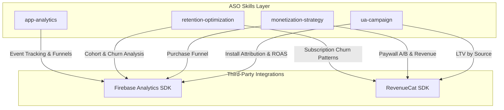
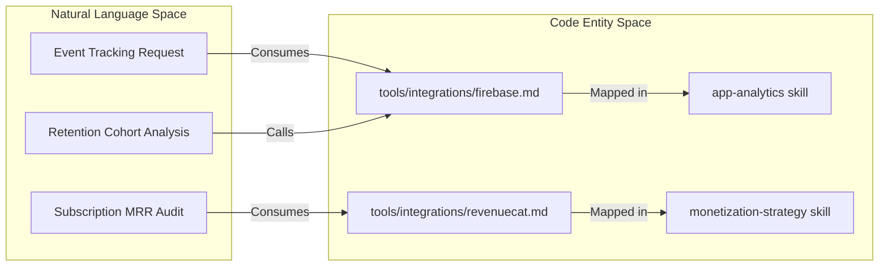

<!-- source: DeepWiki mcp.deepwiki.com · repo Eronred/aso-skills · page 5.3 Third-Party Integrations · fetched 2026-10-26 -->

# Third-Party Integrations

<details>
<summary>Relevant source files</summary>

The following files were used as context for generating this wiki page:

- [tools/integrations/firebase.md](tools/integrations/firebase.md)
- [tools/integrations/revenuecat.md](tools/integrations/revenuecat.md)

</details>


## Purpose and Scope

This page details the integration patterns, metric availability, and skill consumption maps for third-party mobile analytics and monetization platforms supported within the `aso-skills` ecosystem: **Firebase Analytics** and **RevenueCat**. While first-party data is ingested via App Store Connect and the Appeeky MCP server, ASO strategies that optimize post-install conversion, retention, and paid user acquisition rely heavily on events and subscription data tracked by these third-party SDKs. 

---

## 1. Firebase Analytics Integration

Firebase Analytics (Google Analytics for Firebase) serves as the primary event tracking and in-app funnel analytics backend utilized across several engagement-focused ASO and growth skills [tools/integrations/firebase.md:10-23]().

### Key Features & Capabilities

Firebase provides custom event logging, user property segmentation, multi-step funnel analysis, and cohort tracking [tools/integrations/firebase.md:14-23](). Within the skill execution framework, these capabilities are referenced to establish tracking plans during app audits and growth planning.

| Feature | Description | Consuming Skill |
|---------|-------------|-----------------|
| **Event tracking** | Custom events with parameters | `app-analytics` [tools/integrations/firebase.md:16]() |
| **User properties** | Segment users by attributes | `retention-optimization` [tools/integrations/firebase.md:17]() |
| **Funnels** | Multi-step conversion analysis | `app-analytics`, `monetization-strategy` [tools/integrations/firebase.md:18]() |
| **Cohort analysis** | Retention by install date | `retention-optimization` [tools/integrations/firebase.md:19]() |
| **Audiences** | Dynamic user segments | `ua-campaign` [tools/integrations/firebase.md:20]() |
| **Attribution** | Install source tracking | `ua-campaign`, `app-analytics` [tools/integrations/firebase.md:21]() |
| **A/B testing** | Remote Config experiments | `ab-test-store-listing` [tools/integrations/firebase.md:22]() |

### Recommended ASO Events

When executing skills like `app-analytics` or `monetization-strategy`, agents recommend instrumenting specific core telemetry events [tools/integrations/firebase.md:55-75]():

```swift
// Onboarding Tracking
Analytics.logEvent("onboarding_started")
Analytics.logEvent("onboarding_completed", parameters: ["steps_completed": 5])

// Monetization Funnel
Analytics.logEvent("paywall_viewed", parameters: ["source": "settings"])
Analytics.logEvent("trial_started", parameters: ["plan": "annual"])
Analytics.logEvent("purchase_completed", parameters: ["plan": "annual", "price": 49.99])
```

Sources: [tools/integrations/firebase.md:1-127]()

---

## 2. RevenueCat Subscription & Analytics Integration

RevenueCat manages in-app purchase validation, subscription states, and revenue-centric telemetry that supplement Apple's delayed reporting infrastructure [tools/integrations/firebase.md:115-127](), [tools/integrations/revenuecat.md:8-10]().

### Key Metrics and Features

RevenueCat surfaces financial metrics required by monetization and user acquisition skills [tools/integrations/revenuecat.md:12-35]():

| Metric / Feature | Description | Consuming Skill |
|------------------|-------------|-----------------|
| **MRR** | Monthly Recurring Revenue | `monetization-strategy`, `app-analytics` [tools/integrations/revenuecat.md:16]() |
| **Paywall A/B testing** | Test pricing, trial length, design | `monetization-strategy`, `ab-test-store-listing` [tools/integrations/revenuecat.md:17]() |
| **Cohort analysis** | Revenue by acquisition date/source | `ua-campaign`, `retention-optimization` [tools/integrations/revenuecat.md:18]() |
| **Customer lists** | Active, churned, trial users | `retention-optimization` [tools/integrations/revenuecat.md:19]() |
| **Webhooks** | Real-time subscription events | `app-analytics` [tools/integrations/revenuecat.md:20]() |

### API Access Pattern

Skills reference server-side REST API calls to fetch subscriber state during audit workflows [tools/integrations/revenuecat.md:53-57]():

```bash
curl -H "Authorization: Bearer $REVENUECAT_API_KEY" \
  "https://api.revenuecat.com/v1/subscribers/$APP_USER_ID"
```

Sources: [tools/integrations/revenuecat.md:1-87]()

---

## 3. Comparative Tool Selection Matrix

When processing user data requirements across different operational domains, the ASO skill router maps specific evaluation needs to the correct underlying provider [tools/integrations/firebase.md:117-127](), [tools/integrations/revenuecat.md:59-69]().

| Capability | Firebase | App Store Connect | RevenueCat | Appeeky |
|------------|----------|-------------------|-----------|---------|
| **In-app event tracking** | Supported [tools/integrations/firebase.md:119]() | Not Supported [tools/integrations/firebase.md:119]() | Not Supported [tools/integrations/firebase.md:119]() | Not Supported [tools/integrations/firebase.md:119]() |
| **Custom funnels** | Supported [tools/integrations/firebase.md:120]() | Not Supported [tools/integrations/firebase.md:120]() | Not Supported [tools/integrations/firebase.md:120]() | Not Supported [tools/integrations/firebase.md:120]() |
| **Retention cohorts** | Supported [tools/integrations/firebase.md:121]() | Basic [tools/integrations/firebase.md:121]() | By revenue [tools/integrations/firebase.md:121]() | Not Supported [tools/integrations/firebase.md:121]() |
| **Paywall A/B Testing** | Remote Config [tools/integrations/firebase.md:107]() | Not Supported [tools/integrations/revenuecat.md:64]() | Paywalls SDK [tools/integrations/revenuecat.md:64]() | Not Supported [tools/integrations/firebase.md:123]() |
| **Keyword Rankings** | Not Supported [tools/integrations/firebase.md:125]() | Not Supported [tools/integrations/firebase.md:125]() | Not Supported [tools/integrations/firebase.md:125]() | Supported [tools/integrations/firebase.md:125]() |

Sources: [tools/integrations/firebase.md:115-127](), [tools/integrations/revenuecat.md:59-70]()

---

## 4. System Integration Architecture

The following diagrams illustrate how third-party data providers feed into specific optimization skills within the repository.

### Data Flow Diagram: Skills to Integrations



Sources: [tools/integrations/firebase.md:89-114](), [tools/integrations/revenuecat.md:71-87]()

### Natural Language Space to Code Entity Space Bridge



Sources: [tools/integrations/firebase.md:1-127](), [tools/integrations/revenuecat.md:1-87]()

---

