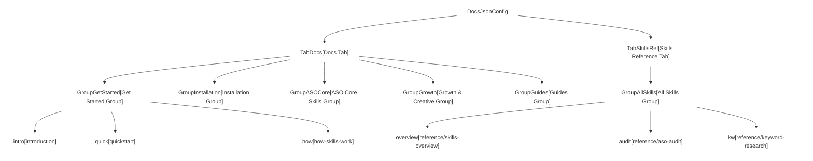
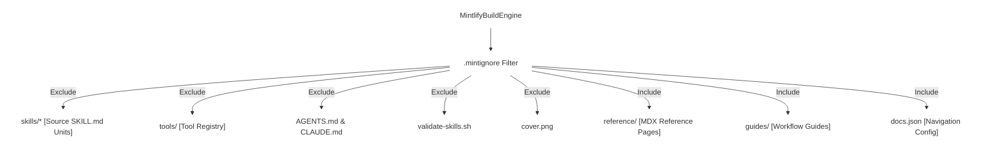

<!-- source: DeepWiki mcp.deepwiki.com · repo Eronred/aso-skills · page 6.1 Docs Configuration & Conventions · fetched 2026-10-26 -->

# Docs Configuration & Conventions

<details>
<summary>Relevant source files</summary>

The following files were used as context for generating this wiki page:

- [.atlas-analysis.json](.atlas-analysis.json)
- [.gitignore](.gitignore)
- [.mintignore](.mintignore)
- [docs.json](docs.json)
- [reference/skills-overview.mdx](reference/skills-overview.mdx)

</details>


This page details the configuration and authoring conventions for the Mintlify documentation site in the `aso-skills` repository. It covers the `docs.json` navigation schema, `.mintignore` exclusion rules for source files, and MDX frontmatter and component patterns used across reference pages.

---

## 1. `docs.json` Navigation Architecture

The documentation site layout, visual theme, and hierarchical navigation are defined in `docs.json` [docs.json:1-105](). Mintlify uses this configuration to construct the multi-tab navigation structure, defining primary themes, brand logos, and tab groups.

The navigation tree is split into two primary tabs:
1. **Docs**: Contains getting started guides, installation instructions for various agents, core skills, growth/creative skills, and user guides [docs.json:21-69]().
2. **Skills Reference**: Contains the comprehensive index and individual reference pages for all available specialist skills [docs.json:70-102]().


*Figure 1: `docs.json` navigation hierarchy mapping tabs, groups, and page references.*

Sources: `[docs.json:1-105]()`

---

## 2. `.mintignore` Exclusion Rules

To prevent raw agent skill definitions, registry scripts, and internal developer documentation from being bundled into the public-facing Mintlify build, the repository utilizes a `.mintignore` file [.mintignore:1-9](). 

The ignore rules explicitly exclude:
- Source skill directories (`skills/*/`) containing raw `SKILL.md` units [.mintignore:2-2]()
- The tool integration registry directory (`tools/`) [.mintignore:3-3]()
- Core developer instructions and scripts such as `AGENTS.md`, `CLAUDE.md`, and `validate-skills.sh` [.mintignore:6-8]()
- Binary assets like root cover images (`cover.png`) [.mintignore:9-9]()


*Figure 2: File exclusion flow governed by `.mintignore` during documentation compilation.*

Sources: `[.mintignore:1-9]()`

---

## 3. MDX Frontmatter Patterns in `reference/` Pages

All documentation pages inside the `reference/` directory employ strict MDX frontmatter conventions and rich Mintlify UI components. As seen in `reference/skills-overview.mdx`, every reference document starts with YAML frontmatter defining metadata properties:

```yaml
---
title: "ASO Skills Reference — Full Skill Library by Category"
sidebarTitle: "Overview"
description: "Browse all 20+ ASO Skills organized by category..."
---
```
*(Source: `[reference/skills-overview.mdx:1-5]()`)*

### Layout Components
Reference pages leverage standard Mintlify components for structuring technical content:
- **Tabs (`<Tabs>`, `<Tab>`)**: Used to separate invocation modes (e.g., Router vs. Direct Invocation) [reference/skills-overview.mdx:13-37]().
- **Callouts (`<Tip>`)**: Highlighting mandatory initialization steps, such as running `/app-marketing-context` first [reference/skills-overview.mdx:39-41]().
- **Grid Layouts (`<CardGroup>`, `<Card>`)**: Organizing skills into visual category cards equipped with icons and deep links [reference/skills-overview.mdx:43-134]().

Sources: `[reference/skills-overview.mdx:1-134]()`

---

