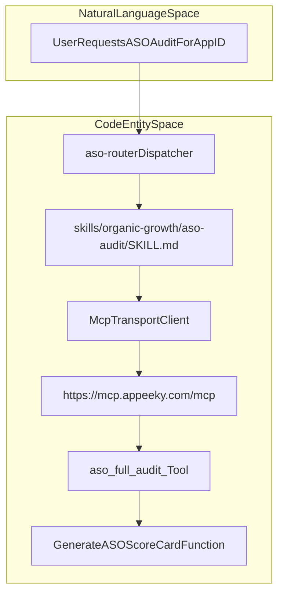
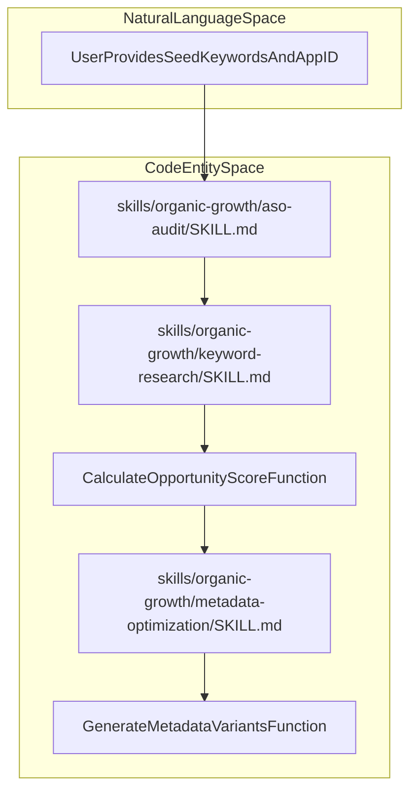

<!-- source: DeepWiki mcp.deepwiki.com · repo Eronred/aso-skills · page 6.2 Workflow Guides · fetched 2026-10-26 -->

# Workflow Guides

<details>
<summary>Relevant source files</summary>

The following files were used as context for generating this wiki page:

- [guides/appeeky-mcp.mdx](guides/appeeky-mcp.mdx)
- [guides/first-aso-audit.mdx](guides/first-aso-audit.mdx)
- [guides/keyword-workflow.mdx](guides/keyword-workflow.mdx)
- [guides/launch-checklist.mdx](guides/launch-checklist.mdx)
- [reference/ab-test-store-listing.mdx](reference/ab-test-store-listing.mdx)

</details>


## Purpose and Scope
This page provides end-to-end technical implementation details and operational workflows for the core instruction guides provided by `aso-skills`. It details the execution mechanics of the first App Store Optimization audit, the multi-step keyword-to-metadata pipeline, the 8-week app launch checklist framework, and the architectural setup of the Appeeky Model Context Protocol (MCP) server integration.

Sources: `guides/first-aso-audit.mdx:1-7](), [guides/keyword-workflow.mdx:1-8](), [guides/launch-checklist.mdx:1-8](), [guides/appeeky-mcp.mdx:1-8]()

---

## 1. First ASO Audit Walkthrough

The `/aso-audit` workflow evaluates an app's listing across ten weighted ranking and conversion factors. It normalizes inputs based on the target platform (iOS App Store numeric IDs vs. Google Play package names) and queries live intelligence endpoints when an MCP connection is present.

### Execution Flow and Data Collection
1. **Identifier Resolution**: The user provides an App ID (`570060128` for iOS or `com.myapp.android` for Android) [guides/first-aso-audit.mdx:28-40]().
2. **Skill Dispatch**: The request is routed via the agent system to `skills/organic-growth/aso-audit/SKILL.md`.
3. **Intelligence Gathering**: If the Appeeky MCP server is active, it invokes remote telemetry tools (`aso_full_audit`, `get_app_intelligence`); otherwise, it prompts the user for manual metadata strings [guides/first-aso-audit.mdx:72-80]().

### ASO Scoring Rubric & Weightings
The audit engine aggregates scores into an overall 0–100 score card [guides/first-aso-audit.mdx:82-98]():

| Factor | Weight | Evaluation Criteria |
| :--- | :--- | :--- |
| **Title** | 20% | Primary keyword presence, brand positioning, 30-character utilization limit [guides/first-aso-audit.mdx:135-137]() |
| **Subtitle** (iOS) | 15% | Secondary keyword density, distinct from title terms, 30-character limit [guides/first-aso-audit.mdx:139-142]() |
| **Keyword Field** (iOS) | 15% | 100-character hidden string, zero redundancy, comma syntax without trailing spaces [guides/first-aso-audit.mdx:144-146]() |
| **Description** | 10% | Conversion copywriting, keyword frequency (Android) |
| **Screenshots & Video** | 15% | Visual hierarchy, value proposition clarity in first frame |
| **Ratings & Reviews** | 15% | Volume, average star rating, recent review velocity and sentiment |
| **Icon & Conversion** | 10% | Brand recognition, category differentiation, category conversion baselines |


*Diagram 1: Natural Language to Code Entity mapping for the audit workflow.*

Sources: `guides/first-aso-audit.mdx:1-146]()

---

## 2. Keyword Research to Metadata Workflow

The keyword workflow coordinates three distinct skill units to transition raw seed terms into structured metadata variants [guides/keyword-workflow.mdx:9-22]():


*Diagram 2: Keyword-to-Metadata pipeline data flow across skill modules.*

### Opportunity Score Formula
The `keyword-research` skill evaluates candidates via a composite scoring calculation [guides/keyword-workflow.mdx:66-70]():

$$\text{Opportunity Score} = (\text{Volume} \times 0.4) + ((100 - \text{Difficulty}) \times 0.3) + (\text{Relevance} \times 0.3)$$

### Metadata Variants & Character Constraints
The optimization stage yields three structural variants (Conservative, Balanced, Aggressive) [guides/keyword-workflow.mdx:116-125]() adhering to platform limits [guides/keyword-workflow.mdx:128-145]():

| Platform | Field | Character Limit | Indexing Status |
| :--- | :--- | :--- | :--- |
| **iOS** | Title | 30 | Indexed (Highest Weight) [guides/keyword-workflow.mdx:132-132]() |
| **iOS** | Subtitle | 30 | Indexed (Second Weight) [guides/keyword-workflow.mdx:133-133]() |
| **iOS** | Keyword Field | 100 | Indexed (Hidden) [guides/keyword-workflow.mdx:134-134]() |
| **Android** | Title | 30 | Indexed (Highest Weight) [guides/keyword-workflow.mdx:141-141]() |
| **Android** | Short Description | 80 | Indexed (Visible) [guides/keyword-workflow.mdx:142-142]() |

Sources: `guides/keyword-workflow.mdx:1-153]()

---

## 3. 8-Week App Launch Framework

The `app-launch` skill generates a synchronized roadmap balancing ASO setup, beta testing, and marketing milestones [guides/launch-checklist.mdx:7-11]().

### Phase Breakdown
- **Pre-Launch (Weeks 1–4)** [guides/launch-checklist.mdx:27-27]():
  - *Week 1*: ASO Foundation audit (`/aso-audit`) and keyword research (`/keyword-research`) [guides/launch-checklist.mdx:29-39]().
  - *Week 2*: Metadata optimization, screenshot design briefs, and icon differentiation (`/metadata-optimization`, `/screenshot-optimization`, `/app-icon-optimization`) [guides/launch-checklist.mdx:49-57]().
  - *Week 3*: TestFlight / Google Play Open Testing, crash analytics configuration (Firebase / Sentry) [guides/launch-checklist.mdx:67-76]().
  - *Week 4*: Press kit creation, journalist pitch drafting (`/press-and-pr`), and Product Hunt setup [guides/launch-checklist.mdx:85-94]().
- **Launch Week (Week 5+)** [guides/launch-checklist.mdx:102-147]():
  - App Store review buffer submission (3 business days prior) [guides/launch-checklist.mdx:110-110]().
  - Launch day synchronization: embargo lifts, social broadcasts, Product Hunt publishing at 12:01 AM PST, and Apple Search Ads activation (`/apple-search-ads`) [guides/launch-checklist.mdx:120-133]().

Sources: `guides/launch-checklist.mdx:1-147]()

---

## 4. Appeeky MCP Server Setup & Architecture

The Appeeky Model Context Protocol (MCP) server bridges local coding environments with live store telemetry.

### Transport Endpoint and Tool Registry
- **Base URL**: `https://mcp.appeeky.com/mcp` [guides/appeeky-mcp.mdx:48-48]()
- **Authentication**: Bearer token via `Authorization: Bearer apk_your_key_here` or `X-API-Key` headers [guides/appeeky-mcp.mdx:50-50](), [guides/appeeky-mcp.mdx:161-161]()
- **Exposed Tool Families**:
  - App Data: `search_apps`, `get_app`, `get_app_intelligence`, `get_app_reviews` [guides/appeeky-mcp.mdx:19-19]()
  - Keyword Intelligence: `get_keyword_ranks`, `get_keyword_suggestions`, `get_keyword_metrics`, `get_app_keywords` [guides/appeeky-mcp.mdx:20-20]()
  - ASO Automation: `aso_full_audit`, `aso_validate_metadata`, `aso_suggest_metadata`, `aso_competitor_report` [guides/appeeky-mcp.mdx:21-21]()

### Client Configuration Paths
Different AI agents consume MCP settings through standardized configuration JSON structures:

```json
{
  "mcpServers": {
    "appeeky": {
      "url": "https://mcp.appeeky.com/mcp",
      "headers": {
        "Authorization": "Bearer apk_your_key_here"
      }
    }
  }
}
```
*Snippet: Typical MCP client configuration layout found in `.cursor/mcp.json` or `~/.claude/settings.json` [guides/appeeky-mcp.mdx:44-55](), [guides/appeeky-mcp.mdx:83-95]().*

Sources: `guides/appeeky-mcp.mdx:1-182]()

---

