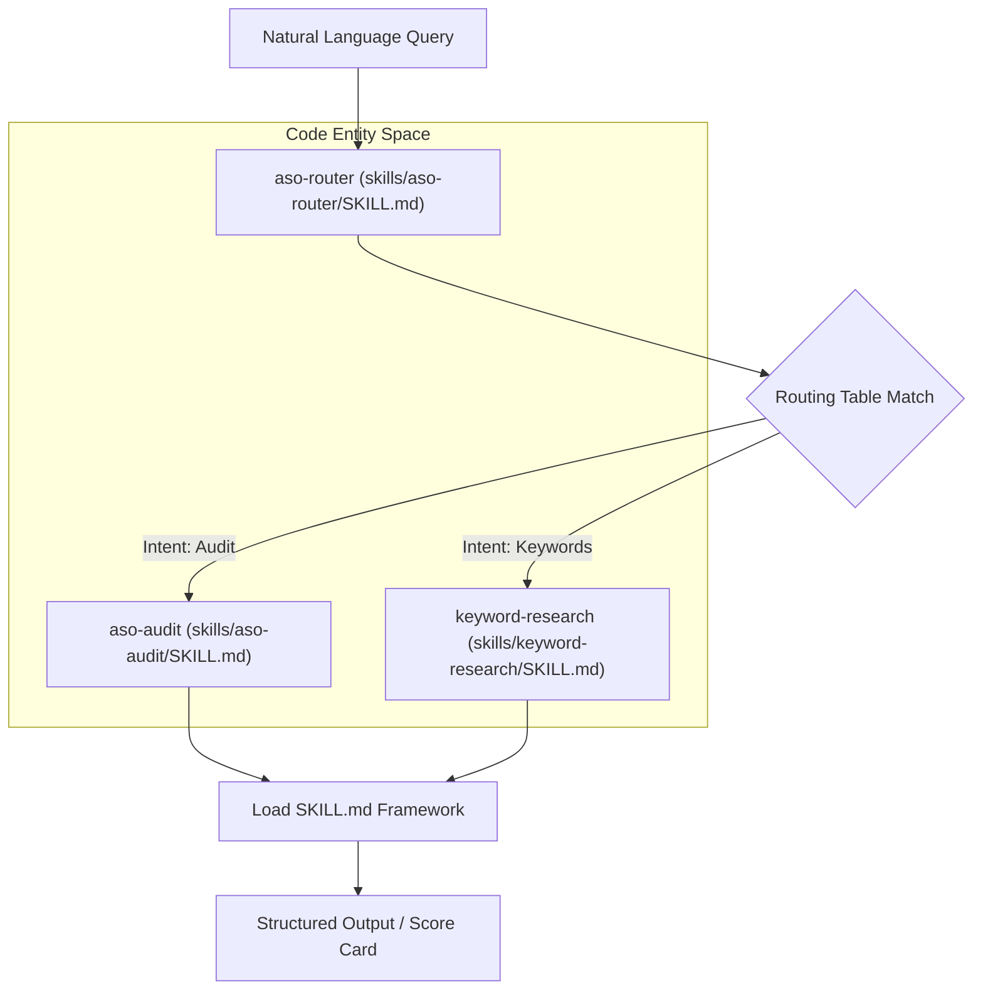
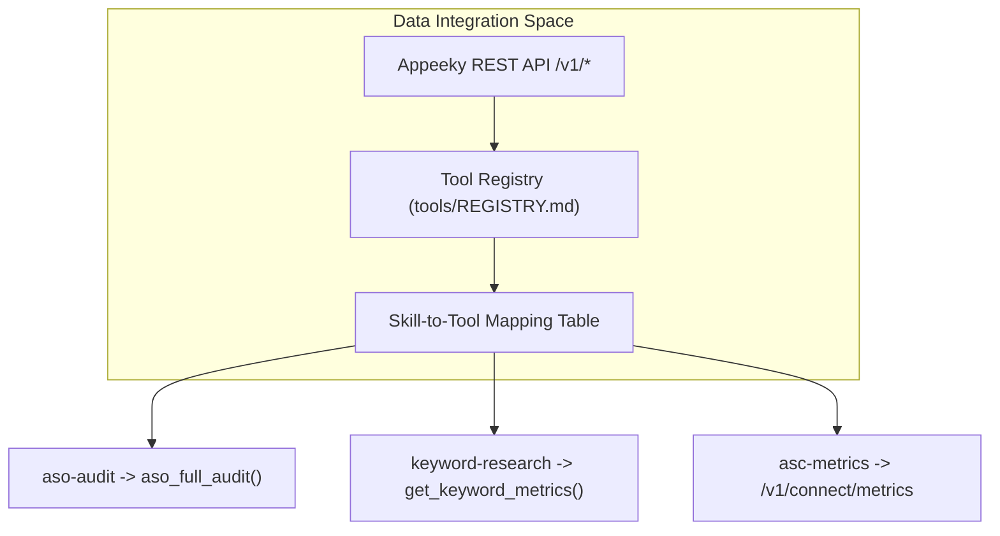

<!-- source: DeepWiki mcp.deepwiki.com · repo Eronred/aso-skills · page 7 Glossary · fetched 2026-10-26 -->

# Glossary

Relevant source files

The following files were used as context for generating this wiki page:

- [.claude-plugin/marketplace.json](.claude-plugin/marketplace.json)
- [README.md](README.md)
- [how-skills-work.mdx](how-skills-work.mdx)
- [introduction.mdx](introduction.mdx)
- [skills/aso-router/SKILL.md](skills/aso-router/SKILL.md)
- [tools/REGISTRY.md](tools/REGISTRY.md)

## Purpose and Scope

This wiki page defines the core jargon, platform abbreviations, architectural primitives, and metrics used across the `aso-skills` repository. It bridges natural language queries, ASO industry terminology, and the codebase's underlying file structures and tool endpoints. 

Sources: `[README.md:18-38](), [how-skills-work.mdx:7-29]()`

---

## Agent Skill & Architecture Jargon

### SKILL.md
The atomic unit of capability in the `aso-skills` repository. A Markdown file containing frontmatter metadata (`name`, `description`), a role definition, step-by-step scoring frameworks, and output templates [how-skills-work.mdx:11-29](). All available skills are registered in the marketplace configuration [ [.claude-plugin/marketplace.json:21-62]() ].

### aso-router
The central dispatcher component (`skills/aso-router/SKILL.md`) that receives unstructured natural language requests, matches them against a routing table, and loads up to three specialist skills sequentially [skills/aso-router/SKILL.md:1-21]().

### MCP (Model Context Protocol)
An open protocol enabling AI models (such as Claude Code or Cursor) to securely interact with external tools and data sources. In this codebase, MCP connects the agent to the `Appeeky` server to fetch live App Store metrics [README.md:20](), `[tools/REGISTRY.md:7-15]()`.

### Score Card
A structured evaluation table generated by assessment skills (such as `aso-audit`), breaking down listing performance across weighted factors with visual progress indicators and numerical scores [how-skills-work.mdx:47-51]().

### Quick Wins
Immediate, high-ROI optimization tasks identified by analytical skills that require minimal effort but yield substantial ranking or conversion improvements [README.md:82](), `[how-skills-work.mdx:51]().`

*Figure 1: Bridging natural language routing requests to concrete `SKILL.md` entities via `aso-router`.*

Sources: `[README.md:82](), [skills/aso-router/SKILL.md:1-21](), [how-skills-work.mdx:11-51](), [.claude-plugin/marketplace.json:21-62]()`

---

## ASO & Mobile Growth Jargon

### ASO (App Store Optimization)
The ongoing process of improving app visibility (organic search rankings) and conversion rates (store listing conversion) in the Apple App Store and Google Play Store [README.md:18](), `[introduction.mdx:2-7]()`.

### ASA (Apple Search Ads)
Apple's first-party paid advertising platform allowing developers to bid on keywords to display ads at the top of App Store search results [README.md:106](), `[skills/aso-router/SKILL.md:70]()`.

### ASC (App Store Connect)
Apple's official web portal for managing app submissions, in-app purchases, and accessing first-party sales and analytics reports [tools/REGISTRY.md:47-51]().

### Appeeky Connect
A first-party data integration layer that syncs exact sales, subscription, and metrics from App Store Connect into local caches or analytics pipelines, consumed by the `asc-metrics` skill [tools/REGISTRY.md:47-51]().

### CPP (Custom Product Pages)
An Apple feature allowing developers to create up to 35 alternative versions of their App Store product page featuring different screenshots, preview videos, and promotional text, targeted via unique URLs or Apple Search Ads [README.md:96](), `[skills/aso-router/SKILL.md:47]()`.

### PPO (Product Page Optimization)
Apple's native A/B testing tool that lets developers test alternative app icons, screenshots, and preview videos against their default product page to optimize conversion rates [README.md:95](), `[skills/aso-router/SKILL.md:46]()`.

### SKAN / SKAdNetwork (AdAttributionKit)
Apple's privacy-centric attribution framework that measures ad campaign conversions at the app level without violating user privacy constraints [skills/aso-router/SKILL.md:89]().

### Keyword Gap
A competitive analysis metric identifying high-volume search terms for which direct competitors currently hold top-10 rankings, but the target application has zero presence or optimization [README.md:85](), `[skills/aso-router/SKILL.md:33]()`.

*Figure 2: Mapping ASO data requirements to backend Appeeky REST endpoints and MCP tool definitions.*

Sources: `[README.md:85-106](), [tools/REGISTRY.md:1-51](), [skills/aso-router/SKILL.md:33-89]()`