# Page: Overview

# Overview

<details>
<summary>Relevant source files</summary>

The following files were used as context for generating this wiki page:

- [.claude-plugin/marketplace.json](.claude-plugin/marketplace.json)
- [README.md](README.md)
- [index.mdx](index.mdx)
- [introduction.mdx](introduction.mdx)
- [reference/competitor-analysis.mdx](reference/competitor-analysis.mdx)
- [reference/skills-overview.mdx](reference/skills-overview.mdx)
- [skills/aso-router/SKILL.md](skills/aso-router/SKILL.md)
- [tools/REGISTRY.md](tools/REGISTRY.md)

</details>


## Purpose and Scope

`aso-skills` is an open-source library consisting of over 40 Markdown Agent Skills designed for App Store Optimization (ASO) and mobile app marketing, coupled with a Mintlify documentation site. The repository provides structured `SKILL.md` files that integrate with AI assistants such as Cursor, Claude Code, or any Agent Skills-compatible environment to automate keyword research, metadata generation, competitor analysis, and app growth workflows [README.md:18-20] [introduction.mdx:1-8]. Live data enrichment is powered by the Appeeky API and Model Context Protocol (MCP) server [README.md:18-21] [tools/REGISTRY.md:5-15].

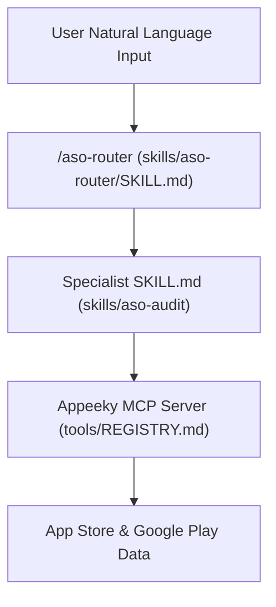
*Sources: [README.md:18-21](), [skills/aso-router/SKILL.md:1-22](), [tools/REGISTRY.md:1-15]()*

---

## Getting Started & Installation

The library can be installed directly into supported IDEs and agent frameworks using package runners, manual repository cloning, or plugin marketplace configurations [README.md:40-47] [.claude-plugin/marketplace.json:12-65]. 

For installation procedures via `npx skills add`, manual `git clone` paths, plugin marketplace integration, and per-editor directory structures, see [Getting Started & Installation](#1.1).

*Sources: [README.md:40-47](), [.claude-plugin/marketplace.json:1-65]*

---

## First ASO Audit Walkthrough

Users can evaluate mobile application listings by supplying identifiers (such as Apple numeric App IDs or Google Play package names) and invoking audit workflows [reference/competitor-analysis.mdx:27-32] [index.mdx:33-35]. 

For an end-to-end tutorial covering app identifier discovery, executing `/aso-audit`, reading scoring rubrics, and processing prioritized fix tiers, see [First ASO Audit Walkthrough](#1.2).

*Sources: [README.md:50-51](), [index.mdx:33-35](), [reference/competitor-analysis.mdx:27-32]*

---

## Repository Layout

The codebase is organized into dedicated directories separating agent execution units, documentation pages, integration maps, and plugin configuration definitions [README.md:76-112] [tools/REGISTRY.md:1-50].

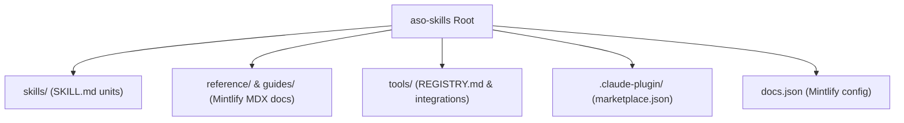
*Sources: [README.md:76-112](), [tools/REGISTRY.md:1-50](), [.claude-plugin/marketplace.json:1-65]*

For a comprehensive map detailing `skills/`, `reference/`, `guides/`, `tools/`, `.claude-plugin/`, and configuration files, see [Repository Layout](#1.3).

*Sources: [README.md:76-112](), [tools/REGISTRY.md:1-50]()*

---

# Page: Getting Started & Installation

# Getting Started & Installation

<details>
<summary>Relevant source files</summary>

The following files were used as context for generating this wiki page:

- [.claude-plugin/marketplace.json](.claude-plugin/marketplace.json)
- [README.md](README.md)
- [install/claude-code.mdx](install/claude-code.mdx)
- [install/cursor.mdx](install/cursor.mdx)
- [install/other-agents.mdx](install/other-agents.mdx)
- [quickstart.mdx](quickstart.mdx)
- [skills/aso-router/SKILL.md](skills/aso-router/SKILL.md)
- [tools/REGISTRY.md](tools/REGISTRY.md)

</details>


## Purpose and Scope
This document outlines the installation mechanics, directory structures, and configuration pathways for deploying the `aso-skills` library into AI-assisted development environments. It covers automated installation via the Agent Skills CLI (`npx skills add`), manual repository cloning, plugin marketplace integration (`.claude-plugin/marketplace.json`), and per-editor target directories for Cursor, Claude Code, Windsurf, and Codex.

Sources: [README.md:40-47](), [.claude-plugin/marketplace.json:1-65]()

---

## 1. CLI Installation Architecture (`npx skills add`)

The primary installation path leverages the Agent Skills CLI ecosystem via `npx skills add`. This command resolves the remote repository `eronred/aso-skills`, downloads the requested skill units (`SKILL.md`), and populates the local project or global configuration directories.

### Command Parameters & Modifiers
* **Full Library Install (Claude Code)**: Fetches all skill units and installs them into the project-local `.claude/skills/` directory [install/claude-code.mdx:9-17]().
* **Target Editor Flag (`-a cursor`)**: Directs the CLI to format and place skills into Cursor-compatible paths [install/cursor.mdx:9-29]().
* **Global Flag (`-g`)**: Installs skills into user-level global directories, making them available across all projects on the machine [install/cursor.mdx:24-28]().
* **Selective Filtering (`--skill`)**: Allows granular cherry-picking of specific skill packages to keep agent context lightweight [install/claude-code.mdx:21-27]().

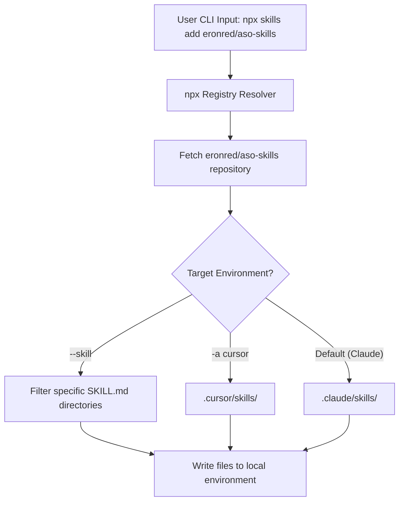
*Sources: [README.md:40-47](), [install/claude-code.mdx:9-39](), [install/cursor.mdx:9-29]()*

---

## 2. Per-Editor Target Directories & Configuration

Different AI-assisted editors read skills from specific file-system paths. The library adapts to these environments by mapping skill packages into distinct target directories [install/other-agents.mdx:62-73]().

### Editor Directory Mapping Table

| Editor | Project-Level Path | Global Path | Configuration Reference |
| :--- | :--- | :--- | :--- |
| **Cursor** | `.cursor/skills/` [install/cursor.mdx:54-59]() | `~/.cursor/skills/` [install/cursor.mdx:61-66]() | `.cursor/mcp.json` [install/cursor.mdx:102-113]() |
| **Claude Code** | `.claude/skills/` [install/claude-code.mdx:11-17]() | N/A | `.claude/config.json` |
| **Windsurf** | `.agents/skills/` [install/other-agents.mdx:24-27]() | N/A | Agent settings |
| **Codex** | `.codex/skills/` [install/other-agents.mdx:29-32]() | N/A | Codex config |

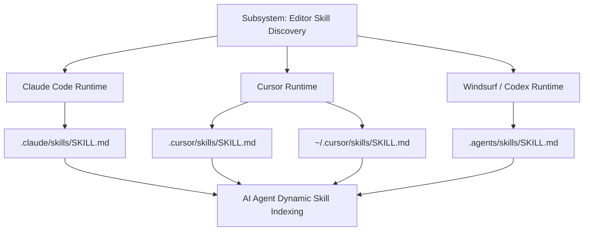
*Sources: [install/claude-code.mdx:11-103](), [install/cursor.mdx:53-68](), [install/other-agents.mdx:21-73]()*

---

## 3. Manual Git Clone & Marketplace Integration

When automated CLI access is restricted or local version control is preferred, manual synchronization is supported via standard Git operations and plugin manifests.

### Manual Synchronization Workflow
1. Clone the repository directly to a local workspace [install/claude-code.mdx:80-84]():
   ```bash
   git clone https://github.com/eronred/aso-skills.git
   ```
2. Create the destination target directory [install/claude-code.mdx:86-90]():
   ```bash
   mkdir -p .claude/skills
   ```
3. Copy skill modules recursively [install/claude-code.mdx:91-95]():
   ```bash
   cp -r aso-skills/skills/* .claude/skills/
   ```

### Plugin Marketplace Specification
For platforms supporting the Claude Plugin standard, the repository exposes [.claude-plugin/marketplace.json]() which registers the plugin metadata, repository URI, and enumerates all 40+ contained skill entry points [ [.claude-plugin/marketplace.json:1-65]()]:

* **Plugin Name**: `aso-skills` [.claude-plugin/marketplace.json:2]()
* **Owner**: `Appeeky` [.claude-plugin/marketplace.json:4]()
* **Strict Mode**: Disabled (`strict: false`) to allow flexible skill composition [.claude-plugin/marketplace.json:17]()
* **Registered Skills**: Maps paths from `./skills/aso-router` through specialist domains [.claude-plugin/marketplace.json:22-61]()

Sources: [.claude-plugin/marketplace.json:1-65](), [install/claude-code.mdx:76-103]()

---

## 4. Optional Tooling & MCP Server Connection

While skills function using built-in expert frameworks, live App Store intelligence requires linking the Appeeky Model Context Protocol (MCP) server [tools/REGISTRY.md:5-15]().

### MCP Client Configuration Structure
Add the following transport configuration to your editor's MCP settings file (e.g., `.cursor/mcp.json` or Claude configuration) [install/claude-code.mdx:129-140]():

```json
{
  "mcpServers": {
    "appeeky": {
      "url": "https://mcp.appeeky.com/mcp",
      "headers": { "Authorization": "Bearer apk_your_key_here" }
    }
  }
}
```

### Verification & Router Execution
Once installed, verification is performed by invoking the dispatcher router skill `skills/aso-router/SKILL.md` [skills/aso-router/SKILL.md:1-6]() or executing a direct audit command [install/claude-code.mdx:107-121]():
* **Router dispatch**: `/aso-router` [README.md:68-72]()
* **Direct invocation**: `/aso-audit` [README.md:74]()

Sources: [README.md:40-74](), [tools/REGISTRY.md:1-15](), [install/claude-code.mdx:125-147]()

---

# Page: First ASO Audit Walkthrough

# First ASO Audit Walkthrough

<details>
<summary>Relevant source files</summary>

The following files were used as context for generating this wiki page:

- [guides/first-aso-audit.mdx](guides/first-aso-audit.mdx)
- [reference/aso-audit.mdx](reference/aso-audit.mdx)

</details>


## Purpose and Scope

This page provides a technical walkthrough for executing and understanding the `aso-audit` skill (`reference/aso-audit.mdx:7-8()`). It details how input parameters like App IDs are processed, how the underlying MCP tools fetch live metadata and keyword rankings, how the 10-factor scoring rubric is computed, and how recommendations are prioritized into actionable remediation tiers (`guides/first-aso-audit.mdx:7-122()`, `reference/aso-audit.mdx:27-102()`).

Sources: `guides/first-aso-audit.mdx:7-122()`, `reference/aso-audit.mdx:7-102()`

---

## Identifying App Targets: App ID Resolution

Before an audit can run, the target application must be correctly identified. The identification scheme varies by platform as outlined in the audit guide (`guides/first-aso-audit.mdx:22-47()`):

- **Apple App Store (iOS)**: Resolved using a numeric App ID parsed from the App Store URL pattern (`https://apps.apple.com/.../id[AppID]`) or retrieved directly from App Store Connect (`guides/first-aso-audit.mdx:28-34()`).
- **Google Play (Android)**: Resolved using a package name string (reverse-domain format like `com.myapp.android`) extracted from the Google Play URL or Google Play Console dashboard (`guides/first-aso-audit.mdx:40-45()`).

Sources: `guides/first-aso-audit.mdx:22-47()`

---

## Audit Execution and Data Flow

The audit can be invoked directly via the `/aso-audit` command or routed dynamically through the `/aso-router` dispatcher (`guides/first-aso-audit.mdx:56-70()`, `reference/aso-audit.mdx:9-21()`). When executed, the system ingests specific parameters (`app_id`, `target_country`, and `platform`) to configure the audit run (`reference/aso-audit.mdx:31-42()`).

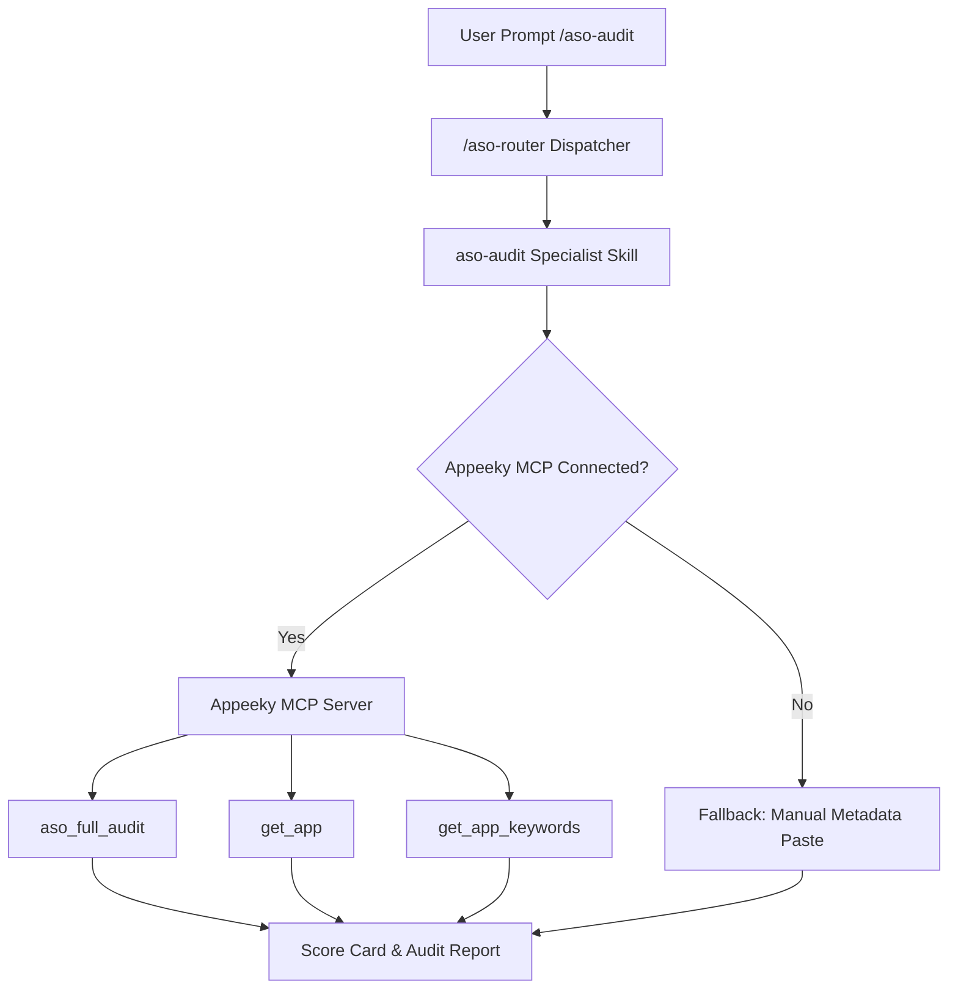
*Figure 1: Data flow and execution path from user prompt to MCP tool integration.*

Sources: `guides/first-aso-audit.mdx:56-80()`, `reference/aso-audit.mdx:9-42()`, `reference/aso-audit.mdx:116-129()`

---

## The 10-Factor Scoring Framework

The core evaluation logic computes a weighted ASO score from 0 to 100 based on ten discrete factors (`reference/aso-audit.mdx:43-62()`):

| Factor | Weight (iOS / Android) | Core Evaluation Criteria |
| :--- | :--- | :--- |
| **Title** | 20% | Primary keyword usage, 30-character limit utilization, brand balance, readability (`reference/aso-audit.mdx:51()`) |
| **Subtitle** | 15% (iOS only) | Secondary non-overlapping keywords, value proposition, character constraints (`reference/aso-audit.mdx:52()`) |
| **Keyword Field** | 15% (iOS only) | Non-repetitive tokens, no trailing comma spaces, singular forms, 100-character use (`reference/aso-audit.mdx:53()`) |
| **Description** | 5% / 15% | First-3-line hook, feature framing, keyword density (Android), formatting, CTA (`reference/aso-audit.mdx:54()`) |
| **Ratings & Reviews** | 10% | Overall rating, review recency, sentiment velocity, developer response rate (`reference/aso-audit.mdx:55()`) |
| **Screenshots** | 10% | Slot utilization (up to 10), first 3 slots for core value, captions, consistency (`reference/aso-audit.mdx:56()`) |
| **App Preview Video**| 5% | Existence, 3-second hook, 15–30s duration, visual comprehension without audio (`reference/aso-audit.mdx:57()`) |
| **Category** | 5% | Optimal primary and secondary category assignments (`reference/aso-audit.mdx:58()`) |
| **Localization** | 5% | Metadata translation and keyword localization per target market (`reference/aso-audit.mdx:59()`) |
| **Ratings Momentum** | 10% | Trend trajectory of ratings over time (improving vs. declining) (`reference/aso-audit.mdx:60()`) |

Sources: `reference/aso-audit.mdx:43-62()`

---

## Score Card & Prioritized Remediation Flow

Following evaluation, the system structures the output into an ASO Score Card followed by a tiered remediation plan (`reference/aso-audit.mdx:64-102()`):

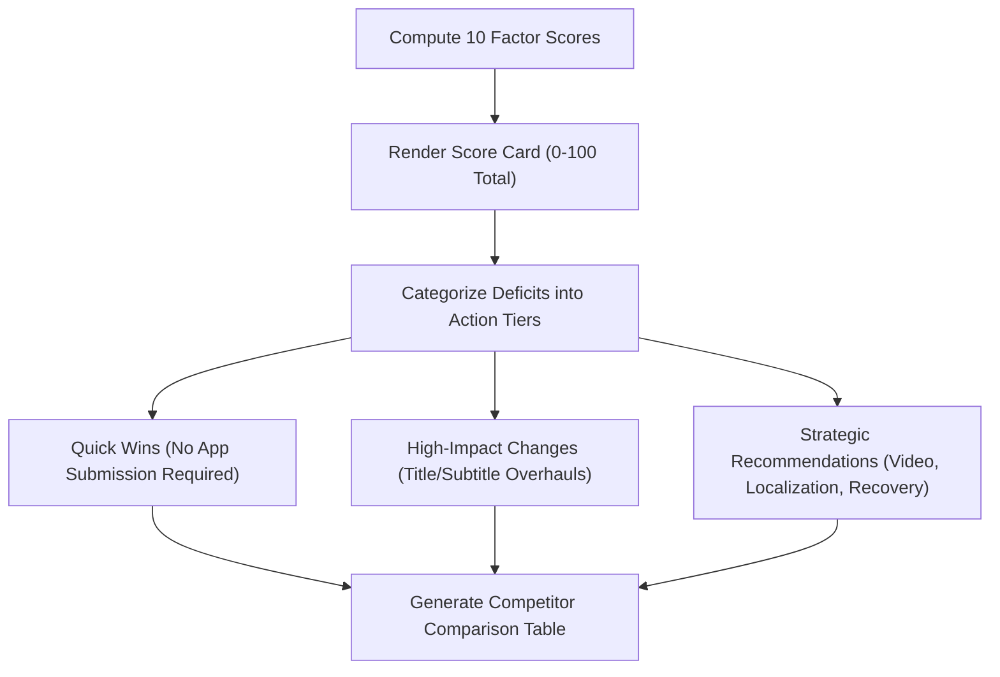
*Figure 2: Remediation mapping workflow from score calculation to prioritized output tiers.*

Sources: `guides/first-aso-audit.mdx:110-122()`, `reference/aso-audit.mdx:64-102()`

---

# Page: Repository Layout

# Repository Layout

<details>
<summary>Relevant source files</summary>

The following files were used as context for generating this wiki page:

- [.atlas-analysis.json](.atlas-analysis.json)
- [.claude-plugin/marketplace.json](.claude-plugin/marketplace.json)
- [.mintignore](.mintignore)
- [AGENTS.md](AGENTS.md)
- [CLAUDE.md](CLAUDE.md)
- [README.md](README.md)
- [docs.json](docs.json)
- [skills/aso-router/SKILL.md](skills/aso-router/SKILL.md)
- [tools/REGISTRY.md](tools/REGISTRY.md)

</details>


## Purpose and Scope

This document provides a technical map of the `aso-skills` repository structure (`https://github.com/Eronred/aso-skills`), detailing the organization of individual agent skill units (`skills/`), the documentation site (`docs.json`), the tool integration registry (`tools/`), and plugin distribution files (`.claude-plugin/`) [AGENTS.md:1-15](), [docs.json:1-105](), [.claude-plugin/marketplace.json:1-12](). 

Sources: `AGENTS.md:1-15`, `docs.json:1-105`, `.claude-plugin/marketplace.json:1-12`

---

## Top-Level Directory Architecture

The repository is structured around the [Agent Skills](https://agentskills.io) open standard [AGENTS.md:1-3](). At the root level, directories segregate core skill execution logic from tooling registries, documentation configuration, and IDE plugin manifests.

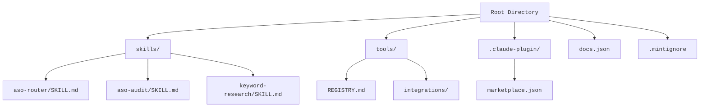
*Figure 1: High-level repository directory layout and code entity mapping.*

The core mapping of directories to codebase entities is summarized below:

| Directory / File | Code Entity / Role | Primary Content |
|------------------|--------------------|-----------------|
| `skills/` | Skill Modules | Contains subdirectories for each specialized agent skill, housing `SKILL.md` instructions and optional reference docs [AGENTS.md:5-12](). |
| `tools/` | Tool Registry & Integration | Houses `tools/REGISTRY.md` mapping capability endpoints to skills and external APIs [tools/REGISTRY.md:1-10](). |
| `.claude-plugin/` | IDE Plugin Manifest | Contains `marketplace.json` defining skill registration for Claude Code and compatible agents [.claude-plugin/marketplace.json:1-12](). |
| `docs.json` | Mintlify Configuration | Defines the documentation site tabs, groups, and page navigation hierarchies [docs.json:1-105](). |
| `.mintignore` | Build Exclusions | Specifies patterns (`skills/*/`, `tools/`) excluded from the public Mintlify documentation build [.mintignore:1-9](). |

Sources: `AGENTS.md:5-12`, `tools/REGISTRY.md:1-10`, `.claude-plugin/marketplace.json:1-12`, `docs.json:1-105`, `.mintignore:1-10`

---

## Skill Unit Structure (`skills/`)

Every skill in the library resides in its own subdirectory under `skills/<skill-name>/` [AGENTS.md:8](). Each skill unit consists of a mandatory `SKILL.md` entry point that adheres to strict frontmatter requirements and markdown formatting rules [AGENTS.md:16-28]().


*Figure 2: Execution and data flow from natural language routing to specific skill modules and tool registries.*

### Frontmatter Specification
Each `SKILL.md` begins with a YAML frontmatter block parsed by agent hosts:
- `name`: Must match the directory name, formatted in lowercase with hyphens (`1-64` characters) [AGENTS.md:20]().
- `description`: Trigger phrases, scope boundaries, and fallback instructions (`1-1024` characters) [AGENTS.md:21]() [skills/aso-router/SKILL.md:1-6]().
- `metadata`: Contains versioning information (e.g., `version: 1.0.0`) [AGENTS.md:22-25]() [skills/aso-router/SKILL.md:4-6]().

Sources: `AGENTS.md:8-28`, `skills/aso-router/SKILL.md:1-6`

---

## Tool Registry (`tools/`)

The `tools/` directory maintains integration metadata that links agent skills to real-time data sources, primarily the Appeeky API and MCP server [tools/REGISTRY.md:1-10]().

- `tools/REGISTRY.md`: Acts as the central capability matrix defining REST endpoints (`GET /v1/...`) and MCP tools (`get_app`, `aso_full_audit`) alongside the specific skills that consume them [tools/REGISTRY.md:1-92]().

Sources: `tools/REGISTRY.md:1-92`

---

## Documentation and Configuration Files

The repository configures both documentation rendering and plugin syndication through dedicated configuration files at the root level:

- `docs.json`: Configures the Mintlify documentation site structure, dividing pages into navigation tabs (`Docs`, `Skills Reference`) and groups (`Get Started`, `Installation`, `ASO Core Skills`, `Guides`, `All Skills`) [docs.json:20-105]().
- `.mintignore`: Prevents source-only files such as `skills/*/` and `tools/` from polluting the compiled documentation artifact [.mintignore:1-9]().
- `.claude-plugin/marketplace.json`: Registers all 40+ skills under the `aso-skills` plugin package for distribution in Claude Code [.claude-plugin/marketplace.json:1-65]().

Sources: `docs.json:20-105`, `.mintignore:1-10`, `.claude-plugin/marketplace.json:1-65`

---

# Page: Skill System Architecture

# Skill System Architecture

<details>
<summary>Relevant source files</summary>

The following files were used as context for generating this wiki page:

- [.claude-plugin/marketplace.json](.claude-plugin/marketplace.json)
- [README.md](README.md)
- [how-skills-work.mdx](how-skills-work.mdx)
- [skills/aso-router/SKILL.md](skills/aso-router/SKILL.md)
- [tools/REGISTRY.md](tools/REGISTRY.md)

</details>


The Skill System Architecture defines how Markdown-based agent skills (`SKILL.md`) are structured, discovered, loaded, routed, and chained together by AI assistants. The system bridges natural language user intent with structured execution frameworks and live App Store data pipelines. 

For full technical details, see the child pages:
- [The aso-router Dispatcher](#2.1)
- [app-marketing-context: Shared State](#2.2)
- [Authoring & Validating Skills](#2.3)

---

## 2.1. The aso-router Dispatcher

The `/aso-router` serves as the single entry point for natural language requests [skills/aso-router/SKILL.md:1-119](). Rather than requiring users to manually invoke one of over 40 individual specialist skills [README.md:76-112](), the router reads incoming prompts, matches them against a comprehensive routing table [skills/aso-router/SKILL.md:22-109](), and dispatches up to three specialist skills [skills/aso-router/SKILL.md:10-20]().

For compound workflows—such as optimizing an entire app store listing or executing a launch plan—the router sequences multiple skills in a deterministic execution order (e.g., `aso-audit` preceding `keyword-research` and `metadata-optimization`) [skills/aso-router/SKILL.md:110-119]() and [how-skills-work.mdx:83-90]().

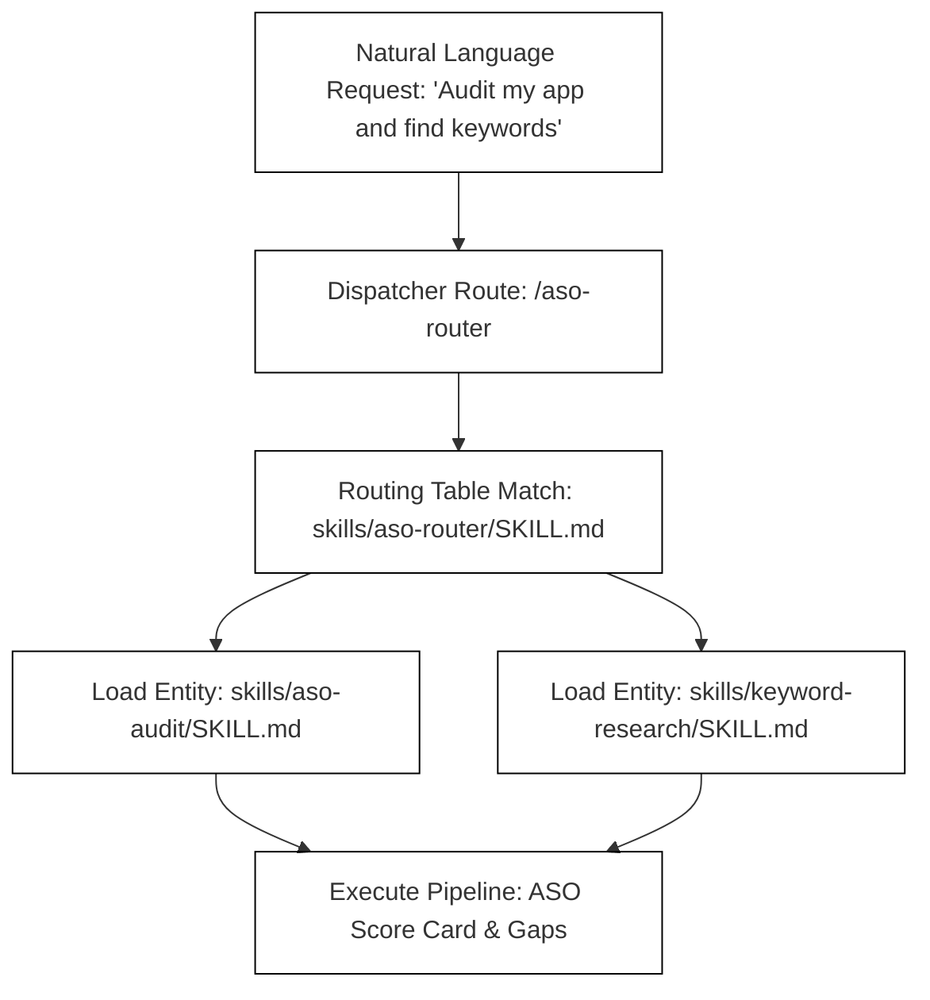
*Figure 2.1: Bridging natural language prompts to code execution paths via `/aso-router`.*

Sources: [skills/aso-router/SKILL.md:1-119](), [how-skills-work.mdx:73-92]()

For details on intent parsing rules, ambiguity handling, and compound sequences, see [The aso-router Dispatcher](#2.1).

---

## 2.2. app-marketing-context: Shared State

Downstream specialist skills frequently require baseline metadata about the target application—such as its App ID, primary category, target audience, competitors, and monetization model. The `app-marketing-context` skill provides an interactive interview mechanism that initializes and persists this state within a shared `app-marketing-context.md` file [skills/aso-router/SKILL.md:104-109]() and [.claude-plugin/marketplace.json:23]().

Once established, downstream skills read this shared artifact to automatically parameterize data calls (such as retrieving rankings or running competitor comparisons) without requiring the user to re-enter basic app parameters.

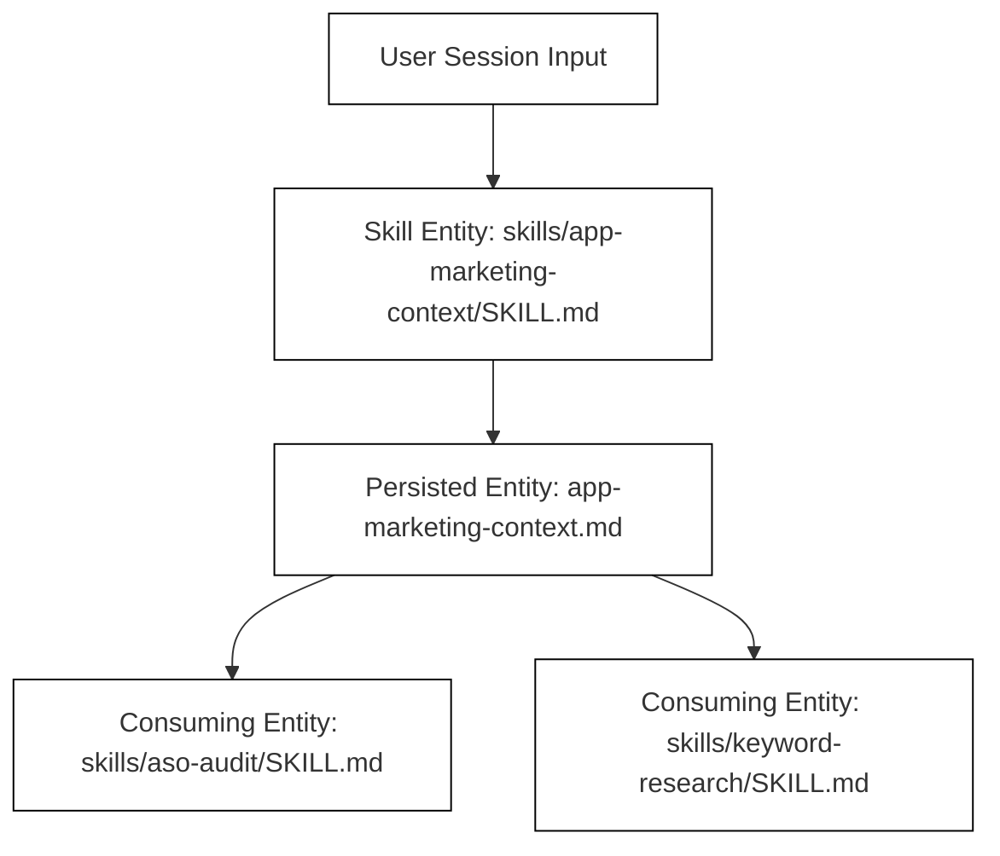
*Figure 2.2: Context persistence lifecycle flowing from interactive prompts to shared state files.*

Sources: [skills/aso-router/SKILL.md:104-109](), [.claude-plugin/marketplace.json:21-23]()

For details on interview flows, schema definitions, and context consumption patterns, see [app-marketing-context: Shared State](#2.2).

---

## 2.3. Authoring & Validating Skills

Every unit of expertise in the repository is encapsulated in a dedicated `SKILL.md` file containing a YAML frontmatter block, role definitions, operational frameworks, scoring rubrics, and standardized output templates [how-skills-work.mdx:9-29](). 

To ensure consistency and compatibility across IDE integrations like Cursor and Claude Code [.claude-plugin/marketplace.json:1-11](), skills must adhere to strict naming conventions, frontmatter specifications, and validation scripts such as `validate-skills.sh`.

Sources: [.claude-plugin/marketplace.json:1-65](), [how-skills-work.mdx:1-128]()

For details on frontmatter schemas, template requirements, validation checks, and contribution workflows, see [Authoring & Validating Skills](#2.3).

---

# Page: The aso-router Dispatcher

# The aso-router Dispatcher

<details>
<summary>Relevant source files</summary>

The following files were used as context for generating this wiki page:

- [.claude-plugin/marketplace.json](.claude-plugin/marketplace.json)
- [README.md](README.md)
- [how-skills-work.mdx](how-skills-work.mdx)
- [skills/aso-router/SKILL.md](skills/aso-router/SKILL.md)
- [tools/REGISTRY.md](tools/REGISTRY.md)

</details>


## Purpose and Scope

The `aso-router` dispatcher (`[skills/aso-router/SKILL.md:1-21]()`) acts as the central intelligent routing layer for the entire `aso-skills` library. Its sole architectural responsibility is intent classification: reading natural language inputs or shorthand commands, matching them against a comprehensive routing table, and dispatching control to between one and three specialist `SKILL.md` units [skills/aso-router/SKILL.md:10-11](). The router operates strictly as a dispatch mechanism and explicitly delegates domain-specific ASO tasks to specialist sub-skills rather than generating responses directly [skills/aso-router/SKILL.md:10]().

---

## Core Architecture & Execution Flow

When a user submits a prompt, the runtime loads `[skills/aso-router/SKILL.md:1-6]()`, which instructs the agent to execute a five-step evaluation pipeline [skills/aso-router/SKILL.md:12-19]():

1. **Input Ingestion**: Parse the user's message string for domain keywords, explicit intents, or slash commands (`/aso-router`, `/aso`, `aso help`, etc.) [skills/aso-router/SKILL.md:3]().
2. **Intent Matching**: Query the internal Routing Table for the highest-confidence match based on semantic intent and exact phrase frequency [skills/aso-router/SKILL.md:24]().
3. **Dispatch Annunciation**: Output a concise routing notification string (`→ Loading: <skill-name>`) [skills/aso-router/SKILL.md:16]().
4. **Context Transition**: Dynamically load the target skill file (`skills/<skill-name>/SKILL.md`) into the active context window [skills/aso-router/SKILL.md:17]().
5. **Disambiguation Fallback**: If the prompt matches zero routes or remains ambiguous, trigger a single clarifying question using the disambiguation playbook [skills/aso-router/SKILL.md:18]().

To maintain context window efficiency and prevent hallucinations, the router enforces a hard ceiling of **maximum 3 specialist skills** per invocation request [skills/aso-router/SKILL.md:10,20]().

### Diagram: Natural Language Space to Code Entity Space (Single Dispatch)

```mermaid
graph TD
    NL["NaturalLanguageInput: 'audit my listing'"] --> Router["skills/aso-router/SKILL.md"]
    Router --> Match{"IntentMatchEngine"}
    Match -->|RouteMatch| Target["skills/aso-audit/SKILL.md"]
    Target --> Execution["AgentExecutes10FactorFramework"]

    subclass NL NaturalLanguageSpace
    subclass Router CodeEntitySpace
    subclass Target CodeEntitySpace
```
*Sources: [skills/aso-router/SKILL.md:1-21](), [.claude-plugin/marketplace.json:21-62]()*

---

## Routing Table Architecture

The routing table contained within `[skills/aso-router/SKILL.md:22-109]()` partitions user intents into logical operational domains. Each domain maps explicit phrase triggers or semantic intent patterns to target skill directories under `skills/`.

| Domain Category | Sample User Intent / Phrase | Target Code Entity |
| :--- | :--- | :--- |
| **ASO Core** | "audit my listing", "ASO score", "why am I not ranking" | `[skills/aso-audit/SKILL.md]()` [skills/aso-router/SKILL.md:30] |
| **ASO Core** | "find keywords", "keyword research", "search volume" | `[skills/keyword-research/SKILL.md]()` [skills/aso-router/SKILL.md:31] |
| **ASO Core** | "write my title", "optimize subtitle", "keyword field" | `[skills/metadata-optimization/SKILL.md]()` [skills/aso-router/SKILL.md:32] |
| **Creative** | "screenshots", "product page design" | `[skills/screenshot-optimization/SKILL.md]()` [skills/aso-router/SKILL.md:43] |
| **Paid UA** | "Apple Search Ads", "ASA", "Search Match" | `[skills/apple-search-ads/SKILL.md]()` [skills/aso-router/SKILL.md:70] |
| **Analytics** | "my downloads", "my revenue", "Sales and Trends" | `[skills/asc-metrics/SKILL.md]()` [skills/aso-router/SKILL.md:87] |

Sources: [skills/aso-router/SKILL.md:22-109](), [.claude-plugin/marketplace.json:21-62]()

---

## Compound Workflow Sequencing

When a user request spans multiple functional domains, the router leverages multi-skill sequencing rules defined in `[skills/aso-router/SKILL.md:110-119]()` and `[how-skills-work.mdx:73-92]()`. Instead of executing isolated files, the dispatcher chains dependent skills in a strict pipeline order where the output of one skill file serves as the input context for the subsequent skill file.

### Multi-Skill Sequencing Matrix

* **"Optimize my entire listing"**: Loads `skills/aso-audit/SKILL.md` → `skills/keyword-research/SKILL.md` → `skills/metadata-optimization/SKILL.md` [skills/aso-router/SKILL.md:116]().
* **"Launch a new app"**: Loads `skills/app-marketing-context/SKILL.md` → `skills/app-launch/SKILL.md` → `skills/aso-audit/SKILL.md` [skills/aso-router/SKILL.md:117]().
* **"My revenue is flat"**: Loads `skills/asc-metrics/SKILL.md` → `skills/monetization-strategy/SKILL.md` → `skills/subscription-lifecycle/SKILL.md` [skills/aso-router/SKILL.md:119]().

### Diagram: Natural Language Space to Code Entity Space (Compound Workflow)

```mermaid
graph TD
    Prompt["NaturalLanguageInput: 'Optimize my entire listing'"] --> Dispatcher["skills/aso-router/SKILL.md"]
    Dispatcher --> Seq1["skills/aso-audit/SKILL.md"]
    Seq1 -->|FlagsGapsAndWeaknesses| Seq2["skills/keyword-research/SKILL.md"]
    Seq2 -->|FeedsKeywordTiers| Seq3["skills/metadata-optimization/SKILL.md"]
    Seq3 --> FinalOutput["GeneratedVariantsWithCharacterCounts"]

    subclass Prompt NaturalLanguageSpace
    subclass Dispatcher CodeEntitySpace
    subclass Seq1 CodeEntitySpace
    subclass Seq2 CodeEntitySpace
    subclass Seq3 CodeEntitySpace
```
*Sources: [skills/aso-router/SKILL.md:110-119](), [how-skills-work.mdx:73-92]()*

---

## Disambiguation and Direct Bypass Rules

1. **Direct Invocation Bypass**: If a user explicitly invokes a specialist skill via direct slash command (e.g., `/aso-audit`, `/keyword-research`), the runtime completely bypasses `skills/aso-router/SKILL.md` and directly mounts the requested file [skills/aso-router/SKILL.md:3,74]().
2. **Ambiguous Inputs**: When an incoming prompt lacks sufficient domain specificity, the router is programmed to halt dispatch and ask exactly **one** clarifying question derived from the disambiguation framework, ensuring zero recursive looping or multi-turn clarification overhead [skills/aso-router/SKILL.md:18]() [how-skills-work.mdx:91]().

Sources: [skills/aso-router/SKILL.md:1-21](), [how-skills-work.mdx:73-120]()

---

# Page: app-marketing-context: Shared State

# app-marketing-context: Shared State

<details>
<summary>Relevant source files</summary>

The following files were used as context for generating this wiki page:

- [reference/app-marketing-context.mdx](reference/app-marketing-context.mdx)
- [skills/app-marketing-context/SKILL.md](skills/app-marketing-context/SKILL.md)

</details>


The `app-marketing-context` skill serves as the foundational architecture for the entire ASO Skills library. It conducts a structured interactive interview with the user to establish a comprehensive app profile, persisting the output to a centralized `app-marketing-context.md` file in the project root [reference/app-marketing-context.mdx:7-10](). Downstream skills automatically check for and consume this shared state, eliminating redundant prompting and ensuring consistent app positioning, audience targeting, and goal alignment across all operations [reference/app-marketing-context.mdx:7-10]().

Sources:
- `reference/app-marketing-context.mdx:7-10`
- `skills/app-marketing-context/SKILL.md:3-10`

---

## Initial Assessment and Execution Flow

When invoked via `/app-marketing-context` or routed through `/aso-router`, the skill first performs an environmental check to determine whether a context file already exists [skills/app-marketing-context/SKILL.md:12-19]().

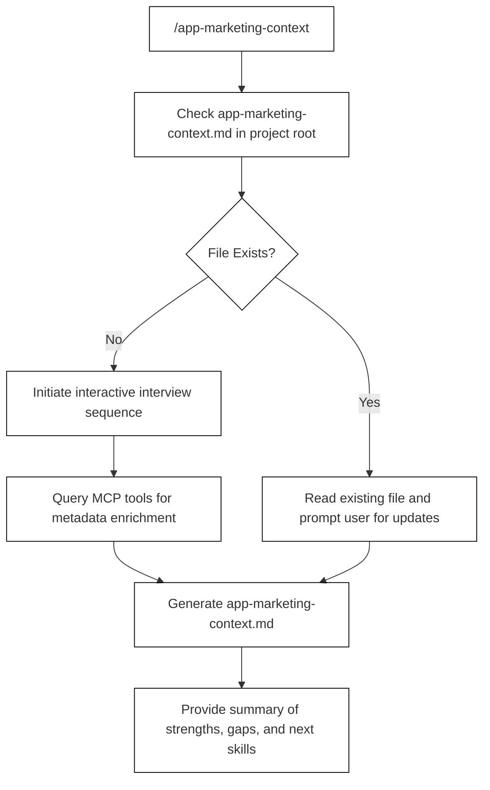
*Figure 1: State detection and document generation pipeline for `app-marketing-context`.*

Sources:
- `reference/app-marketing-context.mdx:11-23`
- `skills/app-marketing-context/SKILL.md:12-19`

---

## Interactive Interview Inputs and Schema

The skill collects specific inputs spanning technical identifiers, value propositions, competitive intelligence, and business objectives [reference/app-marketing-context.mdx:29-63](). 

| Parameter | Type | Required | Description |
| :--- | :--- | :--- | :--- |
| `app_id_ios` | string | No | Apple numeric App ID (e.g., `1617391485`), used to fetch live metadata and rankings [reference/app-marketing-context.mdx:33-35](). |
| `app_id_android` | string | No | Google Play package name (e.g., `com.example.myapp`) [reference/app-marketing-context.mdx:37-39](). |
| `app_description` | string | Yes | Plain-language description of the core problem solved [reference/app-marketing-context.mdx:41-43](). |
| `target_audience` | string | Yes | Ideal user demographics, behaviors, and pain points [reference/app-marketing-context.mdx:45-47](). |
| `main_competitors` | array | No | Top 3–5 competitor names or App IDs [reference/app-marketing-context.mdx:49-51](). |
| `goals` | array | Yes | Top 1–3 goals with target metrics and timelines [reference/app-marketing-context.mdx:53-55](). |
| `budget_and_team` | string | No | Monthly marketing budget and team size configuration [reference/app-marketing-context.mdx:57-59](). |
| `markets` | array | No | Target countries or regions in priority order (default: `["US"]`) [reference/app-marketing-context.mdx:61-63](). |

Sources:
- `reference/app-marketing-context.mdx:29-63`
- `skills/app-marketing-context/SKILL.md:39-114`

---

## Context Document Structure

The generated `app-marketing-context.md` file is parsed by downstream skills to read structural sections [skills/app-marketing-context/SKILL.md:20-117]().

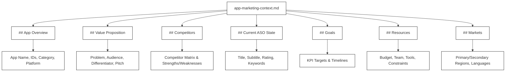
*Figure 2: Hierarchical sections stored inside `app-marketing-context.md`.*

Sources:
- `skills/app-marketing-context/SKILL.md:20-117`
- `reference/app-marketing-context.mdx:69-108`

---

## MCP Tool Integration

When an App ID is supplied, the skill leverages Model Context Protocol (MCP) tools to auto-populate metadata and current ranking metrics [reference/app-marketing-context.mdx:127-134]().

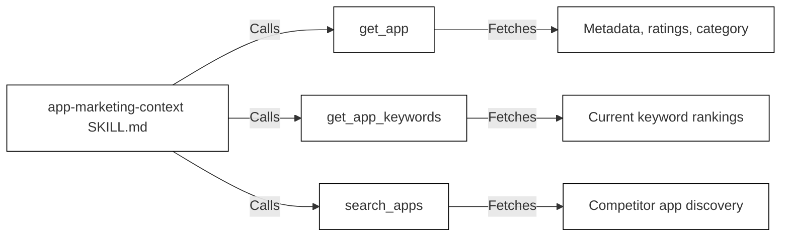
*Figure 3: MCP tool integration mapping within the context-gathering lifecycle.*

Sources:
- `reference/app-marketing-context.mdx:127-134`

---

## Downstream Skill Consumption

Every skill in the library checks for the presence of `app-marketing-context.md` prior to execution [reference/app-marketing-context.mdx:7-10](). 

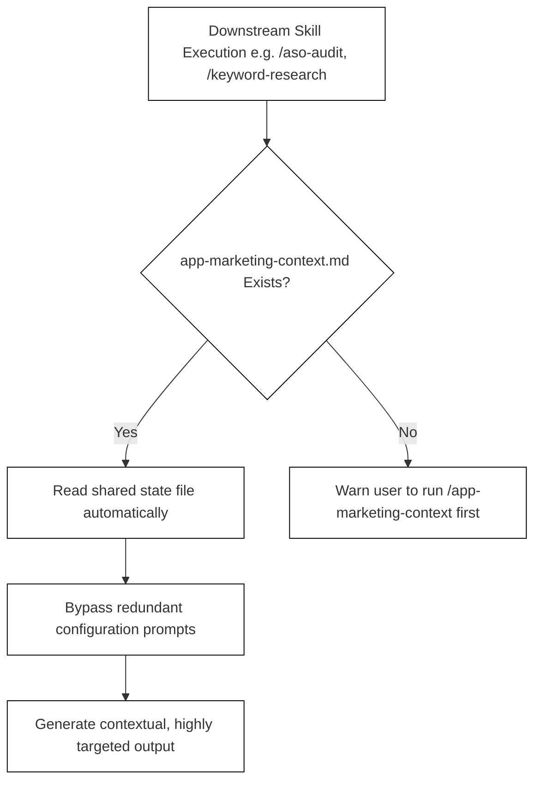
*Figure 4: How downstream skills consume the shared state artifact.*

Sources:
- `reference/app-marketing-context.mdx:7-10`
- `skills/app-marketing-context/SKILL.md:124-130`

---

# Page: Authoring & Validating Skills

# Authoring & Validating Skills

<details>
<summary>Relevant source files</summary>

The following files were used as context for generating this wiki page:

- [AGENTS.md](AGENTS.md)
- [CLAUDE.md](CLAUDE.md)
- [CONTRIBUTING.md](CONTRIBUTING.md)
- [validate-skills.sh](validate-skills.sh)

</details>


## Purpose & Scope

This section defines the technical specifications, structural requirements, and automated validation checks for authoring and maintaining agent skills within the `aso-skills` repository. Every skill functions as an autonomous unit of execution conforming to the Agent Skills open standard [AGENTS.md:3](), residing in dedicated directories under `skills/` [AGENTS.md:8](), and evaluated programmatically via [validate-skills.sh:1-79]().

---

## SKILL.md Frontmatter Specification & Naming Rules

Every skill must include a valid YAML frontmatter block at the very top of its `SKILL.md` file [CONTRIBUTING.md:11-20](). The frontmatter controls agent discovery, routing intent, and version tracking [AGENTS.md:22-27]().

### Frontmatter Schema

```yaml
---
name: skill-name
description: When the user wants to [action]. Also use when the user mentions "[trigger phrases]". For [related task], see [other-skill].
metadata:
  version: 1.0.0
---
```
*(Sources: [AGENTS.md:18-25](), [CONTRIBUTING.md:13-20]())*

### Validation Constraints and Rules

*   **`name` field:** Must strictly match the parent directory name [CONTRIBUTING.md:23](). It must be lowercase, use hyphens for word separation, avoid consecutive hyphens, and be between 1 and 64 characters long [AGENTS.md:20](), [CONTRIBUTING.md:24](). The exact regex enforced during validation is `^[a-z0-9]([a-z0-9-]{0,62}[a-z0-9])?$` [validate-skills.sh:37]().
*   **`description` field:** Must not exceed 1024 characters [AGENTS.md:21](), [validate-skills.sh:54-57](). It drives agent discovery by containing explicit trigger keywords, scoped intent patterns (`when`, `mention`, `use`), and boundary cross-references (`For X, see Y skill`) [AGENTS.md:27](), [CONTRIBUTING.md:16](), [validate-skills.sh:58-61]().
*   **`metadata` field:** Houses operational properties such as semantic versioning (`version: 1.0.0`) [AGENTS.md:22-24](), [CONTRIBUTING.md:17-19]().

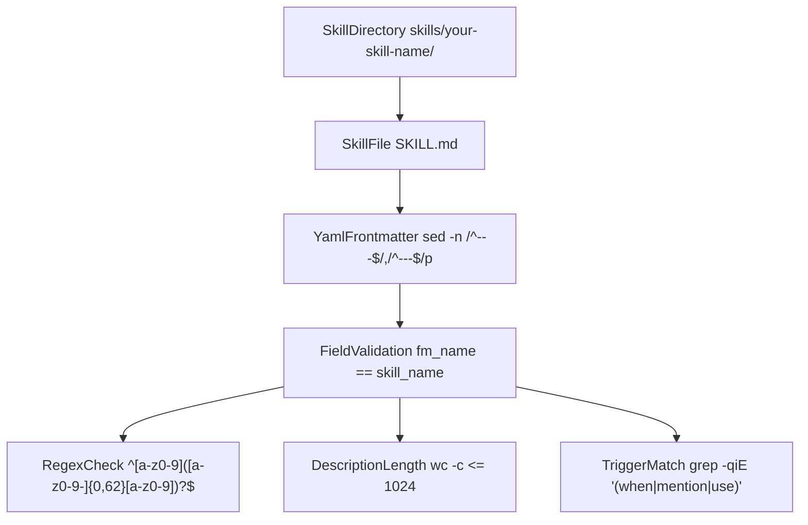
*Figure 1: Natural Language Space to Code Entity Space mapping the directory authoring structure to validation checks executed by `validate-skills.sh`.*

Sources: [AGENTS.md:18-28](), [CONTRIBUTING.md:11-29](), [validate-skills.sh:22-62]()

---

## Authoring Structure & Output Templates

Beyond frontmatter, skills must adhere to specific formatting and content patterns to ensure reliable agent execution [AGENTS.md:29-35]().

### Internal Document Layout

1.  **Role Definition:** The content must begin with an explicit persona declaration, such as `You are an expert in...` [CONTRIBUTING.md:26]().
2.  **Instructional Body:** Utilizes direct, actionable second-person writing, comparative tables, numbered sequences, and code blocks [AGENTS.md:31-33](). Filler text and hedging language are strictly prohibited [AGENTS.md:34]().
3.  **Structured Output Format:** Defines deterministic markdown or JSON output schemas that the agent must produce upon completing the skill workflow [CONTRIBUTING.md:27]().
4.  **Cross-References:** Concludes with a dedicated section mapping related capabilities to adjacent skill units [CONTRIBUTING.md:28]().
5.  **Line Count Limits:** Individual `SKILL.md` files must remain under 500 lines [AGENTS.md:8](), [CONTRIBUTING.md:7](), [validate-skills.sh:65-69](). Optional detailed reference documents can be split off into a `references/` subdirectory [AGENTS.md:9](), [CONTRIBUTING.md:8]().

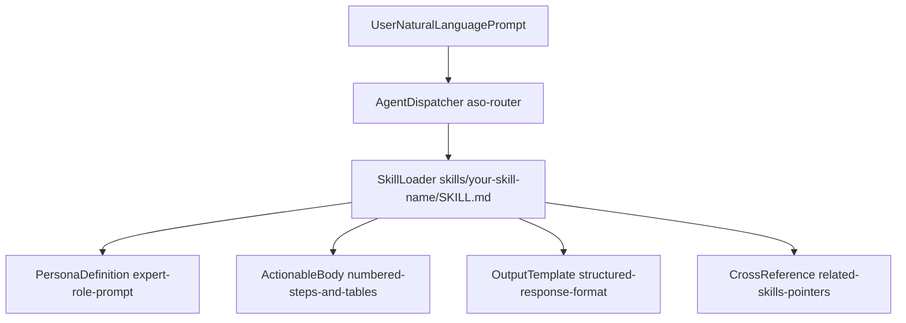
*Figure 2: Natural Language Space to Code Entity Space mapping execution loading from agent dispatch to structural components inside `SKILL.md`.*

Sources: [AGENTS.md:8-9](), [AGENTS.md:31-35](), [CONTRIBUTING.md:6-29]()

---

## Validation Mechanics (`validate-skills.sh`)

Automated verification is handled by the `validate-skills.sh` shell script at the repository root [CONTRIBUTING.md:47-49](). Contributors must execute this script locally and achieve zero errors before submitting pull requests [CONTRIBUTING.md:42]().

### Script Execution Flow and Checks

The script iterates through all subdirectories in `skills/` [validate-skills.sh:12](), executing the following verification steps:

1.  **Existence Check:** Verifies that a `SKILL.md` file exists within `skills/<skill_name>/` [validate-skills.sh:16-20]().
2.  **Frontmatter Extraction:** Uses `sed` to isolate content between the opening and closing `---` delimiters [validate-skills.sh:23]().
3.  **Name Validation:** Confirms the presence of the `name:` field [validate-skills.sh:26-29]() and asserts that its string value matches the parent directory name exactly [validate-skills.sh:30-33]().
4.  **Pattern & Format Validation:** Evaluates the name against strict alphanumeric and hyphen rules [validate-skills.sh:37-45]() and scans for forbidden consecutive hyphens (`--`) [validate-skills.sh:41-44]().
5.  **Description Analysis:** Checks for the presence of the `description:` field [validate-skills.sh:48-51](), ensures character length is under 1024 [validate-skills.sh:53-57](), and issues a warning if trigger words (`when`, `mention`, `use`) are absent [validate-skills.sh:58-61]().
6.  **Line Count Metrics:** Counts total lines using `wc -l` and triggers a warning if the file exceeds 500 lines [validate-skills.sh:65-69]().
7.  **Exit Status:** Aggregates error counts (`ERRORS`) and returns an exit code of `1` if any hard errors are detected, blocking faulty contributions [validate-skills.sh:75-79]().

Sources: [validate-skills.sh:1-79]()

---

## Contribution & Pull Request Workflow

Adding or updating skills follows a standardized Git branching and verification lifecycle [CONTRIBUTING.md:39-43]().

### Workflow Steps

1.  **Branch Creation:** Fork the repository and create a feature or fix branch following naming conventions such as `feature/skill-name` or `fix/skill-name-desc` [AGENTS.md:48](), [CONTRIBUTING.md:41]().
2.  **Authoring / Modification:** Create or edit `skills/<skill-name>/SKILL.md` maintaining character limits and formatting requirements [CONTRIBUTING.md:6-37](). Commit changes using conventional commit prefixes (`feat(skill-name): ...` or `fix(skill-name): ...`) [AGENTS.md:46]().
3.  **Local Validation:** Run the test suite via terminal [CONTRIBUTING.md:42], [CONTRIBUTING.md:47-49]():
    ```bash
    bash validate-skills.sh
    ```
4.  **Pull Request Submission:** Ensure validation outputs zero errors, then open a pull request against the main repository [CONTRIBUTING.md:42-43]().

Sources: [AGENTS.md:44-48](), [CONTRIBUTING.md:39-51]()

---

# Page: ASO Core Skills

# ASO Core Skills

<details>
<summary>Relevant source files</summary>

The following files were used as context for generating this wiki page:

- [reference/skills-overview.mdx](reference/skills-overview.mdx)
- [skills/aso-audit.mdx](skills/aso-audit.mdx)

</details>


The ASO Core Skills group represents the foundational organic-growth engine within the `aso-skills` repository. This collection of specialist AI agent skills automates App Store Optimization (ASO) workflows—ranging from full-listing diagnostics and deep keyword extraction to competitor gap analyses and platform-specific optimizations for Apple App Store and Google Play [reference/skills-overview.mdx:43-66](). 

As a parent page, this document provides a high-level architectural overview of the core organic-growth skills. For deep implementation details, rubrics, and output schemas, refer to the respective child pages below.

```mermaid
graph TD
    UserQuery[""Natural Language Query: /aso-audit or /keyword-research""] --> Router[""Router Dispatcher: /aso-router""]
    Router --> CoreGroup[""Core Skill Group: reference/skills-overview.mdx""]
    CoreGroup --> AuditSkill[""Auditing & Scoring: skills/aso-audit.mdx""]
    CoreGroup --> KeywordSkill[""Keyword & Metadata: reference/skills-overview.mdx""]

    Sources: [reference/skills-overview.mdx:43-66](), [skills/aso-audit.mdx:1-35]()
```

## 3.1 aso-audit: Scoring Framework

The `aso-audit` skill evaluates an application's store presence across ten weighted factors, producing a unified 0–100 score card, actionable quick wins, and structured remediation tiers [skills/aso-audit.mdx:7-44](). The framework weighs factors based on their direct impact on search visibility and conversion rates, allocating high priority to the title (20%), keyword field (15%), screenshots (15%), ratings & reviews (15%), and subtitle (15%) [skills/aso-audit.mdx:41-92]().

Before execution, the skill inspects the shared workspace environment for any existing `app-marketing-context.md` configuration to inherit app positioning details automatically [skills/aso-audit.mdx:15-17](). For detailed factor breakdowns, scoring rubrics, and the complete multi-tier remediation roadmap, see [aso-audit: Scoring Framework](#3.1).

Sources: [skills/aso-audit.mdx:1-124]()

## 3.2 keyword-research & metadata-optimization

The keyword research and metadata optimization sub-group handles quantitative keyword discovery and qualitative text generation. The `keyword-research` skill scores target terms using a volume × difficulty × relevance formula, grouping outcomes into primary, secondary, and long-tail tiers with distinct Opportunity Scores [reference/skills-overview.mdx:51-53](). 

The `metadata-optimization` skill consumes these keywords to generate three distinct text variants for titles, subtitles, keyword fields, and descriptions, complete with character counts and keyword coverage matrices [reference/skills-overview.mdx:54-56](). For information on volume indexing parameters and variant generation rules, see [keyword-research & metadata-optimization](#3.2).

```mermaid
graph TD
    InputContext[""app-marketing-context.md""] --> KW[""Keyword Discovery: keyword-research""]
    KW --> Score[""Opportunity Scoring Matrix""]
    Score --> Meta[""Metadata Generation: metadata-optimization""]
    Meta --> Variants[""3x Title/Subtitle/Field Variants""]

    Sources: [reference/skills-overview.mdx:51-56]()
```

Sources: [reference/skills-overview.mdx:51-56]()

## 3.3 Competitor Analysis & Positioning

The competitor analysis module identifies market blind spots by performing automated keyword gap analysis, creative asset teardowns, and visual positioning maps [reference/skills-overview.mdx:57-59](). By comparing an app's indexed keyword footprint against direct competitors, the skill surfaces exploitable ranking opportunities and differentiators in feature sets or pricing structures. 

For full methodologies on benchmarking competitors and constructing multi-dimensional position maps, see [Competitor Analysis & Positioning](#3.3).

Sources: [reference/skills-overview.mdx:57-59]()

## 3.4 Platform & Seasonal Variants

App Store Optimization differs fundamentally between ecosystems and temporal windows. The platform and seasonal group covers Google Play-specific ranking signals (`android-aso`), indexable long descriptions, Play Store Experiments, and localized keyword strategies [reference/skills-overview.mdx:60-65](). 

Additionally, `seasonal-aso` manages calendar-driven metadata swaps and cultural event optimization [reference/skills-overview.mdx:60-62](). For details on cross-platform algorithm variances and seasonal keyword calendars, see [Platform & Seasonal Variants](#3.4).

Sources: [reference/skills-overview.mdx:60-66]()

---

# Page: aso-audit: Scoring Framework

# aso-audit: Scoring Framework

<details>
<summary>Relevant source files</summary>

The following files were used as context for generating this wiki page:

- [reference/aso-audit.mdx](reference/aso-audit.mdx)
- [skills/aso-audit.mdx](skills/aso-audit.mdx)
- [skills/aso-audit/SKILL.md](skills/aso-audit/SKILL.md)

</details>


## Purpose and Scope

The `aso-audit` skill [skills/aso-audit/SKILL.md:2-3]() is a core diagnostic engine within the `aso-skills` repository [reference/aso-audit.mdx:7](). Its primary purpose is to evaluate an App Store or Google Play listing across ten weighted factors, compute an aggregate 0–100 health score [reference/aso-audit.mdx:7](), and output a structured, tiered remediation plan [reference/aso-audit.mdx:87-102](). This wiki page documents the scoring framework, data ingestion flow, factor weighting rubrics, and output generation mechanics.

---

## 1. Execution Flow & Data Ingestion

When an agent invokes `/aso-audit` [reference/aso-audit.mdx:12](), it initiates a structured assessment lifecycle defined in `skills/aso-audit/SKILL.md` [skills/aso-audit/SKILL.md:12-28](). The engine first checks for shared project state (`app-marketing-context.md`) [skills/aso-audit/SKILL.md:14]() to bypass redundant prompts regarding app positioning and target audience [reference/aso-audit.mdx:24]().

```mermaid
graph TD
    UserQuery["User Natural Language Query (/aso-audit)"] --> Router["aso-router Dispatcher"]
    Router --> SkillDefinition["skills/aso-audit/SKILL.md"]
    SkillDefinition --> ContextCheck{"app-marketing-context.md Exists?"}
    ContextCheck -- Yes --> LoadContext["Read App Positioning & Competitors"]
    ContextCheck -- No --> PromptUser["Prompt for App ID, Country, Platform"]
    LoadContext --> DataFetch["Data Collection Layer"]
    PromptUser --> DataFetch
    DataFetch --> McpServer["Appeeky MCP Server (aso_full_audit, get_app, get_app_keywords)"]
    McpServer --> AuditEngine["Scoring & Rubric Engine"]
```
*Sources: [skills/aso-audit/SKILL.md:12-28](), [reference/aso-audit.mdx:12-42](), [reference/aso-audit.mdx:116-125]()*

If the Appeeky MCP Server is available, the audit fetches live telemetry through dedicated tool bindings: `aso_full_audit`, `get_app`, `get_app_keywords`, and `get_keyword_metrics` [reference/aso-audit.mdx:120-125](). If disconnected, the skill falls back to user-provided metadata strings [skills/aso-audit/SKILL.md:28]().

*Sources: [skills/aso-audit/SKILL.md:12-28](), [reference/aso-audit.mdx:116-130]()*

---

## 2. The Ten Weighted Factors & Rubric

The scoring framework evaluates ten distinct listing attributes [reference/aso-audit.mdx:47-61](). Each factor is scored on an absolute `0–10` scale and multiplied by its corresponding platform weight to derive the aggregate score [skills/aso-audit/SKILL.md:32](). Note that weightings and evaluations differ slightly between iOS and Android (e.g., the Keyword Field and Subtitle are iOS-exclusive, whereas Description weight scales up on Android) [reference/aso-audit.mdx:39-41]().

| Factor | Weight (iOS / Android) | Core Evaluation Criteria | File Reference |
| :--- | :--- | :--- | :--- |
| **Title** | 20% / 20% | Primary keyword presence, 30-character limit utilization, brand/keyword balance, readability [reference/aso-audit.mdx:51](). | `[reference/aso-audit.mdx:51]()` |
| **Subtitle** | 15% / 0% (iOS only) | Secondary non-repeating keywords, value proposition clarity, character usage [reference/aso-audit.mdx:52](). | `[reference/aso-audit.mdx:52]()` |
| **Keyword Field** | 15% / 0% (iOS only) | Uniqueness, no spaces after commas, singular forms, 100-character budget usage [reference/aso-audit.mdx:53](). | `[reference/aso-audit.mdx:53]()` |
| **Description** | 5% / 15% | First-3-line hook, benefit framing, keyword density (Android), formatting, CTA [reference/aso-audit.mdx:54](). | `[reference/aso-audit.mdx:54]()` |
| **Ratings & Reviews** | 10% / 10% | Overall rating value, review recency, sentiment trajectory, developer response rate [reference/aso-audit.mdx:55](). | `[reference/aso-audit.mdx:55]()` |
| **Screenshots** | 10% / 10% | Slot utilization (10/10), top features in first 3 slots, readable text overlays, consistency [reference/aso-audit.mdx:56](). | `[reference/aso-audit.mdx:56]()` |
| **App Preview Video** | 5% / 5% | Presence, 3-second hook, 15–30s runtime, sound-off readability (captions) [reference/aso-audit.mdx:57](). | `[reference/aso-audit.mdx:57]()` |
| **Category** | 5% / 5% | Primary and secondary category selection optimality for discoverability [reference/aso-audit.mdx:58](). | `[reference/aso-audit.mdx:58]()` |
| **Localization** | 5% / 5% | Metadata and keyword adaptation for regional target markets [reference/aso-audit.mdx:59](). | `[reference/aso-audit.mdx:59]()` |
| **Ratings Momentum** | 10% / 10% | Directional trend of rating volume and sentiment over time [reference/aso-audit.mdx:60](). | `[reference/aso-audit.mdx:60]()` |

*Sources: [reference/aso-audit.mdx:47-61](), [skills/aso-audit/SKILL.md:34-137]()*

---

## 3. Score Card & Output Generation

Once individual factor scores are computed, `skills/aso-audit/SKILL.md` aggregates them into an overall weighted score from `0` to `100` [skills/aso-audit/SKILL.md:32](). The output is rendered as an ASCII text block containing a visual progress bar breakdown alongside granular diagnostic data [reference/aso-audit.mdx:68-85]().

```mermaid
graph TD
    FactorScores["Individual Factor Scores (0-10)"] --> WeightMultiplier["Apply Platform Weight Matrix (iOS / Android)"]
    WeightMultiplier --> Summation["Aggregate Weighted Sum Calculation"]
    Summation --> ScoreCardGen["Render ASCII Progress Bar Score Card"]
    ScoreCardGen --> TierClassification["Categorize Deficits into Fix Tiers"]
    TierClassification --> CompetitorTable["Generate Competitor Comparison Snapshot"]
```
*Sources: [skills/aso-audit/SKILL.md:32](), [reference/aso-audit.mdx:68-102]()*

The rendered score card follows this structural template:

```text
Overall ASO Score: [X]/100

Title:              [X]/10  ████████░░
Subtitle:           [X]/10  ██████░░░░
Keyword Field:      [X]/10  ████░░░░░░
Description:        [X]/10  ████████░░
Screenshots:        [X]/10  ██████████
Preview Video:      [X]/10  ██░░░░░░░░
Ratings & Reviews:  [X]/10  ████████░░
Icon:               [X]/10  ████████░░
Keyword Rankings:   [X]/10  ██████░░░░
Conversion Signals: [X]/10  ████░░░░░░
```
*Sources: [skills/aso-audit/SKILL.md:143-155](), [reference/aso-audit.mdx:73-85]()*

*Sources: [skills/aso-audit/SKILL.md:138-155](), [reference/aso-audit.mdx:68-85]()*

---

## 4. Prioritized Fix Tiers & Downstream Routing

To prevent user overwhelm, the audit framework translates numerical deficits into three chronological remediation tiers and connects directly to specialized execution skills [reference/aso-audit.mdx:87-102](), [reference/aso-audit.mdx:145-150]().

1. **Quick Wins — Implement Today:** Changes requiring zero code deployments or App Review submissions (e.g., updating iOS Keyword Fields, tweaking Promotional Text, or responding to negative reviews) [reference/aso-audit.mdx:87-89](), [reference/aso-audit.mdx:134]().
2. **High-Impact Changes — This Week:** Moderate-effort metadata rewrites (titles, subtitles) and major hook optimizations [reference/aso-audit.mdx:91-93]().
3. **Strategic Recommendations — This Month:** Long-term asset production, such as screenshot overhauls, video production, or rating-recovery campaigns [reference/aso-audit.mdx:95-97]().

```mermaid
graph TD
    AuditOutput["aso-audit Output Report"] --> QuickWins["Quick Wins (Metadata & Keyword Field)"]
    AuditOutput --> HighImpact["High-Impact Changes (Title & Subtitle Rewrite)"]
    AuditOutput --> StrategicRecs["Strategic Recommendations (Screenshots & Video)"]
    
    QuickWins --> MetadataOptimizationSkill["/metadata-optimization skill"]
    HighImpact --> KeywordResearchSkill["/keyword-research skill"]
    StrategicRecs --> ScreenshotOptimizationSkill["/screenshot-optimization skill"]
```
*Sources: [reference/aso-audit.mdx:87-98](), [reference/aso-audit.mdx:145-150](), [skills/aso-audit/SKILL.md:173-179]()*

*Sources: [reference/aso-audit.mdx:87-102](), [skills/aso-audit/SKILL.md:157-179]()*

---

# Page: keyword-research & metadata-optimization

# keyword-research & metadata-optimization

<details>
<summary>Relevant source files</summary>

The following files were used as context for generating this wiki page:

- [guides/appeeky-mcp.mdx](guides/appeeky-mcp.mdx)
- [guides/keyword-workflow.mdx](guides/keyword-workflow.mdx)
- [guides/launch-checklist.mdx](guides/launch-checklist.mdx)
- [reference/ab-test-store-listing.mdx](reference/ab-test-store-listing.mdx)
- [reference/keyword-research.mdx](reference/keyword-research.mdx)
- [reference/metadata-optimization.mdx](reference/metadata-optimization.mdx)
- [skills/keyword-research/SKILL.md](skills/keyword-research/SKILL.md)
- [skills/metadata-optimization/SKILL.md](skills/metadata-optimization/SKILL.md)

</details>


## Purpose and Scope

This page covers the technical implementation, scoring rubrics, and data flows for the core organic growth skills: `keyword-research` and `metadata-optimization`. These skills operate as a sequential pipeline to discover high-value App Store and Google Play keywords, score them using multi-signal evaluation models, group them into strategic tiers, and transform them into platform-compliant metadata variants (`title`, `subtitle`, `keyword-field`, and `description`).

Sources: `skills/keyword-research/SKILL.md:1-10`, `skills/metadata-optimization/SKILL.md:1-12`, `guides/keyword-workflow.mdx:7-21`

---

## Keyword Research Engine

The keyword research skill expands initial seed terms into candidate pools, evaluates them against volume, difficulty, relevance, and intent signals, and computes an Opportunity Score [reference/keyword-research.mdx:47-69].

### Research Phases

1. **Seed Expansion (`Phase 1`)**: Takes 3–5 seed keywords and expands them using Apple Search Suggestions, competitor keyword indexing, category analysis, and synonym generation [skills/keyword-research.mdx:22-44].
2. **Keyword Evaluation (`Phase 2`)**: Evaluates candidates across search volume (1–100), difficulty (1–100), relevance (1–100), intent, and current app rank [skills/keyword-research.mdx:45-56].
3. **Opportunity Scoring (`Phase 3`)**: Computes a normalized score balancing search volume, inverted difficulty, and relevance [reference/keyword-research.mdx:57-65].
4. **Keyword Grouping (`Phase 4`)**: Allocates keywords into strategic tiers: Primary (top 5–7), Secondary (ranks 8–20), Long-tail, and Aspirational [reference/keyword-research.mdx:67-69, skills/keyword-research.mdx:74-92].

### Scoring Mathematical Models

Depending on the specific execution context, the opportunity score is calculated via weighted linear combination or multiplicative normalization:

```text
Opportunity Score = (Volume × 0.4) + ((100 − Difficulty) × 0.3) + (Relevance × 0.3)
```
Alternatively, in normalized form:
```text
Opportunity Score = Volume × (1 − Difficulty) × Relevance  [normalized 0–100]
```

Sources: `skills/keyword-research/SKILL.md:20-69`, `reference/keyword-research.mdx:47-65`

### MCP Integration for Keyword Intelligence

The skill relies on specific Model Context Protocol (MCP) tool endpoints to retrieve live search data:

| MCP Tool | Function | Cited File Range |
|---|---|---|
| `get_keyword_suggestions` | Autocomplete-based keyword candidates for seed terms | `reference/keyword-research.mdx:122-122` |
| `get_keyword_metrics` | Search volume and difficulty scores | `reference/keyword-research.mdx:123-123` |
| `get_keyword_ranks` | Current App Store rankings across apps | `reference/keyword-research.mdx:124-124` |
| `get_app_keywords` | Keywords current app and competitors rank for | `reference/keyword-research.mdx:125-125` |

Sources: `reference/keyword-research.mdx:118-126`, `skills/keyword-research/SKILL.md:20-44`

---

## Metadata Optimization Engine

Once keywords are selected, the metadata optimization skill structures copy to maximize search indexing and conversion rates [skills/metadata-optimization.mdx:8-10].

### Platform Character Limits & Indexing Rules

| Platform | Field | Character Limit | Indexed for Search? | Role & Constraints |
|---|---|---|---|---|
| **iOS** | Title | 30 chars | ✅ Yes | Highest keyword weight; brand + primary keyword |
| **iOS** | Subtitle | 30 chars | ✅ Yes | Secondary keyword weight; benefit-driven |
| **iOS** | Keyword Field | 100 chars | ✅ Yes | Hidden; comma-separated, **no spaces** after commas |
| **iOS** | Description | 4,000 chars | ❌ No | Conversion focus; first 170 chars crucial |
| **Android** | Title | 30 chars | ✅ Yes | Highest keyword weight |
| **Android** | Short Description | 80 chars | ✅ Yes | Visible on listing card |
| **Android** | Full Description | 4,000 chars | ✅ Yes | Keyword density (2–3%) matters |

Sources: `skills/metadata-optimization.mdx:22-40`, `reference/metadata-optimization.mdx:51-76`

### Copywriting Rules & Field Constraints

- **No Repeated Keywords**: Apple and Google index unique terms independently; repeating words across title, subtitle, and keyword field wastes character budgets [skills/metadata-optimization.mdx:78-79].
- **Singular Forms**: Use singular forms in the iOS keyword field (e.g., `tracker` instead of `trackers`) because the platform automatically indexes plurals [skills/metadata-optimization.mdx:80].
- **No Space Padding**: In the iOS 100-character keyword field, commas must be immediately followed by the next term without whitespace (`term1,term2,term3`) [skills/metadata-optimization.mdx:78].

Sources: `skills/metadata-optimization.mdx:77-85`, `reference/metadata-optimization.mdx:152-159`

### MCP Tools for Metadata Validation

| MCP Tool | Purpose | Cited File Range |
|---|---|---|
| `aso_validate_metadata` | Checks proposed metadata for rule violations, character overruns, and keyword repetition | `reference/metadata-optimization.mdx:146-146` |
| `aso_suggest_metadata` | Generates keyword-optimized metadata variants based on target keywords | `reference/metadata-optimization.mdx:147-147` |
| `get_app` | Fetches current app metadata for before/after comparisons | `reference/metadata-optimization.mdx:148-148` |

Sources: `reference/metadata-optimization.mdx:142-149`

---

## End-to-End Data Flow & Code Entity Mapping

The transition from user intent to actionable keyword research and metadata generation involves bridging natural language commands with internal skill definitions and MCP tool execution modules.

### Diagram: Keyword Research and Scoring Pipeline

```mermaid
graph TD
    subgraph "NaturalLanguageSpace"
        A["UserPrompt: FindKeywordsForMeditationApp"] --> B["RouterDispatch: aso-router"]
    end
    subgraph "CodeEntitySpace"
        B --> C["SkillDefinition: skills/keyword-research/SKILL.md"]
        C --> D["MCPTool: get_keyword_suggestions"]
        C --> E["MCPTool: get_keyword_metrics"]
        C --> F["MCPTool: get_keyword_ranks"]
        D & E & F --> G["OpportunityScoring: Volume + Difficulty + Relevance"]
        G --> H["StrategicBuckets: Primary, Secondary, Long-tail"]
    end
```

Sources: `skills/keyword-research/SKILL.md:1-142`, `reference/keyword-research.mdx:47-126`

### Diagram: Metadata Optimization and Validation Architecture

```mermaid
graph TD
    subgraph "NaturalLanguageSpace"
        U["UserRequest: OptimizeIOSMetadata"] --> R["RouterDispatch: aso-router"]
    end
    subgraph "CodeEntitySpace"
        R --> S["SkillDefinition: skills/metadata-optimization/SKILL.md"]
        S --> T["MCPTool: get_app"]
        S --> V["MCPTool: aso_suggest_metadata"]
        S --> W["MCPTool: aso_validate_metadata"]
        V --> X["VariantGeneration: Title, Subtitle, KeywordField"]
        X --> W
        W --> Y["CoverageMatrix: keyword-coverage-output"]
    end
```

Sources: `skills/metadata-optimization/SKILL.md:1-171`, `reference/metadata-optimization.mdx:108-149`

---

# Page: Competitor Analysis & Positioning

# Competitor Analysis & Positioning

<details>
<summary>Relevant source files</summary>

The following files were used as context for generating this wiki page:

- [index.mdx](index.mdx)
- [reference/competitor-analysis.mdx](reference/competitor-analysis.mdx)
- [skills/category-positioning/SKILL.md](skills/category-positioning/SKILL.md)
- [skills/competitor-analysis.mdx](skills/competitor-analysis.mdx)
- [skills/competitor-analysis/SKILL.md](skills/competitor-analysis/SKILL.md)
- [skills/competitor-tracking/SKILL.md](skills/competitor-tracking/SKILL.md)

</details>


## Purpose and Scope

This page documents the technical architecture, execution flow, and analytical models used by the competitor intelligence and positioning skills within `aso-skills`. Specifically, this covers three core Markdown agent skills and reference documentation: `competitor-analysis` [skills/competitor-analysis/SKILL.md:1-163](), `competitor-tracking` [skills/competitor-tracking/SKILL.md:1-185](), and `category-positioning` [skills/category-positioning/SKILL.md:1-135](), along with the corresponding Mintlify reference documentation [reference/competitor-analysis.mdx:1-150](). 

These modules provide automated keyword gap detection, creative teardowns, market position mapping, category strategy, and ongoing surveillance across up to five rival applications using live data fetched via Model Context Protocol (MCP) integrations.

Sources: [skills/competitor-analysis/SKILL.md:1-163](), [skills/competitor-tracking/SKILL.md:1-185](), [skills/category-positioning/SKILL.md:1-135](), [reference/competitor-analysis.mdx:1-150]()

---

## 1. Skill Invocation & Dispatch Architecture

Users interact with the competitive intelligence layer either through direct skill invocation (`/competitor-analysis`, `/competitor-tracking`, `/category-positioning`) or by routing natural language intents via the global router. 

The following diagram maps natural language user queries to their underlying file-system execution targets and skill definitions:

```mermaid
graph TD
    NL1["User: 'Analyze my competitors'"] --> Router["aso-router Dispatcher"]
    NL2["User: 'Track weekly changes for Calm'"] --> Router
    NL3["User: 'Should I switch to Health category?'"] --> Router

    Router --> CA["skills/competitor-analysis/SKILL.md"]
    Router --> CT["skills/competitor-tracking/SKILL.md"]
    Router --> CP["skills/category-positioning/SKILL.md"]

    CA --> Context["app-marketing-context.md"]
    CT --> Context
    CP --> Context
```
*Diagram 1: Natural Language Space to Code Entity Space routing for competitive intelligence.*

Sources: [reference/competitor-analysis.mdx:9-25](), [skills/competitor-analysis/SKILL.md:1-19](), [skills/competitor-tracking/SKILL.md:1-27](), [skills/category-positioning/SKILL.md:1-19]()

---

## 2. MCP Tool Integration & Data Pipeline

When an agent executes `competitor-analysis` or `competitor-tracking`, it queries external endpoints through specialized tool bindings defined in the system's registry. 

The data flow connects agent prompts to specific backend API functions, fetching automated reports, side-by-side keyword matrices, and app intelligence metrics:

```mermaid
graph TD
    Agent["LLM Agent Execution Context"] --> Tool1["aso_competitor_report"]
    Agent --> Tool2["compare_keywords"]
    Agent --> Tool3["get_app_intelligence"]
    Agent --> Tool4["get_app_keywords"]

    Tool1 --> API["Appeeky MCP Server / REST API"]
    Tool2 --> API
    Tool3 --> API
    Tool4 --> API

    API --> Output["Structured Comparative Data & Metrics"]
```
*Diagram 2: Data retrieval pipeline mapping agent tools to backend API responses.*

The underlying tools fetch specific analytical vectors:
* `aso_competitor_report`: Generates an automated side-by-side comparison of metadata, rankings, and ratings [reference/competitor-analysis.mdx:127]().
* `compare_keywords`: Cross-references ranking tables between the user's app and specified competitor IDs [reference/competitor-analysis.mdx:128]().
* `get_app_intelligence`: Pulls estimated downloads, monthly revenue, and growth signals [reference/competitor-analysis.mdx:129]().

Sources: [reference/competitor-analysis.mdx:123-130](), [skills/competitor-tracking/SKILL.md:28-32]()

---

## 3. Analysis Framework & Dimensions

The `competitor-analysis` skill [skills/competitor-analysis/SKILL.md:1-163]() structures its evaluation across six distinct analytical dimensions. Agents execute these checks sequentially or selectively based on user focus parameters (`focus: keywords | creative | positioning | all`) [reference/competitor-analysis.mdx:41-43]().

### Metadata and Keyword Gap Matrix
The engine compares character utilization, keyword density, and title/subtitle weighting. Keyword gaps are categorized into three distinct sets:
1. **Gaps**: Keywords where competitors rank in the top 20, but the user is unranked [reference/competitor-analysis.mdx:54]().
2. **Unique Advantages**: Defensive moats where the user ranks and competitors do not [reference/competitor-analysis.mdx:55]().
3. **Outranked Keywords**: Shared target terms where competitors occupy superior ranking positions [reference/competitor-analysis.mdx:56]().

| Dimension | Implementation Details | Source Files |
|---|---|---|
| **Creative Teardown** | Evaluates screenshot counts (target: 10), first-slot hooks, text overlay strategies, and video runtimes [reference/competitor-analysis.mdx:59-61]() | [reference/competitor-analysis.mdx:59-61](), [skills/competitor-analysis/SKILL.md:66-84]() |
| **Ratings & Reviews** | Diffs star averages, 30-day trends, developer response rates, and top user complaints/praise [reference/competitor-analysis.mdx:63-65]() | [reference/competitor-analysis.mdx:63-65](), [skills/competitor-analysis/SKILL.md:85-100]() |
| **Growth Signals** | Compares estimated downloads/revenue, update frequency, In-App Events, Custom Product Pages, and Apple Search Ads (ASA) presence [reference/competitor-analysis.mdx:67-69]() | [reference/competitor-analysis.mdx:67-69](), [skills/competitor-analysis/SKILL.md:101-112]() |

Sources: [reference/competitor-analysis.mdx:45-70](), [skills/competitor-analysis/SKILL.md:31-122]()

---

## 4. Category Positioning & Strategic Choice

Category positioning (`skills/category-positioning/SKILL.md`) evaluates primary and secondary category assignments on iOS and Google Play [skills/category-positioning/SKILL.md:8-39](). 

### Category Selection Scoring Factors
When an agent evaluates alternative categories, it scores candidates against six core metrics:
* **Truth Fit**: Evaluates whether the app violates store guidelines regarding misrepresentation [skills/category-positioning/SKILL.md:57]().
* **Competitive Density**: Counts the number of active top-100 apps directly competing [skills/category-positioning/SKILL.md:58]().
* **Top App Strength**: Determines if category leaders are vulnerable or fortified [skills/category-positioning/SKILL.md:59]().
* **Average #1 Downloads**: Pulls daily download requirements via `get_downloads_to_top` [skills/category-positioning/SKILL.md:60]().
* **Audience Match**: Calculates conversion viability for category browsers [skills/category-positioning/SKILL.md:61]().
* **Featuring Activity**: Assesses Apple/Google editorial curation frequency [skills/category-positioning/SKILL.md:62]().

Sources: [skills/category-positioning/SKILL.md:1-135]()

---

## 5. Ongoing Surveillance & Automated Tracking

The `competitor-tracking` skill [skills/competitor-tracking/SKILL.md:1-185]() provides recurring delta-based intelligence rather than one-time snapshots [skills/competitor-tracking/SKILL.md:12-20]().

### Weekly Delta Workflow
Agents parse weekly diffs across metadata strings, keyword movements, rating velocity, and chart positions using the following recurring schema [skills/competitor-tracking/SKILL.md:34-90]():

```bash
# Example weekly check execution flow via Appeeky REST endpoints
curl -s "https://api.appeeky.com/v1/apps/$APP_ID" \
  -H "X-API-Key: $KEY" | jq '.data | {title, subtitle, rating, reviewCount}'
```
*[skills/competitor-tracking/SKILL.md:151-153]()*: Pulls current metadata state to diff against historical records stored in the project context.

Sources: [skills/competitor-tracking/SKILL.md:1-185]()

---

# Page: Platform & Seasonal Variants

# Platform & Seasonal Variants

<details>
<summary>Relevant source files</summary>

The following files were used as context for generating this wiki page:

- [reference/android-aso.mdx](reference/android-aso.mdx)
- [reference/localization.mdx](reference/localization.mdx)
- [reference/seasonal-aso.mdx](reference/seasonal-aso.mdx)
- [skills/android-aso/SKILL.md](skills/android-aso/SKILL.md)
- [skills/localization/SKILL.md](skills/localization/SKILL.md)
- [skills/seasonal-android.mdx](skills/seasonal-android.mdx)
- [skills/seasonal-aso/SKILL.md](skills/seasonal-aso/SKILL.md)

</details>


This leaf page details the mechanics, operational rules, and data frameworks for platform-specific optimization (**Android ASO / Google Play**), time-sensitive keyword capture (**Seasonal ASO**), and cross-border expansion (**App Store Localization**). It bridges natural language user intent regarding platform differences, calendar holidays, and international markets to the respective agent skill definitions and tool integrations.

---

## 1. Google Play Signals & Architecture (`android-aso`)

Google Play's search and discovery algorithm differs fundamentally from Apple's App Store. The primary architectural distinction is that Google Play indexes the **entire 4,000-character full description**, features no hidden keyword field, and utilizes continuous, non-resetting ratings [skills/android-aso/SKILL.md:10-19]().

### Metadata Rules & Field Weighting

| Field | Character Limit | Indexed | Weight / Behavior |
| :--- | :--- | :--- | :--- |
| **Title** | 30 chars [skills/android-aso/SKILL.md:30]() | Yes [skills/android-aso/SKILL.md:30]() | Highest algorithmic weight [skills/android-aso/SKILL.md:30](); lead with brand or primary keyword. |
| **Short Description** | 80 chars [skills/android-aso/SKILL.md:31]() | Yes [skills/android-aso/SKILL.md:31]() | High weight [skills/android-aso/SKILL.md:31](); primary hook visible on search results [skills/android-aso/SKILL.md:53](). |
| **Full Description** | 4,000 chars [skills/android-aso/SKILL.md:32]() | Yes [skills/android-aso/SKILL.md:32]() | Medium weight [skills/android-aso/SKILL.md:32](); opening 167 characters appear above the fold [reference/android-aso.mdx:50](). |
| **Feature Graphic** | 1024×500px [skills/android-aso/SKILL.md:22]() | N/A | Required graphic asset displayed at top of listing when no video is present [skills/android-aso/SKILL.md:101-103](). |

### Continuous Ratings & Recovery Strategy
Unlike iOS, Google Play ratings are **never reset per version update** [skills/android-aso/SKILL.md:19](). Every historical rating contributes to the public average [skills/android-aso/SKILL.md:112](). Developers must execute rating recovery via active review management:
1. Respond directly to 1–3 star reviews to trigger algorithmic boosts [skills/android-aso/SKILL.md:115]().
2. Utilize the Play In-App Review API (`ReviewManager.requestReviewFlow()`) to prompt users at moments of high satisfaction [skills/android-aso/SKILL.md:120-123]().
3. Track sentiment via `get_app_reviews` [reference/android-aso.mdx:37]().

```mermaid
graph TD
    A["User Intent: Android / Google Play"] --> B["skills/android-aso/SKILL.md"]
    B --> C["Metadata Evaluation: Title (30), Short (80), Full (4000)"]
    C --> D["Appeeky Tool Suite"]
    D --> E["get_keyword_suggestions"]
    D --> F["get_keyword_metrics"]
    D --> G["get_app_reviews"]
    G --> H["Continuous Rating Recovery Loop"]
```
*Sources: [skills/android-aso/SKILL.md:1-25](), [reference/android-aso.mdx:9-38]()*.

---

## 2. Seasonal Aso & Keyword Calendars (`seasonal-aso`)

Seasonal optimization captures short-lived search traffic surges tied to calendar holidays, cultural events, or viral trends [skills/seasonal-aso/SKILL.md:10](). 

### US Seasonal Calendar & Lead Times

| Event | Peak Window | Recommended Lead Time | Key Focus |
| :--- | :--- | :--- | :--- |
| **New Year** | Dec 26 – Jan 7 [skills/seasonal-aso/SKILL.md:20]() | Submit by Dec 21 [skills/seasonal-android.mdx:46]() | Resolutions, habits, fresh starts [skills/seasonal-aso/SKILL.md:20]() |
| **Valentine's Day** | Feb 1–14 [skills/seasonal-aso/SKILL.md:21]() | Submit by Jan 27 [skills/seasonal-android.mdx:47]() | Couples, gifts, romance [skills/seasonal-aso/SKILL.md:21]() |
| **Back to School** | Jul 15 – Sep 10 [skills/seasonal-aso/SKILL.md:25]() | Submit by Jul 10 [skills/seasonal-android.mdx:48]() | Study, planners, student tools [skills/seasonal-aso/SKILL.md:25]() |
| **Halloween** | Oct 1–31 [skills/seasonal-aso/SKILL.md:26]() | Submit by Sep 25 [skills/seasonal-android.mdx:49]() | Spooky themes, costumes [skills/seasonal-aso/SKILL.md:26]() |
| **Christmas** | Dec 1–26 [skills/seasonal-aso/SKILL.md:28]() | Submit by Nov 24 [skills/seasonal-android.mdx:50]() | Holiday planning, gifts, family [skills/seasonal-aso/SKILL.md:28]() |

### Metadata Swap Lifecycle
Because metadata changes require 1–3 days to index and Apple App Review requires buffer time, execution follows strict sequencing managed by `skills/seasonal-aso/SKILL.md` [skills/seasonal-aso/SKILL.md:14]():

```mermaid
graph TD
    A["T-14 Days: research keywords & brief creatives"] --> B["T-10 Days: draft seasonal metadata & promotional text"]
    B --> C["T-7 Days: submit screenshot updates (no review required)"]
    C --> D["T-5 Days: submit keyword & subtitle changes (review buffer)"]
    D --> E["T-0: Event Peak (monitor rankings daily)"]
    E --> F["T+3 Days: revert metadata to evergreen"]
    F --> G["T+5 Days: revert promotional text"]
```
*Sources: [skills/seasonal-aso/SKILL.md:74-85](), [skills/seasonal-android.mdx:43-69]*.

### Promotional Text as an Instant Lever
The iOS promotional text field (170 characters) updates **instantly without requiring App Review** [reference/seasonal-aso.mdx:39](). For non-calendar trending moments (viral news or short-lived cultural surges), agents restrict changes exclusively to promotional text via `get_trending_keywords` and revert within 3 to 7 days [reference/seasonal-aso.mdx:58-60]().

*Sources: [skills/seasonal-aso/SKILL.md:1-141](), [reference/seasonal-aso.mdx:1-64](), [skills/seasonal-android.mdx:1-129]*.

---

## 3. App Store Localization & International Markets (`localization`)

Expanding across international borders requires independent keyword discovery per country rather than literal translations of English seed terms [reference/localization.mdx:46](). 

### Market Prioritization Framework
Markets are categorized into actionable ROI tiers within `skills/localization/SKILL.md` [skills/localization/SKILL.md:20-40]():

- **Tier 1 Markets (Highest ROI):** United States (`en-US`), United Kingdom (`en-GB`), Germany (`de-DE`), Japan (`ja`), France (`fr-FR`), South Korea (`ko`), China (`zh-Hans`), Brazil (`pt-BR`), Canada (`en-CA`), Australia (`en-AU`) [skills/localization/SKILL.md:24-35]().
- **Tier 2 Markets (High Potential):** Spain (`es-ES`), Italy (`it`), Netherlands (`nl`), Sweden (`sv`), Mexico (`es-MX`), India (`en-IN`), Indonesia (`id`), Turkey (`tr`), Saudi Arabia (`ar-SA`) [skills/localization/SKILL.md:39]().

### The Keyword Translation Pitfall
Literal translation fails because search habits vary drastically across cultures. For example, translating "budget tracker" directly yields near-zero volume in Germany or Japan:

```mermaid
graph LR
    A["English Seed Term: 'Budget Tracker'"] --> B["skills/localization/SKILL.md"]
    B --> C["German Market: 'Haushaltsbuch' (Household Book)"]
    B --> D["Japanese Market: '家計簿' (Household Ledger)"]
    B --> E["Spanish Market: 'Control de gastos' (Expense Control)"]
```
*Sources: [reference/localization.mdx:46-47](), [skills/localization/SKILL.md:68-83]*().

### Localization Asset Checklist
When executing `/localization`, the agent builds per-locale packages covering:
1. **Title & Subtitle:** 30 characters each, populated with localized search terms [skills/localization/SKILL.md:59-60]().
2. **Keyword Field (iOS):** Completely distinct 100-character strings researched locally [skills/localization/SKILL.md:61]().
3. **Descriptions:** Culturally adapted narratives maintaining persuasive architecture [skills/localization/SKILL.md:112-115]().
4. **Screenshots & Video:** Translated text overlays, adjusted currency/date formats, and right-to-left (RTL) layout adaptations for Arabic/Hebrew locales [reference/localization.mdx:54]().

*Sources: [reference/localization.mdx:1-59](), [skills/localization/SKILL.md:1-166]*.

---

# Page: Creative, Growth & Revenue Skills

# Creative, Growth & Revenue Skills

<details>
<summary>Relevant source files</summary>

The following files were used as context for generating this wiki page:

- [introduction.mdx](introduction.mdx)
- [reference/skills-overview.mdx](reference/skills-overview.mdx)

</details>


This section provides a high-level overview of the non-core skill families within the `aso-skills` library [introduction.mdx:7-13](). While ASO Core handles organic metadata and keyword foundations, these extended skill groups cover visual conversion assets, user acquisition channels, revenue and paywall mechanisms, analytics and recovery workflows, and market intelligence briefings [introduction.mdx:40-61]().

For deep technical details, scoring rubrics, and output templates, refer to the respective child pages:
- [Creative Assets](#4.1) — screenshot-optimization, app-preview-video, app-icon-optimization, custom-product-pages, app-store-featured, app-clips.
- [Growth & User Acquisition](#4.2) — app-launch, apple-search-ads, ua-campaign, in-app-events, creator-ugc-marketing, referral-program, web-to-app-funnel, press-and-pr.
- [Revenue & Retention](#4.3) — monetization-strategy, paywall-optimization, subscription-lifecycle, retention-optimization, onboarding-optimization, rating-prompt-strategy, review-management.
- [Analytics, Testing & Recovery](#4.4) — asc-metrics, app-analytics, ab-test-store-listing, attribution-setup, crash-analytics, app-rejection-recovery.
- [Market Intelligence](#4.5) — market-movers, market-pulse and competitor-tracking briefing skills and their data sources.

Sources: [introduction.mdx:7-61](), [reference/skills-overview.mdx:43-134]()

---

## Skill Dispatch Architecture: Natural Language to Code Entities

The following diagram bridges "Natural Language Space" to "Code Entity Space" by mapping user intents to specific skill file paths and command structures within the repository.

```mermaid
graph TD
    subgraph NaturalLanguageSpace ["Natural Language Space"]
        NL1["Design screenshots for conversion"]
        NL2["Run an Apple Search Ads campaign"]
        NL3["Audit my subscription paywall"]
        NL4["Track market chart movers"]
    end

    subgraph CodeEntitySpace ["Code Entity Space"]
        RTR["/aso-router<br/>skills/aso-router/SKILL.md"]
        SK1["/screenshot-optimization<br/>skills/screenshot-optimization/SKILL.md"]
        SK2["/apple-search-ads<br/>skills/apple-search-ads/SKILL.md"]
        SK3["/paywall-optimization<br/>skills/paywall-optimization/SKILL.md"]
        SK4["/market-movers<br/>skills/market-movers/SKILL.md"]
    end

    NL1 --> RTR
    NL2 --> RTR
    NL3 --> RTR
    NL4 --> RTR

    RTR -->|Dispatch| SK1
    RTR -->|Dispatch| SK2
    RTR -->|Dispatch| SK3
    RTR -->|Dispatch| SK4
```
Sources: [introduction.mdx:24-25](), [reference/skills-overview.mdx:11-37]()

---

## 4.1 Creative Assets

The creative assets group focuses on optimizing visual conversion rates across app store listings. Skills in this category provide design briefs, text overlay copy strategies, and testing frameworks for store assets [reference/skills-overview.mdx:71-89]().

Key capabilities covered in the child page include:
- **`screenshot-optimization`**: 10-slot screenshot frameworks with visual hierarchy, caption copy, and competitive audits [reference/skills-overview.mdx:71-73]().
- **`app-preview-video`**: Script templates, beat-by-beat structures, and Apple/Google Play technical specifications [reference/skills-overview.mdx:74-76]().
- **`app-icon-optimization`**: Icon design principles, category differentiation, and A/B testing plans [reference/skills-overview.mdx:77-79]().
- **`custom-product-pages`**: Apple CPP audience segmentation strategies tied to paid advertising funnels [reference/skills-overview.mdx:80-82]().

For details, see [Creative Assets](#4.1).

Sources: [reference/skills-overview.mdx:71-89]()

---

## 4.2 Growth & User Acquisition

User acquisition and launch orchestration skills manage the journey from pre-launch anticipation to scaled paid and organic growth channels [introduction.mdx:51]().

Core workflows include:
- **`app-launch`**: Comprehensive 8-week pre-launch to post-launch timeline with daily operational checklists [reference/skills-overview.mdx:94-96]().
- **`apple-search-ads` & `ua-campaign`**: Paid acquisition frameworks spanning keyword match types, campaign structures, and budget allocation across networks [reference/skills-overview.mdx:97-102]().
- **`creator-ugc-marketing` & `press-and-pr`**: Earned and creator-driven acquisition playbooks, including pitch templates and TikTok/Instagram UGC briefs [reference/skills-overview.mdx:103-111]().

For details, see [Growth & User Acquisition](#4.2).

Sources: [reference/skills-overview.mdx:94-111]()

---

## Revenue Pipeline Integration

The following diagram illustrates how app marketing context flows into monetization and retention skills to generate optimized revenue models and user lifecycles.

```mermaid
graph TD
    subgraph NaturalLanguageSpace ["Natural Language Space"]
        Q["Configure monetization and reduce churn"]
    end

    subgraph CodeEntitySpace ["Code Entity Space"]
        CTX["app-marketing-context<br/>skills/app-marketing-context/app-marketing-context.md"]
        MON["/monetization-strategy<br/>skills/monetization-strategy/SKILL.md"]
        PAY["/paywall-optimization<br/>skills/paywall-optimization/SKILL.md"]
        SUB["/subscription-lifecycle<br/>skills/subscription-lifecycle/SKILL.md"]
    end

    Q --> CTX
    CTX -->|Reads State| MON
    MON -->|Pricing Tiers| PAY
    PAY -->|Funnel Audit| SUB
```
Sources: [introduction.mdx:40-41](), [reference/skills-overview.mdx:116-129]()

---

## 4.3 Revenue & Retention

Maximizing LTV requires aligning pricing tiers, paywall conversion funnels, onboarding flows, and churn prevention mechanisms [introduction.mdx:53-54](). 

Key focus areas:
- **`monetization-strategy`**: Category benchmarks, trial structures, and pricing tier optimization [reference/skills-overview.mdx:117-119]().
- **`paywall-optimization`**: 7-element paywall audits and funnel diagnostics for tools like Superwall and RevenueCat [reference/skills-overview.mdx:123-125]().
- **`subscription-lifecycle` & `retention-optimization`**: Dunning campaigns, win-back flows, activation milestones, and habit loops [reference/skills-overview.mdx:120-122, 126-128]().

For details, see [Revenue & Retention](#4.3).

Sources: [reference/skills-overview.mdx:116-129]()

---

## 4.4 Analytics, Testing & Recovery

Measurement and recovery skills ensure continuous monitoring of store performance, attribution accuracy, crash triage, and rejection mitigation [introduction.mdx:57]().

Highlights include:
- **`asc-metrics`**: Integration with App Store Connect data via Appeeky Connect [introduction.mdx:57]().
- **`ab-test-store-listing`**: Hypothesis-to-interpretation workflows for store experiments.
- **`app-rejection-recovery`**: Guideline violation diagnosis and appeal templates.

For details, see [Analytics, Testing & Recovery](#4.4).

Sources: [introduction.mdx:57](), [reference/skills-overview.mdx:43-134]()

---

## 4.5 Market Intelligence

Market intelligence skills provide continuous surveillance of store trends, category movements, and competitor activity [introduction.mdx:59-60]().

Included skills:
- **`market-movers`**: Surfacing chart gainers, losers, and new entries [reference/skills-overview.mdx:134-135]().
- **`market-pulse`**: Comprehensive weekly briefing aggregation.
- **`competitor-tracking`**: Ongoing monitoring of target app metadata and ranking shifts.

For details, see [Market Intelligence](#4.5).

Sources: [introduction.mdx:59-60](), [reference/skills-overview.mdx:134-135]()

---

# Page: Creative Assets

# Creative Assets

<details>
<summary>Relevant source files</summary>

The following files were used as context for generating this wiki page:

- [reference/app-icon-optimization.mdx](reference/app-icon-optimization.mdx)
- [reference/app-preview-video.mdx](reference/app-preview-video.mdx)
- [reference/app-store-featured.mdx](reference/app-store-featured.mdx)
- [reference/screenshot-optimization.mdx](reference/screenshot-optimization.mdx)
- [skills/app-clips/SKILL.md](skills/app-clips/SKILL.md)
- [skills/app-icon-optimization/SKILL.md](skills/app-icon-optimization/SKILL.md)
- [skills/app-preview-video/SKILL.md](skills/app-preview-video/SKILL.md)
- [skills/app-store-featured/SKILL.md](skills/app-store-featured/SKILL.md)
- [skills/custom-product-pages/SKILL.md](skills/custom-product-pages/SKILL.md)
- [skills/screenshot-optimization.mdx](skills/screenshot-optimization.mdx)
- [skills/screenshot-optimization/SKILL.md](skills/screenshot-optimization/SKILL.md)

</details>


## Purpose and Scope

The Creative Assets skill group provides a programmatic framework within `aso-skills` to plan, audit, script, and optimize visual and interactive elements across the App Store and Google Play Store. These components—encompassing static imagery, dynamic video previews, iconography, segmented landing variants, lightweight micro-experiences, and editorial pitches—dictate top-of-funnel conversion rates and discoverability. 

The scope covers six leaf skills:
- `screenshot-optimization`: 10-slot layout frameworks, text overlay rules, and competitor audits [skills/screenshot-optimization/SKILL.md:1-167]().
- `app-preview-video`: Beat-by-beat scripting, platform specifications, and rejection avoidance [skills/app-preview-video/SKILL.md:1-142]().
- `app-icon-optimization`: Icon clarity, color contrast, and A/B test setups via Product Page Optimization [skills/app-icon-optimization/SKILL.md:1-170]().
- `custom-product-pages`: URL-driven variant generation for targeted campaigns and Apple Search Ads [skills/custom-product-pages/SKILL.md:1-151]().
- `app-store-featured`: Editorial readiness scoring, self-nomination workflows, and In-App Event calendars [skills/app-store-featured/SKILL.md:1-213]().
- `app-clips`: Sub-15MB micro-app design, discovery cards, and seamless full-app handoffs [skills/app-clips/SKILL.md:1-163]().

---

## Natural Language Space to Entity Mapping

The following diagram bridges natural language intents expressed by users to the specific skill definitions and MCP data retrieval functions within the codebase.

```mermaid
graph TD
  NL1["User asks about screenshots or competitor visuals"] --> SK1["skills/screenshot-optimization/SKILL.md"]
  NL2["User requests video scripts or specs"] --> SK2["skills/app-preview-video/SKILL.md"]
  NL3["User wants icon A/B testing or audits"] --> SK3["skills/app-icon-optimization/SKILL.md"]
  NL4["User configures URLs for ASA campaigns"] --> SK4["skills/custom-product-pages/SKILL.md"]
  NL5["User pitches Apple editorial team"] --> SK5["skills/app-store-featured/SKILL.md"]
  NL6["User implements instant sub-15MB apps"] --> SK6["skills/app-clips/SKILL.md"]

  SK1 --> Tool1["get_app / get_competitor_screenshots / get_category_screenshots"]
  SK2 --> Tool2["get_app"]
  SK3 --> Tool3["get_app / get_category_screenshots"]
  SK4 --> Tool4["app-marketing-context.md"]
  SK5 --> Tool5["get_featured_apps / get_app"]
  SK6 --> Tool6["app-marketing-context.md"]
```
Sources: [skills/screenshot-optimization/SKILL.md:1-167](), [skills/app-preview-video/SKILL.md:1-142](), [skills/app-icon-optimization/SKILL.md:1-170](), [skills/custom-product-pages/SKILL.md:1-151](), [skills/app-store-featured/SKILL.md:1-213](), [skills/app-clips/SKILL.md:1-163](), [reference/app-icon-optimization.mdx:30-36](), [reference/app-store-featured.mdx:30-36](), [reference/screenshot-optimization.mdx:30-37]()

---

## Core Visual Assets: Screenshots, Videos, and Icons

Static screenshots, preview videos, and icons act as the primary conversion drivers on product pages, responsible for up to 80% of download decisions within the first 3 to 6 seconds of user evaluation [reference/screenshot-optimization.mdx:49]().

### Screenshot Optimization Architecture
The `screenshot-optimization` skill enforces a strict 10-slot framework where every image serves a designated conversion role [skills/screenshot-optimization/SKILL.md:31-67]():

| Slot | Role | Focus Strategy |
|---|---|---|
| **1** | The Hook | Answer "What does this app do and why should I care?" via benefit headline + core UI [skills/screenshot-optimization/SKILL.md:31-40]() |
| **2–3** | Core Value | Showcase the two most compelling features visible without scrolling [skills/screenshot-optimization/SKILL.md:46-48]() |
| **4–7** | Feature Showcase | One feature per slot using the formula `[Benefit Headline] + [Feature UI] + [Supporting Detail]` [skills/screenshot-optimization/SKILL.md:50-54]() |
| **8–9** | Trust & Differentiation | Social proof, awards, press mentions, and unique advantages [skills/screenshot-optimization/SKILL.md:56-60]() |
| **10** | Call to Action | Recap of primary benefits or trial triggers ("Start your free trial") [skills/screenshot-optimization/SKILL.md:62-66]() |

Additionally, because Apple's semantic search indexes text visible within images, text overlays function doubly as organic keyword targets and human conversion hooks [reference/screenshot-optimization.mdx:11-13]().

### App Preview Video Execution
The `app-preview-video` skill governs 15–30 second MP4/MOV assets [skills/app-preview-video/SKILL.md:26-31]() structured around a rigorous beat-by-beat timeline:

```mermaid
sequenceDiagram
  participant User as "User / Agent"
  participant Skill as "skills/app-preview-video/SKILL.md"
  participant Platform as "App Store Connect / Play Console"

  User->>Skill: Invokes /app-preview-video with App ID
  Skill->>Skill: Reads app-marketing-context.md for core value
  Skill->>Skill: Builds 3-Variant Strategy (Outcome, Demo, Social Proof)
  Skill->>Platform: Generates timestamped script & poster frame spec
  Platform->>User: Renders video assets (In-app footage only for iOS)
```
Sources: [skills/app-preview-video/SKILL.md:1-142]()

### Iconography and Contrast
The `app-icon-optimization` skill evaluates icons against category norms and physical device constraints (60x60pt search rendering) [skills/app-icon-optimization/SKILL.md:18-25](). It requires high contrast across both light and dark system modes to prevent icons from washing out against white or black UI backgrounds [skills/app-icon-optimization/SKILL.md:27-34]().

Sources: [skills/screenshot-optimization/SKILL.md:1-167](), [skills/app-preview-video/SKILL.md:1-142](), [skills/app-icon-optimization/SKILL.md:1-170](), [reference/screenshot-optimization.mdx:1-62]()

---

## Advanced Discovery & Segmentation: CPPs and App Clips

Beyond the default product page, growth teams use Custom Product Pages (CPPs) and App Clips to tailor acquisition funnels.

### Custom Product Pages (CPP) Implementation
CPPs allow developers to generate up to 35 alternate URLs, each featuring distinct screenshots, preview videos, and promotional text geared toward specific audience segments or ad channels [skills/custom-product-pages/SKILL.md:10-18]().

- **What can change:** Promotional text (170 chars), up to 10 screenshots per device size, up to 3 preview videos [skills/custom-product-pages/SKILL.md:61-65]().
- **What cannot change:** App name, subtitle, keywords field, description, icon, age rating, price, or IAPs [skills/custom-product-pages/SKILL.md:67]().
- **ASA Integration:** CPP URLs are assigned directly to Apple Search Ads (ASA) ad groups via Creative Sets to match keyword themes with hyper-targeted visuals [skills/custom-product-pages/SKILL.md:108-119]().

### App Clips Lightweight Architecture
The `app-clips` skill handles sub-15MB micro-apps designed for instant launch without full installation [skills/app-clips/SKILL.md:10-29](). 

- **Discovery:** App Clips appear in App Store search results as independent cards below the main app, featuring an "Open" action button [skills/app-clips/SKILL.md:50-52]().
- **Handoff:** Post-value delivery uses `SKOverlay` to transition users smoothly to the full app binary [skills/app-clips/SKILL.md:79-88]():
  ```swift
  let config = SKOverlay.AppClipConfiguration(position: .bottom)
  let overlay = SKOverlay(configuration: config)
  overlay.present(in: windowScene)
  ```
- **Experience Routing:** Configured via URL patterns (`https://yourdomain.com/clip/[experience]`) inside App Store Connect [skills/app-clips/SKILL.md:70-75]().

Sources: [skills/custom-product-pages/SKILL.md:1-151](), [skills/app-clips/SKILL.md:1-163]()

---

## Editorial Featuring and Readiness

The `app-store-featured` skill audits an app against Apple's strict editorial criteria to maximize the likelihood of securing placements like "App of the Day" or "Today Tab Stories" [skills/app-store-featured/SKILL.md:20-48]().

### Featuring Readiness Scoring Pipeline
The readiness assessment evaluates design execution, modern technology adoption, and stability metrics:

```mermaid
graph LR
  Context["app-marketing-context.md"] --> Audit["skills/app-store-featured/SKILL.md"]
  Metadata["get_app / get_featured_apps"] --> Audit
  Audit --> Score["Featuring Readiness Score (0-100)"]
  Score --> Tech["Apple Tech Check (SwiftUI, WidgetKit, visionOS)"]
  Score --> Rating["Quality Check (Rating >= 4.5 Stars)"]
  Tech --> Pitch["Self-Nomination Pitch Generation"]
  Rating --> Pitch
```
Sources: [skills/app-store-featured/SKILL.md:12-84](), [reference/app-store-featured.mdx:30-48]()

### Self-Nomination Structure
When submitting to `developer.apple.com/contact/app-store/promote/`, the skill outputs a structured pitch emphasizing [skills/app-store-featured/SKILL.md:94-108]():
1. **One-sentence hook** establishing unique value [skills/app-store-featured/SKILL.md:102]().
2. **Apple technology adoption** (e.g., SwiftUI, Live Activities, visionOS support) [skills/app-store-featured/SKILL.md:104]().
3. **Developer story and timing rationale** tied to seasonal moments or OS releases [skills/app-store-featured/SKILL.md:105-106]().

Sources: [skills/app-store-featured/SKILL.md:1-213](), [reference/app-store-featured.mdx:1-74]()

---

# Page: Growth & User Acquisition

# Growth & User Acquisition

<details>
<summary>Relevant source files</summary>

The following files were used as context for generating this wiki page:

- [reference/app-launch.mdx](reference/app-launch.mdx)
- [reference/apple-search-ads.mdx](reference/apple-search-ads.mdx)
- [reference/ua-campaign.mdx](reference/ua-campaign.mdx)
- [skills/app-launch.mdx](skills/app-launch.mdx)
- [skills/app-launch/SKILL.md](skills/app-launch/SKILL.md)
- [skills/apple-search-ads/SKILL.md](skills/apple-search-ads/SKILL.md)
- [skills/creator-ugc-marketing/SKILL.md](skills/creator-ugc-marketing/SKILL.md)
- [skills/in-app-events/SKILL.md](skills/in-app-events/SKILL.md)
- [skills/press-and-pr/SKILL.md](skills/press-and-pr/SKILL.md)
- [skills/referral-program/SKILL.md](skills/referral-program/SKILL.md)
- [skills/ua-campaign/SKILL.md](skills/ua-campaign/SKILL.md)
- [skills/web-to-app-funnel/SKILL.md](skills/web-to-app-funnel/SKILL.md)

</details>


## Purpose & Scope

The Growth & User Acquisition module encompasses a suite of markdown agent skills designed to scale mobile applications through structured launch sequences, paid user acquisition campaigns, creator-led organic marketing, viral referral loops, web-to-app conversion funnels, in-app events, and public relations outreach. These skills process inputs from the `app-marketing-context.md` state and orchestrate multi-channel distribution strategies.

Sources: `skills/app-launch/SKILL.md:1-11`, `skills/apple-search-ads/SKILL.md:1-10`, `skills/ua-campaign/SKILL.md:1-10`, `skills/creator-ugc-marketing/SKILL.md:1-12`, `skills/referral-program/SKILL.md:1-12`, `skills/web-to-app-funnel/SKILL.md:1-12`, `skills/in-app-events/SKILL.md:1-10`, `skills/press-and-pr/SKILL.md:1-10`

---

## 1. App Launch Orchestration (`app-launch`)

The `app-launch` skill [skills/app-launch/SKILL.md:2-6] builds a dated, 8-week pre-launch and launch timeline that synchronizes ASO foundations, TestFlight beta cycles, press embargoes, and launch-day execution [reference/app-launch.mdx:7-49].

### Natural Language Space to Code Entity Space: Launch Workflow

```mermaid
graph TD
    UserPrompt["User mentions \"launch plan\" or \"app-launch\""] --> Router["aso-router Dispatcher"]
    Router --> SkillEntity["skills/app-launch/SKILL.md"]
    SkillEntity --> ContextLoad["Read app-marketing-context.md"]
    ContextLoad --> TimelineGen["Generate 8-Week Timeline Reference"]
    TimelineGen --> Deliverable["Output Dated Checklist & Press Strategy"]

    sub5["Code Entity Space"]
    SkillEntity
    ContextLoad
    TimelineGen
```
Sources: `skills/app-launch/SKILL.md:1-21`, `reference/app-launch.mdx:7-21`

### 8-Week Launch Framework

| Phase | Timing | Key Technical & Marketing Focus |
|---|---|---|
| **ASO Foundation** | Week –8 | Keyword target list, metadata variants, screenshot specs [skills/app-launch/SKILL.md:25-33] |
| **Pre-Order & Beta** | Week –4 | TestFlight setup (50–200 users), review-timing coordination [reference/app-launch.mdx:44] |
| **Final Preparation** | Week –1 | App Store review submission (2–3 day buffer), ASA campaign staging [reference/app-launch.mdx:45] |
| **Launch Day** | Day 0 | Press embargo lift, Product Hunt submission, hourly metric monitoring [reference/app-launch.mdx:46-59] |
| **Post-Launch Optimization**| Weeks 1–4 | Review response automation, keyword rank tracking, A/B test setup [reference/app-launch.mdx:48] |

Sources: `skills/app-launch/SKILL.md:21-115`, `reference/app-launch.mdx:38-49`

---

## 2. Paid User Acquisition & Apple Search Ads (`apple-search-ads`, `ua-campaign`)

Paid acquisition logic is split between platform-specific deep dives (`apple-search-ads` [skills/apple-search-ads/SKILL.md:2-6]) and cross-channel budget allocation frameworks (`ua-campaign` [skills/ua-campaign/SKILL.md:2-6]).

### Natural Language Space to Code Entity Space: Paid UA Resolution

```mermaid
graph TD
    NL["User asks about \"ASA CPI\" or \"Meta ad budget\""] --> Router["aso-router Dispatcher"]
    Router --> Match1{"Intent Match?"}
    Match1 -->|Apple Search Ads| EntityASA["skills/apple-search-ads/SKILL.md"]
    Match1 -->|Cross-channel UA| EntityUA["skills/ua-campaign/SKILL.md"]
    
    EntityASA --> CampaignStructure["Build Brand/Competitor/Category/Discovery Hierarchy"]
    EntityUA --> BudgetAllocation["Compute Channel Allocation by Monthly Spend Tier"]

    sub6["Code Entity Space"]
    EntityASA
    EntityUA
    CampaignStructure
    BudgetAllocation
```
Sources: `skills/apple-search-ads/SKILL.md:1-46`, `skills/ua-campaign/SKILL.md:1-33`

### Channel Allocation by Budget Tier

| Monthly Budget | Recommended Channels & Strategy |
|---|---|
| `< $1K` | Apple Search Ads (Basic) only [skills/ua-campaign/SKILL.md:28] |
| `$1K–$5K` | Apple Search Ads (Advanced) + 1 social channel [skills/ua-campaign/SKILL.md:29] |
| `$5K–$20K` | ASA + Meta (Facebook/Instagram) + Google UAC [skills/ua-campaign/SKILL.md:30] |
| `$20K–$100K` | ASA + Meta + Google + TikTok + new channel testing [skills/ua-campaign/SKILL.md:31] |

Sources: `skills/ua-campaign/SKILL.md:24-33`, `reference/ua-campaign.mdx:38-46`

### Apple Search Ads 4-Campaign Architecture
The `apple-search-ads` skill structures accounts into discrete campaigns to protect brand spend and isolate discovery traffic [skills/apple-search-ads/SKILL.md:31-46]:
1. **Brand Campaign**: Exact match on app name and common misspellings [skills/apple-search-ads/SKILL.md:36].
2. **Competitor Campaign**: Exact match on competitor app names [skills/apple-search-ads/SKILL.md:38].
3. **Category Campaign**: High-volume generic terms and feature long-tail [skills/apple-search-ads/SKILL.md:40].
4. **Discovery Campaign**: Search Match enabled with no manual keywords; top terms are mined weekly and promoted to exact-match campaigns [skills/apple-search-ads/SKILL.md:42-43].

Sources: `skills/apple-search-ads/SKILL.md:31-64`, `reference/apple-search-ads.mdx:38-59`

---

## 3. Organic Growth & Viral Loops (`creator-ugc-marketing`, `referral-program`)

Scaling organic installs without direct ad spend relies on structured creator seeding (`creator-ugc-marketing` [skills/creator-ugc-marketing/SKILL.md:2-6]) and viral in-app referral mechanics (`referral-program` [skills/referral-program/SKILL.md:2-6]).

### Creator & UGC Strategy Tiers
The `creator-ugc-marketing` skill defines outreach tiers based on capital allocation [skills/creator-ugc-marketing/SKILL.md:21-28]:
- **$0 Seeding**: Gift free Pro access to 50–200 micro-creators (1k–50k followers); expects 5–15% unprompted posting rate.
- **$500–$5k Sponsored Micro**: Pay 10–30 creators ($50–$500 each) for unscripted hook testing.
- **$5k–$50k Mid-Tier + UGC Ads**: Secure usage rights for 5–10 creators to run content as Spark Ads / Partnership Ads on Meta and TikTok.

Sources: `skills/creator-ugc-marketing/SKILL.md:21-29`

### Referral Program Economics & K-Factor
The `referral-program` skill models the viral coefficient $K$:
```
K = (invites sent per user) × (conversion rate of invites)
```
[skills/referral-program/SKILL.md:65-67]

- **Reward Sizing Rule**: Max referral reward per side must not exceed `(LTV × target margin) - other CAC` [skills/referral-program/SKILL.md:52].
- **Fraud Controls**: Enforces device fingerprinting, IDFV blocking, and qualifying action checks (requiring purchase or X-day retention before reward distribution) [skills/referral-program/SKILL.md:91-103].

Sources: `skills/referral-program/SKILL.md:47-104`

---

## 4. Web Conversion, Events & PR (`web-to-app-funnel`, `in-app-events`, `press-and-pr`)

### Web-to-App Funnel Patterns
The `web-to-app-funnel` skill evaluates three primary user acquisition routing patterns [skills/web-to-app-funnel/SKILL.md:31-49]:
1. **Pattern A (Traditional)**: Web discovery $\rightarrow$ App Install $\rightarrow$ In-App Paywall (App Store billing).
2. **Pattern B (Web Onboarding + Payment)**: Web quiz $\rightarrow$ Email capture $\rightarrow$ Stripe checkout (bypassing App Store fees) $\rightarrow$ App install via deferred deep link carrying paid status tokens [skills/web-to-app-funnel/SKILL.md:39-43].
3. **Pattern C (Web Capture + In-App Pay)**: Web email capture $\rightarrow$ SMS deep link $\rightarrow$ In-app paywall [skills/web-to-app-funnel/SKILL.md:45-49].

Sources: `skills/web-to-app-funnel/SKILL.md:31-71`

### In-App Events & Press Outreach
- **In-App Events (`in-app-events`)**: Manages time-limited content cards (challenges, competitions, live updates) that surface in search and on the Today tab, automatically pushing notifications to lapsed users [skills/in-app-events/SKILL.md:12-21]. Event names are indexed by App Store search algorithms [skills/in-app-events/SKILL.md:115].
- **Press & PR (`press-and-pr`)**: Standardizes journalist pitch emails (max 5 sentences, tailored hooks) and structures press kits (`presskit/` folder specs with high-res assets and founder bios) to secure Tier 1 media coverage [skills/press-and-pr/SKILL.md:67-148].

Sources: `skills/in-app-events/SKILL.md:1-125`, `skills/press-and-pr/SKILL.md:67-148`

---

# Page: Revenue & Retention

# Revenue & Retention

<details>
<summary>Relevant source files</summary>

The following files were used as context for generating this wiki page:

- [reference/monetization-strategy.mdx](reference/monetization-strategy.mdx)
- [reference/retention-optimization.mdx](reference/retention-optimization.mdx)
- [reference/review-management.mdx](reference/review-management.mdx)
- [skills/monetization-strategy/SKILL.md](skills/monetization-strategy/SKILL.md)
- [skills/onboarding-optimization/SKILL.md](skills/onboarding-optimization/SKILL.md)
- [skills/paywall-optimization/SKILL.md](skills/paywall-optimization/SKILL.md)
- [skills/rating-prompt-strategy/SKILL.md](skills/rating-prompt-strategy/SKILL.md)
- [skills/retention-optimization/SKILL.md](skills/retention-optimization/SKILL.md)
- [skills/review-management/SKILL.md](skills/review-management/SKILL.md)
- [skills/subscription-lifecycle/SKILL.md](skills/subscription-lifecycle/SKILL.md)

</details>


## Purpose & Scope

The Revenue & Retention skill group encompasses a collection of specialized Markdown agent skills focused on monetizing mobile applications, optimizing paywall conversions, managing the subscription lifecycle, retaining users through activation and habit formation, and governing user ratings and reviews (`skills/paywall-optimization/SKILL.md:2-3` [skills/paywall-optimization/SKILL.md:2-3](), `skills/subscription-lifecycle/SKILL.md:2-3` [skills/subscription-lifecycle/SKILL.md:2-3](), `skills/onboarding-optimization/SKILL.md:2-3` [skills/onboarding-optimization/SKILL.md:2-3]()). This page documents the architectural flow, data schemas, diagnostic rubrics, and operational frameworks utilized by these skills.

Sources: `skills/paywall-optimization/SKILL.md:1-6` [skills/paywall-optimization/SKILL.md:1-6](), `skills/subscription-lifecycle/SKILL.md:1-6` [skills/subscription-lifecycle/SKILL.md:1-6]()

---

## 1. Monetization & Paywall Architecture

The monetization and paywall optimization subsystem handles pricing model selection, paywall timing, trial structuring, and A/B testing frameworks (`skills/paywall-optimization/SKILL.md:10-11` [skills/paywall-optimization/SKILL.md:10-11](), `skills/monetization-strategy/SKILL.md:8-10` [skills/monetization-strategy/SKILL.md:8-10]()). 

### Paywall Diagnostic Funnel
When invoked via `paywall-optimization`, the agent evaluates four conversion stages:
1. App open to paywall view (Healthy: 60–95%, Red Flag: <50%) (`skills/paywall-optimization/SKILL.md:26-28` [skills/paywall-optimization/SKILL.md:26-28]())
2. Paywall view to CTA tap (Healthy: 25–45%, Red Flag: <15%) (`skills/paywall-optimization/SKILL.md:29` [skills/paywall-optimization/SKILL.md:29]())
3. CTA tap to purchase confirm (Healthy: 70–90%, Red Flag: <50%) (`skills/paywall-optimization/SKILL.md:30` [skills/paywall-optimization/SKILL.md:30]())
4. Trial start to paid conversion (Healthy: 25–60%, Red Flag: <15%) (`skills/paywall-optimization/SKILL.md:31` [skills/paywall-optimization/SKILL.md:31]())

### 7-Element Paywall Audit Rubric
The paywall audit scores components on a 1–5 scale (`skills/paywall-optimization/SKILL.md:37` [skills/paywall-optimization/SKILL.md:37]()):
* **Headline**: Outcome-driven copy (`skills/paywall-optimization/SKILL.md:39` [skills/paywall-optimization/SKILL.md:39]())
* **Value props**: 3–5 benefit-led bullet points (`skills/paywall-optimization/SKILL.md:40` [skills/paywall-optimization/SKILL.md:40]())
* **Social proof**: Ratings, review counts, or testimonials (`skills/paywall-optimization/SKILL.md:41` [skills/paywall-optimization/SKILL.md:41]())
* **Plan picker**: Annual default selection with savings framing (`skills/paywall-optimization/SKILL.md:42` [skills/paywall-optimization/SKILL.md:42]())
* **Price anchoring**: Monthly equivalent breakdown (`skills/paywall-optimization/SKILL.md:43` [skills/paywall-optimization/SKILL.md:43]())
* **Trust elements**: "Cancel anytime", restore button (`skills/paywall-optimization/SKILL.md:44` [skills/paywall-optimization/SKILL.md:44]())
* **CTA**: Single primary action button (`skills/paywall-optimization/SKILL.md:45` [skills/paywall-optimization/SKILL.md:45]())

Title: "Paywall and Monetization Execution Flow"
```mermaid
graph TD
    A["app-marketing-context.md"] --> B["paywall-optimization"]
    A --> C["monetization-strategy"]
    B --> D["PaywallConversionFunnel"]
    B --> E["SevenElementPaywallAudit"]
    C --> F["PricingTierAnalysis"]
    D --> G["ABTestingPlaybook"]
    E --> G
    F --> G
```
Sources: `skills/paywall-optimization/SKILL.md:12-48` [skills/paywall-optimization/SKILL.md:12-48](), `reference/monetization-strategy.mdx:7-21` [reference/monetization-strategy.mdx:7-21]()

---

## 2. Subscription Lifecycle & Churn Management

The `subscription-lifecycle` skill models the subscriber journey from trial activation through voluntary churn, involuntary dunning failure, and win-back campaigns (`skills/subscription-lifecycle/SKILL.md:8-19` [skills/subscription-lifecycle/SKILL.md:8-19]()).

### Subscription Stages & Benchmarks
| Stage | Key Metric | Benchmark Target |
|---|---|---|
| Trial | Trial-to-paid conversion | 25–40% (`skills/subscription-lifecycle/SKILL.md:26` [skills/subscription-lifecycle/SKILL.md:26]()) |
| Retention | Month 1 renewal rate | > 70% (`skills/subscription-lifecycle/SKILL.md:27` [skills/subscription-lifecycle/SKILL.md:27]()) |
| Churn | Monthly churn rate | < 5% good, < 2% excellent (`skills/subscription-lifecycle/SKILL.md:29` [skills/subscription-lifecycle/SKILL.md:29]()) |
| Recovery | Dunning recovery rate | > 30% (`skills/subscription-lifecycle/SKILL.md:32` [skills/subscription-lifecycle/SKILL.md:32]()) |

### Dunning & Involuntary Churn Strategy
Involuntary churn accounts for 20–40% of subscription cancellations (`skills/subscription-lifecycle/SKILL.md:116` [skills/subscription-lifecycle/SKILL.md:116]()). The dunning sequence handles payment retries over a 14-day grace period:
* **Day 0–3**: Silent automatic platform retries (Apple/Google) (`skills/subscription-lifecycle/SKILL.md:122-123` [skills/subscription-lifecycle/SKILL.md:122-123]())
* **Day 7**: In-app "Update payment method" banner trigger (`skills/subscription-lifecycle/SKILL.md:124` [skills/subscription-lifecycle/SKILL.md:124]())
* **Day 10**: Push notification alert (`skills/subscription-lifecycle/SKILL.md:125` [skills/subscription-lifecycle/SKILL.md:125]())
* **Day 14**: Grace period termination and subscription suspension (`skills/subscription-lifecycle/SKILL.md:126` [skills/subscription-lifecycle/SKILL.md:126]())

Title: "Subscription Lifecycle and Win-Back Architecture"
```mermaid
graph TD
    H["subscription-lifecycle"] --> I["TrialNurtureSequence"]
    H --> J["VoluntaryChurnHandler"]
    H --> K["DunningStrategyManager"]
    H --> L["StoreKit2WinBackOffers"]
    J --> M["ExitSurveyCollection"]
    K --> N["RevenueCatWebhookIntegration"]
```
Sources: `skills/subscription-lifecycle/SKILL.md:21-34` [skills/subscription-lifecycle/SKILL.md:21-34](), `skills/subscription-lifecycle/SKILL.md:116-142` [skills/subscription-lifecycle/SKILL.md:116-142]()

---

## 3. Retention & Onboarding Optimization

Retention is governed by `retention-optimization` and `onboarding-optimization`, focusing on reducing time-to-value during Day 0 and structuring habit loops for Days 1–30 (`skills/retention-optimization/SKILL.md:8-11` [skills/retention-optimization/SKILL.md:8-11](), `skills/onboarding-optimization/SKILL.md:8-11` [skills/onboarding-optimization/SKILL.md:8-11]()).

### Activation Framework
Activation is defined as the first moment a user extracts real value, distinct from mere account creation (`skills/onboarding-optimization/SKILL.md:14` [skills/onboarding-optimization/SKILL.md:14()]). The onboarding audit maps every screen into three categories:
* **Required**: Mandatory for basic execution (`skills/onboarding-optimization/SKILL.md:47` [skills/onboarding-optimization/SKILL.md:47]())
* **Value-adding**: Directly drives the user toward the activation event (`skills/onboarding-optimization/SKILL.md:47` [skills/onboarding-optimization/SKILL.md:47]())
* **Friction only**: Candidate for immediate removal or deferral (`skills/onboarding-optimization/SKILL.md:47` [skills/onboarding-optimization/SKILL.md:47]())

### Push Notification Cadence
For Day 1–7 habit formation, the notification schedule emphasizes value delivery over generic re-engagement:
* **Day 1**: Welcome + quick actionable tip (`skills/retention-optimization/SKILL.md:99` [skills/retention-optimization/SKILL.md:99]())
* **Day 3**: Value reminder / data ready (`skills/retention-optimization/SKILL.md:100` [skills/retention-optimization/SKILL.md:100]())
* **Day 5**: Social proof metrics (`skills/retention-optimization/SKILL.md:101` [skills/retention-optimization/SKILL.md:101]())
* **Day 7**: Streak and habit progress summary (`skills/retention-optimization/SKILL.md:102` [skills/retention-optimization/SKILL.md:102]())

Sources: `skills/onboarding-optimization/SKILL.md:10-50` [skills/onboarding-optimization/SKILL.md:10-50](), `skills/retention-optimization/SKILL.md:36-67` [skills/retention-optimization/SKILL.md:36-67]()

---

## 4. Reputation & Rating Management

The `rating-prompt-strategy` and `review-management` skills manage in-app prompt triggers and review sentiment response workflows (`skills/rating-prompt-strategy/SKILL.md:8-11` [skills/rating-prompt-strategy/SKILL.md:8-11](), `skills/review-management/SKILL.md:8-11` [skills/review-management/SKILL.md:8-11]()).

### Pre-Prompt Survey Filter Pattern
To prevent negative 1–2 star ratings on public stores, agents implement a pre-prompt survey flow:
1. Check session thresholds (e.g., sessions ≥ 3, days since install ≥ 3, no recent crash) (`skills/rating-prompt-strategy/SKILL.md:80-84` [skills/rating-prompt-strategy/SKILL.md:80-84]()).
2. Present in-app query: `"Are you enjoying [App Name]?"` (`skills/rating-prompt-strategy/SKILL.md:93` [skills/rating-prompt-strategy/SKILL.md:93]()).
3. If user selects **"Yes, love it!"** → Trigger native review controller (`SKStoreReviewRequest` or Play In-App Review API) (`skills/rating-prompt-strategy/SKILL.md:97` [skills/rating-prompt-strategy/SKILL.md:97]()).
4. If user selects **"Not really"** → Divert to internal feedback form, blocking native prompt activation (`skills/rating-prompt-strategy/SKILL.md:98` [skills/rating-prompt-strategy/SKILL.md:98]()).

### The HEAR Response Framework
Negative review responses are structured using the HEAR framework (`skills/review-management/SKILL.md:70` [skills/review-management/SKILL.md:70]()):
* **Hear**: Acknowledge the specific issue (`skills/review-management/SKILL.md:71` [skills/review-management/SKILL.md:71]()).
* **Empathize**: Validate user frustration (`skills/review-management/SKILL.md:72` [skills/review-management/SKILL.md:72]()).
* **Act**: State resolution status or fix version (`skills/review-management/SKILL.md:73` [skills/review-management/SKILL.md:73]()).
* **Resolve**: Provide direct support contact channel (`skills/review-management/SKILL.md:74` [skills/review-management/SKILL.md:74]()).

Sources: `skills/rating-prompt-strategy/SKILL.md:88-100` [skills/rating-prompt-strategy/SKILL.md:88-100](), `skills/review-management/SKILL.md:70-75` [skills/review-management/SKILL.md:70-75]()

---

# Page: Analytics, Testing & Recovery

# Analytics, Testing & Recovery

<details>
<summary>Relevant source files</summary>

The following files were used as context for generating this wiki page:

- [reference/app-analytics.mdx](reference/app-analytics.mdx)
- [skills/ab-test-store-listing/SKILL.md](skills/ab-test-store-listing/SKILL.md)
- [skills/app-analytics/SKILL.md](skills/app-analytics/SKILL.md)
- [skills/app-rejection-recovery/SKILL.md](skills/app-rejection-recovery/SKILL.md)
- [skills/asc-metrics/SKILL.md](skills/asc-metrics/SKILL.md)
- [skills/attribution-setup/SKILL.md](skills/attribution-setup/SKILL.md)
- [skills/crash-analytics/SKILL.md](skills/crash-analytics/SKILL.md)

</details>


The scope of this page covers six specialized operational skill units designed to measure app performance, optimize store conversion, handle privacy-compliant attribution, monitor stability, and recover from app review rejections. These skills span `asc-metrics`, `app-analytics`, `ab-test-store-listing`, `attribution-setup`, `crash-analytics`, and `app-rejection-recovery`.

---

## 1. Performance Metrics & App Analytics

App analytics combines first-party App Store Connect (ASC) data with in-app telemetry to evaluate acquisition, retention, and monetization funnels. 

### First-Party ASC Data Synchronization

Official App Store Connect data is synchronized via Appeeky Connect API endpoints, bypassing third-party estimations to provide exact download, revenue, IAP, subscription, and trial metrics `[skills/asc-metrics/SKILL.md:8-10]`. 

```
GET /v1/connect/metrics/apps
GET /v1/connect/metrics?from=YYYY-MM-DD&to=YYYY-MM-DD
GET /v1/connect/metrics/apps/:appId?from=YYYY-MM-DD&to=YYYY-MM-DD
```
*Sources: `[skills/asc-metrics/SKILL.md:31-47]()`*

### Analytics Stack & KPI Framework

To establish structured measurement, the system outlines an essential analytics stack consisting of App Store Connect, Firebase Analytics, Mixpanel/Amplitude, RevenueCat, Adjust/AppsFlyer, and Firebase Crashlytics `[skills/app-analytics/SKILL.md:20-32]`. 

Core KPI evaluations encompass:
- **Acquisition:** Impressions, Tap-Through Rate (TTR), Conversion Rate (`[reference/app-analytics.mdx:39-47]()`).
- **Retention:** Day 1 (target >35%), Day 7 (target >20%), Day 10/30 (target >10%) (`[reference/app-analytics.mdx:48-56]()`).
- **Revenue:** ARPU, Trial-to-Paid (target 40–60%), LTV, Churn Rate (`[reference/app-analytics.mdx:57-65]()`).

### Diagram: Analytics Data Flow to Code Entities

```mermaid
graph TD
    User["UserNaturalLanguageRequest"] --> Dispatcher["aso-router Dispatcher"]
    Dispatcher --> ASC["asc-metrics SKILL.md"]
    Dispatcher --> APL["app-analytics SKILL.md"]
    ASC --> Endpoints["GET /v1/connect/metrics/apps"]
    APL --> Tracking["Event Tracking Plan snake_case"]
    Endpoints --> AppeekyDB["AppeekyConnectRESTAPI"]
    Tracking --> FirebaseSDK["FirebaseAnalyticsSDK"]
```
*Sources: `[skills/asc-metrics/SKILL.md:27-50]`, `[skills/app-analytics/SKILL.md:20-132]`, `[reference/app-analytics.mdx:1-36]()`*

---

## 2. Store Listing A/B Testing & Optimization

Product page optimization tests visual and creative assets to maximize conversion rates from store impressions to downloads.

### Apple Product Page Optimization (PPO) vs Custom Product Pages (CPP)

- **PPO (Product Page Optimization):** Native A/B testing via App Store Connect supporting up to 3 variants for app icons, screenshots, and app preview videos against organic traffic `[skills/ab-test-store-listing/SKILL.md:22-41]`. Requires a minimum 90% statistical confidence level `[skills/ab-test-store-listing/SKILL.md:37]`.
- **CPP (Custom Product Pages):** Up to 35 tailored pages per app featuring unique screenshots, videos, and promotional text linked directly from specific ad campaigns or URLs `[skills/ab-test-store-listing/SKILL.md:42-55]`.

### Test Design & Sample Sizing

Tests require rigorous hypothesis formulation (`If we [change], then [metric] will [improve] because [reason]`) and sufficient sample sizes `[skills/ab-test-store-listing/SKILL.md:78-84]`. Daily impressions dictate duration:
- `<1000` daily impressions require 30–90 days.
- `1000–5000` daily impressions require 14–30 days.
- `5000+` daily impressions require 7–14 days `[skills/ab-test-store-listing/SKILL.md:121-125]`.

*Sources: `[skills/ab-test-store-listing/SKILL.md:1-194]()`*

---

## 3. Attribution & Measurement Stacks

Attribution setups manage privacy-preserving frameworks like SKAdNetwork (SKAN 4.0), AdAttributionKit (AAK), and Mobile Measurement Partners (MMPs) such as AppsFlyer, Adjust, Singular, and Branch `[skills/attribution-setup/SKILL.md:1-16]`.

### SKAdNetwork 4.0 & Conversion Value Schemas

SKAN 4 utilizes hierarchical source IDs, three postback windows (0–2 days, 3–7 days, 8–35 days), and 6-bit fine / 2-bit coarse conversion values `[skills/attribution-setup/SKILL.md:32-41]`. A robust subscription conversion value schema front-loads signal into Window 1:
- `0`: Install only `[skills/attribution-setup/SKILL.md:57]`
- `1–5`: Onboarding completed `[skills/attribution-setup/SKILL.md:58]`
- `6–15`: Activation event completed `[skills/attribution-setup/SKILL.md:59]`
- `16–30`: Trial started `[skills/attribution-setup/SKILL.md:60]`
- `31–45`: Paywall viewed `[skills/attribution-setup/SKILL.md:61]`
- `46–63`: Subscription purchased `[skills/attribution-setup/SKILL.md:62]`

### Diagram: Attribution Architecture Mapping

```mermaid
graph TD
    UserInstall["AppInstallEvent"] --> SKAN["SKAdNetwork4.0Engine"]
    UserInstall --> AAK["AdAttributionKitFramework"]
    UserInstall --> Ref["GooglePlayInstallReferrerAPI"]
    SKAN --> Postback["ApplePostbackServer"]
    Postback --> MMP["AppsFlyerAdjustSingularSDK"]
    Ref --> MMP
    MMP --> CV["ConversionValueSchema6Bit"]
```
*Sources: `[skills/attribution-setup/SKILL.md:20-114]()`*

---

## 4. Stability & Crash Analytics

Crash rates directly impact App Store ranking algorithms, featuring eligibility, user ratings, and retention metrics `[skills/crash-analytics/SKILL.md:10-18]`. Targets mandate crash-free sessions $>99.5\%$ and crash-free users $>99\%$ `[skills/crash-analytics/SKILL.md:19]`.

### Crashlytics Implementation & Priority Scoring

Integration relies on Firebase Crashlytics initialization in Swift and Kotlin `[skills/crash-analytics/SKILL.md:32-70]`:
```swift
FirebaseApp.configure()
Crashlytics.crashlytics().record(error: error)
Crashlytics.crashlytics().setCustomValue(userId, forKey: "user_id")
```
*Sources: `[skills/crash-analytics/SKILL.md:43-58]()`*

Triage utilizes a weighted priority score (`Priority Score = Crash Frequency × Affected Users × User Segment Weight`) to classify issues from critical P0 launches down to P3 rare occurrences `[skills/crash-analytics/SKILL.md:76-84]`. Phased rollouts across App Store Connect (7-day rollouts: 1% to 100%) and Google Play Console mitigate blast radiuses `[skills/crash-analytics/SKILL.md:133-138]`.

*Sources: `[skills/crash-analytics/SKILL.md:1-181]()`*

---

## 5. App Rejection & Review Recovery

When apps or updates are rejected by Apple App Review or Google Play Review, the `app-rejection-recovery` skill classifies guideline violations and structures appeals or resubmissions `[skills/app-rejection-recovery/SKILL.md:1-11]`.

### Rejection Taxonomy & Resolution Center Template

Apple guideline violations map to specific functional buckets:
- **Guideline 2.1:** Performance / completeness (crashes, missing demo accounts) `[skills/app-rejection-recovery/SKILL.md:29]`
- **Guideline 2.3.x:** Accurate metadata and screenshot parity `[skills/app-rejection-recovery/SKILL.md:30]`
- **Guideline 3.1.1 & 3.1.2:** In-app purchase and subscription requirements `[skills/app-rejection-recovery/SKILL.md:32-33]`
- **Guideline 4.3:** Design spam and duplication (the most common and difficult rejection) `[skills/app-rejection-recovery/SKILL.md:37,67]`
- **Guideline 5.1.1:** Privacy, data collection, and ATT prompt alignment `[skills/app-rejection-recovery/SKILL.md:39]`

Responses submitted to the Resolution Center must acknowledge the guideline without argument, detail specific binary or metadata adjustments, reference the exact build number, and supply demo credentials `[skills/app-rejection-recovery/SKILL.md:102-136]`.

*Sources: `[skills/app-rejection-recovery/SKILL.md:1-141]()`*

---

# Page: Market Intelligence

# Market Intelligence

<details>
<summary>Relevant source files</summary>

The following files were used as context for generating this wiki page:

- [reference/market-movers.mdx](reference/market-movers.mdx)
- [reference/market-pulse.mdx](reference/market-pulse.mdx)
- [skills/market-intelligence.mdx](skills/market-intelligence.mdx)
- [skills/market-movers/SKILL.md](skills/market-movers/SKILL.md)
- [skills/market-pulse/SKILL.md](skills/market-pulse/SKILL.md)
- [tools/integrations/appeeky-market.md](tools/integrations/appeeky-market.md)

</details>


## Purpose and Scope

The Market Intelligence module within `aso-skills` provides automated briefing, rank tracking, and market pulse analysis for App Store Optimization (ASO) professionals and developers. This page covers the architectural design, operational parameters, data flow, and underlying API/MCP integrations for the core briefing skills: `/market-movers` [reference/market-movers.mdx:1-12]() and `/market-pulse` [reference/market-pulse.mdx:1-13](), as well as their integration with the Appeeky Market Intelligence endpoints [tools/integrations/appeeky-market.md:1-5]().

Sources: [reference/market-movers.mdx:1-12](), [reference/market-pulse.mdx:1-13](), [tools/integrations/appeeky-market.md:1-5]()

---

## 1. Architecture of Briefing Skills

The market intelligence skill group consists of two primary Markdown Agent Skills located in the `skills/` directory:
- `market-movers`: Focuses on discrete chart rank fluctuations, identifying top gainers, top losers, new entries, and apps dropping out of the top 100 [skills/market-movers/SKILL.md:1-6]().
- `market-pulse`: Provides an aggregated cross-signal market briefing combining chart movements, trending keywords, Apple featuring data, new category releases, and download thresholds [skills/market-pulse/SKILL.md:1-6]().

Both skills ingest shared context from `app-marketing-context.md` if available [skills/market-movers/SKILL.md:14-14](), [skills/market-pulse/SKILL.md:14-14](), and fall back to user prompts or default parameters (e.g., US market, top-free charts, all categories) [reference/market-movers.mdx:27-43](), [reference/market-pulse.mdx:27-39]().

Sources: [skills/market-movers/SKILL.md:1-6](), [skills/market-pulse/SKILL.md:1-6](), [skills/market-movers/SKILL.md:14-14](), [skills/market-pulse/SKILL.md:14-14](), [reference/market-movers.mdx:27-43](), [reference/market-pulse.mdx:27-39]()

---

## 2. Natural Language to Code Entity Space

The following diagram bridges natural language intents (entered via agent prompts or `/aso-router`) to the concrete skill files and Model Context Protocol (MCP) execution functions.

```mermaid
graph TD
    subgraph NaturalLanguageSpace ["Natural Language Space"]
        A1["\"What apps are rising in Health & Fitness?\""]
        A2["\"Give me a weekly market briefing for Productivity\""]
    end

    subgraph RouterSpace ["Router Dispatcher"]
        B["/aso-router"]
    end

    subgraph CodeEntitySpace ["Code Entity Space"]
        C1["skills/market-movers/SKILL.md"]
        C2["skills/market-pulse/SKILL.md"]
        D1["get_market_movers()"]
        D2["get_market_activity()"]
        D3["get_trending_keywords()"]
        D4["get_featured_apps()"]
        D5["get_downloads_to_top()"]
    end

    A1 --> B
    A2 --> B
    B --> C1
    B --> C2
    C1 --> D1
    C1 --> D2
    C2 --> D1
    C2 --> D3
    C2 --> D4
    C2 --> D5
```

Sources: [reference/market-movers.mdx:9-21](), [reference/market-pulse.mdx:9-21](), [skills/market-movers/SKILL.md:20-28](), [skills/market-pulse/SKILL.md:19-31]()

---

## 3. Data Sources & Appeeky REST/MCP Mapping

The market intelligence skills rely on the Appeeky Market Intelligence API backend (`https://api.appeeky.com`) [tools/integrations/appeeky-market.md:1-5](). Data is queried via REST endpoints using `X-API-Key` headers or through MCP tool calls [tools/integrations/appeeky-market.md:5-6]().

### Endpoint to MCP Function Mapping

| REST Endpoint | MCP Tool Name | Consuming Skills | Description |
|---|---|---|---|
| `GET /v1/market/movers` | `get_market_movers` [tools/integrations/appeeky-market.md:18]() | `market-movers`, `market-pulse` [tools/integrations/appeeky-market.md:20]() | Compares recent chart snapshots (every 6h) for gainers/losers [tools/integrations/appeeky-market.md:10-12](). |
| `GET /v1/market/activity` | `get_market_activity` [tools/integrations/appeeky-market.md:43]() | `market-movers`, `market-pulse` [tools/integrations/appeeky-market.md:45]() | Chronological feed of significant movements (3+ ranks) [tools/integrations/appeeky-market.md:35-37](). |
| `GET /v1/categories/:genreId/top` | `get_category_top` [tools/integrations/appeeky-market.md:64]() | `market-movers`, `market-pulse` [tools/integrations/appeeky-market.md:66]() | Category-scoped top free/paid/grossing charts [tools/integrations/appeeky-market.md:57-58](). |
| `GET /v1/featured` | `get_featured_apps` [tools/integrations/appeeky-market.md:124]() | `market-pulse` [tools/integrations/appeeky-market.md:126]() | App Store Today tab, App/Game of the Day, and collections [tools/integrations/appeeky-market.md:117-118](). |
| `GET /v1/new-releases` | `get_new_releases` [tools/integrations/appeeky-market.md:141]() | `market-pulse` [tools/integrations/appeeky-market.md:143]() | Recent app launches from Apple RSS [tools/integrations/appeeky-market.md:133-135](). |
| `GET /v1/categories/:genreId/downloads-to-top` | `get_downloads_to_top` [tools/integrations/appeeky-market.md:89]() | `market-pulse` [tools/integrations/appeeky-market.md:91]() | Estimated daily download thresholds for top ranks [tools/integrations/appeeky-market.md:81-83](). |

```mermaid
graph TD
    subgraph APIEndpointSpace ["REST API Routes"]
        R1["GET /v1/market/movers"]
        R2["GET /v1/market/activity"]
        R3["GET /v1/featured"]
        R4["GET /v1/categories/:genreId/downloads-to-top"]
    end

    subgraph MCPClientSpace ["MCP Tool Wrappers"]
        M1["get_market_movers()"]
        M2["get_market_activity()"]
        M3["get_featured_apps()"]
        M4["get_downloads_to_top()"]
    end

    subgraph SkillExecutionSpace ["Skill Engine Ingestion"]
        S1["skills/market-movers/SKILL.md"]
        S2["skills/market-pulse/SKILL.md"]
    end

    R1 --> M1
    R2 --> M2
    R3 --> M3
    R4 --> M4

    M1 --> S1
    M1 --> S2
    M2 --> S1
    M2 --> S2
    M3 --> S2
    M4 --> S2
```

Sources: [tools/integrations/appeeky-market.md:10-145](), [skills/market-movers/SKILL.md:20-28](), [skills/market-pulse.mdx:131-145]()

---

## 4. Execution Data Flow and Analysis Frameworks

When a user triggers `/market-movers` or `/market-pulse`, the agent follows a rigid execution lifecycle:

1. **Context Resolution:** Reads `app-marketing-context.md` to identify the user's target app, category ID (e.g., `6013` for Health & Fitness), and country code [skills/market-movers/SKILL.md:14-14](), [skills/market-pulse/SKILL.md:14-14](), [tools/integrations/appeeky-market.md:77]().
2. **Parallel Tool Invocation:** Dispatches MCP requests to fetch live snapshots (`get_market_movers`, `get_market_activity`, `get_trending_keywords`, `get_featured_apps`, etc.) [skills/market-pulse/SKILL.md:19-31]().
3. **Data Aggregation & Analysis:**
   - **Drivers Analysis:** Evaluates rank changes against external factors (Apple featuring, seasonal keywords, ad spends) [skills/market-movers/SKILL.md:50-53]().
   - **Opportunity Scoring:** Identifies weak competitors (top losers) as entry vectors [skills/market-movers/SKILL.md:62-65]().
   - **Threat Detection:** Flags sudden new entries in top tiers [skills/market-movers/SKILL.md:74-77]().
4. **Formatting Output:** Renders the report into one of three requested structures: Quick Summary (bullet points / Slack alert format), Detailed Report (full markdown tables), or Competitive Focus [reference/market-movers.mdx:86-106](), [reference/market-pulse.mdx:43-117]().

Sources: [skills/market-movers/SKILL.md:12-92](), [skills/market-pulse/SKILL.md:12-114](), [reference/market-movers.mdx:86-106](), [reference/market-pulse.mdx:43-117]()

---

# Page: Data Integrations & Tool Registry

# Data Integrations & Tool Registry

<details>
<summary>Relevant source files</summary>

The following files were used as context for generating this wiki page:

- [.claude-plugin/marketplace.json](.claude-plugin/marketplace.json)
- [README.md](README.md)
- [skills/aso-router/SKILL.md](skills/aso-router/SKILL.md)
- [tools/REGISTRY.md](tools/REGISTRY.md)
- [tools/integrations/appeeky.md](tools/integrations/appeeky.md)

</details>


This page provides a high-level overview of how ASO skills obtain live data, mapping natural language requests to structured API endpoints and MCP transport layers. For deeper technical specifics, refer to the child pages:
- [Appeeky MCP Server & REST Endpoints](#5.1)
- [App Store Connect & Appeeky Connect](#5.2)
- [Third-Party Integrations](#5.3)

Sources: [tools/REGISTRY.md:1-15]()

---

## 5.1 Appeeky MCP Server & REST Endpoints

ASO skills interface with real-time app intelligence through the Appeeky integration layer, which supports both a Model Context Protocol (MCP) server (`mcp.appeeky.com`) for AI agents like Claude Code and Cursor, and a REST API (`api.appeeky.com`) for direct queries [README.md:18-20](), [tools/integrations/appeeky.md:5-33](). Authentication is handled via API keys passed in request headers (`X-API-Key` or Bearer tokens) [tools/integrations/appeeky.md:9-33]().

The tool registry (`tools/REGISTRY.md`) maps specific ASO skills to designated tool families—such as app metadata lookup, keyword metrics, competitor intelligence, and market tracking [tools/REGISTRY.md:53-92]().

```mermaid
graph TD
    NLS["Natural Language Request: Find Keywords"] --> Router["aso-router Dispatcher"]
    Router --> Skill["keyword-research SKILL.md"]
    Skill --> MCP["mcp.appeeky.com MCP Transport"]
    MCP --> Tool["get_keyword_suggestions"]
    Tool --> API["api.appeeky.com/v1/keywords/suggestions"]
```
*Figure 1: Natural Language to Code Entity Space mapping for keyword queries.*

Sources: [README.md:18-20](), [tools/REGISTRY.md:53-92](), [tools/integrations/appeeky.md:5-33](), [skills/aso-router/SKILL.md:8-31]()

---

## 5.2 App Store Connect & Appeeky Connect

First-party financial, sales, and download metrics are synchronized directly from App Store Connect (ASC) using Appeeky Connect integration endpoints [tools/REGISTRY.md:47-52](). These endpoints provide exact data rather than market estimates, feeding metrics directly into analytics-focused skills like `asc-metrics` [tools/REGISTRY.md:51](), [tools/REGISTRY.md:76]().

```mermaid
graph TD
    ASCUser["User requests download & revenue stats"] --> SkillASC["asc-metrics SKILL.md"]
    SkillASC --> RestConnect["GET /v1/connect/metrics"]
    RestConnect --> AppStoreConnect["App Store Connect API"]
```
*Figure 2: Natural Language to Code Entity Space mapping for first-party sales synchronization.*

Sources: [tools/REGISTRY.md:47-52](), [tools/REGISTRY.md:76]()

---

## 5.3 Third-Party Integrations

In addition to App Store Connect and Appeeky intelligence, advanced growth and performance skills integrate telemetry from third-party services like Firebase (for crash analytics and stability metrics) and RevenueCat (for subscription lifecycles, paywall conversion, and churn tracking). These telemetry sources provide the underlying context for diagnostic and optimization skills such as `crash-analytics` and `paywall-optimization` [tools/REGISTRY.md:83-89]().

Sources: [tools/REGISTRY.md:83-89]()

---

# Page: Appeeky MCP Server & REST Endpoints

# Appeeky MCP Server & REST Endpoints

<details>
<summary>Relevant source files</summary>

The following files were used as context for generating this wiki page:

- [guides/appeeky-mcp.mdx](guides/appeeky-mcp.mdx)
- [guides/keyword-workflow.mdx](guides/keyword-workflow.mdx)
- [guides/launch-checklist.mdx](guides/launch-checklist.mdx)
- [reference/ab-test-store-listing.mdx](reference/ab-test-store-listing.mdx)
- [skills/market-movers/SKILL.md](skills/market-movers/SKILL.md)
- [skills/market-pulse/SKILL.md](skills/market-pulse/SKILL.md)
- [tools/integrations/appeeky-aso.md](tools/integrations/appeeky-aso.md)
- [tools/integrations/appeeky-keywords.md](tools/integrations/appeeky-keywords.md)
- [tools/integrations/appeeky-market.md](tools/integrations/appeeky-market.md)
- [tools/integrations/appeeky.md](tools/integrations/appeeky.md)

</details>


## Purpose and Scope

This document details the configuration, authentication headers, transport mechanisms, and specific tool families provided by the Appeeky Model Context Protocol (MCP) server (`https://mcp.appeeky.com`) and REST API (`https://api.appeeky.com`) [tools/integrations/appeeky.md:5-7] [guides/appeeky-mcp.mdx:13](). These integrations supply live App Store and Google Play telemetry—such as keyword rankings, search volumes, review sentiment, chart movements, and automated audit rubrics—to the `aso-skills` agent framework.

Sources: `guides/appeeky-mcp.mdx:1-25` [guides/appeeky-mcp.mdx:1-25](), `tools/integrations/appeeky.md:1-12` [tools/integrations/appeeky.md:1-12]()

---

## Authentication & Transport Protocols

The Appeeky infrastructure supports two primary communication channels:

1. **REST API (`https://api.appeeky.com`)**: Accessed via standard HTTP requests requiring an API key passed in the `X-API-Key` header [tools/integrations/appeeky.md:5-11]().
2. **MCP Server (`https://mcp.appeeky.com/mcp`)**: Accessed via the Model Context Protocol using HTTP/SSE transports, accepting either an `Authorization: Bearer` header with an API key or OAuth authentication for select clients like Claude Desktop [guides/appeeky-mcp.mdx:13-30,48]().

| Transport | Base URL | Auth Header Format | Supported Clients |
| :--- | :--- | :--- | :--- |
| **REST** | `https://api.appeeky.com` | `X-API-Key: apk_...` [tools/integrations/appeeky.md:5-11]() | Direct HTTP / cURL / Custom scripts |
| **MCP** | `https://mcp.appeeky.com/mcp` | `Authorization: Bearer apk_...` [guides/appeeky-mcp.mdx:48-51]() | Cursor, Claude Code, Windsurf, VS Code / Copilot [guides/appeeky-mcp.mdx:40-149]() |
| **MCP (OAuth)** | `https://mcp.appeeky.com` | OAuth Token (Managed) [guides/appeeky-mcp.mdx:100-109]() | Claude Desktop [guides/appeeky-mcp.mdx:99-109]() |

Sources: `tools/integrations/appeeky.md:1-17` [tools/integrations/appeeky.md:1-17](), `guides/appeeky-mcp.mdx:11-30,151-162` [guides/appeeky-mcp.mdx:11-30,151-162]()

---

## Client Configuration Reference

AI coding agents and editor environments require explicit configuration files to establish connection with the Appeeky MCP server. 

### Configuration Paths by Editor

* **Cursor**: `.cursor/mcp.json` (project root or `~/.cursor/mcp.json` globally) [guides/appeeky-mcp.mdx:63-65]()
* **Claude Code**: `~/.claude/settings.json` [guides/appeeky-mcp.mdx:81]()
* **Claude Desktop**: Managed natively via **Settings → Integrations** (OAuth flow) [guides/appeeky-mcp.mdx:100-106]()
* **Windsurf**: `~/.codeium/windsurf/mcp_config.json` [guides/appeeky-mcp.mdx:111]()
* **VS Code / Copilot**: `.vscode/mcp.json` (Workspace Agent Mode) [guides/appeeky-mcp.mdx:129-131]()

Sources: `guides/appeeky-mcp.mdx:40-162` [guides/appeeky-mcp.mdx:40-162]()

---

## Tool Families & REST Endpoints

The Appeeky integration organizes capabilities into four core tool families: App Intelligence, Keyword Intelligence, Market Intelligence, and ASO Automation.

### 1. App Intelligence Family
Handles core metadata retrieval, user reviews, download/revenue estimates, and global chart tracking.

* **Get App Metadata**: `GET /v1/apps/:id?country=us` | MCP: `get_app(app_id, country)` [tools/integrations/appeeky.md:42-45]()
* **App Intelligence Report**: `GET /v1/apps/:id/intelligence?country=us` | MCP: `get_app_intelligence(app_id, country)` [tools/integrations/appeeky.md:73-76]()
* **User Reviews**: `GET /v1/apps/:id/reviews?country=us&sort=mostRecent&limit=50` | MCP: `get_app_reviews(app_id, country, sort, limit)` [tools/integrations/appeeky.md:91-95]()
* **App Keywords**: `GET /v1/apps/:id/keywords?country=us` | MCP: `get_app_keywords(app_id, country)` [tools/integrations/appeeky.md:105-109]()
* **Country Rankings**: `GET /v1/apps/:id/country-rankings?chart=top-free` | MCP: `get_country_rankings(app_id, chart)` [tools/integrations/appeeky.md:130-133]()
* **Search Apps**: `GET /v1/search?q=meditation&country=us&limit=20` | MCP: `search_apps(query, country, limit)` [tools/integrations/appeeky.md:164-167]()

Sources: `tools/integrations/appeeky.md:35-170` [tools/integrations/appeeky.md:35-170]()

### 2. Keyword Intelligence Family
Provides search volume calculations, difficulty scoring, Apple Search autocomplete suggestions, and gap analysis.

* **Keyword Suggestions**: `GET /v1/keywords/suggestions?term=meditation&country=us` | MCP: `get_keyword_suggestions(term, country)` [tools/integrations/appeeky.mdx:15-18]()
* **Keyword Metrics**: `GET /v1/keywords/metrics?keyword=meditation&country=us` | MCP: `get_keyword_metrics(keyword, country)` [tools/integrations/appeeky.mdx:55-58]()
* **Keyword Rankings**: `GET /v1/keywords/ranks?keyword=meditation&country=us` | MCP: `get_keyword_ranks(keyword, country)` [tools/integrations/appeeky.mdx:89-92]()
* **Keyword Comparison**: `GET /v1/keywords/compare?appId1=...&appId2=...` | MCP: `compare_keywords(app_id_1, app_id_2, country)` [tools/integrations/appeeky.mdx:103-106]()
* **Trending Keywords**: `GET /v1/keywords/trending?country=us&days=7` | MCP: `get_trending_keywords(country, days, limit)` [tools/integrations/appeeky.mdx:121-124]()
* **Track Keyword**: `POST /v1/keywords/track` | MCP: `track_keyword(keyword, country)` [tools/integrations/appeeky.mdx:139-145]()

Sources: `tools/integrations/appeeky-keywords.md:8-148` [tools/integrations/appeeky-keywords.md:8-148]()

### 3. Market Intelligence Family
Monitors macro-level category charts, download benchmarks to reach top tiers, featuring lists, and breakout market movers.

* **Market Movers**: `GET /v1/market/movers?country=us&chart=top-free&genre=all` | MCP: `get_market_movers(country, chart, genre, limit)` [tools/integrations/appeeky.md:15-18]()
* **Market Activity**: `GET /v1/market/activity?country=us&chart=top-free` | MCP: `get_market_activity(country, chart, genre, limit)` [tools/integrations/appeeky.md:40-43]()
* **Category Top**: `GET /v1/categories/:genreId/top?country=us` | MCP: `get_category_top(genre_id, country, chart, limit)` [tools/integrations/appeeky.md:61-64]()
* **Downloads to Top**: `GET /v1/categories/:genreId/downloads-to-top` | MCP: `get_downloads_to_top(genre_id, country, chart)` [tools/integrations/appeeky.md:86-89]()
* **Featured Apps**: `GET /v1/featured?country=us` | MCP: `get_featured_apps(country)` [tools/integrations/appeeky.md:121-124]()
* **New Releases**: `GET /v1/new-releases?country=us&maxDays=7` | MCP: `get_new_releases(country, max_days)` [tools/integrations/appeeky.md:138-141]()

Sources: `tools/integrations/appeeky-market.md:8-178` [tools/integrations/appeeky-market.md:8-178]()

### 4. ASO Automation Tool Family (MCP Exclusive)
Composite tools optimized for agent invocation during deep-dive audits and metadata generation workflows.

* `aso_full_audit(app_id, country)` — Comprehensive 0-100 ASO health audit with multi-factor breakdown [tools/integrations/appeeky-aso.md:16]().
* `aso_validate_metadata(title, subtitle, keyword_field, platform)` — Validates character counts, repetition, and syntax rules [tools/integrations/appeeky-aso.md:48]().
* `aso_suggest_metadata(app_id, target_keywords, country)` — Generates conservative, balanced, and aggressive metadata variants [tools/integrations/appeeky-aso.md:71]().
* `aso_find_opportunities(app_id, country, limit)` — Surfaces high-volume, low-difficulty keyword targets [tools/integrations/appeeky-aso.md:93]().
* `aso_competitor_report(app_id, competitor_id, country)` — Side-by-side keyword overlap and gap analysis [tools/integrations/appeeky-aso.md:113]().

Sources: `tools/integrations/appeeky-aso.md:10-130` [tools/integrations/appeeky-aso.md:10-130]()

---

## Data Flow & Entity Mapping Architecture

The following diagrams bridge Natural Language Agent Skills (Natural Language Space) to underlying MCP tool calls and REST endpoints (Code Entity Space).

### Diagram: Natural Language Skill to MCP Tool Entity Mapping

```mermaid
graph TD
    subgraph NaturalLanguageSpace["Natural Language Space"]
        NL1["/aso-audit prompt"]
        NL2["/keyword-research prompt"]
        NL3["/market-movers prompt"]
    end

    subgraph CodeEntitySpace["Code Entity Space (MCP Tools)"]
        TC1["aso_full_audit(app_id, country)"]
        TC2["get_keyword_suggestions(term, country)"]
        TC3["get_market_movers(country, chart, genre, limit)"]
    end

    subgraph RESTEndpointSpace["REST API Endpoints"]
        RE1["GET /v1/apps/:id"]
        RE2["GET /v1/keywords/suggestions"]
        RE3["GET /v1/market/movers"]
    end

    NL1 --> TC1
    NL2 --> TC2
    NL3 --> TC3

    TC1 --> RE1
    TC2 --> RE2
    TC3 --> RE3
```
Sources: `tools/integrations/appeeky.md:35-45` [tools/integrations/appeeky.md:35-45](), `tools/integrations/appeeky-keywords.md:10-18` [tools/integrations/appeeky-keywords.md:10-18](), `tools/integrations/appeeky-market.md:10-18` [tools/integrations/appeeky-market.md:10-18](), `tools/integrations/appeeky-aso.md:10-20` [tools/integrations/appeeky-aso.md:10-20]()

### Diagram: REST Request Authorization & Execution Flow

```mermaid
graph TD
    subgraph ClientExecution["Client Execution Context"]
        Agent["AI Agent / cURL"]
        Header["X-API-Key or Authorization Header"]
    end

    subgraph GatewayRouter["Appeeky API Gateway"]
        AuthCheck["validate_api_key_middleware"]
        RouteDispatcher["express_router_dispatch"]
    end

    subgraph DataHandlers["Controller Logic"]
        AppSvc["app_intelligence_service"]
        KeywordSvc["keyword_intelligence_service"]
        MarketSvc["market_intelligence_service"]
    end

    Agent --> Header
    Header --> AuthCheck
    AuthCheck --> RouteDispatcher
    RouteDispatcher --> AppSvc
    RouteDispatcher --> KeywordSvc
    RouteDispatcher --> MarketSvc
```
Sources: `tools/integrations/appeeky.md:9-17` [tools/integrations/appeeky.md:9-17](), `tools/integrations/appeeky-keywords.md:5-10` [tools/integrations/appeeky-keywords.md:5-10](), `tools/integrations/appeeky-market.md:5-10` [tools/integrations/appeeky-market.md:5-10]()

---

# Page: App Store Connect & Appeeky Connect

# App Store Connect & Appeeky Connect

<details>
<summary>Relevant source files</summary>

The following files were used as context for generating this wiki page:

- [skills/asc-metrics/SKILL.md](skills/asc-metrics/SKILL.md)
- [tools/integrations/app-store-connect.md](tools/integrations/app-store-connect.md)
- [tools/integrations/appeeky-connect.md](tools/integrations/appeeky-connect.md)

</details>


## Purpose and Scope

This page documents the integration architecture between Apple's **App Store Connect (ASC)**, the **Appeeky Connect** synchronization layer, and the first-party analytics skill `asc-metrics`. It covers how official download, revenue, subscription, and country-breakdown data is ingested nightly, queried through REST endpoints at `api.appeeky.com`, and analyzed by agent skills without requiring raw App Store Connect API credentials per request.

Sources: [tools/integrations/app-store-connect.md:1-105](), [tools/integrations/appeeky-connect.md:1-160](), [skills/asc-metrics/SKILL.md:1-157]()

---

## App Store Connect Native Capabilities & Limitations

App Store Connect serves as Apple's official portal and the primary source of truth for first-party performance metrics. Unlike third-party intelligence platforms that rely on estimation models, ASC provides deterministic telemetry.

### Native Analytics Metrics Provided
* **Impressions & Views**: Tracked via search/browse and product page views, utilized by `aso-audit` and `ab-test-store-listing` [tools/integrations/app-store-connect.md:12-18]().
* **Financials**: App Units (first-time downloads), Proceeds (revenue after Apple's cut), Sessions, and Active Devices [tools/integrations/app-store-connect.md:19-22]().
* **Reliability & Engagement**: Day 1, 7, and 28 retention rates alongside crash rates per session [tools/integrations/app-store-connect.md:23-24]().

### API Access Architecture
For automated operations, ASC exposes a REST and JWT-authenticated API:
* Base Endpoint: `https://api.appstoreconnect.apple.com/v1` [tools/integrations/app-store-connect.md:79-80]()
* Version Management: `/v1/apps/{id}/appStoreVersions` [tools/integrations/app-store-connect.md:84]()
* Customer Reviews & Responses: `/v1/apps/{id}/customerReviews` and `/v1/apps/{id}/customerReviewResponses` [tools/integrations/app-store-connect.md:85-86]()

Sources: [tools/integrations/app-store-connect.md:1-105]()

---

## Appeeky Connect Bridge & REST Endpoints

Because raw ASC API interactions require complex JWT generation and scoping, **Appeeky Connect** bridges the gap. Users connect their ASC API key and Vendor Number once via `appeeky.com → Settings → Integrations`. Appeeky syncs data nightly (retaining up to 90 days of history), allowing downstream agent skills to query clean JSON over standard API keys [tools/integrations/appeeky-connect.md:1-10]().

### Authentication and Request Specs
* **Base URL:** `https://api.appeeky.com` [tools/integrations/appeeky-connect.md:5]()
* **Headers:** `X-API-Key: $KEY` (REST) or `Authorization: Bearer` (MCP) [tools/integrations/appeeky-connect.md:6]()
* **Cost:** Indie plan or higher, consuming 2 credits per request [tools/integrations/appeeky-connect.md:7]()

### Core Endpoints

```
GET /v1/connect/metrics
```
Returns portfolio-wide totals and per-app breakdowns for a specified date range (`from` and `to` query parameters) [tools/integrations/appeeky-connect.md:27-31]().

```
GET /v1/connect/metrics/apps
```
Lists all app Apple IDs that have successfully synced metrics data [tools/integrations/appeeky-connect.md:89-94]().

```
GET /v1/connect/metrics/apps/:appId
```
Fetches the granular daily time series (`daily[]`) and geographical distribution (`countries[]`) for a specific App Store Connect numeric app ID [tools/integrations/appeeky-connect.md:99-105]().

Sources: [tools/integrations/appeeky-connect.md:1-160]()

---

## The `asc-metrics` Skill Implementation

The `asc-metrics` skill (`skills/asc-metrics/SKILL.md`) acts as the primary consumer of Appeeky Connect data, orchestrating conversational queries into analytical assessments.

```mermaid
graph TD
    UserQuery["UserNaturalLanguageQuery"] --> SkillParse["skills/asc-metrics/SKILL.md"]
    SkillParse --> CheckAuth["VerifyAppeekyIntegration"]
    CheckAuth --> FetchApps["GET /v1/connect/metrics/apps"]
    FetchApps --> FetchDetail["GET /v1/connect/metrics/apps/:appId"]
    FetchDetail --> ParseData["ProcessDailyAndCountriesJSON"]
    ParseData --> OutputCard["GeneratePerformanceSnapshot"]

    sub: "Code Entity Space"
    SkillParse
    FetchApps
    FetchDetail
    ParseData
    OutputCard
end
```

Sources: [skills/asc-metrics/SKILL.md:1-157](), [tools/integrations/appeeky-connect.md:1-160]()

### Analysis Frameworks Executed by the Skill
1. **Period-over-Period Comparison:** Evaluates two equal-length time windows to compute delta percentages for downloads, revenue, subscriptions, trials, and trial-to-subscription conversion rates [skills/asc-metrics/SKILL.md:55-66]().
2. **Daily Trend Analysis:** Inspects the `daily[]` array to isolate traffic spikes or drop-offs, correlating them with version releases or external factors [skills/asc-metrics/SKILL.md:72-78]().
3. **Country Breakdown & Revenue Quality Check:** Ranks `countries[]` by downloads and revenue to compute Average Revenue Per Download (ARPD) and identify under-tapped international markets for localization [skills/asc-metrics/SKILL.md:79-97]().

Sources: [skills/asc-metrics/SKILL.md:1-157]()

---

## Data Flow & Integration Architecture

The following diagram maps the structural relationship between user prompt intentions, the `asc-metrics` skill script, the Appeeky Connect REST API endpoints, and the underlying App Store Connect synchronization pipeline.

```mermaid
graph TD
    User["UserPrompt"] --> Skill["skills/asc-metrics/SKILL.md"]
    Skill --> API["https://api.appeeky.com"]
    API --> End1["GET /v1/connect/metrics/apps"]
    API --> End2["GET /v1/connect/metrics"]
    API --> End3["GET /v1/connect/metrics/apps/:appId"]
    End3 --> Resp["JSONResponseData: daily[] / countries[] / totals"]
    Resp --> Render["PerformanceSnapshotOutput"]

    sub: "System Architecture"
    API
    End1
    End2
    End3
end
```

Sources: [tools/integrations/app-store-connect.md:1-105](), [tools/integrations/appeeky-connect.md:1-160](), [skills/asc-metrics/SKILL.md:1-157]()

---

## Capability Matrix: ASC vs Appeeky Connect vs Appeeky Intelligence

| Capability | App Store Connect (Native) | Appeeky Connect (Synced) | Appeeky Intelligence |
|------------|-----------------------------|--------------------------|----------------------|
| **Downloads** | Exact (`app-store-connect.md`) | Exact (`appeeky-connect.md`) | Estimated |
| **Revenue** | Exact (`app-store-connect.md`) | Exact (`appeeky-connect.md`) | Estimated |
| **Subscriptions & Trials** | Exact (`app-store-connect.md`) | Exact (`appeeky-connect.md`) | Not Available |
| **Competitor Data** | Not Available | Not Available | Available (`market-movers`) |
| **Keyword Rankings** | Not Available | Not Available | Available (`keyword-research`) |
| **Credential Management** | Native ASC Portal | Synced via `appeeky.com` | None Required |

Sources: [tools/integrations/app-store-connect.md:89-105](), [tools/integrations/appeeky-connect.md:11-22]()

---

# Page: Third-Party Integrations

# Third-Party Integrations

<details>
<summary>Relevant source files</summary>

The following files were used as context for generating this wiki page:

- [tools/integrations/firebase.md](tools/integrations/firebase.md)
- [tools/integrations/revenuecat.md](tools/integrations/revenuecat.md)

</details>


## Purpose and Scope

This page details the integration patterns, metric availability, and skill consumption maps for third-party mobile analytics and monetization platforms supported within the `aso-skills` ecosystem: **Firebase Analytics** and **RevenueCat**. While first-party data is ingested via App Store Connect and the Appeeky MCP server, ASO strategies that optimize post-install conversion, retention, and paid user acquisition rely heavily on events and subscription data tracked by these third-party SDKs. 

---

## 1. Firebase Analytics Integration

Firebase Analytics (Google Analytics for Firebase) serves as the primary event tracking and in-app funnel analytics backend utilized across several engagement-focused ASO and growth skills [tools/integrations/firebase.md:10-23]().

### Key Features & Capabilities

Firebase provides custom event logging, user property segmentation, multi-step funnel analysis, and cohort tracking [tools/integrations/firebase.md:14-23](). Within the skill execution framework, these capabilities are referenced to establish tracking plans during app audits and growth planning.

| Feature | Description | Consuming Skill |
|---------|-------------|-----------------|
| **Event tracking** | Custom events with parameters | `app-analytics` [tools/integrations/firebase.md:16]() |
| **User properties** | Segment users by attributes | `retention-optimization` [tools/integrations/firebase.md:17]() |
| **Funnels** | Multi-step conversion analysis | `app-analytics`, `monetization-strategy` [tools/integrations/firebase.md:18]() |
| **Cohort analysis** | Retention by install date | `retention-optimization` [tools/integrations/firebase.md:19]() |
| **Audiences** | Dynamic user segments | `ua-campaign` [tools/integrations/firebase.md:20]() |
| **Attribution** | Install source tracking | `ua-campaign`, `app-analytics` [tools/integrations/firebase.md:21]() |
| **A/B testing** | Remote Config experiments | `ab-test-store-listing` [tools/integrations/firebase.md:22]() |

### Recommended ASO Events

When executing skills like `app-analytics` or `monetization-strategy`, agents recommend instrumenting specific core telemetry events [tools/integrations/firebase.md:55-75]():

```swift
// Onboarding Tracking
Analytics.logEvent("onboarding_started")
Analytics.logEvent("onboarding_completed", parameters: ["steps_completed": 5])

// Monetization Funnel
Analytics.logEvent("paywall_viewed", parameters: ["source": "settings"])
Analytics.logEvent("trial_started", parameters: ["plan": "annual"])
Analytics.logEvent("purchase_completed", parameters: ["plan": "annual", "price": 49.99])
```

Sources: [tools/integrations/firebase.md:1-127]()

---

## 2. RevenueCat Subscription & Analytics Integration

RevenueCat manages in-app purchase validation, subscription states, and revenue-centric telemetry that supplement Apple's delayed reporting infrastructure [tools/integrations/firebase.md:115-127](), [tools/integrations/revenuecat.md:8-10]().

### Key Metrics and Features

RevenueCat surfaces financial metrics required by monetization and user acquisition skills [tools/integrations/revenuecat.md:12-35]():

| Metric / Feature | Description | Consuming Skill |
|------------------|-------------|-----------------|
| **MRR** | Monthly Recurring Revenue | `monetization-strategy`, `app-analytics` [tools/integrations/revenuecat.md:16]() |
| **Paywall A/B testing** | Test pricing, trial length, design | `monetization-strategy`, `ab-test-store-listing` [tools/integrations/revenuecat.md:17]() |
| **Cohort analysis** | Revenue by acquisition date/source | `ua-campaign`, `retention-optimization` [tools/integrations/revenuecat.md:18]() |
| **Customer lists** | Active, churned, trial users | `retention-optimization` [tools/integrations/revenuecat.md:19]() |
| **Webhooks** | Real-time subscription events | `app-analytics` [tools/integrations/revenuecat.md:20]() |

### API Access Pattern

Skills reference server-side REST API calls to fetch subscriber state during audit workflows [tools/integrations/revenuecat.md:53-57]():

```bash
curl -H "Authorization: Bearer $REVENUECAT_API_KEY" \
  "https://api.revenuecat.com/v1/subscribers/$APP_USER_ID"
```

Sources: [tools/integrations/revenuecat.md:1-87]()

---

## 3. Comparative Tool Selection Matrix

When processing user data requirements across different operational domains, the ASO skill router maps specific evaluation needs to the correct underlying provider [tools/integrations/firebase.md:117-127](), [tools/integrations/revenuecat.md:59-69]().

| Capability | Firebase | App Store Connect | RevenueCat | Appeeky |
|------------|----------|-------------------|-----------|---------|
| **In-app event tracking** | Supported [tools/integrations/firebase.md:119]() | Not Supported [tools/integrations/firebase.md:119]() | Not Supported [tools/integrations/firebase.md:119]() | Not Supported [tools/integrations/firebase.md:119]() |
| **Custom funnels** | Supported [tools/integrations/firebase.md:120]() | Not Supported [tools/integrations/firebase.md:120]() | Not Supported [tools/integrations/firebase.md:120]() | Not Supported [tools/integrations/firebase.md:120]() |
| **Retention cohorts** | Supported [tools/integrations/firebase.md:121]() | Basic [tools/integrations/firebase.md:121]() | By revenue [tools/integrations/firebase.md:121]() | Not Supported [tools/integrations/firebase.md:121]() |
| **Paywall A/B Testing** | Remote Config [tools/integrations/firebase.md:107]() | Not Supported [tools/integrations/revenuecat.md:64]() | Paywalls SDK [tools/integrations/revenuecat.md:64]() | Not Supported [tools/integrations/firebase.md:123]() |
| **Keyword Rankings** | Not Supported [tools/integrations/firebase.md:125]() | Not Supported [tools/integrations/firebase.md:125]() | Not Supported [tools/integrations/firebase.md:125]() | Supported [tools/integrations/firebase.md:125]() |

Sources: [tools/integrations/firebase.md:115-127](), [tools/integrations/revenuecat.md:59-70]()

---

## 4. System Integration Architecture

The following diagrams illustrate how third-party data providers feed into specific optimization skills within the repository.

### Data Flow Diagram: Skills to Integrations

```mermaid
graph TD
    subgraph "ASO Skills Layer"
        SKILL_A["app-analytics"]
        SKILL_R["retention-optimization"]
        SKILL_M["monetization-strategy"]
        SKILL_U["ua-campaign"]
    end

    subgraph "Third-Party Integrations"
        FB["Firebase Analytics SDK"]
        RC["RevenueCat SDK"]
    end

    SKILL_A -->|"Event Tracking & Funnels"| FB
    SKILL_R -->|"Cohort & Churn Analysis"| FB
    SKILL_R -->|"Subscription Churn Patterns"| RC
    SKILL_M -->|"Paywall A/B & Revenue"| RC
    SKILL_M -->|"Purchase Funnel"| FB
    SKILL_U -->|"Install Attribution & ROAS"| FB
    SKILL_U -->|"LTV by Source"| RC
```

Sources: [tools/integrations/firebase.md:89-114](), [tools/integrations/revenuecat.md:71-87]()

### Natural Language Space to Code Entity Space Bridge

```mermaid
graph LR
    subgraph "Natural Language Space"
        NL_EVENT["Event Tracking Request"]
        NL_SUB["Subscription MRR Audit"]
        NL_RET["Retention Cohort Analysis"]
    end

    subgraph "Code Entity Space"
        CE_FB["tools/integrations/firebase.md"]
        CE_RC["tools/integrations/revenuecat.md"]
        CE_SKILLS_ANALYTICS["app-analytics skill"]
        CE_SKILLS_MONETIZATION["monetization-strategy skill"]
    end

    NL_EVENT -->|"Consumes"| CE_FB
    NL_SUB -->|"Consumes"| CE_RC
    NL_RET -->|"Calls"| CE_FB
    CE_FB -->|"Mapped in"| CE_SKILLS_ANALYTICS
    CE_RC -->|"Mapped in"| CE_SKILLS_MONETIZATION
```

Sources: [tools/integrations/firebase.md:1-127](), [tools/integrations/revenuecat.md:1-87]()

---

# Page: Documentation Site & Guides

# Documentation Site & Guides

<details>
<summary>Relevant source files</summary>

The following files were used as context for generating this wiki page:

- [.atlas-analysis.json](.atlas-analysis.json)
- [.mintignore](.mintignore)
- [docs.json](docs.json)
- [index.mdx](index.mdx)
- [reference/competitor-analysis.mdx](reference/competitor-analysis.mdx)

</details>


The documentation site for `aso-skills` is built using [Mintlify](https://mintlify.com/), providing an interactive, structured portal for users to explore skills, installation guides, and workflow tutorials. The site source is housed directly in the repository alongside the agent skills, allowing documentation to evolve in lockstep with the codebase.

For details, see the child pages:
- [Docs Configuration & Conventions](#6.1) — Covers `docs.json` navigation schemas [docs.json:1-105](), build exclusions via `.mintignore` [.mintignore:1-9](), and MDX frontmatter patterns [reference/competitor-analysis.mdx:1-5]().
- [Workflow Guides](#6.2) — Covers step-by-step practical guides in `guides/` for running initial audits, keyword workflows, launch checklists, and MCP server setup.

---

## 6.1 Docs Configuration & Conventions

The Mintlify site relies on configuration files at the repository root to determine site metadata, styling, and navigation hierarchies. The primary configuration is defined in `docs.json` [docs.json:1-105](), which establishes the theme, brand colors, and tabbed navigation groups. Source code files like individual skill directories (`skills/*/`) and utility scripts (`validate-skills.sh`) are explicitly excluded from the documentation build output using `.mintignore` [.mintignore:1-9]().

Documentation pages utilize MDX format with structured frontmatter defining metadata such as page titles, sidebar labels, and descriptions [reference/competitor-analysis.mdx:1-5](). 

```mermaid
graph TD
    A["RepositoryRoot"] --> B["docs.json"]
    A --> C[".mintignore"]
    A --> D["reference/*.mdx"]
    B --> E["MintlifyNavigationSchema"]
    C --> F["BuildExclusions"]
    D --> G["RenderedDocPages"]

    style A fill:none,stroke:#000,stroke-width:2px
    style B fill:none,stroke:#000,stroke-width:1px
    style C fill:none,stroke:#000,stroke-width:1px
    style D fill:none,stroke:#000,stroke-width:1px
    style E fill:none,stroke:#000,stroke-width:1px
    style F fill:none,stroke:#000,stroke-width:1px
    style G fill:none,stroke:#000,stroke-width:1px
```
*Figure 6.1: Documentation Site Build Pipeline Configuration.*

For complete technical specifications on navigation layout, tab structures, and frontmatter patterns, see [Docs Configuration & Conventions](#6.1).

Sources: `docs.json:1-105](), [.mintignore:1-9](), [reference/competitor-analysis.mdx:1-5]()`

---

## 6.2 Workflow Guides

In addition to API and skill references, the documentation site includes practical, step-by-step walkthroughs located in the `guides/` directory. These guides bridge theoretical ASO concepts with actionable execution, helping practitioners run their first audit, execute keyword expansion strategies, plan app launches, and configure the Appeeky MCP server [index.mdx:24-36]().

```mermaid
graph TD
    A["UserGoal"] --> B["guides/first-aso-audit.mdx"]
    A --> C["guides/keyword-workflow.mdx"]
    A --> D["guides/launch-checklist.mdx"]
    A --> E["guides/appeeky-mcp.mdx"]
    B --> F["ScoreCardAndFixes"]
    C --> G["KeywordResearchOutput"]
    D --> H["ExecutionTimeline"]
    E --> I["MCPServerConnection"]

    style A fill:none,stroke:#000,stroke-width:2px
    style B fill:none,stroke:#000,stroke-width:1px
    style C fill:none,stroke:#000,stroke-width:1px
    style D fill:none,stroke:#000,stroke-width:1px
    style E fill:none,stroke:#000,stroke-width:1px
    style F fill:none,stroke:#000,stroke-width:1px
    style G fill:none,stroke:#000,stroke-width:1px
    style H fill:none,stroke:#000,stroke-width:1px
    style I fill:none,stroke:#000,stroke-width:1px
```
*Figure 6.2: Workflow Guides Architecture and Output Mapping.*

For detailed walkthroughs, code snippets, and operational checklists, see [Workflow Guides](#6.2).

Sources: `[index.mdx:24-36](), [docs.json:60-67]()`

---

# Page: Docs Configuration & Conventions

# Docs Configuration & Conventions

<details>
<summary>Relevant source files</summary>

The following files were used as context for generating this wiki page:

- [.atlas-analysis.json](.atlas-analysis.json)
- [.gitignore](.gitignore)
- [.mintignore](.mintignore)
- [docs.json](docs.json)
- [reference/skills-overview.mdx](reference/skills-overview.mdx)

</details>


This page details the configuration and authoring conventions for the Mintlify documentation site in the `aso-skills` repository. It covers the `docs.json` navigation schema, `.mintignore` exclusion rules for source files, and MDX frontmatter and component patterns used across reference pages.

---

## 1. `docs.json` Navigation Architecture

The documentation site layout, visual theme, and hierarchical navigation are defined in `docs.json` [docs.json:1-105](). Mintlify uses this configuration to construct the multi-tab navigation structure, defining primary themes, brand logos, and tab groups.

The navigation tree is split into two primary tabs:
1. **Docs**: Contains getting started guides, installation instructions for various agents, core skills, growth/creative skills, and user guides [docs.json:21-69]().
2. **Skills Reference**: Contains the comprehensive index and individual reference pages for all available specialist skills [docs.json:70-102]().

```mermaid
graph TD
    sub5["DocsJsonConfig"] --> tab1["TabDocs[Docs Tab]"]
    sub5 --> tab2["TabSkillsRef[Skills Reference Tab]"]
    
    tab1 --> grp1["GroupGetStarted[Get Started Group]"]
    tab1 --> grp2["GroupInstallation[Installation Group]"]
    tab1 --> grp3["GroupASOCore[ASO Core Skills Group]"]
    tab1 --> grp4["GroupGrowth[Growth & Creative Group]"]
    tab1 --> grp5["GroupGuides[Guides Group]"]
    
    tab2 --> grp6["GroupAllSkills[All Skills Group]"]
    
    grp1 --> page1["intro[introduction]"]
    grp1 --> page2["quick[quickstart]"]
    grp1 --> page3["how[how-skills-work]"]
    
    grp6 --> ref1["overview[reference/skills-overview]"]
    grp6 --> ref2["audit[reference/aso-audit]"]
    grp6 --> ref3["kw[reference/keyword-research]"]

    style sub5 fill:none,stroke:none
    style tab1 fill:none,stroke:none
    style tab2 fill:none,stroke:none
    style grp1 fill:none,stroke:none
    style grp2 fill:none,stroke:none
    style grp3 fill:none,stroke:none
    style grp4 fill:none,stroke:none
    style grp5 fill:none,stroke:none
    style grp6 fill:none,stroke:none
    style page1 fill:none,stroke:none
    style page2 fill:none,stroke:none
    style page3 fill:none,stroke:none
    style ref1 fill:none,stroke:none
    style ref2 fill:none,stroke:none
    style ref3 fill:none,stroke:none
```
*Figure 1: `docs.json` navigation hierarchy mapping tabs, groups, and page references.*

Sources: `[docs.json:1-105]()`

---

## 2. `.mintignore` Exclusion Rules

To prevent raw agent skill definitions, registry scripts, and internal developer documentation from being bundled into the public-facing Mintlify build, the repository utilizes a `.mintignore` file [.mintignore:1-9](). 

The ignore rules explicitly exclude:
- Source skill directories (`skills/*/`) containing raw `SKILL.md` units [.mintignore:2-2]()
- The tool integration registry directory (`tools/`) [.mintignore:3-3]()
- Core developer instructions and scripts such as `AGENTS.md`, `CLAUDE.md`, and `validate-skills.sh` [.mintignore:6-8]()
- Binary assets like root cover images (`cover.png`) [.mintignore:9-9]()

```mermaid
graph TD
    sub6["MintlifyBuildEngine"] --> check[".mintignore Filter"]
    
    check -->|Exclude| ex1["skills/* [Source SKILL.md Units]"]
    check -->|Exclude| ex2["tools/ [Tool Registry]"]
    check -->|Exclude| ex3["AGENTS.md & CLAUDE.md"]
    check -->|Exclude| ex4["validate-skills.sh"]
    check -->|Exclude| ex5["cover.png"]
    
    check -->|Include| inc1["reference/ [MDX Reference Pages]"]
    check -->|Include| inc2["guides/ [Workflow Guides]"]
    check -->|Include| inc3["docs.json [Navigation Config]"]

    style sub6 fill:none,stroke:none
    style check fill:none,stroke:none
    style ex1 fill:none,stroke:none
    style ex2 fill:none,stroke:none
    style ex3 fill:none,stroke:none
    style ex4 fill:none,stroke:none
    style ex5 fill:none,stroke:none
    style inc1 fill:none,stroke:none
    style inc2 fill:none,stroke:none
    style inc3 fill:none,stroke:none
```
*Figure 2: File exclusion flow governed by `.mintignore` during documentation compilation.*

Sources: `[.mintignore:1-9]()`

---

## 3. MDX Frontmatter Patterns in `reference/` Pages

All documentation pages inside the `reference/` directory employ strict MDX frontmatter conventions and rich Mintlify UI components. As seen in `reference/skills-overview.mdx`, every reference document starts with YAML frontmatter defining metadata properties:

```yaml
---
title: "ASO Skills Reference — Full Skill Library by Category"
sidebarTitle: "Overview"
description: "Browse all 20+ ASO Skills organized by category..."
---
```
*(Source: `[reference/skills-overview.mdx:1-5]()`)*

### Layout Components
Reference pages leverage standard Mintlify components for structuring technical content:
- **Tabs (`<Tabs>`, `<Tab>`)**: Used to separate invocation modes (e.g., Router vs. Direct Invocation) [reference/skills-overview.mdx:13-37]().
- **Callouts (`<Tip>`)**: Highlighting mandatory initialization steps, such as running `/app-marketing-context` first [reference/skills-overview.mdx:39-41]().
- **Grid Layouts (`<CardGroup>`, `<Card>`)**: Organizing skills into visual category cards equipped with icons and deep links [reference/skills-overview.mdx:43-134]().

Sources: `[reference/skills-overview.mdx:1-134]()`

---

# Page: Workflow Guides

# Workflow Guides

<details>
<summary>Relevant source files</summary>

The following files were used as context for generating this wiki page:

- [guides/appeeky-mcp.mdx](guides/appeeky-mcp.mdx)
- [guides/first-aso-audit.mdx](guides/first-aso-audit.mdx)
- [guides/keyword-workflow.mdx](guides/keyword-workflow.mdx)
- [guides/launch-checklist.mdx](guides/launch-checklist.mdx)
- [reference/ab-test-store-listing.mdx](reference/ab-test-store-listing.mdx)

</details>


## Purpose and Scope
This page provides end-to-end technical implementation details and operational workflows for the core instruction guides provided by `aso-skills`. It details the execution mechanics of the first App Store Optimization audit, the multi-step keyword-to-metadata pipeline, the 8-week app launch checklist framework, and the architectural setup of the Appeeky Model Context Protocol (MCP) server integration.

Sources: `guides/first-aso-audit.mdx:1-7](), [guides/keyword-workflow.mdx:1-8](), [guides/launch-checklist.mdx:1-8](), [guides/appeeky-mcp.mdx:1-8]()

---

## 1. First ASO Audit Walkthrough

The `/aso-audit` workflow evaluates an app's listing across ten weighted ranking and conversion factors. It normalizes inputs based on the target platform (iOS App Store numeric IDs vs. Google Play package names) and queries live intelligence endpoints when an MCP connection is present.

### Execution Flow and Data Collection
1. **Identifier Resolution**: The user provides an App ID (`570060128` for iOS or `com.myapp.android` for Android) [guides/first-aso-audit.mdx:28-40]().
2. **Skill Dispatch**: The request is routed via the agent system to `skills/organic-growth/aso-audit/SKILL.md`.
3. **Intelligence Gathering**: If the Appeeky MCP server is active, it invokes remote telemetry tools (`aso_full_audit`, `get_app_intelligence`); otherwise, it prompts the user for manual metadata strings [guides/first-aso-audit.mdx:72-80]().

### ASO Scoring Rubric & Weightings
The audit engine aggregates scores into an overall 0–100 score card [guides/first-aso-audit.mdx:82-98]():

| Factor | Weight | Evaluation Criteria |
| :--- | :--- | :--- |
| **Title** | 20% | Primary keyword presence, brand positioning, 30-character utilization limit [guides/first-aso-audit.mdx:135-137]() |
| **Subtitle** (iOS) | 15% | Secondary keyword density, distinct from title terms, 30-character limit [guides/first-aso-audit.mdx:139-142]() |
| **Keyword Field** (iOS) | 15% | 100-character hidden string, zero redundancy, comma syntax without trailing spaces [guides/first-aso-audit.mdx:144-146]() |
| **Description** | 10% | Conversion copywriting, keyword frequency (Android) |
| **Screenshots & Video** | 15% | Visual hierarchy, value proposition clarity in first frame |
| **Ratings & Reviews** | 15% | Volume, average star rating, recent review velocity and sentiment |
| **Icon & Conversion** | 10% | Brand recognition, category differentiation, category conversion baselines |

```mermaid
graph TD
    subgraph "NaturalLanguageSpace"
        UserReq["UserRequestsASOAuditForAppID"]
    end
    subgraph "CodeEntitySpace"
        UserReq --> Router["aso-routerDispatcher"]
        Router --> AuditSkill["skills/organic-growth/aso-audit/SKILL.md"]
        AuditSkill --> MCPClient["McpTransportClient"]
        MCPClient --> ToolEndpoint["https://mcp.appeeky.com/mcp"]
        ToolEndpoint --> ToolExec["aso_full_audit_Tool"]
        ToolExec --> ScoreCard["GenerateASOScoreCardFunction"]
    end
```
*Diagram 1: Natural Language to Code Entity mapping for the audit workflow.*

Sources: `guides/first-aso-audit.mdx:1-146]()

---

## 2. Keyword Research to Metadata Workflow

The keyword workflow coordinates three distinct skill units to transition raw seed terms into structured metadata variants [guides/keyword-workflow.mdx:9-22]():

```mermaid
graph TD
    subgraph "NaturalLanguageSpace"
        SeedInput["UserProvidesSeedKeywordsAndAppID"]
    end
    subgraph "CodeEntitySpace"
        SeedInput --> Step1["skills/organic-growth/aso-audit/SKILL.md"]
        Step1 --> Step2["skills/organic-growth/keyword-research/SKILL.md"]
        Step2 --> CalcScore["CalculateOpportunityScoreFunction"]
        CalcScore --> Step3["skills/organic-growth/metadata-optimization/SKILL.md"]
        Step3 --> GenVariants["GenerateMetadataVariantsFunction"]
    end
```
*Diagram 2: Keyword-to-Metadata pipeline data flow across skill modules.*

### Opportunity Score Formula
The `keyword-research` skill evaluates candidates via a composite scoring calculation [guides/keyword-workflow.mdx:66-70]():

$$\text{Opportunity Score} = (\text{Volume} \times 0.4) + ((100 - \text{Difficulty}) \times 0.3) + (\text{Relevance} \times 0.3)$$

### Metadata Variants & Character Constraints
The optimization stage yields three structural variants (Conservative, Balanced, Aggressive) [guides/keyword-workflow.mdx:116-125]() adhering to platform limits [guides/keyword-workflow.mdx:128-145]():

| Platform | Field | Character Limit | Indexing Status |
| :--- | :--- | :--- | :--- |
| **iOS** | Title | 30 | Indexed (Highest Weight) [guides/keyword-workflow.mdx:132-132]() |
| **iOS** | Subtitle | 30 | Indexed (Second Weight) [guides/keyword-workflow.mdx:133-133]() |
| **iOS** | Keyword Field | 100 | Indexed (Hidden) [guides/keyword-workflow.mdx:134-134]() |
| **Android** | Title | 30 | Indexed (Highest Weight) [guides/keyword-workflow.mdx:141-141]() |
| **Android** | Short Description | 80 | Indexed (Visible) [guides/keyword-workflow.mdx:142-142]() |

Sources: `guides/keyword-workflow.mdx:1-153]()

---

## 3. 8-Week App Launch Framework

The `app-launch` skill generates a synchronized roadmap balancing ASO setup, beta testing, and marketing milestones [guides/launch-checklist.mdx:7-11]().

### Phase Breakdown
- **Pre-Launch (Weeks 1–4)** [guides/launch-checklist.mdx:27-27]():
  - *Week 1*: ASO Foundation audit (`/aso-audit`) and keyword research (`/keyword-research`) [guides/launch-checklist.mdx:29-39]().
  - *Week 2*: Metadata optimization, screenshot design briefs, and icon differentiation (`/metadata-optimization`, `/screenshot-optimization`, `/app-icon-optimization`) [guides/launch-checklist.mdx:49-57]().
  - *Week 3*: TestFlight / Google Play Open Testing, crash analytics configuration (Firebase / Sentry) [guides/launch-checklist.mdx:67-76]().
  - *Week 4*: Press kit creation, journalist pitch drafting (`/press-and-pr`), and Product Hunt setup [guides/launch-checklist.mdx:85-94]().
- **Launch Week (Week 5+)** [guides/launch-checklist.mdx:102-147]():
  - App Store review buffer submission (3 business days prior) [guides/launch-checklist.mdx:110-110]().
  - Launch day synchronization: embargo lifts, social broadcasts, Product Hunt publishing at 12:01 AM PST, and Apple Search Ads activation (`/apple-search-ads`) [guides/launch-checklist.mdx:120-133]().

Sources: `guides/launch-checklist.mdx:1-147]()

---

## 4. Appeeky MCP Server Setup & Architecture

The Appeeky Model Context Protocol (MCP) server bridges local coding environments with live store telemetry.

### Transport Endpoint and Tool Registry
- **Base URL**: `https://mcp.appeeky.com/mcp` [guides/appeeky-mcp.mdx:48-48]()
- **Authentication**: Bearer token via `Authorization: Bearer apk_your_key_here` or `X-API-Key` headers [guides/appeeky-mcp.mdx:50-50](), [guides/appeeky-mcp.mdx:161-161]()
- **Exposed Tool Families**:
  - App Data: `search_apps`, `get_app`, `get_app_intelligence`, `get_app_reviews` [guides/appeeky-mcp.mdx:19-19]()
  - Keyword Intelligence: `get_keyword_ranks`, `get_keyword_suggestions`, `get_keyword_metrics`, `get_app_keywords` [guides/appeeky-mcp.mdx:20-20]()
  - ASO Automation: `aso_full_audit`, `aso_validate_metadata`, `aso_suggest_metadata`, `aso_competitor_report` [guides/appeeky-mcp.mdx:21-21]()

### Client Configuration Paths
Different AI agents consume MCP settings through standardized configuration JSON structures:

```json
{
  "mcpServers": {
    "appeeky": {
      "url": "https://mcp.appeeky.com/mcp",
      "headers": {
        "Authorization": "Bearer apk_your_key_here"
      }
    }
  }
}
```
*Snippet: Typical MCP client configuration layout found in `.cursor/mcp.json` or `~/.claude/settings.json` [guides/appeeky-mcp.mdx:44-55](), [guides/appeeky-mcp.mdx:83-95]().*

Sources: `guides/appeeky-mcp.mdx:1-182]()

---

# Page: Glossary

# Glossary

<details>
<summary>Relevant source files</summary>

The following files were used as context for generating this wiki page:

- [.claude-plugin/marketplace.json](.claude-plugin/marketplace.json)
- [README.md](README.md)
- [how-skills-work.mdx](how-skills-work.mdx)
- [introduction.mdx](introduction.mdx)
- [skills/aso-router/SKILL.md](skills/aso-router/SKILL.md)
- [tools/REGISTRY.md](tools/REGISTRY.md)

</details>


## Purpose and Scope

This wiki page defines the core jargon, platform abbreviations, architectural primitives, and metrics used across the `aso-skills` repository. It bridges natural language queries, ASO industry terminology, and the codebase's underlying file structures and tool endpoints. 

Sources: `[README.md:18-38](), [how-skills-work.mdx:7-29]()`

---

## Agent Skill & Architecture Jargon

### SKILL.md
The atomic unit of capability in the `aso-skills` repository. A Markdown file containing frontmatter metadata (`name`, `description`), a role definition, step-by-step scoring frameworks, and output templates [how-skills-work.mdx:11-29](). All available skills are registered in the marketplace configuration [ [.claude-plugin/marketplace.json:21-62]() ].

### aso-router
The central dispatcher component (`skills/aso-router/SKILL.md`) that receives unstructured natural language requests, matches them against a routing table, and loads up to three specialist skills sequentially [skills/aso-router/SKILL.md:1-21]().

### MCP (Model Context Protocol)
An open protocol enabling AI models (such as Claude Code or Cursor) to securely interact with external tools and data sources. In this codebase, MCP connects the agent to the `Appeeky` server to fetch live App Store metrics [README.md:20](), `[tools/REGISTRY.md:7-15]()`.

### Score Card
A structured evaluation table generated by assessment skills (such as `aso-audit`), breaking down listing performance across weighted factors with visual progress indicators and numerical scores [how-skills-work.mdx:47-51]().

### Quick Wins
Immediate, high-ROI optimization tasks identified by analytical skills that require minimal effort but yield substantial ranking or conversion improvements [README.md:82](), `[how-skills-work.mdx:51]().`

```mermaid
graph TD
    UserInput["Natural Language Query"] --> Router["aso-router (skills/aso-router/SKILL.md)"]
    Router --> Match{"Routing Table Match"}
    Match -->|Intent: Audit| AuditSkill["aso-audit (skills/aso-audit/SKILL.md)"]
    Match -->|Intent: Keywords| KwSkill["keyword-research (skills/keyword-research/SKILL.md)"]
    AuditSkill --> SkillLoad["Load SKILL.md Framework"]
    KwSkill --> SkillLoad
    SkillLoad --> Output["Structured Output / Score Card"]

    subgraph "Code Entity Space"
        Router
        AuditSkill
        KwSkill
    end
```
*Figure 1: Bridging natural language routing requests to concrete `SKILL.md` entities via `aso-router`.*

Sources: `[README.md:82](), [skills/aso-router/SKILL.md:1-21](), [how-skills-work.mdx:11-51](), [.claude-plugin/marketplace.json:21-62]()`

---

## ASO & Mobile Growth Jargon

### ASO (App Store Optimization)
The ongoing process of improving app visibility (organic search rankings) and conversion rates (store listing conversion) in the Apple App Store and Google Play Store [README.md:18](), `[introduction.mdx:2-7]()`.

### ASA (Apple Search Ads)
Apple's first-party paid advertising platform allowing developers to bid on keywords to display ads at the top of App Store search results [README.md:106](), `[skills/aso-router/SKILL.md:70]()`.

### ASC (App Store Connect)
Apple's official web portal for managing app submissions, in-app purchases, and accessing first-party sales and analytics reports [tools/REGISTRY.md:47-51]().

### Appeeky Connect
A first-party data integration layer that syncs exact sales, subscription, and metrics from App Store Connect into local caches or analytics pipelines, consumed by the `asc-metrics` skill [tools/REGISTRY.md:47-51]().

### CPP (Custom Product Pages)
An Apple feature allowing developers to create up to 35 alternative versions of their App Store product page featuring different screenshots, preview videos, and promotional text, targeted via unique URLs or Apple Search Ads [README.md:96](), `[skills/aso-router/SKILL.md:47]()`.

### PPO (Product Page Optimization)
Apple's native A/B testing tool that lets developers test alternative app icons, screenshots, and preview videos against their default product page to optimize conversion rates [README.md:95](), `[skills/aso-router/SKILL.md:46]()`.

### SKAN / SKAdNetwork (AdAttributionKit)
Apple's privacy-centric attribution framework that measures ad campaign conversions at the app level without violating user privacy constraints [skills/aso-router/SKILL.md:89]().

### Keyword Gap
A competitive analysis metric identifying high-volume search terms for which direct competitors currently hold top-10 rankings, but the target application has zero presence or optimization [README.md:85](), `[skills/aso-router/SKILL.md:33]()`.

```mermaid
graph TD
    AppeekyAPI["Appeeky REST API /v1/*"] --> Reg["Tool Registry (tools/REGISTRY.md)"]
    Reg --> ToolMap["Skill-to-Tool Mapping Table"]
    ToolMap --> AsAudit["aso-audit -> aso_full_audit()"]
    ToolMap --> KwRes["keyword-research -> get_keyword_metrics()"]
    ToolMap --> AscMet["asc-metrics -> /v1/connect/metrics"]

    subgraph "Data Integration Space"
        AppeekyAPI
        Reg
        ToolMap
    end
```
*Figure 2: Mapping ASO data requirements to backend Appeeky REST endpoints and MCP tool definitions.*

Sources: `[README.md:85-106](), [tools/REGISTRY.md:1-51](), [skills/aso-router/SKILL.md:33-89]()`