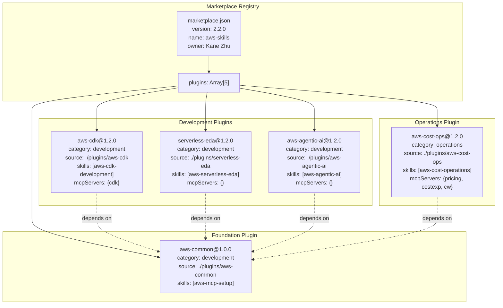
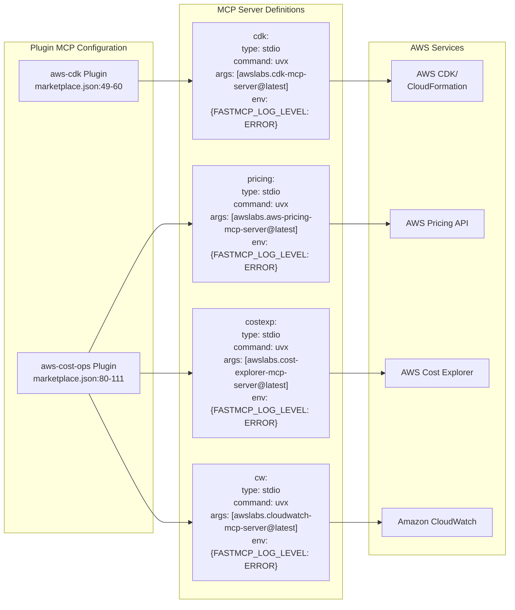
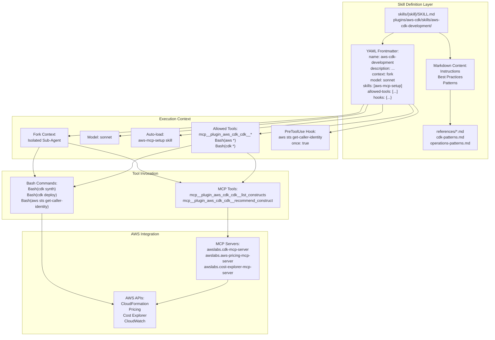
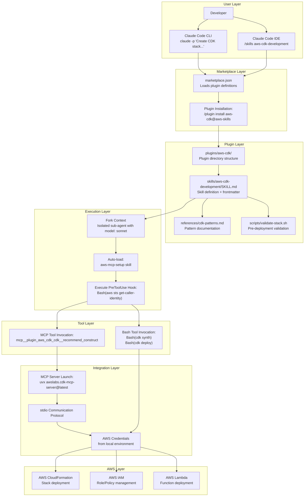

<!-- source: DeepWiki mcp.deepwiki.com · repo zxkane/aws-skills · page 1 Overview · fetched 2026-10-26 -->

# Overview

<details>
<summary>Relevant source files</summary>

The following files were used as context for generating this wiki page:

- [.claude-plugin/marketplace.json](.claude-plugin/marketplace.json)
- [README.md](README.md)

</details>


## Purpose and Scope

AWS Skills for Claude Code is a plugin marketplace system that extends Claude Code with specialized AWS development capabilities. The system provides five domain-specific plugins built on a common foundation, enabling infrastructure as code development, cost optimization, event-driven architecture design, and AI agent deployment through a unified skill-based interface backed by Model Context Protocol (MCP) servers.

This document provides a high-level overview of the marketplace architecture, plugin ecosystem, MCP server integration, and skill execution model. For detailed installation instructions, see [Getting Started](#2). For plugin-specific documentation, see [Plugins](#4). For contribution guidelines, see [Development Guide](#5).

Sources: [README.md:1-3](), [.claude-plugin/marketplace.json:1-152]()

## Marketplace Architecture

The marketplace is defined in `.claude-plugin/marketplace.json` as a central registry at version 2.2.0, managing all plugin metadata, versioning, and MCP server configurations. Claude Code loads plugins from this registry when users add the marketplace via `/plugin marketplace add zxkane/aws-skills`.



**Marketplace Structure**: The registry defines plugin metadata including `name`, `description`, `version`, `author`, `homepage`, `repository`, `license`, `keywords`, `category`, `source` directory, `strict` mode, `skills` array, and optional `mcpServers` configuration. Each plugin's `source` points to a directory under `./plugins/`.

Sources: [.claude-plugin/marketplace.json:1-152]()

## Plugin Ecosystem

The system consists of five plugins organized in a layered dependency model with `aws-common` as the foundation:

| Plugin | Version | Category | Skills | MCP Servers | Purpose |
|--------|---------|----------|--------|-------------|---------|
| `aws-common` | 1.0.0 | development | `aws-mcp-setup` | 0 | Foundation dependency providing MCP configuration guidance |
| `aws-cdk` | 1.2.0 | development | `aws-cdk-development` | 1 (cdk) | Infrastructure as code with CDK best practices |
| `aws-cost-ops` | 1.2.0 | operations | `aws-cost-operations` | 3 (pricing, costexp, cw) | Cost optimization and operational monitoring |
| `serverless-eda` | 1.2.0 | development | `aws-serverless-eda` | 0 | Event-driven architecture patterns |
| `aws-agentic-ai` | 1.2.0 | development | `aws-agentic-ai` | 0 | Bedrock AgentCore deployment |

**Version Strategy**: `aws-common` at v1.0.0 represents a stable foundation, while domain plugins at v1.2.0 evolve more rapidly with new features and patterns.

**Installation Order**: Users must install `aws-common` first, then install domain plugins as needed. The marketplace enforces this dependency through the skill auto-loading mechanism described in [Skill Execution Model](#skill-execution-model).

Sources: [.claude-plugin/marketplace.json:11-151](), [README.md:7-66]()

### aws-common Plugin (Foundation)

Provides the `aws-mcp-setup` skill that guides users through MCP server configuration. All domain plugins depend on this skill to ensure access to up-to-date AWS documentation and services.

Sources: [.claude-plugin/marketplace.json:12-30](), [README.md:7-16]()

### aws-cdk Plugin (Infrastructure)

Implements AWS CDK development patterns with integrated CDK MCP server. Provides best practices for resource naming, Lambda function bundling (`NodejsFunction`, `PythonFunction`), and pre-deployment validation scripts.

Sources: [.claude-plugin/marketplace.json:31-61](), [README.md:18-26]()

### aws-cost-ops Plugin (Operations)

Integrates three MCP servers (`pricing`, `costexp`, `cw`) for comprehensive cost optimization, monitoring, and operational excellence. Enables pre-deployment cost estimation and post-deployment analysis.

Sources: [.claude-plugin/marketplace.json:62-112](), [README.md:30-42]()

### serverless-eda Plugin (Event-Driven)

Provides serverless and event-driven architecture patterns based on AWS Well-Architected Framework. Covers orchestration, saga patterns, and event sourcing without dedicated MCP servers, relying on CDK skill dependency.

Sources: [.claude-plugin/marketplace.json:113-131](), [README.md:44-53]()

### aws-agentic-ai Plugin (AI Agents)

Comprehensive expert for Bedrock AgentCore covering seven services: Gateway, Runtime, Memory, Identity, Code Interpreter, Browser, and Observability. Focuses on architectural guidance rather than MCP integration.

Sources: [.claude-plugin/marketplace.json:132-150](), [README.md:55-66]()

## MCP Server Integration

MCP (Model Context Protocol) servers bridge Claude Code to AWS services through a standardized `stdio` protocol. Plugins declare MCP servers in their `mcpServers` configuration, specifying the launcher command, arguments, and environment variables.



**MCP Server Naming**: Servers use short identifiers (`cdk`, `cw`, `pricing`, `costexp`) to comply with Bedrock's 64-character tool name limit. The runtime generates tool names following the pattern: `mcp__plugin_{plugin}_{server}__{tool}`.

**Launch Mechanism**: All MCP servers use `uvx` (Python package launcher) to execute `awslabs.*-mcp-server@latest` packages, ensuring users always get the latest AWS service integrations. The `FASTMCP_LOG_LEVEL: ERROR` setting minimizes log noise during normal operations.

**Integration Patterns**:
- **aws-cdk**: 1 server for CDK operations
- **aws-cost-ops**: 3 servers for comprehensive cost/monitoring coverage
- **aws-common, serverless-eda, aws-agentic-ai**: 0 dedicated servers, rely on shared `aws-common` documentation MCP or transitive dependencies

Sources: [.claude-plugin/marketplace.json:49-111](), [README.md:267-271]()

## Skill Execution Model

Skills are defined through `SKILL.md` files with YAML frontmatter controlling execution context, dependencies, tool permissions, and lifecycle hooks. When a skill is invoked, Claude Code forks an isolated sub-agent context with the specified configuration.



**Skill Structure**: Each skill follows a standardized directory structure:
- `SKILL.md`: Main skill definition with frontmatter and instructions
- `references/`: Optional detailed pattern documentation
- `scripts/`: Optional utility scripts (e.g., `validate-stack.sh`)
- `services/`: Optional service-specific code

**Frontmatter Configuration**:
- `name`, `description`: Skill metadata
- `context: fork`: Execute in isolated sub-agent
- `model: sonnet`: Model selection (e.g., Claude 3.5 Sonnet)
- `skills: [aws-mcp-setup]`: Auto-loaded skill dependencies
- `allowed-tools`: Whitelist of MCP servers and bash command patterns
- `hooks`: Lifecycle hooks (e.g., `PreToolUse` for account verification)

**Dependency Auto-Loading**: When `aws-cdk-development` skill is invoked, it automatically loads `aws-mcp-setup` skill. When `aws-serverless-eda` is invoked, it loads both `aws-mcp-setup` and `aws-cdk-development`, creating a dependency chain.

**Tool Naming Convention**: MCP tools follow the pattern `mcp__plugin_{plugin}_{server}__{tool}`, where `{plugin}` is the plugin name, `{server}` is the MCP server identifier, and `{tool}` is the specific tool name. For example: `mcp__plugin_aws_cdk_cdk__list_constructs`.

Sources: [README.md:227-265](), [README.md:267-271](), [.claude-plugin/marketplace.json:27-29](), [.claude-plugin/marketplace.json:46-48]()

## System Integration Flow

The complete flow from user interaction to AWS service invocation demonstrates how the marketplace, plugins, skills, and MCP servers integrate:



**Flow Stages**:

1. **User Interaction**: Developer invokes skill via CLI (`claude -p`) or IDE (`/skills` command)
2. **Marketplace Loading**: Claude Code reads `marketplace.json` and resolves plugin definitions
3. **Plugin Discovery**: Locates plugin directory (`./plugins/aws-cdk`) and skill file (`./skills/aws-cdk-development/SKILL.md`)
4. **Execution Setup**: Creates fork context with specified model, auto-loads dependency skills, validates tool permissions
5. **Hook Execution**: Runs `PreToolUse` hook (e.g., account verification via `aws sts get-caller-identity`) before tool invocation
6. **Tool Invocation**: Executes MCP tools or bash commands based on `allowed-tools` whitelist
7. **MCP Launch**: On-demand launch of MCP server via `uvx`, establishing `stdio` communication channel
8. **AWS Integration**: MCP servers and bash commands interact with AWS services using local credentials

**Critical Bootstrap**: Before any AWS-related question is answered, skills check for MCP tool availability. If unavailable, the auto-loaded `aws-mcp-setup` skill guides users through configuration, ensuring no outdated AWS information is provided.

Sources: [.claude-plugin/marketplace.json:1-152](), [README.md:68-87](), [README.md:127-142]()

## Version Management

The system uses semantic versioning with distinct strategies for the marketplace versus individual plugins:

| Component | Current Version | Bump Trigger | Example |
|-----------|----------------|--------------|---------|
| Marketplace (`marketplace.json`) | 2.2.0 | New plugin added | 2.1.0 → 2.2.0 |
| `aws-common` plugin | 1.0.0 | Structural changes to foundation | 1.0.0 (stable) |
| Development plugins | 1.2.0 | New skills, dependencies, features | 1.1.0 → 1.2.0 |

**Version Differential**: The version gap (marketplace at 2.2.0 vs plugins at 1.0.0-1.2.0) reflects that the marketplace tracks plugin additions while individual plugins track their own evolution independently.

**Minor vs Patch Bumps**:
- **Minor (x.Y.0)**: New skill, new MCP server, new dependency, new plugin
- **Patch (x.y.Z)**: Bug fixes, documentation updates, configuration tweaks, typo corrections

For detailed version management rules, see [Version Management](#5.2).

Sources: [.claude-plugin/marketplace.json:9](), [.claude-plugin/marketplace.json:15](), [.claude-plugin/marketplace.json:34]()

## Directory Structure

The repository follows a standardized structure enabling plugin discovery, skill loading, and local development:

```
aws-skills/
├── .claude-plugin/
│   └── marketplace.json              # Central registry (v2.2.0)
├── plugins/                          # Plugin isolation
│   ├── aws-common/
│   │   └── skills/
│   │       └── aws-mcp-setup/        # Foundation skill
│   ├── aws-cdk/
│   │   └── skills/
│   │       └── aws-cdk-development/  # CDK skill with references, scripts
│   ├── aws-cost-ops/
│   │   └── skills/
│   │       └── aws-cost-operations/  # Cost/ops skill with patterns
│   ├── serverless-eda/
│   │   └── skills/
│   │       └── aws-serverless-eda/   # EDA skill with patterns
│   └── aws-agentic-ai/
│       └── skills/
│           └── aws-agentic-ai/       # AgentCore skill with services/
└── README.md                         # User documentation
```

**Key Locations**:
- [.claude-plugin/marketplace.json:1-152](): Central registry defining all plugins
- `plugins/{plugin}/skills/{skill}/SKILL.md`: Skill definition with frontmatter
- `plugins/{plugin}/skills/{skill}/references/*.md`: Pattern documentation
- `plugins/{plugin}/skills/{skill}/scripts/*.sh`: Utility scripts
- `plugins/{plugin}/skills/{skill}/services/`: Service-specific documentation

**Local Development**: Developers symlink `plugins/{plugin}/skills/` to `.claude/skills/` for rapid iteration without reinstallation. See [Local Development Setup](#5.1) for details.

Sources: [README.md:225-265]()

---

