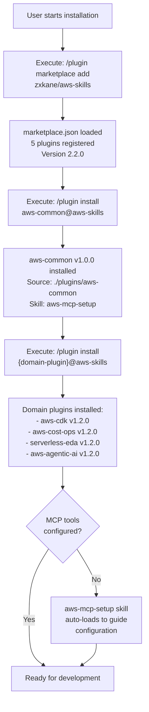
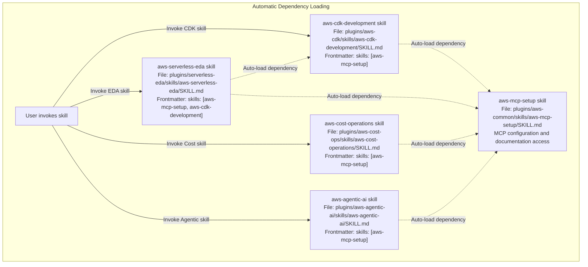
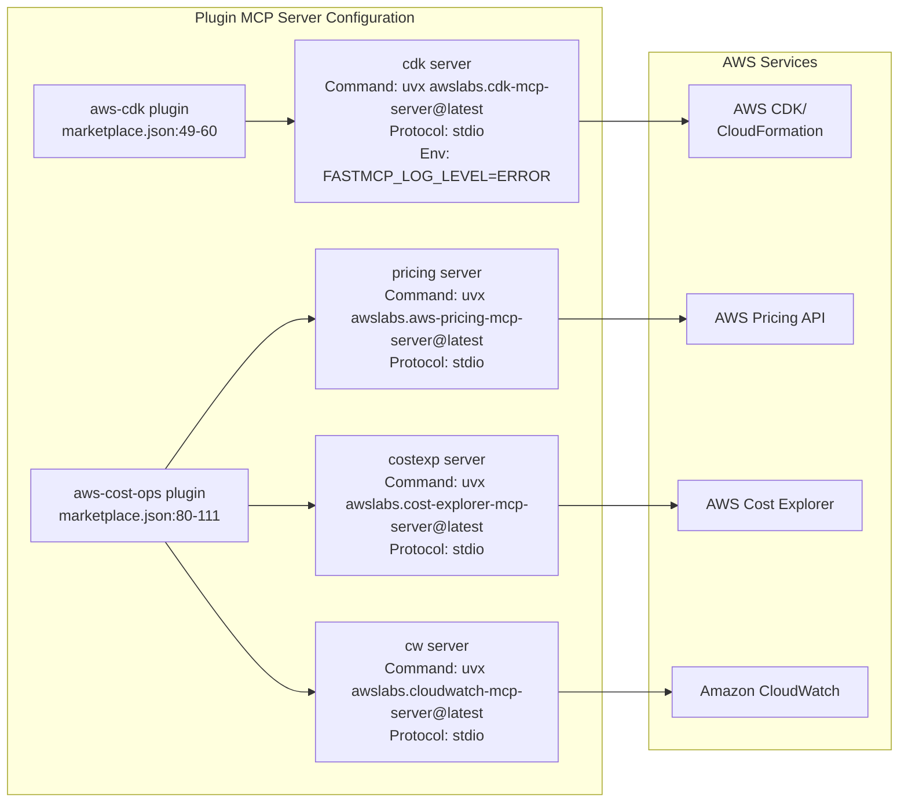

<!-- source: DeepWiki mcp.deepwiki.com · repo zxkane/aws-skills · page 2 Getting Started · fetched 2026-10-26 -->

# Getting Started

<details>
<summary>Relevant source files</summary>

The following files were used as context for generating this wiki page:

- [.claude-plugin/marketplace.json](.claude-plugin/marketplace.json)
- [README.md](README.md)

</details>


This document guides you through the initial setup of AWS Skills for Claude Code, from adding the marketplace to installing plugins and configuring AWS MCP tools. By the end of this guide, you will have a working development environment with access to AWS development capabilities through Claude Code.

For detailed installation instructions, see [Installation](#2.1). For comprehensive MCP server configuration, see [MCP Setup](#2.2).

## Prerequisites

Before installing AWS Skills, ensure you have:

- **Claude Code** installed and running (CLI or IDE)
- **Python 3.10+** with `uvx` (for MCP servers that provide AWS API access)
- **AWS credentials** configured locally (optional, required only for MCP servers that access AWS APIs)
- **Node.js 18+** (for CDK-based development)

Some plugins can function with documentation-only access if AWS credentials are not configured. The `aws-mcp-setup` skill will guide you through configuration options when first invoked.

Sources: [README.md:68-87]()

## Installation Overview

The AWS Skills system follows a strict installation order due to plugin dependencies. All domain plugins (`aws-cdk`, `aws-cost-ops`, `serverless-eda`, `aws-agentic-ai`) depend on the foundational `aws-common` plugin.

### Installation Flow



**Diagram: Plugin Installation Sequence and Dependency Flow**

Sources: [.claude-plugin/marketplace.json:1-152](), [README.md:68-87]()

## Quick Start Commands

Execute these commands in Claude Code to install the complete AWS Skills ecosystem:

```bash
# Step 1: Add the marketplace registry
/plugin marketplace add zxkane/aws-skills

# Step 2: Install the foundational plugin (REQUIRED FIRST)
/plugin install aws-common@aws-skills

# Step 3: Install domain plugins as needed
/plugin install aws-cdk@aws-skills           # Infrastructure as Code
/plugin install aws-cost-ops@aws-skills      # Cost & Operations
/plugin install serverless-eda@aws-skills    # Event-Driven Architecture
/plugin install aws-agentic-ai@aws-skills    # Bedrock AgentCore
```

Each `/plugin install` command loads the plugin definition from [.claude-plugin/marketplace.json]() and symlinks the skill directories into Claude Code's runtime environment.

Sources: [README.md:70-87](), [.claude-plugin/marketplace.json:11-151]()

## Plugin Registry Structure

The marketplace registry at [.claude-plugin/marketplace.json]() defines all available plugins:

| Plugin | Version | Category | Skills | MCP Servers | Dependencies |
|--------|---------|----------|--------|-------------|--------------|
| `aws-common` | 1.0.0 | development | `aws-mcp-setup` | 0 | None (foundation) |
| `aws-cdk` | 1.2.0 | development | `aws-cdk-development` | 1 (`cdk`) | `aws-common` |
| `aws-cost-ops` | 1.2.0 | operations | `aws-cost-operations` | 3 (`pricing`, `costexp`, `cw`) | `aws-common` |
| `serverless-eda` | 1.2.0 | development | `aws-serverless-eda` | 0 | `aws-common`, `aws-cdk` |
| `aws-agentic-ai` | 1.2.0 | development | `aws-agentic-ai` | 0 | `aws-common` |

The `source` field in each plugin definition points to the local directory containing the skill implementation (e.g., `./plugins/aws-common`).

Sources: [.claude-plugin/marketplace.json:11-151]()

## Dependency Resolution

When a domain plugin is loaded, Claude Code automatically resolves and loads its dependencies through the `skills` field in the skill frontmatter. This creates a dependency chain that ensures required capabilities are always available.



**Diagram: Skill Dependency Chain with File Paths**

The frontmatter `skills` array in each `SKILL.md` file declares dependencies that Claude Code automatically loads before executing the skill. This ensures that `aws-mcp-setup` is always available when needed, without requiring manual invocation.

Sources: [.claude-plugin/marketplace.json:27-29](), [.claude-plugin/marketplace.json:46-47](), [.claude-plugin/marketplace.json:77-78](), [.claude-plugin/marketplace.json:128-129](), [.claude-plugin/marketplace.json:147-148]()

## MCP Server Configuration

Plugins that integrate AWS services through MCP servers define them in the `mcpServers` field of [.claude-plugin/marketplace.json](). These servers launch on-demand via the `uvx` command with the `stdio` protocol.

### MCP Server Definitions



**Diagram: MCP Server Deployment and AWS Service Mapping**

Each MCP server is launched with:
- `type: stdio` - standard input/output communication protocol
- `command: uvx` - Python package executor
- `args: ["awslabs.{server}-mcp-server@latest"]` - MCP server package at latest version
- `env: {FASTMCP_LOG_LEVEL: "ERROR"}` - logging configuration

Sources: [.claude-plugin/marketplace.json:49-60](), [.claude-plugin/marketplace.json:80-111]()

## Initial Configuration Check

When a skill is first invoked, it performs an availability check for MCP tools. If MCP servers are not configured, the `aws-mcp-setup` skill automatically loads to guide configuration.

### Configuration Options

The `aws-mcp-setup` skill offers two configuration paths:

| Option | Requirements | Capabilities |
|--------|-------------|-------------|
| **Full AWS MCP Server** | Python 3.10+, `uvx`, AWS credentials | Full AWS API access + documentation search |
| **AWS Documentation MCP** | None (uses public endpoints) | Documentation search only |

Users without AWS credentials or Python can still access AWS documentation through the documentation-only MCP server. This enables architectural guidance and best practices without requiring AWS account access.

Sources: [README.md:9-16]()

## Verification Steps

After installation, verify the setup:

1. **Check installed plugins**:
   ```bash
   /plugin list
   ```
   Expected output should show `aws-common` and any domain plugins installed.

2. **Verify skill availability**:
   ```bash
   /skills
   ```
   Should list available skills including `aws-mcp-setup` and any domain skills.

3. **Test MCP connectivity** (if configured):
   Invoke any domain skill. If MCP tools are not configured, the `aws-mcp-setup` skill will automatically guide you through setup.

4. **Confirm AWS credentials** (for full MCP access):
   ```bash
   aws sts get-caller-identity
   ```
   This command verifies AWS CLI configuration. Some skills use `PreToolUse` hooks to run this check automatically before AWS operations.

Sources: [README.md:68-87]()

## Next Steps

- For detailed installation procedures and troubleshooting, see [Installation](#2.1)
- For comprehensive MCP server configuration including credential setup and server selection, see [MCP Setup](#2.2)
- For understanding the plugin architecture and skill execution model, see [Architecture](#3)
- For guidance on using specific plugins, see [Plugins](#4)

Sources: [README.md:1-284](), [.claude-plugin/marketplace.json:1-152]()

---

