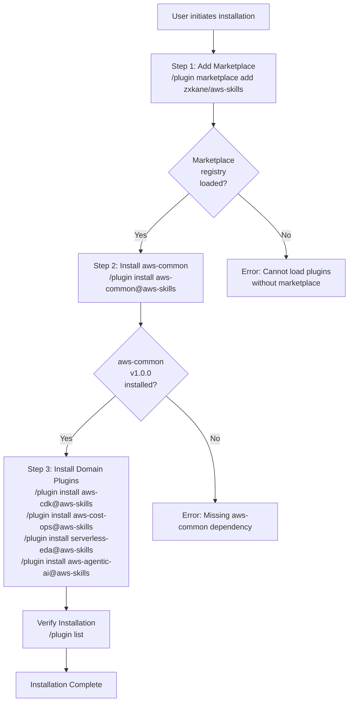
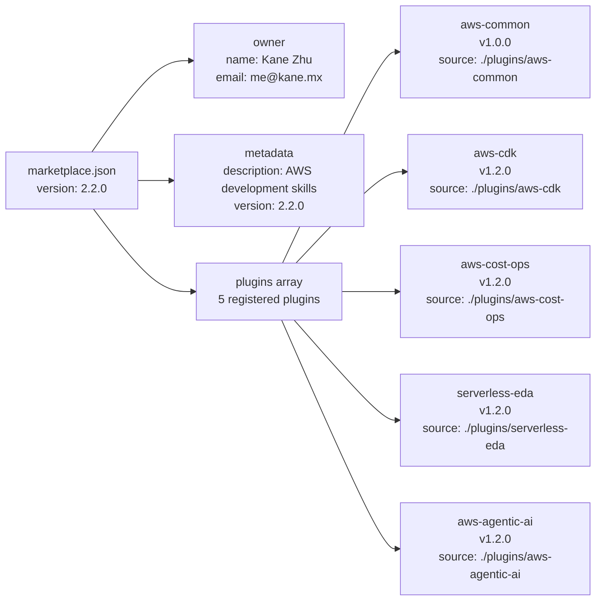
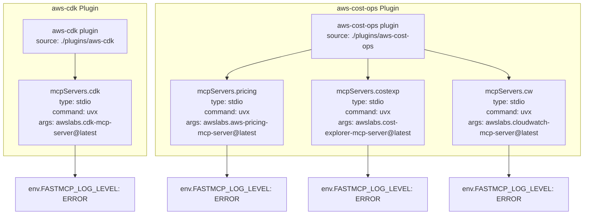
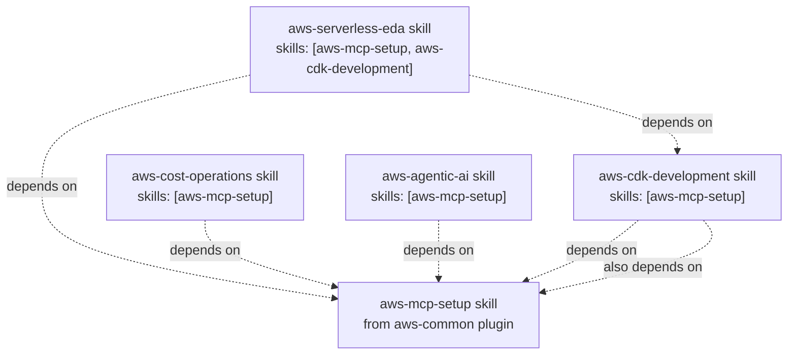
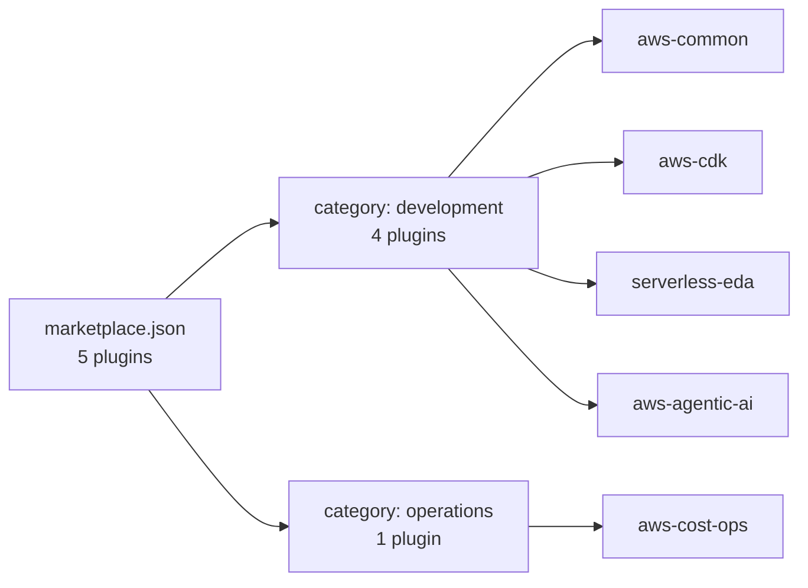

<!-- source: DeepWiki mcp.deepwiki.com · repo zxkane/aws-skills · page 2.1 Installation · fetched 2026-10-26 -->

# Installation

<details>
<summary>Relevant source files</summary>

The following files were used as context for generating this wiki page:

- [.claude-plugin/marketplace.json](.claude-plugin/marketplace.json)
- [README.md](README.md)

</details>


This document provides step-by-step instructions for installing plugins from the AWS Skills marketplace. Installation must follow a specific dependency order to ensure proper plugin functionality.

**Scope**: This page covers marketplace registration, plugin installation commands, and dependency verification. For configuring AWS MCP tools after installation, see [MCP Setup](#2.2). For modifying or developing plugins locally, see [Local Development Setup](#5.1).

## Prerequisites

Before installing plugins, ensure the following requirements are met:

| Requirement | Description |
|-------------|-------------|
| Claude Code | Claude Code IDE or CLI must be installed and authenticated |
| Marketplace Support | Claude Code version must support plugin marketplace functionality |
| Network Access | Internet connection to download plugins from GitHub repository |

## Installation Sequence

The installation process follows a mandatory three-step sequence. Deviating from this order will cause dependency resolution failures.

### Installation Flow



**Sources**: [.claude-plugin/marketplace.json:1-152](), [README.md:68-87]()

## Step 1: Add Marketplace

The marketplace registry must be added before any plugins can be installed. This registers the remote repository containing plugin definitions.

```bash
/plugin marketplace add zxkane/aws-skills
```

This command performs the following operations:

1. Fetches `marketplace.json` from `https://github.com/zxkane/aws-skills`
2. Validates the marketplace metadata version (currently `2.2.0`)
3. Registers 5 available plugins in the Claude Code registry
4. Makes plugins available for installation via `@aws-skills` suffix

### Marketplace Structure



**Sources**: [.claude-plugin/marketplace.json:1-10](), [.claude-plugin/marketplace.json:11-151]()

## Step 2: Install Foundation Plugin (aws-common)

The `aws-common` plugin **must be installed first** as it provides the `aws-mcp-setup` skill that all other plugins depend on.

```bash
/plugin install aws-common@aws-skills
```

### Why aws-common is Required First

| Aspect | Details |
|--------|---------|
| Version | `1.0.0` (stable foundation, lower version than domain plugins) |
| Category | `development` |
| Provides | `aws-mcp-setup` skill for MCP server configuration |
| Source Path | `./plugins/aws-common` |
| Skills Registered | `./skills/aws-mcp-setup` |
| Strict Mode | `false` (allows flexible skill invocation) |

The plugin installs from the source directory defined in the marketplace entry at [.claude-plugin/marketplace.json:25](). When installed, Claude Code:

1. Downloads files from `plugins/aws-common/` directory
2. Registers the `aws-mcp-setup` skill defined at [.claude-plugin/marketplace.json:28]()
3. Makes the skill available for dependency auto-loading by other plugins

**Sources**: [.claude-plugin/marketplace.json:11-30](), [README.md:79-80]()

## Step 3: Install Domain Plugins

After `aws-common` is installed, domain plugins can be installed in any order. Each plugin automatically resolves its dependency on `aws-common`.

### Individual Plugin Installation

```bash
# Infrastructure as Code
/plugin install aws-cdk@aws-skills

# Cost Optimization and Operations
/plugin install aws-cost-ops@aws-skills

# Serverless and Event-Driven Architecture
/plugin install serverless-eda@aws-skills

# AI Agent Development with Bedrock AgentCore
/plugin install aws-agentic-ai@aws-skills
```

### Plugin Comparison

| Plugin Name | Version | MCP Servers | Primary Skills | Source Path |
|-------------|---------|-------------|----------------|-------------|
| `aws-cdk` | 1.2.0 | 1 (`cdk`) | `aws-cdk-development` | `./plugins/aws-cdk` |
| `aws-cost-ops` | 1.2.0 | 3 (`pricing`, `costexp`, `cw`) | `aws-cost-operations` | `./plugins/aws-cost-ops` |
| `serverless-eda` | 1.2.0 | 0 (pattern-based) | `aws-serverless-eda` | `./plugins/serverless-eda` |
| `aws-agentic-ai` | 1.2.0 | 0 (pattern-based) | `aws-agentic-ai` | `./plugins/aws-agentic-ai` |

**Sources**: [.claude-plugin/marketplace.json:31-61](), [.claude-plugin/marketplace.json:62-112](), [.claude-plugin/marketplace.json:113-131](), [.claude-plugin/marketplace.json:132-150]()

### MCP Server Provisioning

Plugins with `mcpServers` configuration automatically provision MCP server integrations during installation:



All MCP servers use the `stdio` protocol type and are launched with `uvx` pointing to `@latest` versions from the `awslabs` namespace. The `FASTMCP_LOG_LEVEL` is set to `ERROR` to minimize log verbosity.

**Sources**: [.claude-plugin/marketplace.json:49-60](), [.claude-plugin/marketplace.json:80-111]()

## Dependency Resolution

Claude Code automatically resolves skill dependencies when a plugin is installed or invoked. The dependency graph ensures `aws-common` is loaded before any domain plugin functionality.

### Skill Dependency Chain



The `serverless-eda` plugin has a dual dependency: it depends on both `aws-mcp-setup` (from `aws-common`) and `aws-cdk-development` (from `aws-cdk`). This allows it to leverage both documentation access and CDK infrastructure patterns.

**Sources**: [.claude-plugin/marketplace.json:27-29](), [.claude-plugin/marketplace.json:46-48](), [.claude-plugin/marketplace.json:77-79](), [.claude-plugin/marketplace.json:128-130](), [.claude-plugin/marketplace.json:147-149]()

## Installation Verification

After installing plugins, verify the installation using Claude Code commands.

### List Installed Plugins

```bash
/plugin list
```

Expected output should include:

| Plugin Name | Version | Status | Skills Loaded |
|-------------|---------|--------|---------------|
| `aws-common` | 1.0.0 | Installed | `aws-mcp-setup` |
| `aws-cdk` | 1.2.0 | Installed | `aws-cdk-development` |
| `aws-cost-ops` | 1.2.0 | Installed | `aws-cost-operations` |
| `serverless-eda` | 1.2.0 | Installed | `aws-serverless-eda` |
| `aws-agentic-ai` | 1.2.0 | Installed | `aws-agentic-ai` |

### List Available Skills

```bash
/skills
```

This command displays all skills from installed plugins. Each skill should appear with its description from the skill frontmatter metadata.

### Test Skill Invocation

Verify skill functionality by invoking a skill:

```
Use the aws-mcp-setup skill to check MCP server configuration
```

If the skill is properly installed, Claude Code will load it and execute according to its SKILL.md definition.

**Sources**: [README.md:68-87]()

## Troubleshooting

### Common Installation Issues

| Issue | Cause | Solution |
|-------|-------|----------|
| "Plugin not found" | Marketplace not added | Run `/plugin marketplace add zxkane/aws-skills` first |
| "Dependency not met" | `aws-common` not installed | Install `aws-common` before domain plugins |
| "MCP server failed to start" | Missing `uvx` or Python | Install prerequisites (see [MCP Setup](#2.2)) |
| "Permission denied" | Network restrictions | Check firewall and GitHub access |
| "Version conflict" | Outdated marketplace cache | Remove and re-add marketplace |

### Dependency Error Example

If attempting to install `aws-cdk` before `aws-common`:

```
Error: Cannot resolve skill dependency 'aws-mcp-setup'
Required by: aws-cdk-development skill
Install aws-common plugin first
```

This error occurs because the skill definition at the plugin source references `aws-mcp-setup` in its frontmatter `skills:` array, but the skill is not available in Claude Code's registry.

### MCP Server Launch Issues

If MCP servers fail to launch (e.g., for `aws-cdk` or `aws-cost-ops` plugins), the error typically indicates missing prerequisites:

```
Error: MCP server 'cdk' failed to start
Command: uvx awslabs.cdk-mcp-server@latest
Check if uvx is installed and accessible
```

MCP server issues should be resolved by following [MCP Setup](#2.2) to install required tools like `uvx`, Python, and AWS credentials.

**Sources**: [.claude-plugin/marketplace.json:49-60](), [.claude-plugin/marketplace.json:80-111]()

## Plugin Categories

The marketplace organizes plugins into categories for easier discovery:



- **Development**: Plugins focused on building and deploying AWS applications (`aws-common`, `aws-cdk`, `serverless-eda`, `aws-agentic-ai`)
- **Operations**: Plugins focused on operating and monitoring AWS resources (`aws-cost-ops`)

**Sources**: [.claude-plugin/marketplace.json:24](), [.claude-plugin/marketplace.json:43](), [.claude-plugin/marketplace.json:74](), [.claude-plugin/marketplace.json:125](), [.claude-plugin/marketplace.json:144]()

## Next Steps

After successfully installing plugins:

1. **Configure MCP Tools**: Follow [MCP Setup](#2.2) to configure AWS MCP servers for live AWS data access
2. **Explore Plugin Capabilities**: Review plugin documentation at [Plugins](#4)
3. **Start Development**: Begin using skills through Claude Code IDE or CLI

Installation is complete when all required plugins are listed in `/plugin list` and their skills appear in `/skills`. MCP server configuration is the next critical step for enabling full AWS integration functionality.

---

