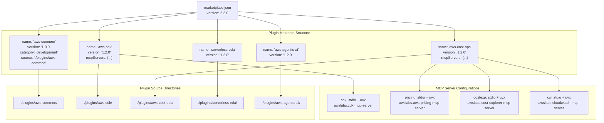
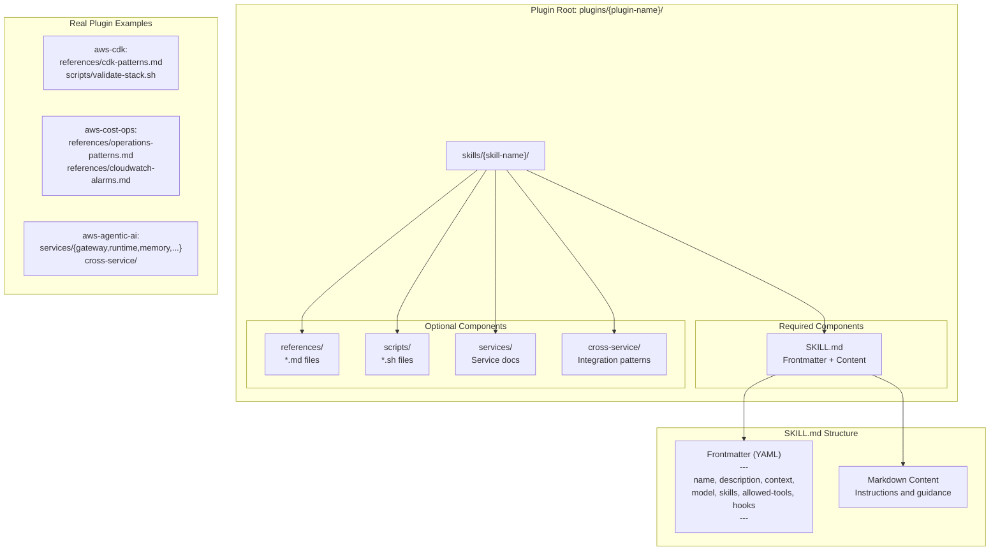
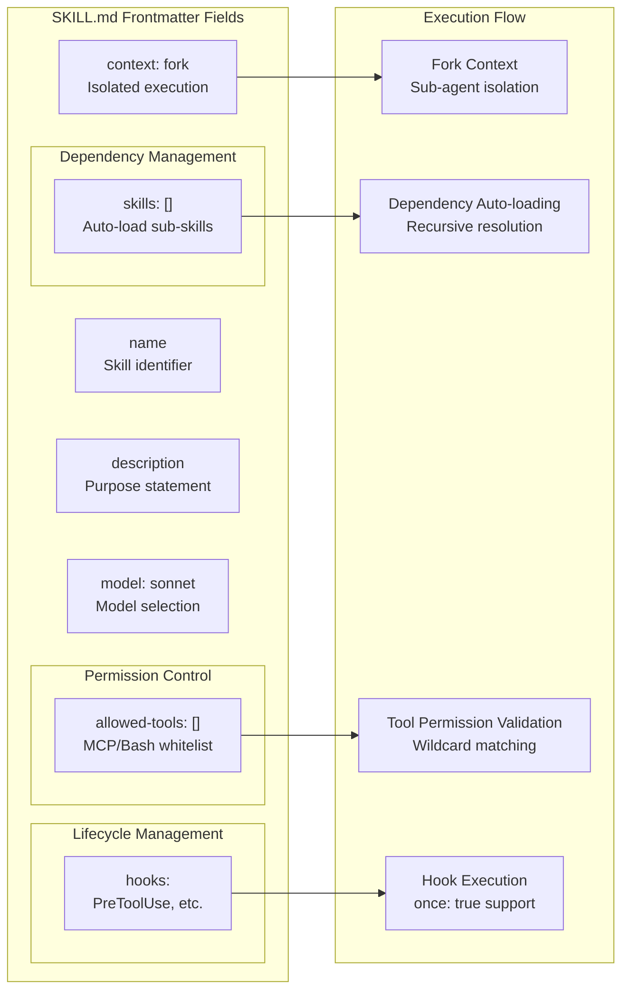
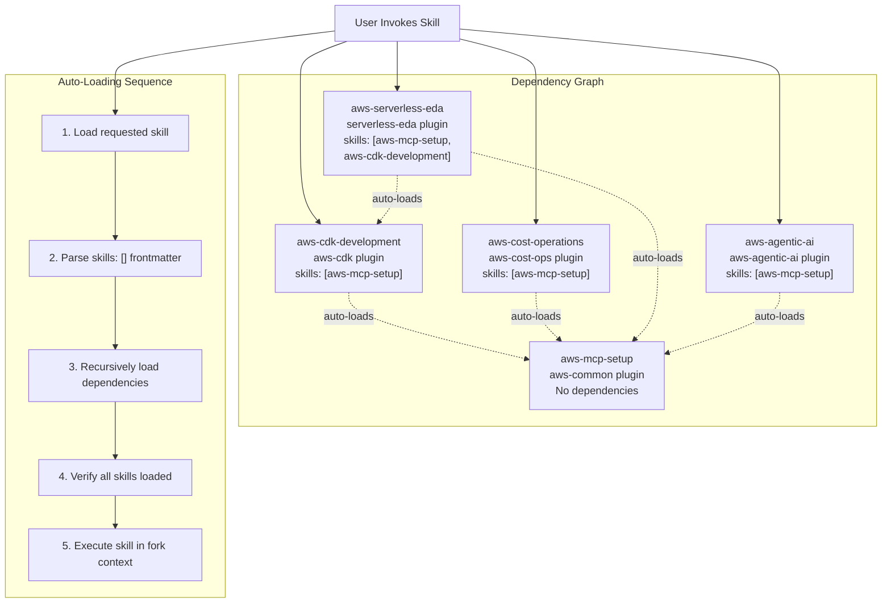
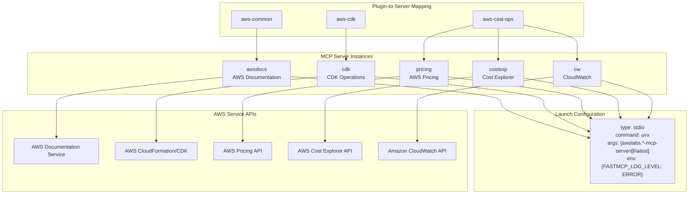
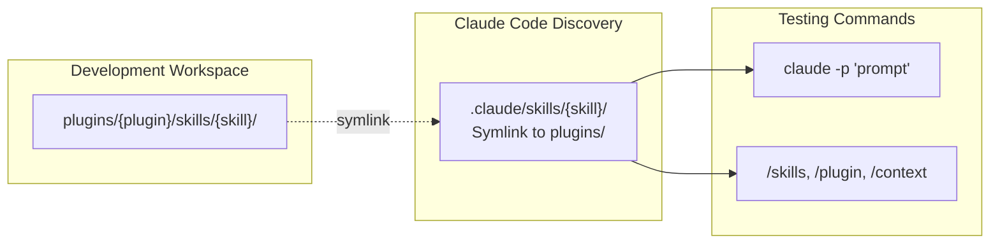

<!-- source: DeepWiki mcp.deepwiki.com · repo zxkane/aws-skills · page 3 Architecture · fetched 2026-10-26 -->

# Architecture

<details>
<summary>Relevant source files</summary>

The following files were used as context for generating this wiki page:

- [.claude-plugin/marketplace.json](.claude-plugin/marketplace.json)
- [CLAUDE.md](CLAUDE.md)
- [README.md](README.md)

</details>


This document explains the internal architecture of the AWS Skills for Claude Code system. It covers the marketplace registry mechanism, standardized plugin structure, skill execution model with fork contexts and dependency resolution, and MCP server integration patterns.

For step-by-step installation instructions, see [Getting Started](#2). For detailed information about individual plugins, see [Plugins](#4). For contribution guidelines and local development, see [Development Guide](#5).

## System Overview

The AWS Skills system is a marketplace-based plugin architecture for Claude Code that extends the IDE with AWS development capabilities. The architecture consists of four primary layers:

1. **Marketplace Registry Layer** - Central registry defined in `marketplace.json` that manages plugin metadata, versions, and MCP server configurations
2. **Plugin Layer** - Five distinct plugins (`aws-common`, `aws-cdk`, `aws-cost-ops`, `serverless-eda`, `aws-agentic-ai`) following a standardized directory structure
3. **Skill Execution Layer** - Fork-based sub-agent execution with frontmatter-driven configuration, dependency auto-loading, and lifecycle hooks
4. **MCP Integration Layer** - Model Context Protocol servers providing real-time AWS service access via stdio communication

### Marketplace Registry Architecture



**Marketplace Registry Architecture** - The `marketplace.json` file serves as the central registry, defining plugin metadata and MCP server configurations. Each plugin entry includes name, version, category, source path, and optional `mcpServers` object.

Sources: [.claude-plugin/marketplace.json:1-152](), [README.md:227-264]()

## Plugin Structure

Each plugin follows a standardized directory structure with required and optional components:

| Component | Required | Purpose |
|-----------|----------|---------|
| `skills/<skill-name>/SKILL.md` | Yes | Main skill definition with frontmatter configuration |
| `skills/<skill-name>/references/*.md` | No | Detailed reference documentation and patterns |
| `scripts/*.sh` | No | Utility scripts (e.g., validation, deployment) |
| `services/` | No | Service-specific documentation (used by `aws-agentic-ai`) |
| `cross-service/` | No | Cross-service integration patterns |

### Plugin Directory Layout



**Plugin Directory Layout** - Each plugin's `skills/` directory contains at least one skill with a `SKILL.md` file. The frontmatter section configures execution parameters, while the markdown content provides instructions. Optional directories contain supporting materials.

Sources: [README.md:227-264](), [CLAUDE.md:21-24]()

## Skill Execution Model

Skills execute in isolated fork contexts (sub-agents) with declarative configuration via YAML frontmatter. The execution model includes dependency resolution, tool permissions, model selection, and lifecycle hooks.

### Frontmatter Configuration Schema



**Frontmatter Configuration Schema** - The YAML frontmatter defines seven key configuration areas: name/description metadata, fork execution context, model selection, recursive skill dependencies, tool permissions with wildcard support, and lifecycle hooks with execution control.

Sources: [CLAUDE.md:56-77]()

### Skill Dependency Resolution

The `skills:` frontmatter field creates an auto-loading dependency chain. When a skill is invoked, Claude Code automatically loads all declared dependencies recursively:



**Skill Dependency Resolution** - All domain plugins depend on `aws-mcp-setup` from the `aws-common` plugin. The `serverless-eda` plugin has a two-level dependency chain, auto-loading both `aws-mcp-setup` and `aws-cdk-development`.

Sources: [.claude-plugin/marketplace.json:11-150](), [README.md:16]()

### Tool Permission Model

The `allowed-tools` frontmatter field controls which MCP tools and bash commands can be invoked during skill execution. Wildcard patterns enable flexible permission grants:

| Pattern Type | Example | Grants Access To |
|--------------|---------|------------------|
| MCP Wildcard | `mcp__plugin_aws-cdk_cdk__*` | All tools from CDK MCP server |
| MCP Specific | `mcp__plugin_aws-cost-ops_pricing__get_pricing` | Single pricing tool |
| Bash Wildcard | `Bash(aws *)` | All AWS CLI commands |
| Bash Specific | `Bash(cdk synth)` | Single CDK command |

Tool names follow the pattern: `mcp__plugin_{plugin}_{server}__{tool}`

For example, `mcp__plugin_aws-cdk_cdk__synthesize_stack` breaks down as:
- `plugin_aws-cdk` - The `aws-cdk` plugin
- `cdk` - The `cdk` MCP server
- `synthesize_stack` - The specific tool name

Sources: [README.md:267-271](), [CLAUDE.md:68-70](), [CLAUDE.md:80-87]()

### Lifecycle Hooks

The `hooks` frontmatter field defines lifecycle actions that execute at specific points in the skill execution flow:

```yaml
hooks:
  PreToolUse:
    - matcher: Bash(cdk deploy*)
      command: aws sts get-caller-identity --query Account --output text
      once: true
```

**Hook Configuration:**
- `matcher` - Pattern matching the tool about to be invoked
- `command` - Shell command to execute before the matched tool
- `once: true` - Execute hook only once per session (prevents redundant checks)

This example verifies AWS account identity before any `cdk deploy` command executes, preventing accidental cross-account deployments.

Sources: [CLAUDE.md:72-76]()

## MCP Server Integration

MCP (Model Context Protocol) servers provide real-time AWS service access through a standardized stdio communication protocol. The system uses five MCP servers across three plugins:

### MCP Server Configuration



**MCP Server Configuration** - Each MCP server uses stdio protocol with uvx launcher, executing the latest version of AWS Labs packages. The `FASTMCP_LOG_LEVEL: ERROR` environment variable suppresses verbose logging.

Sources: [.claude-plugin/marketplace.json:49-111]()

### Server Configuration Details

**aws-cdk plugin:**
```json
"mcpServers": {
  "cdk": {
    "type": "stdio",
    "command": "uvx",
    "args": ["awslabs.cdk-mcp-server@latest"],
    "env": {"FASTMCP_LOG_LEVEL": "ERROR"}
  }
}
```

**aws-cost-ops plugin:**
```json
"mcpServers": {
  "pricing": {
    "type": "stdio",
    "command": "uvx",
    "args": ["awslabs.aws-pricing-mcp-server@latest"],
    "env": {"FASTMCP_LOG_LEVEL": "ERROR"}
  },
  "costexp": {
    "type": "stdio",
    "command": "uvx",
    "args": ["awslabs.cost-explorer-mcp-server@latest"],
    "env": {"FASTMCP_LOG_LEVEL": "ERROR"}
  },
  "cw": {
    "type": "stdio",
    "command": "uvx",
    "args": ["awslabs.cloudwatch-mcp-server@latest"],
    "env": {"FASTMCP_LOG_LEVEL": "ERROR"}
  }
}
```

Sources: [.claude-plugin/marketplace.json:49-111]()

### MCP Tool Naming Convention

MCP server tools use abbreviated server names to comply with Amazon Bedrock's 64-character tool name limit. The naming pattern is:

```
mcp__plugin_{plugin}_{server}__{tool}
```

**Server Name Abbreviations:**

| Full Server Name | Abbreviated Name | Purpose |
|-----------------|------------------|---------|
| awsdocs | `awsdocs` | AWS Documentation search |
| cdk | `cdk` | CDK operations |
| pricing | `pricing` | Cost estimation |
| costexp | `costexp` | Cost Explorer analysis |
| cw | `cw` | CloudWatch metrics |

**Example Tool Names:**
- `mcp__plugin_aws-cdk_cdk__synthesize_stack`
- `mcp__plugin_aws-cost-ops_pricing__get_pricing`
- `mcp__plugin_aws-cost-ops_cw__get_metric_statistics`

This naming scheme enables consistent tool discovery while maintaining compatibility with Bedrock's naming constraints.

Sources: [README.md:267-271](), [CLAUDE.md:80-87]()

## Version Management

The system maintains two version types: marketplace version and plugin versions. Version numbers follow semantic versioning with specific bump rules:

**Version Types:**

| Version Type | Location | Purpose |
|--------------|----------|---------|
| Marketplace Version | `metadata.version` | Overall marketplace version (currently 2.2.0) |
| Plugin Version | `plugins[].version` | Individual plugin versions (1.0.0 or 1.2.0) |

**Version Bump Rules:**

| Change Type | Bump | Examples |
|-------------|------|----------|
| Minor (x.Y.0) | Structural changes | New skill, new `skills:` dependency, new MCP server, new plugin |
| Patch (x.y.Z) | Content changes | Bug fixes, documentation updates, configuration tweaks, typo fixes |

**Current Version State:**
- `marketplace.json` version: 2.2.0
- `aws-common` version: 1.0.0 (stable foundation)
- All domain plugins: 1.2.0 (`aws-cdk`, `aws-cost-ops`, `serverless-eda`, `aws-agentic-ai`)

The version differential (1.0.0 vs 1.2.0) reflects that `aws-common` is a stable dependency layer while domain plugins evolve more rapidly with new features.

Sources: [CLAUDE.md:89-108](), [.claude-plugin/marketplace.json:9-150]()

## Local Development Architecture

For contributors, the system supports local development through symlinks that enable real-time skill testing without plugin reinstallation:



**Local Development Architecture** - Symlinks from `.claude/skills/` to `plugins/*/skills/*` enable Claude Code to discover skill changes instantly during development.

**Symlink Creation:**
```bash
cd .claude && rm -rf skills && mkdir skills
ln -s ../../plugins/aws-common/skills/aws-mcp-setup skills/
ln -s ../../plugins/aws-cdk/skills/aws-cdk-development skills/
ln -s ../../plugins/serverless-eda/skills/aws-serverless-eda skills/
ln -s ../../plugins/aws-agentic-ai/skills/aws-agentic-ai skills/
ln -s ../../plugins/aws-cost-ops/skills/aws-cost-operations skills/
```

Sources: [CLAUDE.md:26-54]()

## Summary

The AWS Skills architecture is a layered system with clear separation of concerns:

1. **Marketplace Layer** - `marketplace.json` defines plugins, versions, and MCP servers
2. **Plugin Layer** - Standardized directory structure with required SKILL.md and optional references
3. **Execution Layer** - Fork-based isolation with frontmatter configuration, dependency auto-loading, and lifecycle hooks
4. **Integration Layer** - MCP servers via stdio protocol with abbreviated naming for Bedrock compatibility

The architecture prioritizes modularity (plugins as independent units), declarative configuration (frontmatter-driven execution), and real-time AWS knowledge (MCP server integration). For detailed information on specific components, see [Marketplace and Plugin System](#3.1), [Skills and Execution Model](#3.2), and [MCP Server Integration](#3.3).

---

