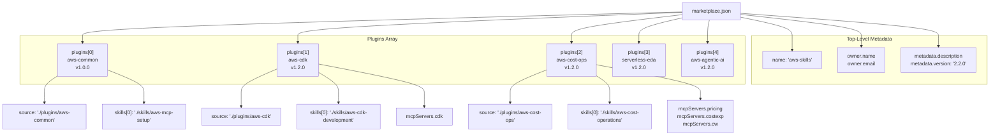
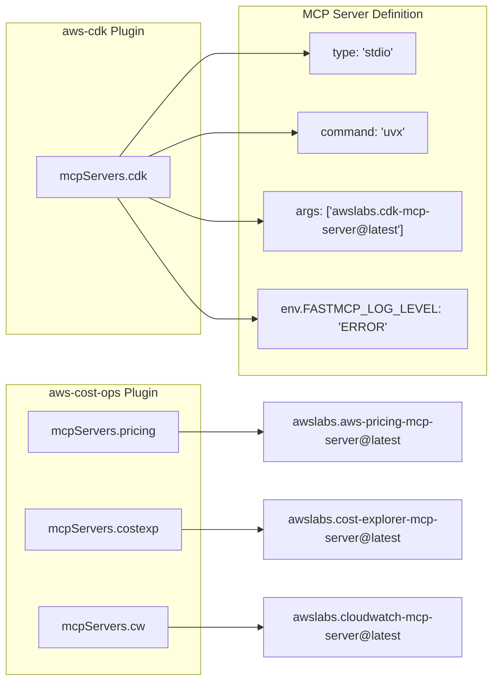
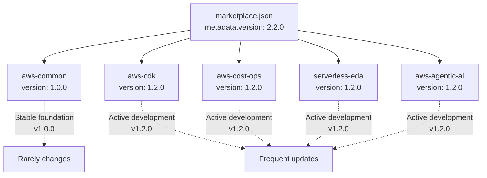
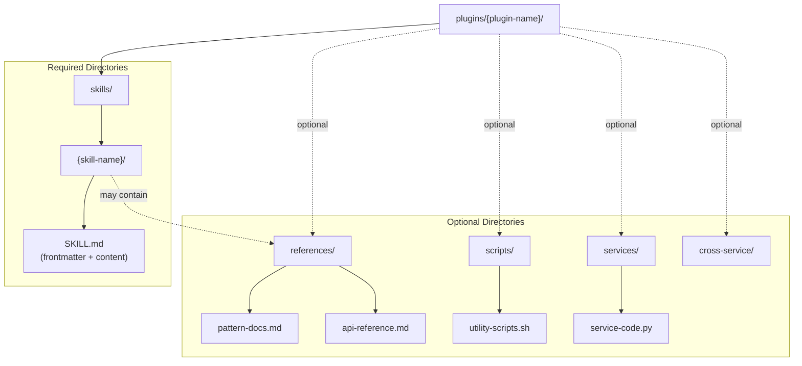
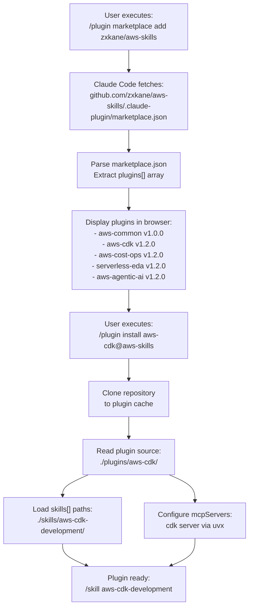
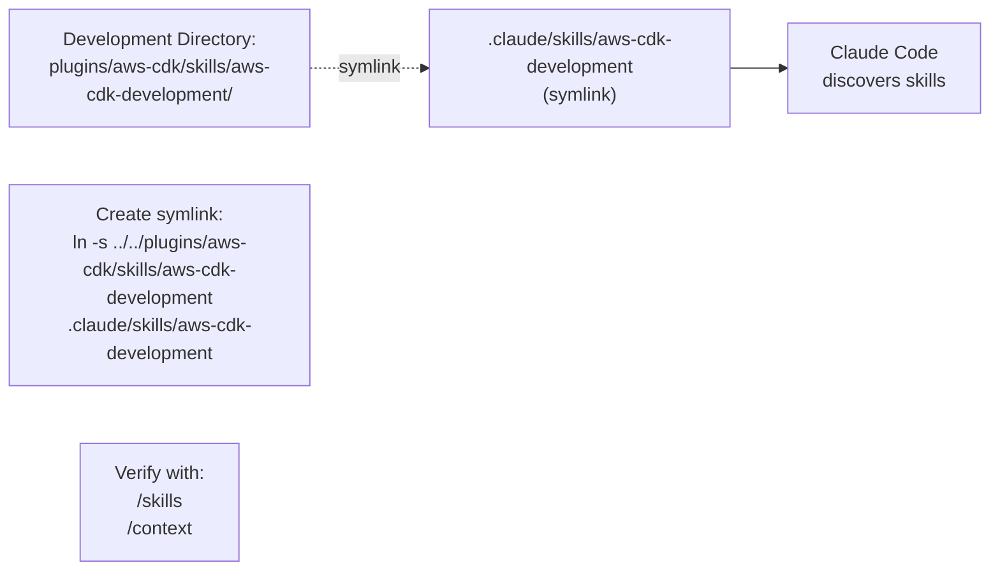

<!-- source: DeepWiki mcp.deepwiki.com · repo zxkane/aws-skills · page 3.1 Marketplace and Plugin System · fetched 2026-10-26 -->

# Marketplace and Plugin System

<details>
<summary>Relevant source files</summary>

The following files were used as context for generating this wiki page:

- [.claude-plugin/marketplace.json](.claude-plugin/marketplace.json)
- [CLAUDE.md](CLAUDE.md)

</details>


This document covers the central marketplace registry (`marketplace.json`), plugin registration structure, version management strategy, and the standardized plugin directory layout. For information about how skills are executed and dependencies are loaded, see [Skills and Execution Model](#3.2). For details on MCP server configuration and the stdio protocol, see [MCP Server Integration](#3.3).

## Marketplace Registry

The marketplace is defined by a single JSON file at `.claude-plugin/marketplace.json` that serves as the central registry for all plugins in the AWS Skills ecosystem.

### Registry Structure



**Marketplace Registry Structure**

The registry contains marketplace-level metadata and an ordered array of plugin definitions. Each plugin specifies its source directory and exposed skills.

Sources: [.claude-plugin/marketplace.json:1-11]()

### Marketplace Metadata

The top-level `metadata` object defines the overall marketplace identity:

| Field | Value | Purpose |
|-------|-------|---------|
| `name` | `"aws-skills"` | Marketplace identifier used in commands like `/plugin marketplace add zxkane/aws-skills` |
| `owner.name` | `"Kane Zhu"` | Marketplace maintainer |
| `owner.email` | `"me@kane.mx"` | Contact information |
| `metadata.description` | Long description | Marketplace description shown in plugin browser |
| `metadata.version` | `"2.2.0"` | Marketplace version, bumped when new plugins are added |

Sources: [.claude-plugin/marketplace.json:2-10]()

## Plugin Registration

Each plugin in the `plugins` array follows a standardized registration structure with required and optional fields.

### Required Fields

Every plugin must define these fields:

| Field | Type | Example | Purpose |
|-------|------|---------|---------|
| `name` | string | `"aws-cdk"` | Unique plugin identifier |
| `description` | string | `"Comprehensive AWS development skills..."` | Plugin description for UI display |
| `version` | string | `"1.2.0"` | Semantic version (major.minor.patch) |
| `author.name` | string | `"Kane Zhu"` | Plugin author |
| `author.email` | string | `"me@kane.mx"` | Author contact |
| `homepage` | string | `"https://github.com/zxkane/aws-skills"` | Plugin homepage URL |
| `repository` | string | `"https://github.com/zxkane/aws-skills"` | Source code repository |
| `license` | string | `"MIT"` | License identifier |
| `keywords` | string[] | `["aws", "cdk", "lambda"]` | Searchable keywords |
| `category` | string | `"development"` or `"operations"` | Plugin category |
| `source` | string | `"./plugins/aws-cdk"` | Relative path to plugin directory |
| `strict` | boolean | `false` | Strict mode flag (currently unused) |
| `skills` | string[] | `["./skills/aws-cdk-development"]` | Paths to skill directories relative to `source` |

Sources: [.claude-plugin/marketplace.json:32-48](), [.claude-plugin/marketplace.json:63-79]()

### MCP Server Configuration

Plugins optionally define MCP servers in the `mcpServers` object. Each server is keyed by a short name (to satisfy Bedrock's 64-character tool name limit):



**MCP Server Configuration Structure**

Each MCP server is defined with `type: "stdio"`, launched via `uvx` with a specific `awslabs.*-mcp-server@latest` package, and configured with `FASTMCP_LOG_LEVEL: "ERROR"`.

The server key (e.g., `cdk`, `pricing`) becomes part of the tool naming pattern: `mcp__plugin_{plugin}_{server}__{tool}`. For example, the CDK server's tools are named `mcp__plugin_aws-cdk_cdk__*`.

Sources: [.claude-plugin/marketplace.json:49-60](), [.claude-plugin/marketplace.json:80-111](), [CLAUDE.md:79-87]()

### Plugin Categories

Plugins are categorized as:

| Category | Plugins | Purpose |
|----------|---------|---------|
| `"development"` | `aws-common`, `aws-cdk`, `serverless-eda`, `aws-agentic-ai` | Infrastructure and application development |
| `"operations"` | `aws-cost-ops` | Post-deployment operations and monitoring |

Sources: [.claude-plugin/marketplace.json:24](), [.claude-plugin/marketplace.json:43](), [.claude-plugin/marketplace.json:74]()

## Version Management

The system uses semantic versioning with distinct version numbers for the marketplace and individual plugins.

### Version Hierarchy



**Version Hierarchy**

The marketplace version (2.2.0) is independent of plugin versions. The foundational `aws-common` plugin remains at v1.0.0 while domain plugins evolve at v1.2.0.

Sources: [.claude-plugin/marketplace.json:9](), [.claude-plugin/marketplace.json:15](), [.claude-plugin/marketplace.json:34]()

### Version Bump Rules

The system follows these rules for version increments:

| Change Type | Version Bump | When to Apply |
|-------------|--------------|---------------|
| **Minor** (x.Y.0) | Increment minor version | New skill added, new `skills:` dependency in frontmatter, new MCP server added, new plugin added |
| **Patch** (x.y.Z) | Increment patch version | Bug fixes, documentation updates, configuration tweaks, typo fixes, content updates without structural changes |

**Marketplace Version Bumps:**
- Add new plugin to `plugins` array → Minor bump `metadata.version`
- Modify existing plugin metadata only → Patch bump `metadata.version`

**Plugin Version Bumps:**
- Add new skill to `skills` array → Minor bump plugin `version`
- Add `skills:` dependency in SKILL.md frontmatter → Minor bump plugin `version`
- Add MCP server to `mcpServers` → Minor bump plugin `version`
- Update skill content without frontmatter changes → Patch bump plugin `version`
- Fix documentation or configuration → Patch bump plugin `version`

**Mandatory Bump Policy:** All content modifications must include a version bump before committing.

Sources: [CLAUDE.md:89-108]()

### Version Comparison Table

| Plugin | Current Version | Last Minor Bump | Reason for Version Gap |
|--------|----------------|-----------------|------------------------|
| `aws-common` | 1.0.0 | Initial release | Stable foundation, minimal changes needed |
| `aws-cdk` | 1.2.0 | Added features | Active development of CDK patterns |
| `aws-cost-ops` | 1.2.0 | Added MCP servers | Evolved from basic to three-server integration |
| `serverless-eda` | 1.2.0 | Added patterns | Expanded event-driven architecture coverage |
| `aws-agentic-ai` | 1.2.0 | Added services | Growth of AgentCore service coverage |

Sources: [.claude-plugin/marketplace.json:15](), [.claude-plugin/marketplace.json:34](), [.claude-plugin/marketplace.json:65](), [.claude-plugin/marketplace.json:116](), [.claude-plugin/marketplace.json:135]()

## Plugin Directory Structure

All plugins follow a standardized directory layout to ensure consistency and predictability.

### Standard Layout



**Plugin Directory Structure**

Every plugin must have a `skills/` directory containing skill subdirectories with SKILL.md files. Optional directories include `references/`, `scripts/`, `services/`, and `cross-service/`.

Sources: [CLAUDE.md:20-24]()

### Directory Purposes

| Directory | Required | Purpose | Example Content |
|-----------|----------|---------|-----------------|
| `skills/` | Yes | Contains skill subdirectories with SKILL.md definitions | `aws-cdk-development/`, `aws-mcp-setup/` |
| `skills/{skill}/SKILL.md` | Yes | Skill definition with frontmatter and markdown content | Frontmatter configuration + guidance text |
| `skills/{skill}/references/` | No | Detailed reference documentation for the skill | `cdk-patterns.md`, `lambda-best-practices.md` |
| `references/` | No | Plugin-wide reference documentation | Cross-cutting patterns and guides |
| `scripts/` | No | Utility scripts for automation or validation | `validate-stack.sh`, `setup.sh` |
| `services/` | No | Service-specific implementation code | AWS service integration code |
| `cross-service/` | No | Multi-service orchestration code | Cross-service patterns and workflows |

Sources: [CLAUDE.md:20-24]()

### Real Plugin Examples

**aws-common Plugin Structure:**
```
plugins/aws-common/
└── skills/
    └── aws-mcp-setup/
        └── SKILL.md
```

**aws-cdk Plugin Structure:**
```
plugins/aws-cdk/
└── skills/
    └── aws-cdk-development/
        ├── SKILL.md
        └── references/
            ├── cdk-patterns.md
            ├── lambda-nodejs.md
            └── lambda-python.md
```

**aws-cost-ops Plugin Structure:**
```
plugins/aws-cost-ops/
└── skills/
    └── aws-cost-operations/
        ├── SKILL.md
        └── references/
            └── operations-patterns.md
```

Sources: [.claude-plugin/marketplace.json:25-29](), [.claude-plugin/marketplace.json:44-48](), [.claude-plugin/marketplace.json:75-79]()

## Plugin Discovery and Loading

Claude Code discovers plugins through the marketplace registry and loads them based on the `source` and `skills` paths.

### Discovery Mechanism



**Plugin Discovery and Loading Flow**

Claude Code fetches the marketplace registry from GitHub, parses the `plugins` array, and loads plugin content from the specified `source` paths. Skills are loaded from the paths in the `skills` array, and MCP servers are configured from the `mcpServers` object.

Sources: [.claude-plugin/marketplace.json:1-152](), [CLAUDE.md:7-8]()

### Local Development Discovery

For local development, plugins are discovered via symlinks in `.claude/skills/`:



**Local Development Discovery**

During development, symlinks in `.claude/skills/` point to plugin directories in `plugins/`, enabling immediate skill updates without reinstallation. Changes to SKILL.md files are detected immediately by Claude Code.

Sources: [CLAUDE.md:26-54]()

### Path Resolution

The system resolves paths using these rules:

1. **Plugin Source Path:** Resolved from marketplace root
   - `marketplace.json` at `.claude-plugin/marketplace.json`
   - Plugin source at `.claude-plugin/` + `plugins[].source`
   - Example: `.claude-plugin/` + `"./plugins/aws-cdk"` = `.claude-plugin/plugins/aws-cdk/`

2. **Skill Path:** Resolved from plugin source
   - Plugin source: `.claude-plugin/plugins/aws-cdk/`
   - Skill path: `"./skills/aws-cdk-development"`
   - Full path: `.claude-plugin/plugins/aws-cdk/skills/aws-cdk-development/SKILL.md`

3. **Reference Path:** Resolved from skill directory
   - Skill directory: `.claude-plugin/plugins/aws-cdk/skills/aws-cdk-development/`
   - Reference: `references/cdk-patterns.md`
   - Full path: `.claude-plugin/plugins/aws-cdk/skills/aws-cdk-development/references/cdk-patterns.md`

Sources: [.claude-plugin/marketplace.json:44](), [.claude-plugin/marketplace.json:46-48]()

### Skill Registration

When a plugin is installed, Claude Code registers skills by:

1. Reading the `skills` array from the plugin definition
2. Loading each `SKILL.md` file from the resolved path
3. Parsing the YAML frontmatter for skill metadata
4. Making the skill available via `/skill {skill-name}` command
5. Auto-loading dependencies specified in the `skills:` frontmatter field

The skill name used in commands is derived from the frontmatter `name:` field, not the directory name.

Sources: [CLAUDE.md:20-24](), [CLAUDE.md:56-77]()

---

