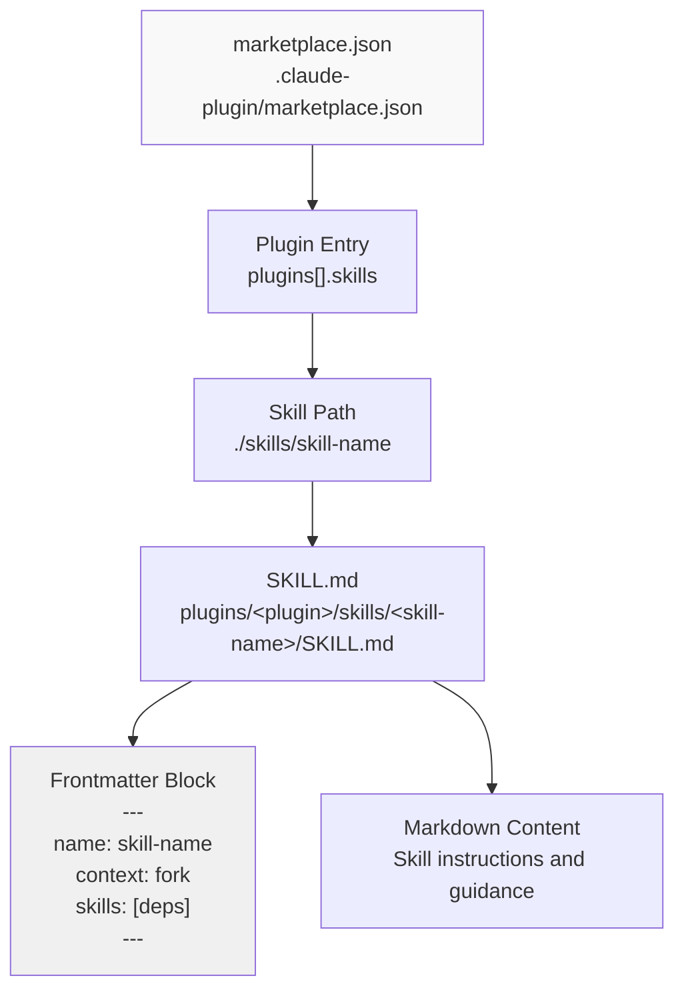
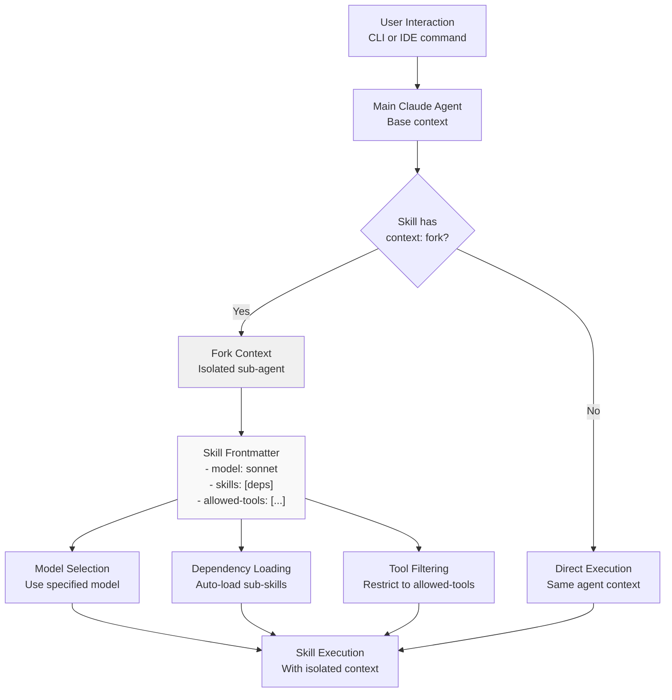
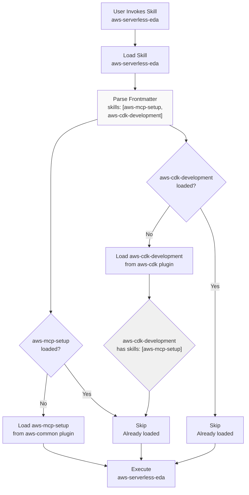
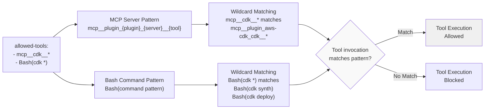
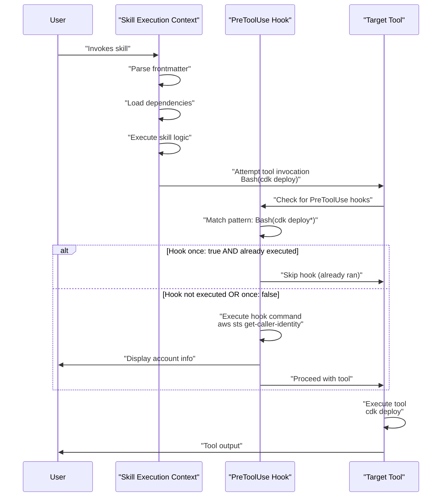
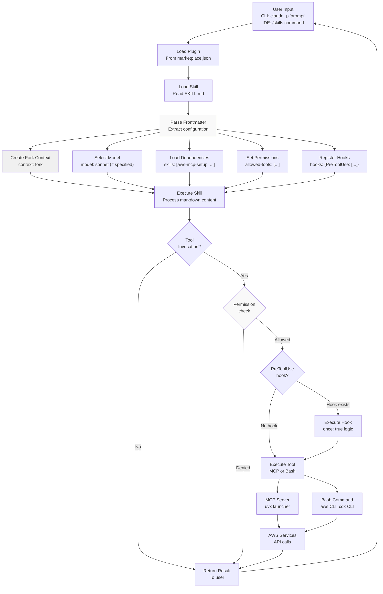
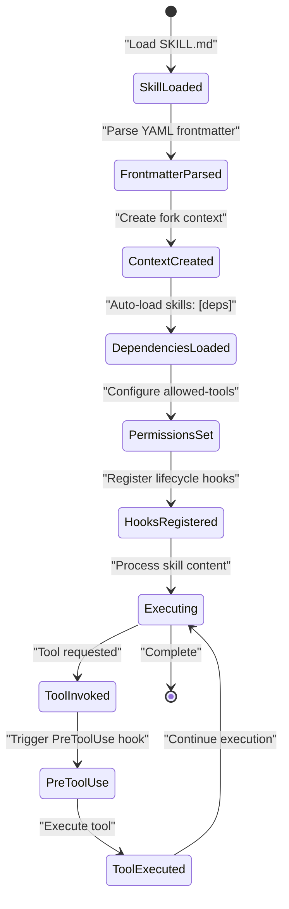

<!-- source: DeepWiki mcp.deepwiki.com · repo zxkane/aws-skills · page 3.2 Skills and Execution Model · fetched 2026-10-26 -->

# Skills and Execution Model

<details>
<summary>Relevant source files</summary>

The following files were used as context for generating this wiki page:

- [.claude-plugin/marketplace.json](.claude-plugin/marketplace.json)
- [CLAUDE.md](CLAUDE.md)
- [plugins/aws-cdk/skills/aws-cdk-development/SKILL.md](plugins/aws-cdk/skills/aws-cdk-development/SKILL.md)

</details>


This page documents how skills are defined, configured, and executed within the AWS Skills system. It covers the SKILL.md frontmatter format, fork execution context, dependency resolution, tool permission system, and lifecycle hooks that control skill behavior.

For information about plugin-level configuration and marketplace registration, see [Marketplace and Plugin System](#3.1). For MCP server integration details, see [MCP Server Integration](#3.3).

## Skill Definition Structure

Skills are defined in `SKILL.md` files within each plugin's `skills/<skill-name>/` directory. Each skill uses YAML frontmatter to declare metadata, dependencies, permissions, and execution context.

### SKILL.md Frontmatter Format

The frontmatter follows this structure:

```yaml
---
name: skill-name
description: detailed description with usage triggers
context: fork
model: sonnet
skills:
  - dependency-skill-1
  - dependency-skill-2
allowed-tools:
  - mcp__server__*
  - Bash(command pattern)
hooks:
  PreToolUse:
    - matcher: Bash(pattern)
      command: command to execute
      once: true
---
```

**Field Definitions:**

| Field | Type | Purpose | Example |
|-------|------|---------|---------|
| `name` | string | Unique skill identifier | `aws-cdk-development` |
| `description` | string | Usage guidance, trigger keywords | "Use when user mentions CDK, cdk synth, IaC..." |
| `context` | string | Execution isolation level | `fork` |
| `model` | string | Model selection for execution | `sonnet` |
| `skills` | array | Auto-loaded skill dependencies | `[aws-mcp-setup]` |
| `allowed-tools` | array | Permitted tool invocations | `[mcp__cdk__*, Bash(aws *)]` |
| `hooks` | object | Lifecycle event handlers | `PreToolUse: [...]` |

Sources: [plugins/aws-cdk/skills/aws-cdk-development/SKILL.md:1-21](), [CLAUDE.md:56-77]()

### Skill Discovery and Registration

The marketplace defines which skills are included in each plugin:



**Skill Discovery Flow:**
1. Claude Code reads `.claude-plugin/marketplace.json`
2. For each plugin entry, reads `plugins[].skills` array
3. Resolves skill paths relative to plugin `source` directory
4. Loads each `SKILL.md` file and parses frontmatter

Sources: [.claude-plugin/marketplace.json:11-151](), [CLAUDE.md:21-24]()

## Execution Context

### Fork Context Model

Skills execute in a **fork context**, creating an isolated sub-agent for each skill invocation:



**Fork Context Benefits:**
- **Isolation**: Each skill runs with its own context boundary
- **Model Selection**: Skills can specify optimal models for their domain
- **Permission Scoping**: Tool access is restricted per skill
- **Dependency Encapsulation**: Sub-skills load with their own contexts

Sources: [plugins/aws-cdk/skills/aws-cdk-development/SKILL.md:4](), [CLAUDE.md:64]()

### Model Selection

The `model` field specifies which Claude model executes the skill:

| Model Value | Description | Use Case |
|-------------|-------------|----------|
| `sonnet` | Claude Sonnet | Default for most skills, balanced performance |
| (unspecified) | System default | Uses Claude Code's configured model |

All current skills use `context: fork` without explicit `model` specification, defaulting to system configuration.

Sources: [CLAUDE.md:65]()

## Dependency Resolution

### Auto-Loading Mechanism

The `skills:` frontmatter field declares skill dependencies that are automatically loaded before the parent skill executes:



**Dependency Resolution Rules:**
1. Dependencies are loaded in declaration order
2. Already-loaded skills are skipped (no duplicate loading)
3. Transitive dependencies are resolved automatically
4. All skills ultimately depend on `aws-mcp-setup` from `aws-common` plugin

Sources: [plugins/aws-cdk/skills/aws-cdk-development/SKILL.md:5-6](), [CLAUDE.md:66-67]()

### Dependency Graph

The complete dependency graph across all plugins:

| Skill | Plugin | Dependencies |
|-------|--------|--------------|
| `aws-mcp-setup` | aws-common | *(none - root dependency)* |
| `aws-cdk-development` | aws-cdk | `[aws-mcp-setup]` |
| `aws-cost-operations` | aws-cost-ops | `[aws-mcp-setup]` |
| `aws-serverless-eda` | serverless-eda | `[aws-mcp-setup, aws-cdk-development]` |
| `aws-agentic-ai` | aws-agentic-ai | `[aws-mcp-setup]` |

**Key Insight:** Every skill in the system depends on `aws-mcp-setup`, either directly or transitively through `aws-cdk-development`. This ensures all AWS-related skills have access to AWS documentation lookup capabilities.

Sources: [.claude-plugin/marketplace.json:27-149](), [plugins/aws-cdk/skills/aws-cdk-development/SKILL.md:5-6]()

## Tool Permissions

### Allowed-Tools Declaration

The `allowed-tools:` field restricts which tools and commands a skill can invoke. This implements a permission boundary for fork contexts.

```yaml
allowed-tools:
  - mcp__cdk__*                    # All tools from CDK MCP server
  - mcp__aws-mcp__*                # All tools from AWS MCP server
  - mcp__awsdocs__*                # All tools from AWS Docs server
  - Bash(cdk *)                    # CDK CLI commands
  - Bash(npm *)                    # npm commands
  - Bash(npx *)                    # npx commands
  - Bash(aws cloudformation *)     # CloudFormation CLI
  - Bash(aws sts get-caller-identity) # Account identity check
```

Sources: [plugins/aws-cdk/skills/aws-cdk-development/SKILL.md:7-15]()

### Tool Permission Patterns



**Permission Model:**
- **MCP Tools**: Pattern `mcp__<server>__*` matches all tools from specified server
- **Bash Commands**: Pattern `Bash(command pattern)` uses wildcard matching
- **Wildcard Support**: `*` matches any characters in tool/command names
- **Explicit Permissions**: Each command must be explicitly allowed or wildcarded

Sources: [plugins/aws-cdk/skills/aws-cdk-development/SKILL.md:7-15](), [CLAUDE.md:68-70]()

### Tool Permission Scope by Skill

| Skill | MCP Servers | Bash Commands |
|-------|-------------|---------------|
| `aws-cdk-development` | `cdk`, `aws-mcp`, `awsdocs` | `cdk *`, `npm *`, `npx *`, `aws cloudformation *`, `aws sts get-caller-identity` |
| `aws-mcp-setup` | `aws-mcp`, `awsdocs` | (MCP configuration commands) |
| `aws-cost-operations` | `pricing`, `costexp`, `cw`, `aws-mcp`, `awsdocs` | (Cost analysis commands) |
| `aws-serverless-eda` | (inherits from `aws-cdk-development`) | (inherits from dependencies) |
| `aws-agentic-ai` | `aws-mcp`, `awsdocs` | (AgentCore deployment commands) |

Sources: [plugins/aws-cdk/skills/aws-cdk-development/SKILL.md:7-15]()

## Hooks and Lifecycle Events

### PreToolUse Hooks

The `hooks.PreToolUse` field defines commands that execute before specific tool invocations:

```yaml
hooks:
  PreToolUse:
    - matcher: Bash(cdk deploy*)
      command: aws sts get-caller-identity --query Account --output text
      once: true
```

**Hook Configuration:**

| Field | Type | Purpose |
|-------|------|---------|
| `matcher` | string | Tool pattern to trigger hook | 
| `command` | string | Command to execute before matched tool |
| `once` | boolean | Execute only once per session (prevents duplicates) |

Sources: [plugins/aws-cdk/skills/aws-cdk-development/SKILL.md:16-21](), [CLAUDE.md:71-76]()

### Hook Execution Flow



**Hook Use Cases:**

1. **Account Verification**: Verify AWS account before deployments
   - Hook: `aws sts get-caller-identity` before `cdk deploy*`
   - Prevents accidental cross-account deployments

2. **Prerequisite Checks**: Validate environment setup
   - Check credentials, CLI installations, configuration

3. **Audit Trails**: Log tool invocations for compliance
   - Record what operations are about to execute

Sources: [plugins/aws-cdk/skills/aws-cdk-development/SKILL.md:16-21]()

## Complete Execution Flow

### User to AWS Execution Path



**Execution Stages:**

1. **Initialization**: Load plugin and skill from marketplace
2. **Parsing**: Extract frontmatter configuration
3. **Context Setup**: Create fork, select model, load dependencies
4. **Permission Setup**: Configure allowed-tools and register hooks
5. **Execution**: Process skill content and handle tool invocations
6. **Tool Invocation**: Check permissions, run hooks, execute tools
7. **AWS Integration**: Route through MCP servers or Bash commands
8. **Result Handling**: Return output to user

Sources: [plugins/aws-cdk/skills/aws-cdk-development/SKILL.md:1-21](), [CLAUDE.md:56-77](), [.claude-plugin/marketplace.json:1-152]()

### Skill Lifecycle Events



**State Transitions:**

1. **SkillLoaded → FrontmatterParsed**: YAML block extracted and validated
2. **FrontmatterParsed → ContextCreated**: Fork context instantiated with isolated scope
3. **ContextCreated → DependenciesLoaded**: Recursive dependency loading
4. **DependenciesLoaded → PermissionsSet**: Tool permission boundary established
5. **PermissionsSet → HooksRegistered**: Lifecycle hooks attached to tool matchers
6. **Executing → ToolInvoked**: Skill logic requests tool execution
7. **ToolInvoked → PreToolUse**: Hook matcher fires (if configured)
8. **PreToolUse → ToolExecuted**: Tool proceeds after hook completion

Sources: [plugins/aws-cdk/skills/aws-cdk-development/SKILL.md:1-21](), [CLAUDE.md:56-77]()

## Frontmatter Best Practices

### Dependency Management

**Minimal Dependencies**: Only declare direct dependencies. Transitive dependencies load automatically.

```yaml
# ✅ GOOD - Minimal, explicit dependencies
skills:
  - aws-mcp-setup

# ❌ BAD - Redundant transitive dependency
skills:
  - aws-cdk-development  # This already loads aws-mcp-setup
  - aws-mcp-setup        # Redundant
```

### Tool Permission Patterns

**Use Wildcards Strategically**: Balance between security and usability.

```yaml
# ✅ GOOD - Scope to specific MCP servers
allowed-tools:
  - mcp__cdk__*            # All CDK server tools
  - mcp__aws-mcp__*        # All AWS MCP tools
  - Bash(cdk *)            # CDK CLI only
  - Bash(aws sts get-caller-identity)  # Specific command

# ❌ BAD - Overly permissive
allowed-tools:
  - mcp__*__*              # All MCP servers (too broad)
  - Bash(*)                # All bash commands (insecure)
```

### Hook Configuration

**Use once: true for Idempotent Operations**: Prevent duplicate executions of expensive or side-effecting commands.

```yaml
hooks:
  PreToolUse:
    # ✅ GOOD - Account check runs once per session
    - matcher: Bash(cdk deploy*)
      command: aws sts get-caller-identity --query Account --output text
      once: true
    
    # ❌ BAD - Would run on every deployment
    # - matcher: Bash(cdk deploy*)
    #   command: aws sts get-caller-identity
    #   once: false  # Wastes API calls
```

Sources: [plugins/aws-cdk/skills/aws-cdk-development/SKILL.md:5-21](), [CLAUDE.md:66-76]()

## Reference Implementation

The `aws-cdk-development` skill demonstrates all frontmatter features:

**File:** [plugins/aws-cdk/skills/aws-cdk-development/SKILL.md:1-21]()

- **Context Isolation**: `context: fork`
- **Dependency Loading**: `skills: [aws-mcp-setup]`
- **MCP Permissions**: `mcp__cdk__*`, `mcp__aws-mcp__*`, `mcp__awsdocs__*`
- **Bash Permissions**: `Bash(cdk *)`, `Bash(npm *)`, `Bash(aws cloudformation *)`
- **Lifecycle Hook**: PreToolUse hook for `aws sts get-caller-identity` before `cdk deploy*`

This frontmatter configuration ensures the skill has:
1. Isolated execution context
2. Access to AWS documentation through auto-loaded `aws-mcp-setup`
3. Controlled tool permissions for CDK operations
4. Account verification before deployments

Sources: [plugins/aws-cdk/skills/aws-cdk-development/SKILL.md:1-21]()

---

