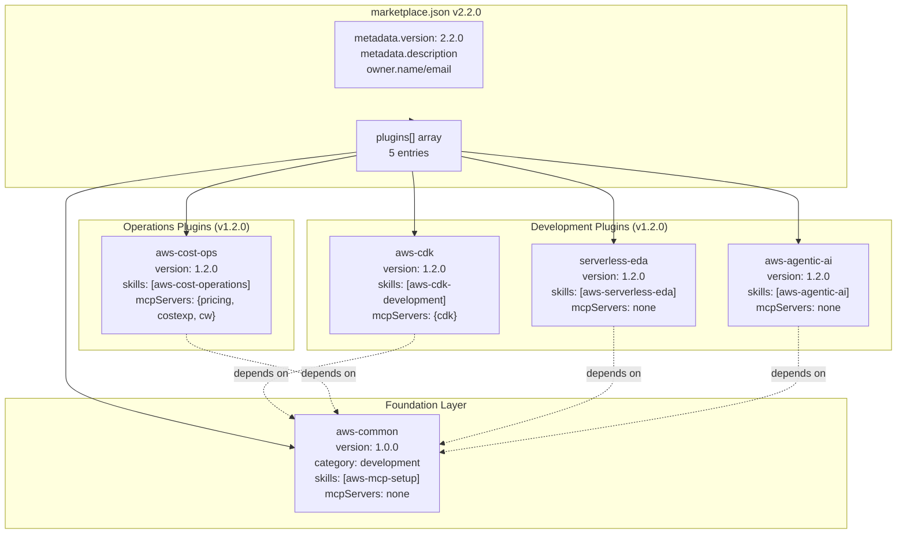
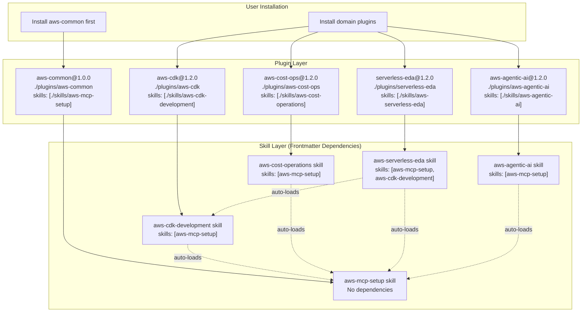
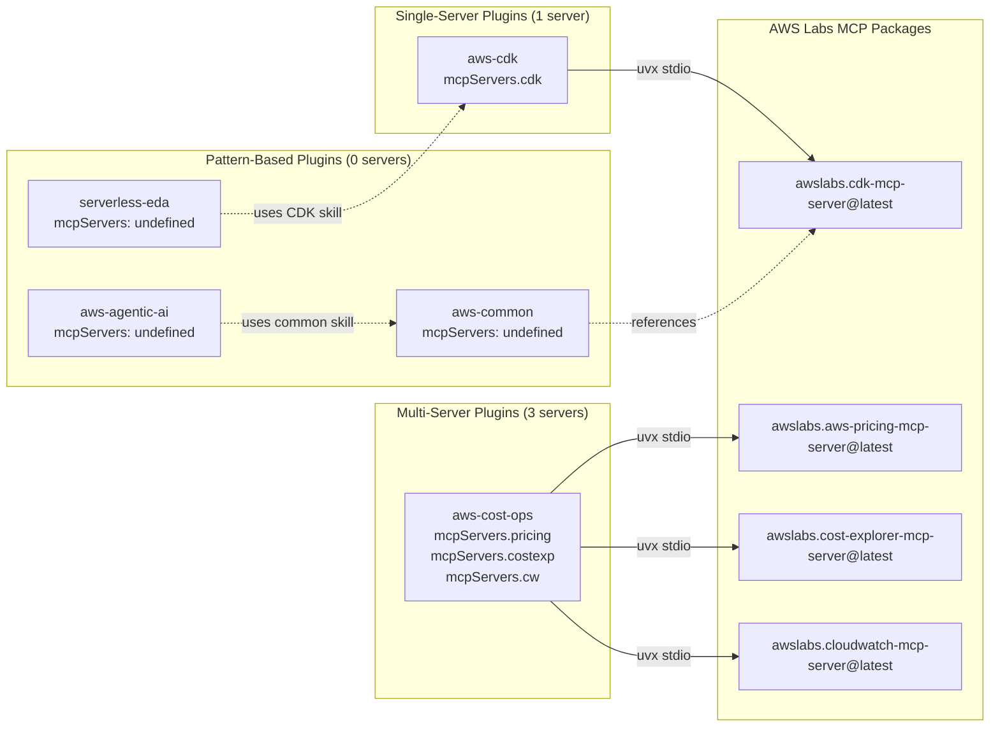
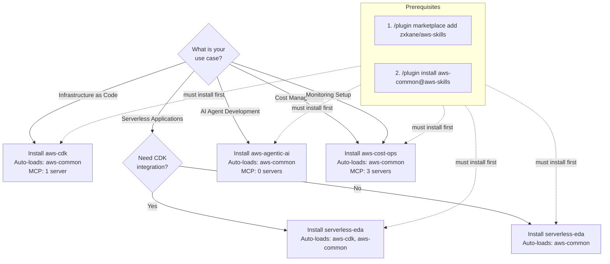

<!-- source: DeepWiki mcp.deepwiki.com · repo zxkane/aws-skills · page 4 Plugins · fetched 2026-10-26 -->

# Plugins

<details>
<summary>Relevant source files</summary>

The following files were used as context for generating this wiki page:

- [.claude-plugin/marketplace.json](.claude-plugin/marketplace.json)
- [README.md](README.md)

</details>


## Purpose and Scope

This page provides an overview of the five plugins available in the AWS Skills marketplace. Each plugin provides specialized AWS development capabilities through Claude Code skills and integrated MCP servers. The page covers plugin categories, versioning, dependency relationships, and MCP server integration patterns.

For detailed documentation on individual plugins, see:
- [aws-common Plugin](#4.1) - Foundational dependency
- [aws-cdk Plugin](#4.2) - Infrastructure as Code
- [aws-cost-ops Plugin](#4.3) - Cost optimization and operations
- [serverless-eda Plugin](#4.4) - Serverless and event-driven architecture
- [aws-agentic-ai Plugin](#4.5) - Bedrock AgentCore for AI agents

For installation instructions, see [Installation](#2.1). For MCP setup, see [MCP Setup](#2.2).

## Plugin Registry Structure

The marketplace registry at [.claude-plugin/marketplace.json:1-152]() defines all five plugins with standardized metadata. The registry operates at version `2.2.0` and is owned by Kane Zhu. Each plugin entry contains:

- `name` - Plugin identifier used in installation commands
- `description` - Brief summary of plugin capabilities
- `version` - Semantic version (either `1.0.0` or `1.2.0`)
- `category` - Either `"development"` or `"operations"`
- `source` - Relative path to plugin directory (e.g., `"./plugins/aws-common"`)
- `skills` - Array of skill paths (e.g., `["./skills/aws-mcp-setup"]`)
- `mcpServers` - Optional object mapping server names to stdio configurations
- `strict` - Boolean flag (set to `false` for all plugins)

### Plugin Registry Overview



**Sources:** [.claude-plugin/marketplace.json:1-152]()

## Plugin Comparison

| Plugin | Version | Category | Skills | MCP Servers | Dependencies | Primary Use Case |
|--------|---------|----------|--------|-------------|--------------|------------------|
| `aws-common` | 1.0.0 | development | 1 | 0 | none | MCP configuration for all plugins |
| `aws-cdk` | 1.2.0 | development | 1 | 1 (cdk) | aws-common | Infrastructure as Code with CDK |
| `aws-cost-ops` | 1.2.0 | operations | 1 | 3 (pricing, costexp, cw) | aws-common | Cost optimization and monitoring |
| `serverless-eda` | 1.2.0 | development | 1 | 0 | aws-common, aws-cdk | Serverless and event-driven architecture |
| `aws-agentic-ai` | 1.2.0 | development | 1 | 0 | aws-common | Bedrock AgentCore for AI agents |

**Sources:** [.claude-plugin/marketplace.json:11-151](), [README.md:5-67]()

## Version Strategy

The marketplace employs a two-tier versioning strategy:

### Foundation Layer (v1.0.0)
The `aws-common` plugin remains at version `1.0.0` [.claude-plugin/marketplace.json:15](), indicating a stable, mature foundation. This lower version number reflects its role as a dependency that rarely changes.

### Domain Plugins (v1.2.0)
All four domain-specific plugins (`aws-cdk`, `aws-cost-ops`, `serverless-eda`, `aws-agentic-ai`) share version `1.2.0` [.claude-plugin/marketplace.json:34,65,116,135](). The higher minor version indicates active development and feature additions.

### Marketplace Version (v2.2.0)
The overall marketplace version `2.2.0` [.claude-plugin/marketplace.json:9]() tracks structural changes to the plugin ecosystem itself, such as adding new plugins to the registry.

**Sources:** [.claude-plugin/marketplace.json:9,15,34,65,116,135]()

## Dependency Architecture

All domain plugins declare a transitive dependency on `aws-common` through their skill frontmatter configurations. The `serverless-eda` plugin additionally depends on `aws-cdk` skills.

### Plugin Dependency Graph



**Installation Requirement:** Users must install `aws-common` before any domain plugin [.claude-plugin/marketplace.json:11-30](), as documented in [README.md:77-87](). The skill dependency chain automatically loads required skills at runtime through the frontmatter `skills:` field.

**Sources:** [.claude-plugin/marketplace.json:11-151](), [README.md:77-87]()

## MCP Server Integration

Plugins vary significantly in their MCP server integration complexity. The `mcpServers` object in each plugin definition configures stdio-based MCP servers launched via `uvx`.

### MCP Server Configuration Pattern

All MCP servers follow the standardized configuration pattern defined in [.claude-plugin/marketplace.json:49-60,80-111]():

```json
"mcpServers": {
  "<server-name>": {
    "type": "stdio",
    "command": "uvx",
    "args": ["awslabs.<package>-mcp-server@latest"],
    "env": {
      "FASTMCP_LOG_LEVEL": "ERROR"
    }
  }
}
```

### MCP Server Distribution



**Integration Strategy:**
- **Zero Integration**: `aws-common`, `serverless-eda`, and `aws-agentic-ai` define no `mcpServers` [.claude-plugin/marketplace.json:11-30,113-131,132-150](). These plugins rely on pattern libraries, documentation, and transitive dependencies.
- **Single Integration**: `aws-cdk` integrates one server named `cdk` for CDK construct operations [.claude-plugin/marketplace.json:49-60]()
- **Multi Integration**: `aws-cost-ops` integrates three servers for comprehensive cost/monitoring [.claude-plugin/marketplace.json:80-111]():
  - `pricing` - AWS Pricing API access
  - `costexp` - Cost Explorer analysis
  - `cw` - CloudWatch metrics and logs

**Sources:** [.claude-plugin/marketplace.json:49-111]()

## Plugin Categories and Use Cases

### Development Plugins (category: "development")

Four plugins target the development phase with `"category": "development"` [.claude-plugin/marketplace.json:24,43,125,144]():

**aws-common** [.claude-plugin/marketplace.json:13-30]()
- **Primary Purpose**: MCP configuration and AWS documentation access
- **Key Skill**: `aws-mcp-setup` for setting up AWS MCP tools
- **Usage**: Automatically loaded by all other plugins as a dependency
- **When to Use**: Required for all AWS development in Claude Code

**aws-cdk** [.claude-plugin/marketplace.json:32-61]()
- **Primary Purpose**: Infrastructure as Code with AWS CDK
- **Key Features**: CDK best practices, resource naming conventions, Lambda bundling
- **MCP Server**: CDK MCP for construct recommendations
- **When to Use**: Building and deploying AWS infrastructure with CDK

**serverless-eda** [.claude-plugin/marketplace.json:113-131]()
- **Primary Purpose**: Serverless and event-driven architecture patterns
- **Key Features**: 7 Well-Architected design principles, event-driven patterns, Step Functions orchestration
- **Dependencies**: `aws-common` + `aws-cdk` (transitive)
- **When to Use**: Designing serverless applications or event-driven systems

**aws-agentic-ai** [.claude-plugin/marketplace.json:132-150]()
- **Primary Purpose**: Bedrock AgentCore for AI agent deployment
- **Key Features**: 7 AgentCore services (Gateway, Runtime, Memory, Identity, Code Interpreter, Browser, Observability)
- **When to Use**: Building and deploying AI agents with Bedrock AgentCore

### Operations Plugins (category: "operations")

One plugin targets post-deployment operations with `"category": "operations"` [.claude-plugin/marketplace.json:74]():

**aws-cost-ops** [.claude-plugin/marketplace.json:63-112]()
- **Primary Purpose**: Cost optimization, monitoring, and operational excellence
- **MCP Servers**: 3 servers for pricing, cost analysis, and CloudWatch
- **Key Features**: Pre-deployment cost estimation, post-deployment analysis, monitoring patterns
- **When to Use**: Optimizing costs, setting up monitoring, or investigating operational issues

**Sources:** [.claude-plugin/marketplace.json:13-150](), [README.md:7-67]()

## Plugin Selection Guide



**Decision Criteria:**

| If you need to... | Install | Rationale |
|-------------------|---------|-----------|
| Build CDK infrastructure | `aws-cdk` | Provides CDK patterns, validation, and MCP server |
| Design serverless systems | `serverless-eda` | Provides 7 Well-Architected principles and event patterns |
| Deploy AI agents | `aws-agentic-ai` | Comprehensive AgentCore service coverage |
| Estimate costs before deployment | `aws-cost-ops` | Pricing MCP server for cost estimation |
| Monitor existing resources | `aws-cost-ops` | CloudWatch MCP server for metrics and logs |
| Analyze spending patterns | `aws-cost-ops` | Cost Explorer MCP server for analysis |
| Query AWS documentation | Already included | `aws-common` auto-loads with any plugin |

**Sources:** [.claude-plugin/marketplace.json:11-151](), [README.md:69-87]()

## Plugin Metadata Fields

Each plugin entry in [.claude-plugin/marketplace.json:11-151]() contains the following standardized fields:

### Required Fields
- `name` - String identifier (e.g., `"aws-common"`, `"aws-cdk"`)
- `description` - Brief summary of capabilities
- `version` - Semantic version string
- `author.name` - Author name (all plugins: `"Kane Zhu"`)
- `author.email` - Author email (all plugins: `"me@kane.mx"`)
- `homepage` - GitHub repository URL
- `repository` - GitHub repository URL (same as homepage)
- `license` - License type (all plugins: `"MIT"`)
- `keywords` - Array of searchable keywords
- `category` - Either `"development"` or `"operations"`
- `source` - Relative path to plugin directory
- `strict` - Boolean flag (all plugins: `false`)
- `skills` - Array of skill paths

### Optional Fields
- `mcpServers` - Object mapping server names to stdio configurations (only present in `aws-cdk` and `aws-cost-ops`)

**Sources:** [.claude-plugin/marketplace.json:11-151]()

---

