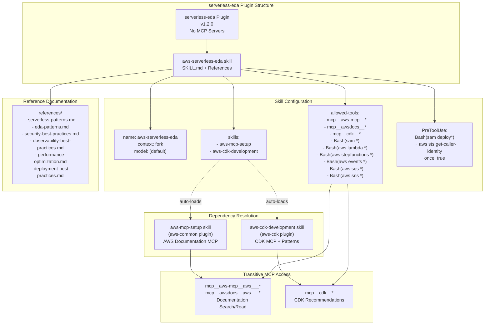
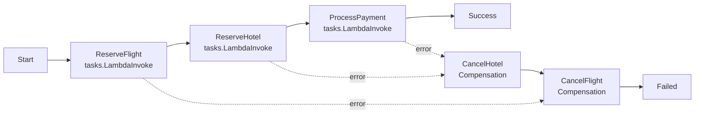
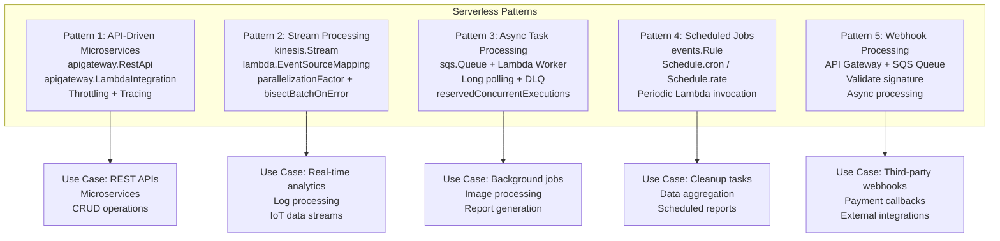
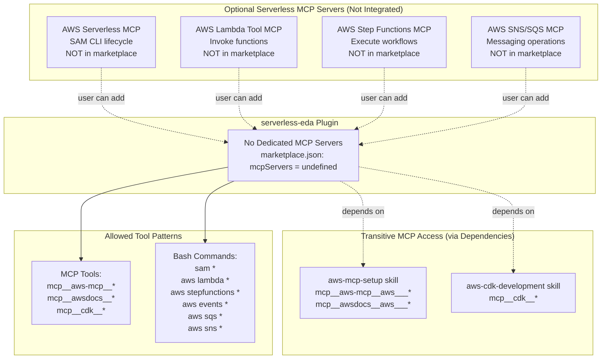

<!-- source: DeepWiki mcp.deepwiki.com · repo zxkane/aws-skills · page 4.4 serverless-eda Plugin · fetched 2026-10-26 -->

# serverless-eda Plugin

<details>
<summary>Relevant source files</summary>

The following files were used as context for generating this wiki page:

- [.claude-plugin/marketplace.json](.claude-plugin/marketplace.json)
- [README.md](README.md)
- [plugins/serverless-eda/skills/aws-serverless-eda/SKILL.md](plugins/serverless-eda/skills/aws-serverless-eda/SKILL.md)

</details>


## Purpose and Scope

This document covers the **serverless-eda plugin** (version 1.2.0), which provides comprehensive guidance for building serverless applications and event-driven architectures on AWS based on the Well-Architected Framework. The plugin includes seven design principles for serverless applications and five event-driven architecture patterns.

For CDK infrastructure implementation details, see [aws-cdk Plugin](#4.2). For AWS MCP setup and foundational capabilities, see [aws-common Plugin](#4.1). For operational concerns like cost and monitoring, see [aws-cost-ops Plugin](#4.3).

**Sources:** [.claude-plugin/marketplace.json:113-130](), [README.md:44-53]()

## Overview

The serverless-eda plugin is a **pattern-based** plugin that provides architectural guidance without dedicated MCP servers. It differs from other plugins in the marketplace by focusing on design principles and reference patterns rather than tool integrations.

| Property | Value |
|----------|-------|
| Plugin Name | `serverless-eda` |
| Version | `1.2.0` |
| Category | `development` |
| Source Path | `./plugins/serverless-eda` |
| Primary Skill | `aws-serverless-eda` |
| MCP Servers | **0** (pattern-based approach) |
| Dependencies | `aws-mcp-setup`, `aws-cdk-development` |
| Keywords | `aws`, `serverless`, `lambda`, `event-driven`, `eda`, `step-functions`, `eventbridge`, `sqs`, `sns` |

**Key Characteristics:**
- **No dedicated MCP servers**: Unlike `aws-cost-ops` (3 servers) or `aws-cdk` (1 server), this plugin operates purely on guidance patterns
- **Dual dependency**: Requires both `aws-mcp-setup` and `aws-cdk-development` to leverage documentation and infrastructure capabilities
- **Comprehensive coverage**: Spans Lambda, API Gateway, DynamoDB, Step Functions, EventBridge, SQS, SNS, and Kinesis
- **Well-Architected alignment**: All guidance derives from AWS Well-Architected Serverless Lens

**Sources:** [.claude-plugin/marketplace.json:113-130](), [plugins/serverless-eda/skills/aws-serverless-eda/SKILL.md:1-27]()

## Plugin Architecture and Dependencies



**Architecture Notes:**

1. **Zero MCP Servers**: The plugin registers no MCP servers in `marketplace.json`, distinguishing it from `aws-cdk` (1 server) and `aws-cost-ops` (3 servers)
2. **Skill Auto-Loading**: Invoking `aws-serverless-eda` automatically loads `aws-mcp-setup` and `aws-cdk-development`, creating a three-skill execution context
3. **Transitive Tool Access**: Through dependencies, gains access to AWS Documentation MCP and CDK MCP without declaring its own servers
4. **Fork Context**: Executes in isolated sub-agent with full tool permissions inherited from skill configuration
5. **Hook Validation**: Before any `sam deploy*` command, automatically verifies AWS account context using `aws sts get-caller-identity` (once per session)

**Sources:** [.claude-plugin/marketplace.json:113-130](), [plugins/serverless-eda/skills/aws-serverless-eda/SKILL.md:1-27]()

## When to Use This Skill

The `aws-serverless-eda` skill is invoked automatically by Claude Code when user prompts contain specific keywords or architectural patterns:

| Trigger Category | Keywords/Patterns |
|------------------|-------------------|
| **Serverless Basics** | `serverless`, `Lambda`, `Lambda function`, `API Gateway`, `REST API`, `HTTP API` |
| **Event-Driven** | `event-driven`, `EventBridge`, `SQS`, `SNS`, `async processing`, `queues`, `pub/sub` |
| **Orchestration** | `Step Functions`, `state machine`, `workflow`, `saga pattern`, `distributed transaction` |
| **Data Processing** | `Kinesis`, `stream processing`, `DynamoDB Streams`, `event sourcing` |
| **Microservices** | `microservices`, `API-driven`, `service mesh`, `async communication` |
| **Architecture** | "build scalable serverless", "design event-driven system", "implement saga" |

**Skill Selection Logic** (from description in [SKILL.md:3]()):
> Use when building serverless APIs, Lambda functions, REST APIs, microservices, or async workflows. Essential when user mentions serverless, Lambda, API Gateway, event-driven, async processing, queues, pub/sub, or wants to build scalable serverless applications with AWS best practices.

**Sources:** [plugins/serverless-eda/skills/aws-serverless-eda/SKILL.md:1-97]()

## Seven Well-Architected Design Principles

The plugin enforces seven core design principles from the AWS Well-Architected Serverless Lens. Each principle maps to specific code patterns:

```mermaid
graph TB
    subgraph "Principle 1: Speedy, Simple, Singular"
        P1["Single-purpose functions<br/>Minimize cold starts<br/>Optimize memory"]
        P1Code["Code Pattern:<br/>export const processOrder<br/>export const validateOrder<br/>export const publishEvent"]
        P1 --> P1Code
    end
    
    subgraph "Principle 2: Think Concurrent Requests"
        P2["Design for concurrency<br/>Not total volume<br/>Control throttling"]
        P2Code["Code Pattern:<br/>table.autoScaleReadCapacity()<br/>table.autoScaleWriteCapacity()<br/>reservedConcurrentExecutions"]
        P2 --> P2Code
    end
    
    subgraph "Principle 3: Share Nothing"
        P3["No local state<br/>Use persistent storage<br/>Stateless functions"]
        P3Code["Code Pattern:<br/>s3.putObject()<br/>dynamodb.putItem()<br/>elasticache.set()"]
        P3 --> P3Code
    end
    
    subgraph "Principle 4: Assume No Hardware Affinity"
        P4["Hardware-agnostic<br/>Environment variables<br/>Portable design"]
        P4Code["Code Pattern:<br/>process.env.BUCKET_NAME<br/>process.env.TABLE_NAME<br/>process.env.QUEUE_URL"]
        P4 --> P4Code
    end
    
    subgraph "Principle 5: Orchestrate with State Machines"
        P5["Use Step Functions<br/>Not function chaining<br/>Visual workflows"]
        P5Code["Code Pattern:<br/>stepfunctions.StateMachine<br/>stepfunctions.Chain.start()<br/>tasks.LambdaInvoke"]
        P5 --> P5Code
    end
    
    subgraph "Principle 6: Use Events to Trigger"
        P6["Event-driven<br/>Not synchronous<br/>Loose coupling"]
        P6Code["Code Pattern:<br/>s3.addEventNotification<br/>events.Rule<br/>eventPattern"]
        P6 --> P6Code
    end
    
    subgraph "Principle 7: Design for Failures"
        P7["Idempotent operations<br/>Retry logic<br/>Exponential backoff"]
        P7Code["Code Pattern:<br/>dynamodb.getItem(orderId)<br/>await withRetry(fn)<br/>reportBatchItemFailures"]
        P7 --> P7Code
    end
```



### Principle 1: Speedy, Simple, Singular

**Concept**: Functions should be concise, single-purpose, and environmentally efficient.

**Code Implementation** [SKILL.md:104-119]():
- ✅ **Good**: `export const processOrder = async (event: OrderEvent)` - single responsibility
- ❌ **Bad**: `export const handleEverything = async (event: any)` - multiple concerns

**Optimization Checklist**:
- Minimize cold start times
- Optimize memory allocation (128MB-10GB range)
- Use provisioned concurrency only when needed
- Leverage connection reuse (database pools)

### Principle 2: Think Concurrent Requests, Not Total Requests

**Concept**: Lambda scales horizontally; design for concurrent execution limits, not total volume.

**Code Implementation** [SKILL.md:137-152]():
```typescript
// Auto-scales with concurrent load
const table = new dynamodb.Table(this, 'Table', {
  billingMode: dynamodb.BillingMode.PAY_PER_REQUEST,
});

// Or with auto-scaling
table.autoScaleReadCapacity({ minCapacity: 5, maxCapacity: 100 });
table.autoScaleWriteCapacity({ minCapacity: 5, maxCapacity: 100 });
```

**Design Considerations**:
- Concurrent execution limits (account-level, function-level)
- Downstream service throttling (DynamoDB, RDS)
- Shared resource contention (VPC ENIs)
- Connection pool sizing (database connections)

### Principle 3: Share Nothing

**Concept**: Function runtime environments are ephemeral; state must be externalized.

**Code Implementation** [SKILL.md:159-179]():
- ❌ **Bad**: `fs.writeFileSync('/tmp/data.json')` - lost after execution
- ✅ **Good**: `s3.putObject({ Bucket, Key, Body })` - persistent storage

**State Management Options**:
- **DynamoDB**: Persistent application state
- **Step Functions**: Workflow state and orchestration
- **ElastiCache**: Session state and caching
- **S3**: File storage and archives

### Principle 4: Assume No Hardware Affinity

**Concept**: Applications must be hardware-agnostic; infrastructure can change without notice.

**Design Pattern** [SKILL.md:181-194]():
- Use environment variables for configuration
- Avoid hardware-specific optimizations
- Test across different environments
- No assumptions about underlying infrastructure

### Principle 5: Orchestrate with State Machines, Not Function Chaining

**Concept**: Use Step Functions for orchestration instead of Lambda-to-Lambda invocations.

**Code Comparison** [SKILL.md:199-225]():

❌ **Anti-Pattern**: Lambda chaining
```typescript
export const handler1 = async (event: any) => {
  const result = await processStep1(event);
  await lambda.invoke({
    FunctionName: 'handler2',
    Payload: JSON.stringify(result),
  });
};
```

✅ **Best Practice**: Step Functions orchestration
```typescript
const stateMachine = new stepfunctions.StateMachine(this, 'OrderWorkflow', {
  definition: stepfunctions.Chain
    .start(validateOrder)
    .next(processPayment)
    .next(shipOrder)
    .next(sendConfirmation),
});
```

**Step Functions Benefits**:
- Visual workflow representation
- Built-in error handling and retries
- Execution history and debugging
- Parallel and sequential execution
- Service integrations without code

### Principle 6: Use Events to Trigger Transactions

**Concept**: Favor event-driven patterns over synchronous request/response.

**Code Implementation** [SKILL.md:231-255]():

**S3 Event Notification**:
```typescript
bucket.addEventNotification(
  s3.EventType.OBJECT_CREATED,
  new s3n.LambdaDestination(processFunction),
  { prefix: 'uploads/' }
);
```

**EventBridge Integration**:
```typescript
const rule = new events.Rule(this, 'OrderRule', {
  eventPattern: {
    source: ['orders'],
    detailType: ['OrderPlaced'],
  },
});
rule.addTarget(new targets.LambdaFunction(processOrderFunction));
```

**Benefits**: Loose coupling, asynchronous processing, fault tolerance, independent scaling

### Principle 7: Design for Failures and Duplicates

**Concept**: Operations must be idempotent with retry logic and exponential backoff.

**Idempotency Pattern** [SKILL.md:262-302]():
```typescript
export const handler = async (event: SQSEvent) => {
  for (const record of event.Records) {
    const orderId = JSON.parse(record.body).orderId;
    
    // Check if already processed (idempotency)
    const existing = await dynamodb.getItem({
      TableName: process.env.TABLE_NAME,
      Key: { orderId },
    });
    
    if (existing.Item) {
      console.log('Order already processed:', orderId);
      continue; // Skip duplicate
    }
    
    await processOrder(orderId);
    await dynamodb.putItem({ /* mark as processed */ });
  }
};
```

**Retry with Exponential Backoff** [SKILL.md:291-302]():
```typescript
async function withRetry<T>(fn: () => Promise<T>, maxRetries = 3): Promise<T> {
  for (let i = 0; i < maxRetries; i++) {
    try {
      return await fn();
    } catch (error) {
      if (i === maxRetries - 1) throw error;
      await new Promise(resolve => setTimeout(resolve, Math.pow(2, i) * 1000));
    }
  }
}
```

**Sources:** [plugins/serverless-eda/skills/aws-serverless-eda/SKILL.md:98-304]()

## Five Event-Driven Architecture Patterns

The plugin provides five canonical EDA patterns that map directly to AWS services:

```mermaid
graph TB
    subgraph "Pattern 1: Event Router"
        ER["EventBridge Custom Bus<br/>events.EventBus<br/>events.Rule<br/>eventPattern matching"]
        ER1["Use Case:<br/>Route events to multiple consumers<br/>Content-based routing<br/>Schema validation"]
    end
    
    subgraph "Pattern 2: Queue-Based Processing"
        QP["SQS Queue + Lambda Consumer<br/>sqs.Queue<br/>lambda.EventSourceMapping<br/>batchSize + maxBatchingWindow"]
        QP1["Use Case:<br/>At-least-once delivery<br/>Async processing<br/>Load leveling"]
    end
    
    subgraph "Pattern 3: Pub/Sub Fan-Out"
        PS["SNS Topic + SQS Subscriptions<br/>sns.Topic<br/>subscriptions.SqsSubscription<br/>Multiple consumers"]
        PS1["Use Case:<br/>Broadcast to multiple services<br/>Parallel processing<br/>Service decoupling"]
    end
    
    subgraph "Pattern 4: Saga Pattern"
        SP["Step Functions + Compensation<br/>stepfunctions.StateMachine<br/>tasks.LambdaInvoke<br/>addCatch(compensate)"]
        SP1["Use Case:<br/>Distributed transactions<br/>Long-running workflows<br/>Rollback on failure"]
    end
    
    subgraph "Pattern 5: Event Sourcing"
        ES["DynamoDB Event Store<br/>partitionKey: aggregateId<br/>sortKey: version<br/>stream: NEW_IMAGE"]
        ES1["Use Case:<br/>Audit trail<br/>Temporal queries<br/>Event replay"]
    end
    
    ER --> ER1
    QP --> QP1
    PS --> PS1
    SP --> SP1
    ES --> ES1
```



### Pattern 1: Event Router (EventBridge)

**Architecture**: Central event bus with content-based routing using EventBridge rules.

**Core Components** [SKILL.md:311-357]():

| Component | CDK Construct | Purpose |
|-----------|--------------|---------|
| Event Bus | `events.EventBus` | Custom namespace for events |
| Schema | `events.Schema` | Event contract definition |
| Rules | `events.Rule` | Pattern-based routing |
| Targets | `targets.LambdaFunction` | Event consumers |

**Implementation Example**:
```typescript
// Custom event bus
const eventBus = new events.EventBus(this, 'AppEventBus', {
  eventBusName: 'application-events',
});

// Multiple rules for different consumers
new events.Rule(this, 'ProcessOrderRule', {
  eventBus,
  eventPattern: {
    source: ['orders'],
    detailType: ['OrderPlaced'],
  },
  targets: [new targets.LambdaFunction(processOrderFunction)],
});

new events.Rule(this, 'NotifyCustomerRule', {
  eventBus,
  eventPattern: {
    source: ['orders'],
    detailType: ['OrderPlaced'],
  },
  targets: [new targets.LambdaFunction(notifyCustomerFunction)],
});
```

**Use Cases**: Microservices communication, event-driven workflows, service decoupling

### Pattern 2: Queue-Based Processing (SQS)

**Architecture**: SQS queues with Lambda consumers for reliable asynchronous processing.

**Queue Types** [SKILL.md:362-388]():

| Queue Type | Use Case | Code Pattern |
|------------|----------|--------------|
| **Standard** | At-least-once delivery, high throughput | `new sqs.Queue()` |
| **FIFO** | Exactly-once, ordered processing | `fifo: true, contentBasedDeduplication: true` |

**Implementation with DLQ** [SKILL.md:364-387]():
```typescript
// Standard queue with DLQ
const queue = new sqs.Queue(this, 'ProcessingQueue', {
  visibilityTimeout: Duration.seconds(300),
  retentionPeriod: Duration.days(14),
  deadLetterQueue: {
    queue: dlq,
    maxReceiveCount: 3,
  },
});

// Lambda consumer with batching
new lambda.EventSourceMapping(this, 'QueueConsumer', {
  target: processingFunction,
  eventSourceArn: queue.queueArn,
  batchSize: 10,
  maxBatchingWindow: Duration.seconds(5),
});
```

**Use Cases**: Background job processing, load leveling, retry semantics, decoupling producers/consumers

### Pattern 3: Pub/Sub (SNS + SQS Fan-Out)

**Architecture**: SNS topic broadcasts to multiple SQS queues, each with dedicated Lambda consumer.

**Fan-Out Pattern** [SKILL.md:393-414]():
```typescript
// SNS topic
const topic = new sns.Topic(this, 'OrderTopic', {
  displayName: 'Order Events',
});

// Multiple SQS subscriptions
const inventoryQueue = new sqs.Queue(this, 'InventoryQueue');
const shippingQueue = new sqs.Queue(this, 'ShippingQueue');
const analyticsQueue = new sqs.Queue(this, 'AnalyticsQueue');

topic.addSubscription(new subscriptions.SqsSubscription(inventoryQueue));
topic.addSubscription(new subscriptions.SqsSubscription(shippingQueue));
topic.addSubscription(new subscriptions.SqsSubscription(analyticsQueue));

// Each queue has independent consumer
new lambda.EventSourceMapping(this, 'InventoryConsumer', {
  target: inventoryFunction,
  eventSourceArn: inventoryQueue.queueArn,
});
```

**Benefits**: Broadcast events, parallel processing, service independence, buffering

### Pattern 4: Saga Pattern with Step Functions

**Architecture**: Distributed transactions with compensating actions for rollback.

**Saga Implementation** [SKILL.md:419-456]():



**Code Pattern**:
```typescript
const definition = reserveFlight
  .next(reserveHotel)
  .next(processPayment)
  .addCatch(cancelHotel.next(cancelFlight), {
    resultPath: '$.error',
  });

new stepfunctions.StateMachine(this, 'BookingStateMachine', {
  definition,
  timeout: Duration.minutes(5),
});
```

**Use Cases**: Multi-service transactions (booking systems), long-running workflows, eventual consistency

### Pattern 5: Event Sourcing

**Architecture**: DynamoDB streams as append-only event store with projection functions.

**Event Store Schema** [SKILL.md:462-501]():

| Column | Type | Purpose |
|--------|------|---------|
| `aggregateId` | STRING (PK) | Entity identifier |
| `version` | NUMBER (SK) | Event sequence number |
| `eventType` | STRING | Event classification |
| `eventData` | MAP | Event payload |
| `timestamp` | NUMBER | Event creation time |

**Implementation**:
```typescript
const eventStore = new dynamodb.Table(this, 'EventStore', {
  partitionKey: { name: 'aggregateId', type: dynamodb.AttributeType.STRING },
  sortKey: { name: 'version', type: dynamodb.AttributeType.NUMBER },
  stream: dynamodb.StreamViewType.NEW_IMAGE,
});

// Lambda appends events
export const handleCommand = async (event: any) => {
  const { aggregateId, eventType, eventData } = event;
  
  // Get current version
  const items = await dynamodb.query({
    KeyConditionExpression: 'aggregateId = :id',
    Limit: 1,
  });
  
  const nextVersion = items.Items?.[0]?.version + 1 || 1;
  
  // Append event
  await dynamodb.putItem({
    Item: { aggregateId, version: nextVersion, eventType, eventData, timestamp: Date.now() },
  });
};

// Projections read from stream
eventStore.grantStreamRead(projectionFunction);
```

**Use Cases**: Audit trails, temporal queries, event replay, CQRS architectures

**Sources:** [plugins/serverless-eda/skills/aws-serverless-eda/SKILL.md:305-501]()

## Serverless Architecture Patterns

Five additional patterns for common serverless use cases:



### Pattern 1: API-Driven Microservices

**Components**: REST API with Lambda backend, throttling, and X-Ray tracing.

**Implementation** [SKILL.md:508-528]():
```typescript
const api = new apigateway.RestApi(this, 'Api', {
  restApiName: 'microservices-api',
  deployOptions: {
    throttlingRateLimit: 1000,
    throttlingBurstLimit: 2000,
    tracingEnabled: true,
  },
});

// User service
const users = api.root.addResource('users');
users.addMethod('GET', new apigateway.LambdaIntegration(getUsersFunction));
users.addMethod('POST', new apigateway.LambdaIntegration(createUserFunction));

// Order service
const orders = api.root.addResource('orders');
orders.addMethod('GET', new apigateway.LambdaIntegration(getOrdersFunction));
orders.addMethod('POST', new apigateway.LambdaIntegration(createOrderFunction));
```

### Pattern 2: Stream Processing

**Components**: Kinesis stream with Lambda consumer, parallel processing, and error handling.

**Configuration** [SKILL.md:533-552]():
```typescript
const stream = new kinesis.Stream(this, 'DataStream', {
  shardCount: 2,
  retentionPeriod: Duration.days(7),
});

new lambda.EventSourceMapping(this, 'StreamProcessor', {
  target: processFunction,
  eventSourceArn: stream.streamArn,
  batchSize: 100,
  maxBatchingWindow: Duration.seconds(5),
  parallelizationFactor: 10,
  startingPosition: lambda.StartingPosition.LATEST,
  retryAttempts: 3,
  bisectBatchOnError: true,
  onFailure: new lambdaDestinations.SqsDestination(dlq),
});
```

### Pattern 3: Async Task Processing

**Components**: SQS queue with Lambda worker, concurrency control, and partial batch failures.

**Implementation** [SKILL.md:557-581]():
```typescript
const taskQueue = new sqs.Queue(this, 'TaskQueue', {
  visibilityTimeout: Duration.minutes(5),
  receiveMessageWaitTime: Duration.seconds(20), // Long polling
  deadLetterQueue: { queue: dlq, maxReceiveCount: 3 },
});

const worker = new lambda.Function(this, 'TaskWorker', {
  reservedConcurrentExecutions: 10, // Control concurrency
});

new lambda.EventSourceMapping(this, 'TaskConsumer', {
  target: worker,
  eventSourceArn: taskQueue.queueArn,
  batchSize: 10,
  reportBatchItemFailures: true, // Partial batch failure handling
});
```

### Pattern 4: Scheduled Jobs

**Components**: EventBridge rules with cron/rate expressions for periodic Lambda invocations.

**Examples** [SKILL.md:586-599]():
```typescript
// Daily cleanup job at 2 AM
new events.Rule(this, 'DailyCleanup', {
  schedule: events.Schedule.cron({ hour: '2', minute: '0' }),
  targets: [new targets.LambdaFunction(cleanupFunction)],
});

// Process every 5 minutes
new events.Rule(this, 'FrequentProcessing', {
  schedule: events.Schedule.rate(Duration.minutes(5)),
  targets: [new targets.LambdaFunction(processFunction)],
});
```

### Pattern 5: Webhook Processing

**Components**: API Gateway endpoint with signature validation and asynchronous SQS queuing.

**Pattern** [SKILL.md:604-634]():
```typescript
const webhookApi = new apigateway.RestApi(this, 'WebhookApi', {
  restApiName: 'webhooks',
});

const webhook = webhookApi.root.addResource('webhook');
webhook.addMethod('POST', new apigateway.LambdaIntegration(webhookFunction, {
  proxy: true,
  timeout: Duration.seconds(29), // API Gateway max
}));

// Handler validates and queues
export const handler = async (event: APIGatewayProxyEvent) => {
  // Validate webhook signature
  const isValid = validateSignature(event.headers, event.body);
  if (!isValid) {
    return { statusCode: 401, body: 'Invalid signature' };
  }
  
  // Queue for async processing
  await sqs.sendMessage({
    QueueUrl: process.env.QUEUE_URL,
    MessageBody: event.body,
  });
  
  // Return immediately
  return { statusCode: 202, body: 'Accepted' };
};
```

**Sources:** [plugins/serverless-eda/skills/aws-serverless-eda/SKILL.md:503-635]()

## Best Practices and Observability

### Error Handling and Dead Letter Queues

**Partial Batch Failures** [SKILL.md:642-658]():
```typescript
export const handler = async (event: SQSEvent) => {
  const failures: SQSBatchItemFailure[] = [];
  
  for (const record of event.Records) {
    try {
      await processRecord(record);
    } catch (error) {
      console.error('Failed to process record:', record.messageId, error);
      failures.push({ itemIdentifier: record.messageId });
    }
  }
  
  // Return partial batch failures for retry
  return { batchItemFailures: failures };
};
```

**Dead Letter Queue Configuration** [SKILL.md:664-683]():
```typescript
const dlq = new sqs.Queue(this, 'DLQ', {
  retentionPeriod: Duration.days(14),
});

const queue = new sqs.Queue(this, 'Queue', {
  deadLetterQueue: {
    queue: dlq,
    maxReceiveCount: 3,
  },
});

// Monitor DLQ depth
new cloudwatch.Alarm(this, 'DLQAlarm', {
  metric: dlq.metricApproximateNumberOfMessagesVisible(),
  threshold: 1,
  evaluationPeriods: 1,
  alarmDescription: 'Messages in DLQ require attention',
});
```

### Observability Configuration

**X-Ray Tracing and Powertools** [SKILL.md:689-699]():
```typescript
new NodejsFunction(this, 'Function', {
  entry: 'src/handler.ts',
  tracing: lambda.Tracing.ACTIVE, // X-Ray tracing
  environment: {
    POWERTOOLS_SERVICE_NAME: 'order-service',
    POWERTOOLS_METRICS_NAMESPACE: 'MyApp',
    LOG_LEVEL: 'INFO',
  },
});
```

**Sources:** [plugins/serverless-eda/skills/aws-serverless-eda/SKILL.md:636-699]()

## MCP Server Integration Strategy

Unlike `aws-cdk` (1 MCP server) and `aws-cost-ops` (3 MCP servers), the serverless-eda plugin does **not register dedicated MCP servers**. Instead, it leverages a hybrid approach:



### Transitive MCP Access

The plugin gains MCP capabilities through auto-loaded dependencies:

1. **AWS Documentation MCP** (via `aws-mcp-setup`):
   - `mcp__aws-mcp__aws___search_documentation` - Search AWS docs
   - `mcp__aws-mcp__aws___read_documentation` - Read specific pages
   - `mcp__aws-mcp__aws___get_regional_availability` - Check service availability

2. **CDK MCP** (via `aws-cdk-development`):
   - `mcp__cdk__*` - CDK construct recommendations and infrastructure patterns

### Direct AWS CLI Access

The skill configuration allows direct AWS CLI invocations [SKILL.md:12-20]():
- `Bash(sam *)` - SAM CLI for serverless deployments
- `Bash(aws lambda *)` - Lambda function management
- `Bash(aws apigateway *)` - REST API operations
- `Bash(aws apigatewayv2 *)` - HTTP API operations
- `Bash(aws dynamodb *)` - DynamoDB operations
- `Bash(aws stepfunctions *)` - Step Functions orchestration
- `Bash(aws events *)` - EventBridge event management
- `Bash(aws sqs *)` - SQS queue operations
- `Bash(aws sns *)` - SNS topic operations

### Optional MCP Servers

The skill documentation mentions four optional serverless MCP servers [SKILL.md:51-84]() that users can add manually (not included in marketplace):

| MCP Server | Purpose | Tools Provided |
|------------|---------|----------------|
| **AWS Serverless MCP** | SAM application lifecycle | Initialize, deploy, test locally, generate templates |
| **AWS Lambda Tool MCP** | Execute Lambda as tools | Invoke functions, test integrations, private resource access |
| **AWS Step Functions MCP** | Workflow orchestration | Create state machines, execute workflows, saga patterns |
| **AWS SNS/SQS MCP** | Event-driven messaging | Publish to SNS, send/receive SQS, pub/sub patterns |

**Integration Status**: These servers are **not registered** in `.claude-plugin/marketplace.json`. Users must add them separately if desired.

**Sources:** [.claude-plugin/marketplace.json:113-130](), [plugins/serverless-eda/skills/aws-serverless-eda/SKILL.md:8-27](), [plugins/serverless-eda/skills/aws-serverless-eda/SKILL.md:51-84]()

## Reference Documentation

The plugin includes six comprehensive reference files in the `references/` directory:

| Reference File | Coverage | Lines |
|----------------|----------|-------|
| **serverless-patterns.md** | Core serverless architectures, API patterns, data processing, Step Functions orchestration, anti-patterns | [SKILL.md:739-743]() |
| **eda-patterns.md** | Event routing and processing, event sourcing, saga patterns, idempotency, message ordering | [SKILL.md:745-749]() |
| **security-best-practices.md** | Shared responsibility model, IAM least privilege, data protection and encryption, VPC network security | [SKILL.md:751-755]() |
| **observability-best-practices.md** | Three pillars (metrics, logs, traces), structured logging with Powertools, X-Ray distributed tracing, CloudWatch dashboards | [SKILL.md:757-761]() |
| **performance-optimization.md** | Cold start optimization, memory and CPU tuning, package size reduction, provisioned concurrency | [SKILL.md:763-767]() |
| **deployment-best-practices.md** | CI/CD pipeline design, testing strategies (unit, integration, load), deployment strategies (canary, blue/green), rollback mechanisms | [SKILL.md:769-773]() |

### External Resources

The skill also references AWS documentation and learning resources:

- **AWS Well-Architected Serverless Lens**: https://docs.aws.amazon.com/wellarchitected/latest/serverless-applications-lens/
- **ServerlessLand.com**: Pre-built serverless patterns and examples
- **AWS Serverless Workshops**: https://serverlessland.com/learn?type=Workshops

**Sources:** [plugins/serverless-eda/skills/aws-serverless-eda/SKILL.md:736-780]()

## Hook Configuration and Account Validation

The plugin implements a `PreToolUse` hook to validate AWS account context before deployments:

```mermaid
graph LR
    User["User Command:<br/>sam deploy ..."] --> Hook{PreToolUse Hook:<br/>Matcher}
    Hook -->|Matches<br/>'Bash(sam deploy*)'| Validate["Execute:<br/>aws sts get-caller-identity<br/>--query Account<br/>--output text"]
    Hook -->|Does not match| Continue["Continue execution"]
    Validate --> CheckOnce{once: true<br/>executed?}
    CheckOnce -->|No| Execute["Run validation<br/>Display account info<br/>Mark as executed"]
    CheckOnce -->|Yes| Skip["Skip validation<br/>Already run this session"]
    Execute --> Continue
    Skip --> Continue
    Continue --> Deploy["Execute:<br/>sam deploy"]
```

**Hook Configuration** [SKILL.md:22-26]():
```yaml
hooks:
  PreToolUse:
    - matcher: Bash(sam deploy*)
      command: aws sts get-caller-identity --query Account --output text
      once: true
```

**Behavior**:
- **Trigger**: Before any command matching `Bash(sam deploy*)`
- **Action**: Execute `aws sts get-caller-identity` to display current AWS account
- **Frequency**: Once per session (`once: true`)
- **Purpose**: Prevent accidental cross-account deployments

**Sources:** [plugins/serverless-eda/skills/aws-serverless-eda/SKILL.md:22-26]()

## Usage Examples

### Creating a Serverless API

**User Prompt**: "Create a serverless API with Lambda and API Gateway for user management"

**Expected Behavior**:
1. Auto-loads `aws-mcp-setup` and `aws-cdk-development` skills
2. Uses `mcp__cdk__*` tools for CDK construct recommendations
3. Applies principle #1 (Speedy, Simple, Singular) - separate Lambda for each operation
4. Applies principle #4 (No Hardware Affinity) - uses environment variables
5. Generates CDK code with `NodejsFunction` for automatic bundling

### Implementing Event-Driven Workflow

**User Prompt**: "Create an event-driven order processing system with EventBridge and Step Functions"

**Expected Behavior**:
1. Applies Pattern #1 (Event Router) - EventBridge for event routing
2. Applies principle #5 (Orchestrate with State Machines) - Step Functions for workflow
3. Applies principle #6 (Use Events to Trigger) - event-driven design
4. Applies principle #7 (Design for Failures) - idempotent operations with retries

### Implementing Saga Pattern

**User Prompt**: "Implement a saga pattern for booking flights, hotels, and car rentals with compensation logic"

**Expected Behavior**:
1. Uses Pattern #4 (Saga Pattern with Step Functions)
2. Defines forward transactions: reserve flight → reserve hotel → reserve car → process payment
3. Defines compensating transactions: cancel car → cancel hotel → cancel flight
4. Adds `.addCatch()` handlers for rollback on failures

**Sources:** [README.md:186-203](), [plugins/serverless-eda/skills/aws-serverless-eda/SKILL.md:86-97]()

---

