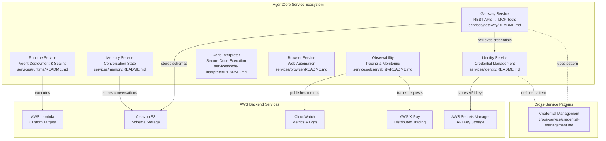
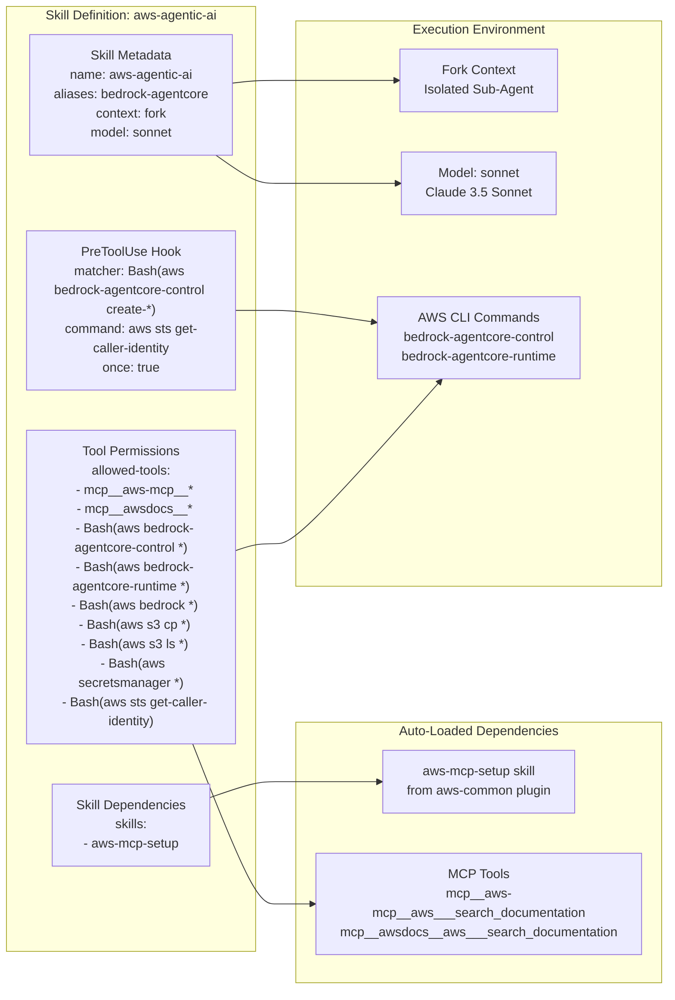
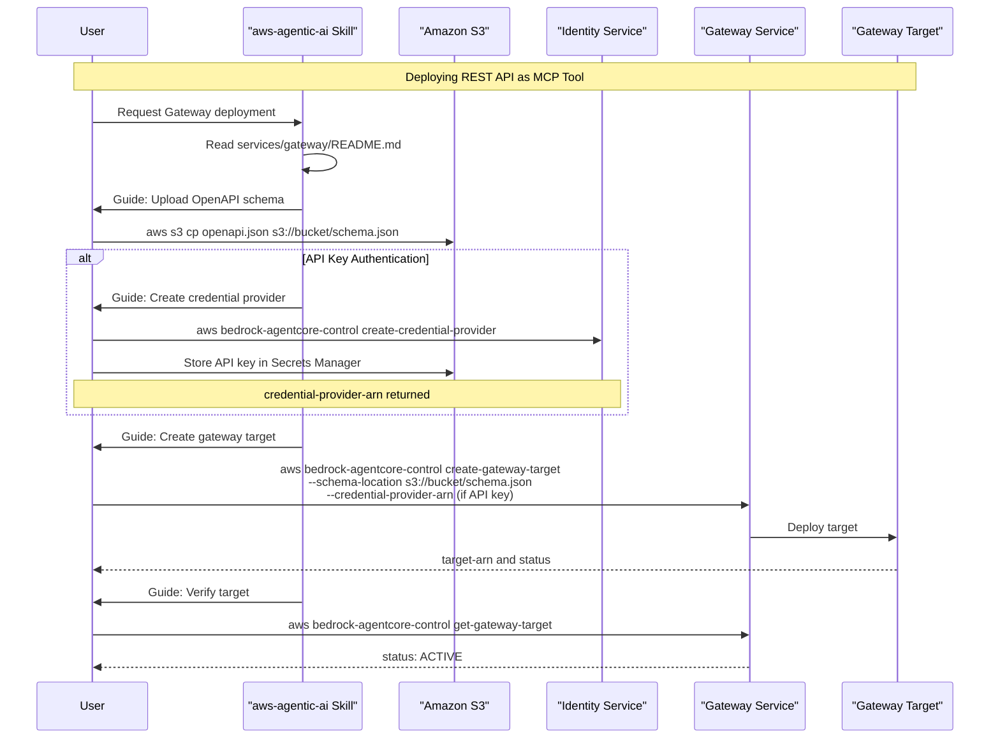
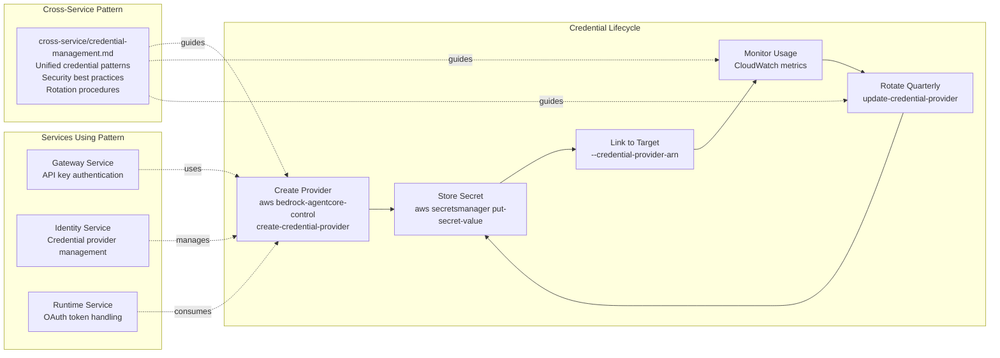
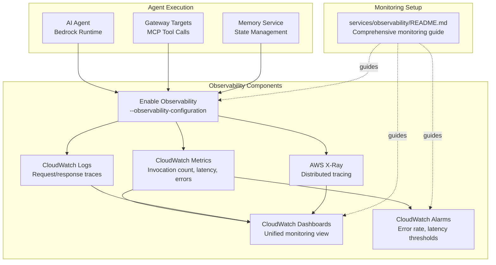
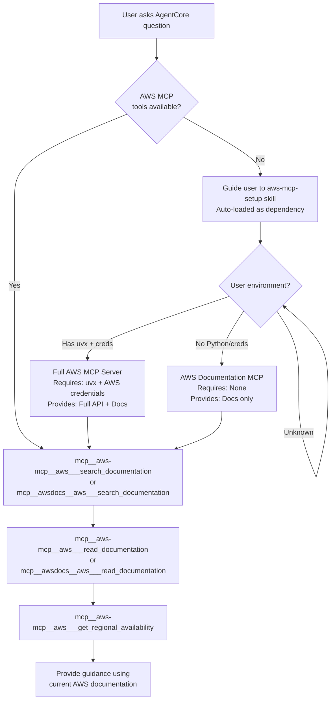
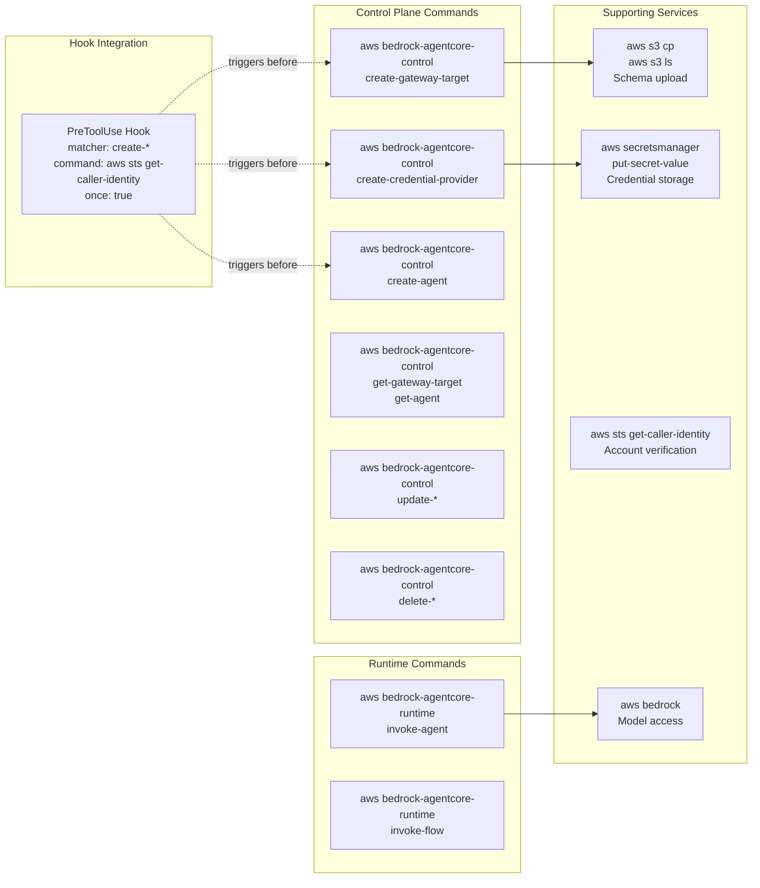

<!-- source: DeepWiki mcp.deepwiki.com · repo zxkane/aws-skills · page 4.5 aws-agentic-ai Plugin · fetched 2026-10-26 -->

# aws-agentic-ai Plugin

<details>
<summary>Relevant source files</summary>

The following files were used as context for generating this wiki page:

- [.claude-plugin/marketplace.json](.claude-plugin/marketplace.json)
- [README.md](README.md)
- [plugins/aws-agentic-ai/skills/aws-agentic-ai/SKILL.md](plugins/aws-agentic-ai/skills/aws-agentic-ai/SKILL.md)

</details>


The `aws-agentic-ai` plugin provides comprehensive guidance for deploying and managing AWS Bedrock AgentCore, a platform for building scalable AI agent applications. This plugin covers seven core AgentCore services (Gateway, Runtime, Memory, Identity, Code Interpreter, Browser, Observability) and their integration patterns. Unlike the `aws-cdk` [4.2](#4.2) and `aws-cost-ops` [4.3](#4.3) plugins, this plugin does not provide dedicated MCP servers but instead focuses on architectural patterns and AWS CLI workflows for AgentCore deployment.

For initial marketplace setup and installation, see [Getting Started](#2). For the foundational `aws-common` plugin that this plugin depends on, see [aws-common Plugin](#4.1).

## Plugin Overview

The plugin is registered in [.claude-plugin/marketplace.json:132-150]() at version 1.2.0 as part of the development category. It provides a single skill (`aws-agentic-ai`) that acts as a comprehensive guide for all AgentCore services.

**Key Characteristics**:
- **Version**: 1.2.0 (matching other domain plugins)
- **Category**: development
- **MCP Servers**: None (relies on `aws-common` for AWS documentation access)
- **Dependencies**: `aws-common` plugin for `aws-mcp-setup` skill
- **Primary Interface**: AWS CLI (`aws bedrock-agentcore-control` and `aws bedrock-agentcore-runtime` commands)

Sources: [.claude-plugin/marketplace.json:132-150](), [README.md:55-67]()

## Seven AgentCore Services

The plugin organizes guidance around seven core AgentCore services, each addressing a specific aspect of AI agent deployment and operation.

### Service Capabilities Matrix



**Service Breakdown**:

| Service | Primary Use Case | Documentation Path |
|---------|------------------|-------------------|
| **Gateway** | Converting REST APIs to MCP tools for agent consumption | `services/gateway/README.md` |
| **Runtime** | Deploying and auto-scaling agent execution environments | `services/runtime/README.md` |
| **Memory** | Persisting conversation history and context across sessions | `services/memory/README.md` |
| **Identity** | Managing API credentials, authentication, and authorization | `services/identity/README.md` |
| **Code Interpreter** | Executing user-provided code in isolated sandboxes | `services/code-interpreter/README.md` |
| **Browser** | Automating web interactions and scraping for agents | `services/browser/README.md` |
| **Observability** | Monitoring agent performance and debugging issues | `services/observability/README.md` |

Sources: [plugins/aws-agentic-ai/skills/aws-agentic-ai/SKILL.md:62-72](), [README.md:55-67]()

## Skill Configuration

The plugin's single skill is defined in [plugins/aws-agentic-ai/skills/aws-agentic-ai/SKILL.md]() with comprehensive frontmatter configuration that controls execution context, dependencies, and tool permissions.

### Skill Metadata and Execution Context



**Configuration Details**:

1. **Execution Context** [SKILL.md:7-8]():
   - `context: fork` - Executes in isolated sub-agent for focused AgentCore guidance
   - `model: sonnet` - Uses Claude 3.5 Sonnet for complex architectural decisions

2. **Dependency Chain** [SKILL.md:9-10]():
   - Depends on `aws-mcp-setup` skill from `aws-common` plugin
   - Auto-loads MCP documentation tools before answering AWS questions
   - Ensures all guidance is based on current AWS documentation

3. **Tool Permissions** [SKILL.md:11-20]():
   - **MCP Tools**: `mcp__aws-mcp__*` and `mcp__awsdocs__*` patterns allow access to AWS documentation search and retrieval
   - **Bedrock Commands**: `aws bedrock-agentcore-control` for service management, `aws bedrock-agentcore-runtime` for agent execution
   - **Supporting Commands**: `aws s3`, `aws secretsmanager`, `aws bedrock` for schema upload, credential storage, and model access
   - **Validation**: `aws sts get-caller-identity` for account verification

4. **Pre-Tool Hook** [SKILL.md:21-26]():
   - Matches any `create-*` operation in `bedrock-agentcore-control`
   - Automatically executes `aws sts get-caller-identity` to verify AWS account
   - Runs once per session to prevent accidental cross-account deployments
   - Displays account ID before creating AgentCore resources

Sources: [plugins/aws-agentic-ai/skills/aws-agentic-ai/SKILL.md:1-26]()

## Documentation Structure

The plugin organizes documentation into two primary categories: service-specific guides and cross-service patterns. This structure reflects the modular nature of AgentCore where services can be used independently or combined for comprehensive agent applications.

### Documentation Organization Diagram

```mermaid
graph TB
    subgraph "Plugin Root: plugins/aws-agentic-ai/skills/aws-agentic-ai/"
        SkillMD["SKILL.md<br/>Skill definition + quickstart"]
        
        subgraph "services/ Directory"
            GatewayDir["gateway/<br/>REST API → MCP conversion"]
            RuntimeDir["runtime/<br/>Agent deployment"]
            MemoryDir["memory/<br/>Conversation state"]
            IdentityDir["identity/<br/>Credential management"]
            CodeInterpDir["code-interpreter/<br/>Code execution"]
            BrowserDir["browser/<br/>Web automation"]
            ObsDir["observability/<br/>Monitoring & tracing"]
        end
        
        subgraph "cross-service/ Directory"
            CredMgmt["credential-management.md<br/>Unified credential patterns"]
        end
        
        subgraph "Gateway Service Details"
            GatewayReadme["gateway/README.md<br/>Overview & quickstart"]
            DeployStrat["gateway/deployment-strategies.md<br/>Deployment patterns"]
            Troubleshoot["gateway/troubleshooting-guide.md<br/>Common issues & solutions"]
        end
    end
    
    subgraph "Referenced by SKILL.md"
        ServiceTable["Service Selection Table<br/>Lines 62-72"]
        Workflows["Common Workflows<br/>Lines 73-106"]
        Resources["Service-Specific Docs<br/>Lines 107-124"]
        CrossService["Cross-Service Patterns<br/>Lines 125-130"]
    end
    
    SkillMD --> ServiceTable
    SkillMD --> Workflows
    SkillMD --> Resources
    SkillMD --> CrossService
    
    ServiceTable --> GatewayDir
    ServiceTable --> RuntimeDir
    ServiceTable --> MemoryDir
    ServiceTable --> IdentityDir
    ServiceTable --> CodeInterpDir
    ServiceTable --> BrowserDir
    ServiceTable --> ObsDir
    
    Workflows --> GatewayReadme
    Workflows --> CredMgmt
    Workflows --> ObsDir
    
    Resources --> GatewayReadme
    Resources --> DeployStrat
    Resources --> Troubleshoot
    
    CrossService --> CredMgmt
```



**Documentation Hierarchy**:

1. **Entry Point** [SKILL.md:28-136]():
   - `SKILL.md` provides skill configuration, service overview, and common workflows
   - Links to detailed documentation with `MANDATORY - READ DETAILED DOCUMENTATION` directives
   - Ensures users access comprehensive guides before implementation

2. **Service-Specific Documentation**:
   - Each service has a dedicated subdirectory under `services/`
   - Minimum: `README.md` with overview, setup, and CLI examples
   - Gateway service includes additional specialized guides:
     - `deployment-strategies.md` - Architecture patterns for different use cases
     - `troubleshooting-guide.md` - Common errors and resolution steps

3. **Cross-Service Patterns** [SKILL.md:125-130]():
   - `cross-service/credential-management.md` - Unified credential patterns used across Gateway, Identity, and other services
   - Provides security best practices, rotation procedures, and monitoring strategies
   - Single source of truth for credential handling across all AgentCore services

Sources: [plugins/aws-agentic-ai/skills/aws-agentic-ai/SKILL.md:62-130](), [README.md:258-264]()

## Common Workflows

The skill defines three primary workflows that represent the most frequent AgentCore use cases. Each workflow includes a quick reference in `SKILL.md` and links to comprehensive documentation.

### Gateway Target Deployment Workflow



**Workflow Steps** [SKILL.md:75-85]():

1. **Upload OpenAPI Schema** - Store API specification in S3 for Gateway to reference
2. **Create Credential Provider** (API key auth only) - Use Identity service to store API key in Secrets Manager
3. **Create Gateway Target** - Link schema and credentials (if applicable) via `create-gateway-target` command
4. **Verify Target** - Check status transitions from CREATING → ACTIVE

**Authentication Options**:
- **API Key**: Requires credential provider ARN reference
- **Lambda**: Uses IAM roles (no credential provider needed)
- **MCP Servers**: Uses OAuth flows (handled by Runtime service)

Sources: [plugins/aws-agentic-ai/skills/aws-agentic-ai/SKILL.md:75-85]()

### Credential Management Workflow



**Workflow Steps** [SKILL.md:87-96]():

1. **Use Identity Service** - All API keys managed through credential providers (not direct Secrets Manager)
2. **Link Providers** - Reference provider ARN in gateway targets for automatic credential injection
3. **Rotate Quarterly** - Update credential provider with new secrets following documented rotation procedures
4. **Monitor Usage** - Track credential access via CloudWatch metrics for anomaly detection

**Key Principle**: The `cross-service/credential-management.md` document provides a single source of truth for credential handling across all AgentCore services, ensuring consistent security practices.

Sources: [plugins/aws-agentic-ai/skills/aws-agentic-ai/SKILL.md:87-96]()

### Observability Workflow



**Workflow Steps** [SKILL.md:98-106]():

1. **Enable Observability** - Configure observability settings when creating agents or targets
2. **Configure Dashboards** - Set up CloudWatch dashboards aggregating metrics across services
3. **Set Up Alarms** - Create alarms for error rates, latency percentiles, and throughput thresholds
4. **Use X-Ray** - Enable distributed tracing for end-to-end request visibility across gateway, runtime, and memory services

Sources: [plugins/aws-agentic-ai/skills/aws-agentic-ai/SKILL.md:98-106]()

## AWS Documentation Requirement

Like all domain plugins, `aws-agentic-ai` enforces a strict policy of consulting live AWS documentation before providing guidance. This prevents outdated information and ensures recommendations align with current AWS service capabilities.

### Documentation Access Flow



**Implementation Details** [SKILL.md:32-48]():

1. **CRITICAL Policy**: Skill must verify AWS information using MCP tools before answering
2. **MCP Tool Pattern**: Supports both `mcp__aws-mcp__aws___*` (full server) and `mcp__awsdocs__aws___*` (docs-only server)
3. **Auto-Loaded Dependency**: `aws-mcp-setup` skill (from `aws-common` plugin) is automatically loaded via `skills:` frontmatter
4. **Setup Guidance**: If MCP tools unavailable, guide user through configuration options:
   - Full AWS MCP Server: Requires `uvx` and AWS credentials, provides full API + documentation access
   - AWS Documentation MCP: No prerequisites, provides documentation-only access
5. **Environment Detection**: Help user determine which option fits their setup, or ask if unable to determine

This architecture ensures no AgentCore guidance is provided without consulting current AWS documentation, preventing the skill from providing stale or incorrect information about rapidly evolving services.

Sources: [plugins/aws-agentic-ai/skills/aws-agentic-ai/SKILL.md:32-48]()

## Integration with AWS Services

The plugin enables interaction with AgentCore services through AWS CLI commands, complemented by supporting AWS services for storage, credentials, and monitoring.

### AWS CLI Command Structure



**Command Categories**:

1. **Control Plane** [SKILL.md:14]():
   - `aws bedrock-agentcore-control create-*` - Create AgentCore resources (gateway targets, agents, credential providers)
   - `aws bedrock-agentcore-control get-*` - Retrieve resource status and configuration
   - `aws bedrock-agentcore-control update-*` - Modify existing resources
   - `aws bedrock-agentcore-control delete-*` - Remove resources

2. **Runtime** [SKILL.md:15]():
   - `aws bedrock-agentcore-runtime invoke-agent` - Execute agents with user input
   - `aws bedrock-agentcore-runtime invoke-flow` - Execute predefined workflows

3. **Supporting Commands** [SKILL.md:16-20]():
   - `aws s3 cp` / `aws s3 ls` - Upload/list OpenAPI schemas
   - `aws secretsmanager *` - Store and retrieve API keys
   - `aws sts get-caller-identity` - Verify AWS account (used by PreToolUse hook)
   - `aws bedrock *` - Access foundation models

4. **Pre-Tool Hook** [SKILL.md:21-26]():
   - Automatically runs `aws sts get-caller-identity` before any `create-*` operation
   - Displays AWS account ID for verification
   - Executes once per session to prevent repeated prompts
   - Prevents accidental cross-account resource creation

Sources: [plugins/aws-agentic-ai/skills/aws-agentic-ai/SKILL.md:11-26]()

## Usage Patterns

The plugin guides users through AgentCore deployment using natural language prompts that trigger skill-guided workflows.

**Example Prompts** [README.md:206-224]():

```
# Gateway Service
Deploy a REST API as an MCP tool using AgentCore Gateway

# Memory Service  
Set up conversation memory for my AI agent with DynamoDB backend

# Observability
Configure observability for my AgentCore runtime with CloudWatch dashboards
```

**Execution Flow**:
1. User provides natural language description of desired AgentCore functionality
2. Skill identifies relevant service(s) from the seven AgentCore services
3. Skill reads detailed documentation from `services/` or `cross-service/` directories
4. Skill guides user through AWS CLI commands with parameter explanations
5. PreToolUse hook verifies account before any `create-*` operations
6. Skill validates resource creation and provides next steps

**Multi-Service Scenarios**:
- Gateway + Identity: API deployment with credential management
- Runtime + Memory: Agent execution with conversation persistence
- Gateway + Observability: API deployment with monitoring
- All Services: Comprehensive agent application with full observability

Sources: [README.md:206-224](), [plugins/aws-agentic-ai/skills/aws-agentic-ai/SKILL.md:50-72]()

## Dependency on aws-common Plugin

The `aws-agentic-ai` plugin has a mandatory dependency on the `aws-common` plugin, specifically its `aws-mcp-setup` skill for AWS documentation access.

### Dependency Chain

```mermaid
graph TB
    subgraph "Plugin Installation Order"
        InstallCommon["1. /plugin install aws-common@aws-skills<br/>Required first"]
        InstallAgentic["2. /plugin install aws-agentic-ai@aws-skills<br/>Depends on aws-common"]
    end
    
    subgraph "Skill Dependency Resolution"
        AgenticSkill["aws-agentic-ai skill<br/>SKILL.md frontmatter"]
        SkillsDep["skills:<br/>  - aws-mcp-setup"]
        MCPSetup["aws-mcp-setup skill<br/>from aws-common plugin"]
    end
    
    subgraph "Runtime Auto-Loading"
        UserPrompt["User asks AgentCore question"]
        LoadAgentic["Load aws-agentic-ai skill<br/>context: fork"]
        AutoLoadMCP["Auto-load aws-mcp-setup<br/>Before skill execution"]
        CheckMCP["Check AWS MCP tools availability"]
        GuidanceFlow["Provide guidance or setup MCP"]
    end
    
    InstallCommon --> InstallAgentic
    
    AgenticSkill --> SkillsDep
    SkillsDep --> MCPSetup
    
    UserPrompt --> LoadAgentic
    LoadAgentic --> AutoLoadMCP
    AutoLoadMCP --> CheckMCP
    CheckMCP --> GuidanceFlow
```



**Dependency Mechanism** [SKILL.md:9-10]():

1. **Installation Requirement**: `aws-common` must be installed before `aws-agentic-ai`
2. **Skill Frontmatter Declaration**: `skills: [aws-mcp-setup]` declares the dependency
3. **Auto-Loading**: When `aws-agentic-ai` skill executes, `aws-mcp-setup` is automatically loaded first
4. **MCP Tool Access**: Provides `mcp__aws-mcp__aws___*` or `mcp__awsdocs__aws___*` tools for documentation search

**Why This Dependency Exists**:
- AgentCore services evolve rapidly with new features and API changes
- Live documentation access ensures guidance remains accurate
- Prevents skill from providing outdated deployment patterns
- Enables verification of service availability in specific AWS regions

Without this dependency, the skill would be limited to static documentation that could quickly become obsolete as AWS updates AgentCore services.

Sources: [plugins/aws-agentic-ai/skills/aws-agentic-ai/SKILL.md:9-10](), [.claude-plugin/marketplace.json:132-150](), [README.md:78-87]()

## Version and Maintenance

The plugin follows the version management strategy defined for all AWS Skills plugins.

**Current Version**: 1.2.0 [.claude-plugin/marketplace.json:135]()

**Version Bump Policy** (see [Version Management](#5.2) for details):
- **Minor Bump** (x.Y.0): New AgentCore service coverage, new dependencies, structural changes to documentation
- **Patch Bump** (x.y.Z): Bug fixes, documentation updates, typo corrections in service guides

**Marketplace Version**: Independent from plugin version; only bumps when new plugins are added to marketplace (currently 2.2.0)

Sources: [.claude-plugin/marketplace.json:9](), [.claude-plugin/marketplace.json:135]()

---

