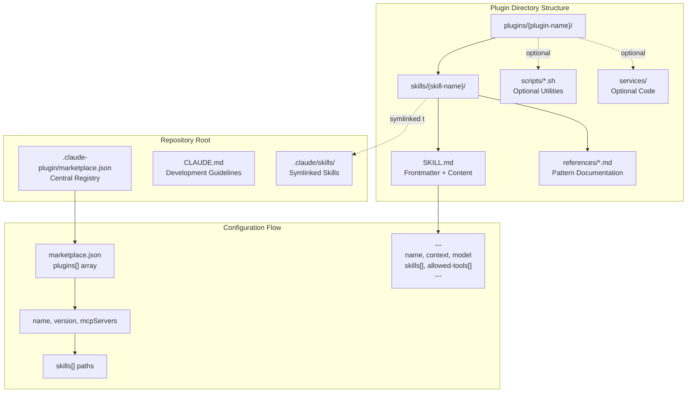
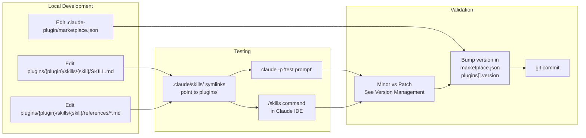
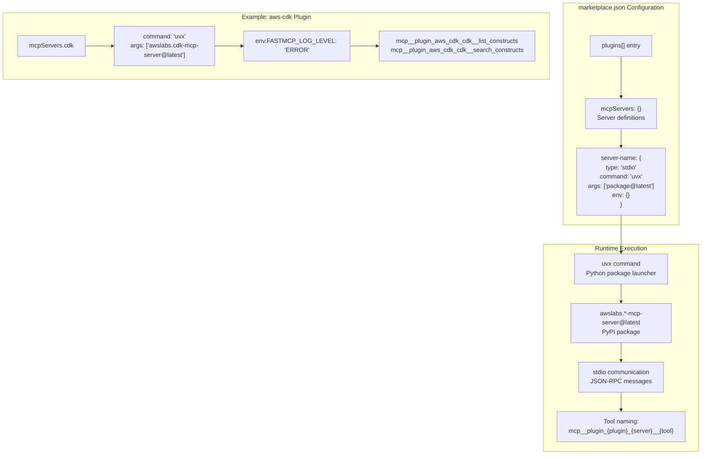
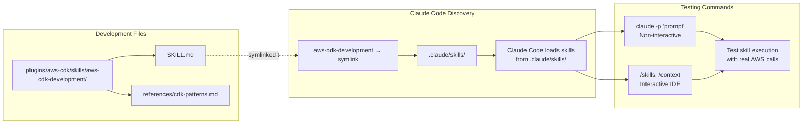

<!-- source: DeepWiki mcp.deepwiki.com · repo zxkane/aws-skills · page 5 Development Guide · fetched 2026-10-26 -->

# Development Guide

<details>
<summary>Relevant source files</summary>

The following files were used as context for generating this wiki page:

- [.claude-plugin/marketplace.json](.claude-plugin/marketplace.json)
- [CLAUDE.md](CLAUDE.md)

</details>


This document provides technical guidance for contributors who want to modify existing plugins, add new skills, create new plugins, or enhance the AWS Skills marketplace. It covers the plugin development workflow, directory structure conventions, skill configuration syntax, MCP server integration patterns, and testing strategies.

For step-by-step instructions on setting up your local development environment, see [Local Development Setup](#5.1). For rules on version bumping and release management, see [Version Management](#5.2). For validation strategies and quality gates, see [Validation and Quality Assurance](#5.3).

## Repository Architecture

The repository follows a marketplace-plugin-skill hierarchy with standardized directory structures and configuration files.

**Repository Structure Overview**



**Sources:** [.claude-plugin/marketplace.json:1-152](), [CLAUDE.md:9-24]()

The marketplace uses a three-tier architecture:
1. **Marketplace Registry** - `.claude-plugin/marketplace.json` defines all plugins, versions, and MCP server configurations
2. **Plugin Layer** - Each plugin in `plugins/` contains one or more skills with metadata
3. **Skill Layer** - Skills in `skills/{skill-name}/` directories contain SKILL.md with frontmatter configuration and markdown content

## Plugin Development Workflow

The typical workflow for plugin development involves local changes, symlink testing, version bumping, and marketplace updates.

**Development Workflow Diagram**



**Sources:** [CLAUDE.md:26-54](), [CLAUDE.md:89-108]()

### Development Steps

1. **Make Changes** - Edit skill files in `plugins/{plugin-name}/skills/`
2. **Test Locally** - Skills are automatically available via symlinks in `.claude/skills/`
3. **Determine Version Bump** - Classify change as Minor (structural) or Patch (content)
4. **Update Version** - Modify version in `.claude-plugin/marketplace.json`
5. **Commit** - All changes must include version bump before committing

## Plugin Directory Structure

Each plugin follows a standardized directory structure with required and optional components.

| Component | Location | Required | Purpose |
|-----------|----------|----------|---------|
| Skill Definition | `skills/{skill-name}/SKILL.md` | ✓ | Frontmatter configuration + skill content |
| Reference Docs | `skills/{skill-name}/references/*.md` | Optional | Detailed pattern documentation |
| Utility Scripts | `scripts/*.sh` | Optional | Helper scripts (e.g., validation) |
| Service Code | `services/` | Optional | Service-specific implementations |
| Cross-Service Code | `cross-service/` | Optional | Shared code across services |

**Sources:** [CLAUDE.md:21-24](), [.claude-plugin/marketplace.json:25-29]()

### Plugin Metadata in Marketplace

Each plugin entry in `.claude-plugin/marketplace.json` requires:

```yaml
{
  "name": "plugin-name",           # Unique identifier
  "description": "...",            # Plugin purpose
  "version": "x.y.z",              # Semantic version
  "author": {...},                 # Contact information
  "category": "development",       # Category classification
  "source": "./plugins/plugin-name", # Relative path
  "strict": false,                 # Error handling mode
  "skills": ["./skills/skill-name"], # Skill paths
  "mcpServers": {...}              # Optional MCP configuration
}
```

**Sources:** [.claude-plugin/marketplace.json:12-30](), [.claude-plugin/marketplace.json:31-61]()

## Skill Frontmatter Configuration

Skills use YAML frontmatter in `SKILL.md` to configure execution behavior. This is the primary mechanism for defining skill metadata, dependencies, tool permissions, and lifecycle hooks.

### Frontmatter Fields

| Field | Type | Purpose | Example |
|-------|------|---------|---------|
| `name` | string | Skill identifier | `aws-cdk-development` |
| `description` | string | Brief purpose statement | `AWS CDK infrastructure...` |
| `context` | string | Execution context | `fork` (run in sub-agent) |
| `model` | string | Model to use | `sonnet` |
| `skills` | array | Auto-loaded dependencies | `["aws-mcp-setup"]` |
| `allowed-tools` | array | Tool permission patterns | `["mcp__plugin_*"]` |
| `hooks` | object | Lifecycle hooks | `PreToolUse: [{...}]` |

**Sources:** [CLAUDE.md:56-77]()

### Frontmatter Example with All Features

```yaml
---
name: aws-cdk-development
description: Expert AWS CDK development assistance
context: fork
model: sonnet
skills:
  - aws-mcp-setup
allowed-tools:
  - mcp__plugin_aws_cdk_cdk__*
  - Bash(aws *)
  - Bash(cdk *)
  - Bash(npm *)
hooks:
  PreToolUse:
    - matcher: Bash(cdk deploy*)
      command: aws sts get-caller-identity --query Account --output text
      once: true
---
```

**Sources:** [CLAUDE.md:60-76]()

### Dependency Auto-Loading

The `skills:` frontmatter field creates automatic dependency chains:
- When a skill is invoked, all listed sub-skills are automatically loaded
- This enables hierarchical skill composition
- Example: `aws-serverless-eda` skill lists both `aws-mcp-setup` and `aws-cdk-development`, so both are auto-loaded

### Tool Permission Patterns

The `allowed-tools:` field uses wildcard patterns for flexible permission grants:
- `mcp__plugin_aws_cdk_cdk__*` - All tools from the `cdk` MCP server in `aws-cdk` plugin
- `Bash(aws *)` - All AWS CLI commands
- `Bash(cdk *)` - All CDK CLI commands

### Lifecycle Hooks

Hooks execute commands at specific lifecycle points:
- `PreToolUse` - Runs before a tool matching `matcher` pattern executes
- `once: true` - Hook executes only once per session (useful for account verification)
- Example use case: Verify AWS account identity before `cdk deploy` to prevent cross-account mistakes

**Sources:** [CLAUDE.md:71-76]()

## MCP Server Integration

MCP (Model Context Protocol) servers provide AWS service integrations. Plugins can declare MCP servers in the marketplace configuration.

**MCP Server Configuration Flow**



**Sources:** [.claude-plugin/marketplace.json:49-60](), [.claude-plugin/marketplace.json:80-111](), [CLAUDE.md:79-87]()

### MCP Server Configuration Schema

Add MCP servers to a plugin in `.claude-plugin/marketplace.json`:

```json
{
  "plugins": [
    {
      "name": "plugin-name",
      "mcpServers": {
        "server-short-name": {
          "type": "stdio",
          "command": "uvx",
          "args": ["awslabs.package-name@latest"],
          "env": {
            "FASTMCP_LOG_LEVEL": "ERROR"
          }
        }
      }
    }
  ]
}
```

**Sources:** [.claude-plugin/marketplace.json:49-60]()

### MCP Server Naming Conventions

| Component | Constraint | Rationale |
|-----------|------------|-----------|
| Server Short Name | Brief (e.g., `cdk`, `pricing`, `costexp`, `cw`) | Bedrock 64-char tool name limit |
| Tool Name Pattern | `mcp__plugin_{plugin}_{server}__{tool}` | Namespace isolation between plugins |
| Package Name | `awslabs.*-mcp-server@latest` | Official AWS Labs packages |
| Log Level | `FASTMCP_LOG_LEVEL: "ERROR"` | Reduce noise in Claude Code logs |

**Sources:** [CLAUDE.md:79-87]()

### Example: aws-cost-ops Multi-Server Configuration

The `aws-cost-ops` plugin demonstrates complex MCP integration with three servers:

```json
"mcpServers": {
  "pricing": {
    "type": "stdio",
    "command": "uvx",
    "args": ["awslabs.aws-pricing-mcp-server@latest"],
    "env": {"FASTMCP_LOG_LEVEL": "ERROR"}
  },
  "costexp": {
    "type": "stdio",
    "command": "uvx",
    "args": ["awslabs.cost-explorer-mcp-server@latest"],
    "env": {"FASTMCP_LOG_LEVEL": "ERROR"}
  },
  "cw": {
    "type": "stdio",
    "command": "uvx",
    "args": ["awslabs.cloudwatch-mcp-server@latest"],
    "env": {"FASTMCP_LOG_LEVEL": "ERROR"}
  }
}
```

**Sources:** [.claude-plugin/marketplace.json:80-111]()

## Creating a New Skill

To add a new skill to an existing plugin:

1. **Create Skill Directory** - `plugins/{plugin}/skills/{skill-name}/`
2. **Create SKILL.md** - Main skill file with frontmatter and content
3. **Add Reference Docs** (optional) - `references/` subdirectory with pattern documentation
4. **Update marketplace.json** - Add skill path to plugin's `skills[]` array
5. **Bump Plugin Version** - Increment minor version (x.Y.0) for new skills
6. **Test Locally** - Create symlink in `.claude/skills/` if needed
7. **Commit Changes** - Include version bump

**Sources:** [CLAUDE.md:89-108](), [CLAUDE.md:110-117]()

## Creating a New Plugin

To create an entirely new plugin:

1. **Create Plugin Directory** - `plugins/{new-plugin-name}/`
2. **Create Skill Structure** - Follow standard skill directory layout
3. **Add Plugin Entry** - Add to `.claude-plugin/marketplace.json` plugins array
4. **Configure MCP Servers** (if needed) - Add `mcpServers` configuration
5. **Set Dependencies** - Typically depend on `aws-common` via `skills: ["aws-mcp-setup"]`
6. **Bump Marketplace Version** - Increment marketplace minor version (x.Y.0)
7. **Create Symlinks** - Add symlinks to `.claude/skills/` for testing
8. **Document Plugin** - Update documentation and README

**Sources:** [.claude-plugin/marketplace.json:1-152](), [CLAUDE.md:89-108]()

## Version Management Overview

Version management follows semantic versioning with specific rules for different change types. For complete version management guidelines, see [Version Management](#5.2).

| Change Type | Version Bump | Scope | Examples |
|-------------|--------------|-------|----------|
| **Minor** (x.Y.0) | Plugin or Marketplace | Structural changes | New skill, new dependency, new MCP server, new plugin |
| **Patch** (x.y.Z) | Plugin only | Content changes | Bug fixes, doc updates, typo fixes, description updates |

**Important Rules:**
- Adding/modifying `skills:` dependencies → Minor bump for affected plugins
- Adding new plugin → Minor bump for marketplace `metadata.version`
- All changes must include version bump before commit
- Version locations: `.claude-plugin/marketplace.json` at `metadata.version` and `plugins[].version`

**Sources:** [CLAUDE.md:89-108]()

## Testing and Validation Overview

The repository uses symlink-based local testing and multi-layer validation. For complete validation strategies, see [Validation and Quality Assurance](#5.3).

### Local Testing Approach

**Symlink Testing Architecture**



**Sources:** [CLAUDE.md:26-54]()

### Testing Commands

```bash
# Start Claude Code in repository root
cd /path/to/aws-skills
claude

# Interactive testing
/skills                    # List all available skills
/context                   # Show loaded context

# Non-interactive testing
claude -p "List all available skills in this project"
claude -p "Read the frontmatter of aws-cdk-development skill"
```

**Sources:** [CLAUDE.md:30-44]()

### Recreating Symlinks

If symlinks break during development:

```bash
cd .claude && rm -rf skills && mkdir skills
ln -s ../../plugins/aws-common/skills/aws-mcp-setup skills/
ln -s ../../plugins/aws-cdk/skills/aws-cdk-development skills/
ln -s ../../plugins/serverless-eda/skills/aws-serverless-eda skills/
ln -s ../../plugins/aws-agentic-ai/skills/aws-agentic-ai skills/
ln -s ../../plugins/aws-cost-ops/skills/aws-cost-operations skills/
```

**Sources:** [CLAUDE.md:46-54]()

## Key Files for Common Tasks

This table provides quick reference for common development tasks:

| Task | Files to Modify |
|------|-----------------|
| Add/update skill content | `plugins/{plugin}/skills/{skill}/SKILL.md` |
| Add reference documentation | `plugins/{plugin}/skills/{skill}/references/*.md` |
| Add MCP server to plugin | `.claude-plugin/marketplace.json` → `plugins[].mcpServers` |
| Change plugin metadata | `.claude-plugin/marketplace.json` → `plugins[]` properties |
| Update marketplace version | `.claude-plugin/marketplace.json` → `metadata.version` |
| Update plugin version | `.claude-plugin/marketplace.json` → `plugins[].version` |
| Add skill dependency | `plugins/{plugin}/skills/{skill}/SKILL.md` → `skills:` frontmatter |
| Configure tool permissions | `plugins/{plugin}/skills/{skill}/SKILL.md` → `allowed-tools:` frontmatter |
| Add lifecycle hooks | `plugins/{plugin}/skills/{skill}/SKILL.md` → `hooks:` frontmatter |

**Sources:** [CLAUDE.md:110-117](), [.claude-plugin/marketplace.json:1-152]()

## Contribution Workflow Summary

1. **Setup** - Fork repository, clone locally, verify symlinks in `.claude/skills/`
2. **Develop** - Make changes to plugin files, test with Claude Code CLI/IDE
3. **Validate** - Run any validation scripts, verify skill execution
4. **Version** - Determine change type (Minor/Patch), bump appropriate version
5. **Commit** - Commit with descriptive message including version bump
6. **Pull Request** - Submit PR with clear description of changes and rationale

For detailed development environment setup, see [Local Development Setup](#5.1). For version bump decision trees, see [Version Management](#5.2). For validation requirements, see [Validation and Quality Assurance](#5.3).

**Sources:** [CLAUDE.md:1-118](), [.claude-plugin/marketplace.json:1-152]()

---

