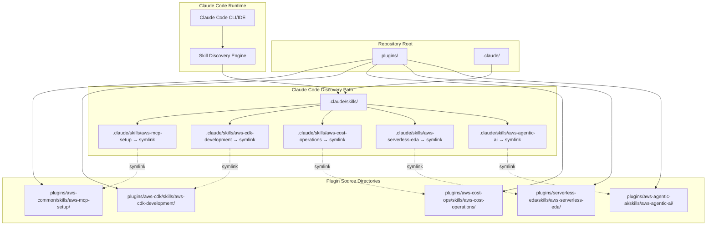
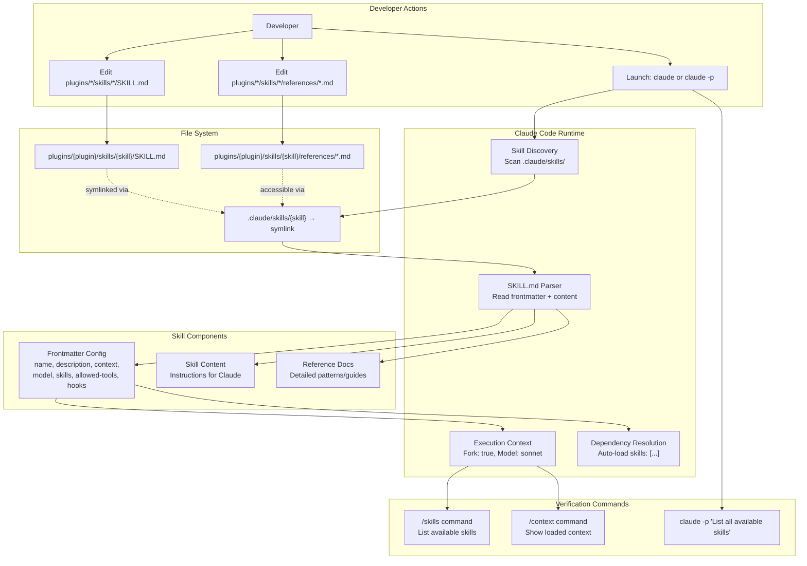

<!-- source: DeepWiki mcp.deepwiki.com · repo zxkane/aws-skills · page 5.1 Local Development Setup · fetched 2026-10-26 -->

# Local Development Setup

<details>
<summary>Relevant source files</summary>

The following files were used as context for generating this wiki page:

- [.gitignore](.gitignore)
- [CLAUDE.md](CLAUDE.md)

</details>


This document provides instructions for setting up a local development environment to modify plugins, add new skills, or contribute to the AWS Skills marketplace. It covers the symlink-based development workflow that enables rapid iteration without requiring plugin reinstallation.

For information about version management when making changes, see [Version Management](#5.2). For validation and testing strategies, see [Validation and Quality Assurance](#5.3). For installing plugins as an end user, see [Installation](#2.1).

## Purpose and Scope

Local development uses symlinks from `.claude/skills/` to individual plugin skill directories in `plugins/*/skills/`. This architecture allows Claude Code to discover and load skills directly from the working tree, enabling contributors to test changes immediately without packaging or reinstalling plugins. The workflow supports both interactive testing (launching Claude Code CLI/IDE) and non-interactive testing (using `claude -p` commands).

Sources: [CLAUDE.md:26-54]()

## Symlink Architecture

### Directory Structure

The repository uses a dual-directory structure where plugin source files reside in `plugins/` but are exposed to Claude Code through `.claude/skills/` symlinks:



**Directory Structure: Symlink-Based Local Development**

Each skill directory contains a `SKILL.md` file with frontmatter configuration and optional `references/*.md` documentation. Claude Code reads from `.claude/skills/` which symlinks to the actual source files in `plugins/*/skills/`, allowing changes to be reflected immediately without reinstalling.

Sources: [CLAUDE.md:11-24](), [CLAUDE.md:46-54]()

### How Symlinks Enable Local Development

The symlink approach provides several benefits:

| Benefit | Explanation |
|---------|-------------|
| **Instant Reflection** | Changes to `plugins/*/skills/*/SKILL.md` are immediately visible to Claude Code without plugin reinstallation |
| **Version Control** | Source files remain in `plugins/` where they're tracked by git, while `.claude/` is used only for discovery |
| **Multi-Skill Development** | All five plugins' skills are simultaneously available for testing dependencies and interactions |
| **Isolation** | `.claude/settings.local.json` and `CLAUDE.local.md` are gitignored, allowing developer-specific configurations |

Sources: [CLAUDE.md:26-38](), [.gitignore:102-103]()

## Setting Up Local Development

### Prerequisites

Before setting up local development, ensure you have:

- Claude Code CLI or IDE installed
- Git repository cloned to a local directory
- Bash or compatible shell (for symlink commands)
- Optional: AWS credentials configured (for testing AWS MCP tools)

### Creating the Symlink Structure

The `.claude/skills/` directory must contain symlinks to each plugin's skill directory. Use the following commands to create the structure:

```bash
# Navigate to repository root
cd /path/to/aws-skills

# Create .claude/skills directory (if it doesn't exist)
mkdir -p .claude/skills

# Create symlinks for all five plugins
cd .claude/skills
ln -s ../../plugins/aws-common/skills/aws-mcp-setup .
ln -s ../../plugins/aws-cdk/skills/aws-cdk-development .
ln -s ../../plugins/aws-cost-ops/skills/aws-cost-operations .
ln -s ../../plugins/serverless-eda/skills/aws-serverless-eda .
ln -s ../../plugins/aws-agentic-ai/skills/aws-agentic-ai .
```

Sources: [CLAUDE.md:46-54]()

### Verifying Symlink Creation

After creating symlinks, verify they point to valid directories:

```bash
cd .claude/skills
ls -lah

# Expected output:
# aws-mcp-setup -> ../../plugins/aws-common/skills/aws-mcp-setup
# aws-cdk-development -> ../../plugins/aws-cdk/skills/aws-cdk-development
# aws-cost-operations -> ../../plugins/aws-cost-ops/skills/aws-cost-operations
# aws-serverless-eda -> ../../plugins/serverless-eda/skills/aws-serverless-eda
# aws-agentic-ai -> ../../plugins/aws-agentic-ai/skills/aws-agentic-ai
```

Each symlink should point to a directory containing a `SKILL.md` file.

Sources: [CLAUDE.md:46-54]()

## Development Workflow

### Skill Loading and Execution Flow



**Development Workflow: Edit-Launch-Verify Cycle**

This diagram shows the complete cycle from editing source files to verifying they load correctly in Claude Code. Changes to files in `plugins/` are immediately visible through symlinks in `.claude/skills/`, where Claude Code discovers and parses them.

Sources: [CLAUDE.md:26-44]()

### Starting Claude Code

To begin local development, launch Claude Code from the repository root:

```bash
# Navigate to repository root
cd /path/to/aws-skills

# Launch Claude Code CLI (interactive mode)
claude

# Skills automatically load from .claude/skills/
```

When Claude Code starts, it automatically discovers and loads all skills from `.claude/skills/`. The symlink structure ensures it reads the latest versions from `plugins/`.

Sources: [CLAUDE.md:30-33]()

### Verifying Skills Load

After launching Claude Code, verify skills loaded correctly:

**Interactive verification:**
```bash
# Inside Claude Code CLI/IDE:
/skills           # Lists all available skills
/context          # Shows loaded context including skills
```

**Non-interactive verification:**
```bash
# From terminal (without launching interactive session):
claude -p "List all available skills in this project"
claude -p "Read the frontmatter of aws-cdk-development skill"
```

Sources: [CLAUDE.md:36-44]()

### Making and Testing Changes

The typical development cycle:

1. **Edit skill content:** Modify `plugins/{plugin}/skills/{skill}/SKILL.md`
2. **Edit references (optional):** Add/update `plugins/{plugin}/skills/{skill}/references/*.md`
3. **Restart Claude Code:** Exit and relaunch to reload changed skills
4. **Test skill behavior:** Use `/skills {skill-name}` or `claude -p` commands
5. **Iterate:** Repeat steps 1-4 until desired behavior achieved

Example workflow:
```bash
# 1. Edit skill file
vim plugins/aws-cdk/skills/aws-cdk-development/SKILL.md

# 2. Test non-interactively
claude -p "Using aws-cdk-development skill, explain CDK best practices"

# 3. Test interactively
claude
> /skills aws-cdk-development
> Ask me about CDK best practices
```

Sources: [CLAUDE.md:26-44]()

## Testing Skills Locally

### Interactive Testing

Launch Claude Code in interactive mode for conversational testing:

```bash
cd /path/to/aws-skills
claude

# Test skill loading
> /skills

# Test specific skill
> /skills aws-cdk-development

# Test skill with conversation
> I need to create a Lambda function using CDK. What are the best practices?
```

Interactive mode is ideal for:
- Testing skill responses to varied prompts
- Verifying dependency auto-loading (`skills:` frontmatter field)
- Testing hook execution (`PreToolUse` hooks)
- Observing fork context behavior (`context: fork`)

Sources: [CLAUDE.md:30-38]()

### Non-Interactive Testing

Use `claude -p` for automated or scripted testing:

```bash
# Test skill availability
claude -p "List all available skills in this project"

# Test skill metadata parsing
claude -p "Read the frontmatter of aws-cdk-development skill"

# Test skill content
claude -p "Using aws-mcp-setup skill, explain MCP configuration options"

# Test skill with specific question
claude -p "Using aws-cdk-development, show me Lambda function best practices"
```

Non-interactive mode is ideal for:
- Automated testing in CI/CD pipelines
- Quick verification after changes
- Regression testing skill responses
- Documentation generation from skill content

Sources: [CLAUDE.md:40-44]()

### Testing Skill Dependencies

When testing skills that declare dependencies in the `skills:` frontmatter field, verify auto-loading works:

```bash
# Test serverless-eda (depends on aws-mcp-setup and aws-cdk-development)
claude -p "Using aws-serverless-eda skill, explain event-driven patterns"

# Verify both dependencies loaded automatically:
# 1. aws-mcp-setup should provide MCP tools
# 2. aws-cdk-development should provide CDK patterns
```

The skill loader automatically includes dependencies before executing the requested skill, creating a complete context.

Sources: [CLAUDE.md:56-77]()

## Troubleshooting

### Recreating Broken Symlinks

If symlinks become broken (e.g., after directory reorganization or repository clone), recreate them:

```bash
cd /path/to/aws-skills/.claude

# Remove broken symlinks
rm -rf skills

# Recreate directory and symlinks
mkdir skills
cd skills
ln -s ../../plugins/aws-common/skills/aws-mcp-setup .
ln -s ../../plugins/aws-cdk/skills/aws-cdk-development .
ln -s ../../plugins/aws-cost-ops/skills/aws-cost-operations .
ln -s ../../plugins/serverless-eda/skills/aws-serverless-eda .
ln -s ../../plugins/aws-agentic-ai/skills/aws-agentic-ai .

# Verify recreation
ls -lah
```

Sources: [CLAUDE.md:46-54]()

### Common Issues

| Issue | Symptom | Resolution |
|-------|---------|------------|
| **Skills not loading** | `/skills` shows empty list | Verify symlinks exist and point to valid directories |
| **Stale skill content** | Changes not reflected | Restart Claude Code to reload skills |
| **Missing dependencies** | Skill references unavailable dependency | Ensure all five plugin symlinks are created |
| **Permission errors** | Cannot read skill files | Check file permissions on `plugins/*/skills/*/SKILL.md` |

### Verifying Symlink Integrity

```bash
# Check if symlinks point to actual files
cd .claude/skills
for skill in *; do
    if [ -L "$skill" ]; then
        target=$(readlink "$skill")
        if [ -f "$skill/SKILL.md" ]; then
            echo "✓ $skill -> $target (valid)"
        else
            echo "✗ $skill -> $target (broken: SKILL.md missing)"
        fi
    fi
done
```

This script verifies each symlink points to a directory containing `SKILL.md`.

Sources: [CLAUDE.md:46-54]()

## File Structure Reference

### Skill Directory Layout

Each plugin skill directory follows this structure:

```
plugins/{plugin}/skills/{skill}/
├── SKILL.md                      # Main skill file (required)
├── references/                   # Optional documentation
│   ├── pattern-guide.md
│   ├── best-practices.md
│   └── examples.md
└── README.md                     # Optional skill overview
```

### Key Files for Local Development

| File Path | Purpose | Edit Frequency |
|-----------|---------|----------------|
| `plugins/*/skills/*/SKILL.md` | Skill definition and frontmatter | High |
| `plugins/*/skills/*/references/*.md` | Detailed reference documentation | Medium |
| `.claude/skills/*` | Symlinks (read-only, regenerate if broken) | Low |
| `.claude/settings.local.json` | Developer-specific settings (gitignored) | Low |
| `CLAUDE.md` | Repository guidance for Claude Code | Medium |

Sources: [CLAUDE.md:21-24](), [.gitignore:102-103]()

## Next Steps

After setting up local development:

1. **Understand version management:** See [Version Management](#5.2) for rules on bumping versions when making changes
2. **Learn validation:** See [Validation and Quality Assurance](#5.3) for multi-layer validation strategy
3. **Explore plugin structure:** See [Marketplace and Plugin System](#3.1) for plugin architecture details
4. **Study skill frontmatter:** See [Skills and Execution Model](#3.2) for frontmatter configuration options

Sources: [CLAUDE.md:1-118]()

---

