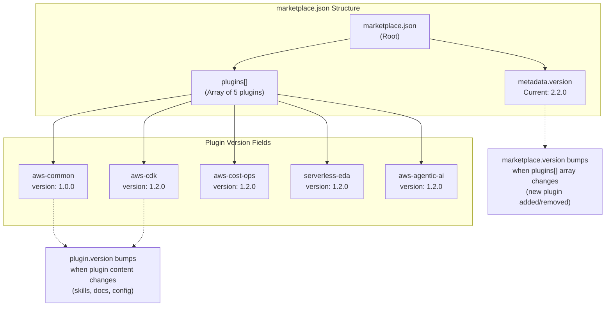
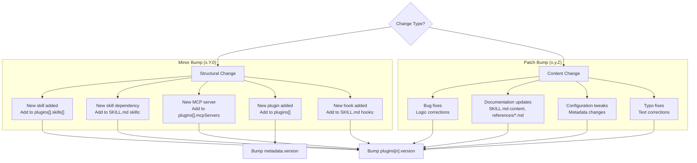
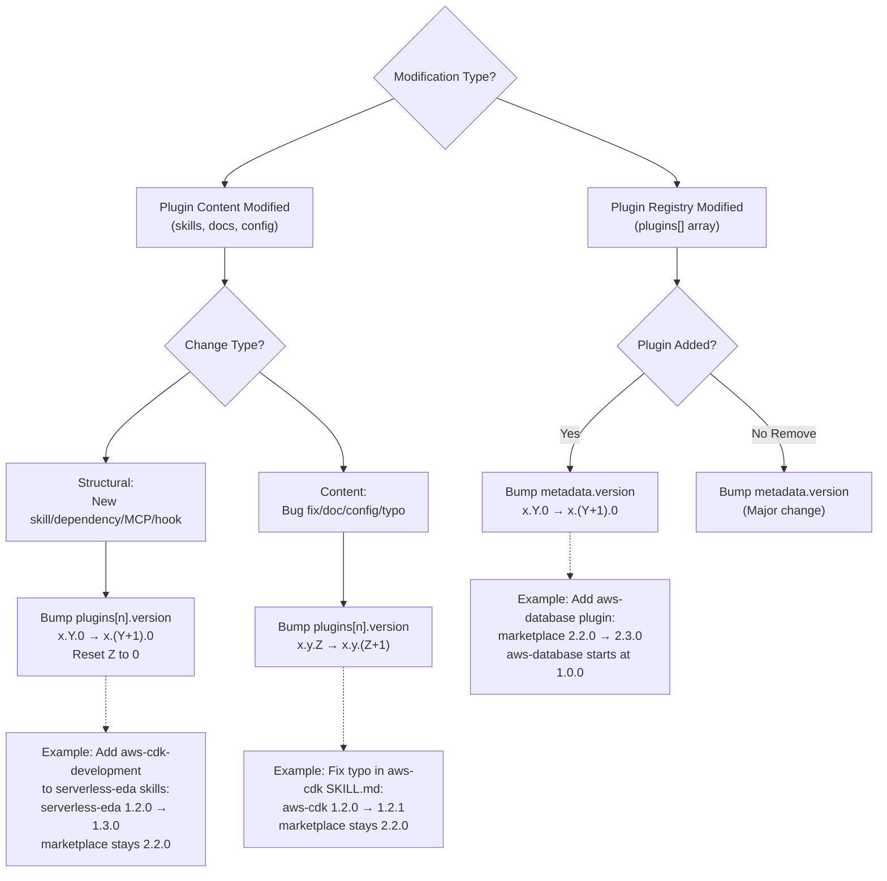
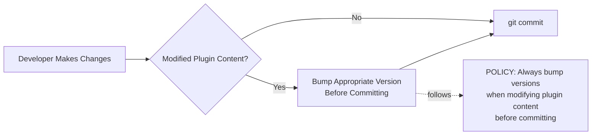

<!-- source: DeepWiki mcp.deepwiki.com · repo zxkane/aws-skills · page 5.2 Version Management · fetched 2026-10-26 -->

# Version Management

<details>
<summary>Relevant source files</summary>

The following files were used as context for generating this wiki page:

- [.claude-plugin/marketplace.json](.claude-plugin/marketplace.json)
- [CLAUDE.md](CLAUDE.md)

</details>


This document defines the version management strategy for the AWS Skills marketplace and its constituent plugins. It covers the two-level versioning system (marketplace-level and plugin-level), rules for determining Minor vs Patch version bumps, and the mandatory version bump policy for all content modifications. For instructions on setting up local development with symlinks, see [Local Development Setup](#5.1). For quality gates that trigger before version releases, see [Validation and Quality Assurance](#5.3).

## Two-Level Versioning System

The AWS Skills system employs a two-level versioning hierarchy: the marketplace itself has a version, and each plugin within the marketplace maintains its own independent version.

### Marketplace Version Structure



**Two-Level Versioning System**

The marketplace version at `metadata.version` (currently `2.2.0`) tracks structural changes to the plugin registry, while individual `plugins[].version` fields track content changes within each plugin. The version differential pattern is evident: `aws-common` remains at `1.0.0` indicating foundational stability, while domain plugins have evolved to `1.2.0`.

**Sources:** [.claude-plugin/marketplace.json:1-152]()

### Version Location in Code

| Version Type | JSON Path | Current Value | Purpose |
|--------------|-----------|---------------|---------|
| Marketplace | `metadata.version` | `2.2.0` | Tracks plugin registry changes |
| aws-common | `plugins[0].version` | `1.0.0` | Foundational plugin versioning |
| aws-cdk | `plugins[1].version` | `1.2.0` | CDK plugin versioning |
| aws-cost-ops | `plugins[2].version` | `1.2.0` | Cost operations plugin versioning |
| serverless-eda | `plugins[3].version` | `1.2.0` | Serverless plugin versioning |
| aws-agentic-ai | `plugins[4].version` | `1.2.0` | Agentic AI plugin versioning |

**Sources:** [.claude-plugin/marketplace.json:9](), [.claude-plugin/marketplace.json:15](), [.claude-plugin/marketplace.json:34](), [.claude-plugin/marketplace.json:65](), [.claude-plugin/marketplace.json:116](), [.claude-plugin/marketplace.json:135]()

## Version Bump Rules

The system follows semantic versioning principles with two bump categories: Minor (x.Y.0) for structural changes and Patch (x.y.Z) for content changes.



**Version Bump Decision Tree**

This diagram maps change types to version bump actions. Structural changes (new skills, dependencies, MCP servers, hooks) trigger Minor bumps. Content changes (bug fixes, documentation, configuration, typos) trigger Patch bumps. Only adding a new plugin triggers a marketplace version bump.

**Sources:** [CLAUDE.md:89-108]()

### Minor Bump Triggers (x.Y.0)

Minor version bumps occur when plugin capabilities expand or structural configuration changes:

| Trigger | Affected File | Example |
|---------|---------------|---------|
| **New skill added** | `plugins[].skills[]` array | Adding `./skills/new-skill` to aws-cdk plugin |
| **New skill dependency** | `skills/<skill>/SKILL.md` frontmatter | Adding `aws-cdk-development` to `skills:` list |
| **New MCP server** | `plugins[].mcpServers` object | Adding `stepfunctions` server to aws-cdk plugin |
| **New hook configuration** | `skills/<skill>/SKILL.md` frontmatter | Adding `PreToolUse` hook with matcher |
| **New plugin** | `plugins[]` array | Adding sixth plugin to marketplace |

**Examples of Minor Bump Changes:**

```yaml
# Adding skill dependency in SKILL.md frontmatter → Minor bump
---
name: aws-serverless-eda
skills:
  - aws-mcp-setup           # Existing
  - aws-cdk-development     # NEW → Triggers minor bump
---
```

```json
// Adding MCP server in marketplace.json → Minor bump
{
  "name": "aws-cdk",
  "version": "1.3.0",  // Bumped from 1.2.0
  "mcpServers": {
    "cdk": { ... },
    "stepfunctions": { ... }  // NEW server
  }
}
```

**Sources:** [CLAUDE.md:99-100](), [.claude-plugin/marketplace.json:49-60]()

### Patch Bump Triggers (x.y.Z)

Patch version bumps occur when content improves without structural changes:

| Trigger | Affected Files | Example |
|---------|----------------|---------|
| **Bug fixes** | Any plugin code/scripts | Fixing broken validation logic |
| **Documentation updates** | `SKILL.md`, `references/*.md` | Updating best practices content |
| **Configuration tweaks** | `marketplace.json` metadata | Updating description text |
| **Typo fixes** | Any text content | Correcting spelling errors |

**Examples of Patch Bump Changes:**

```markdown
<!-- Updating SKILL.md content → Patch bump -->
## CDK Best Practices

- Use `NodejsFunction` for TypeScript/JavaScript Lambdas
- Use `PythonFunction` for Python Lambdas (UPDATED TEXT)
```

```json
// Updating plugin metadata → Patch bump
{
  "name": "aws-cdk",
  "version": "1.2.1",  // Bumped from 1.2.0
  "description": "Comprehensive AWS development skills including CDK best practices...",
  // Description text updated, no structural changes
}
```

**Sources:** [CLAUDE.md:100]()

## When to Bump Which Version



**Version Bump Target Decision Tree**

This diagram determines which version field to bump based on modification scope. Plugin content changes affect only that plugin's version. Adding a new plugin to the registry bumps the marketplace version while the new plugin starts at `1.0.0`.

**Sources:** [CLAUDE.md:102-108](), [.claude-plugin/marketplace.json:9]()

### Plugin Version Bumping

**Rule:** Bump `plugins[n].version` whenever content within that plugin changes.

**Affected Files Mapping:**

| Modified File Pattern | Bump Target | Bump Type |
|----------------------|-------------|-----------|
| `plugins/<plugin>/skills/<skill>/SKILL.md` (frontmatter) | `plugins[n].version` | Minor |
| `plugins/<plugin>/skills/<skill>/SKILL.md` (content) | `plugins[n].version` | Patch |
| `plugins/<plugin>/skills/<skill>/references/*.md` | `plugins[n].version` | Patch |
| `plugins/<plugin>/scripts/*.sh` | `plugins[n].version` | Patch |
| `.claude-plugin/marketplace.json` (plugin's `mcpServers`) | `plugins[n].version` | Minor |
| `.claude-plugin/marketplace.json` (plugin's `description`) | `plugins[n].version` | Patch |

**Sources:** [CLAUDE.md:113-117](), [.claude-plugin/marketplace.json:11-150]()

### Marketplace Version Bumping

**Rule:** Bump `metadata.version` only when the `plugins[]` array structure changes.

**Triggers:**
- **Adding new plugin:** Minor bump `2.2.0` → `2.3.0`
- **Removing plugin:** Major bump `2.2.0` → `3.0.0` (breaking change)
- **Reordering plugins:** No version change (non-functional change)

**Plugin Content Changes Do NOT Affect Marketplace Version:**

```json
// This change bumps aws-cdk from 1.2.0 → 1.2.1
// Marketplace version stays 2.2.0
{
  "metadata": {
    "version": "2.2.0"  // UNCHANGED
  },
  "plugins": [
    {
      "name": "aws-cdk",
      "version": "1.2.1"  // BUMPED
    }
  ]
}
```

**Sources:** [CLAUDE.md:105-106](), [.claude-plugin/marketplace.json:8-10]()

## Mandatory Version Bump Policy



**Mandatory Version Bump Workflow**

All plugin content modifications require a version bump before committing. This ensures version numbers accurately reflect the state of the codebase.

**Policy Statement:** "Always bump versions when modifying plugin content before committing." [CLAUDE.md:108]()

### Pre-Commit Checklist

Before committing changes to any plugin:

1. **Identify modified files:**
   ```bash
   git status | grep "plugins/"
   ```

2. **Determine bump type:**
   - Modified `SKILL.md` frontmatter (`skills:`, `hooks:`, `allowed-tools:`) → Minor
   - Modified `SKILL.md` content or `references/*.md` → Patch
   - Added MCP server to `marketplace.json` → Minor
   - Fixed bugs or typos → Patch

3. **Update version in `.claude-plugin/marketplace.json`:**
   ```json
   {
     "plugins": [
       {
         "name": "affected-plugin",
         "version": "x.y.z"  // Update this field
       }
     ]
   }
   ```

4. **Commit with descriptive message:**
   ```bash
   git commit -m "feat(aws-cdk): add Step Functions MCP server
   
   Bump aws-cdk version 1.2.0 → 1.3.0 (minor)"
   ```

**Sources:** [CLAUDE.md:108]()

## Version Differential Strategy

The current version distribution reveals a deliberate stability strategy:

| Plugin | Version | Rationale |
|--------|---------|-----------|
| aws-common | `1.0.0` | Foundational dependency - kept stable to minimize downstream impact |
| aws-cdk | `1.2.0` | Domain plugin - evolves with CDK best practices |
| aws-cost-ops | `1.2.0` | Domain plugin - evolves with operational patterns |
| serverless-eda | `1.2.0` | Domain plugin - evolves with architectural patterns |
| aws-agentic-ai | `1.2.0` | Domain plugin - evolves with Bedrock capabilities |

**Strategy Rationale:**

The `aws-common` plugin at `1.0.0` provides the foundational `aws-mcp-setup` skill that all other plugins depend on via the `skills:` frontmatter field. Keeping this plugin at `1.0.0` signals API stability - changes to `aws-common` would force all dependent plugins to update their dependency declarations. Domain plugins at `1.2.0` indicate they have evolved through two minor releases (adding features, dependencies, or MCP servers) without requiring breaking changes to the foundation.

**Sources:** [.claude-plugin/marketplace.json:15](), [.claude-plugin/marketplace.json:34](), [.claude-plugin/marketplace.json:65](), [.claude-plugin/marketplace.json:116](), [.claude-plugin/marketplace.json:135]()

## Common Version Bump Scenarios

### Scenario 1: Adding Skill Dependency

**Change:** Add `aws-cdk-development` to `serverless-eda` skill's dependencies.

```yaml
# plugins/serverless-eda/skills/aws-serverless-eda/SKILL.md
---
name: aws-serverless-eda
skills:
  - aws-mcp-setup           # Existing
  - aws-cdk-development     # NEW
---
```

**Version Impact:**
- Bump `plugins[3].version` (serverless-eda): `1.2.0` → `1.3.0` (Minor)
- Marketplace version: `2.2.0` (unchanged)

**Rationale:** Adding a skill dependency is a structural change that expands the skill's capabilities.

**Sources:** [CLAUDE.md:99]()

### Scenario 2: Updating Documentation Content

**Change:** Update CDK best practices documentation.

```markdown
<!-- plugins/aws-cdk/skills/aws-cdk-development/references/cdk-patterns.md -->
## Lambda Development

Updated guidance on NodejsFunction construct...
```

**Version Impact:**
- Bump `plugins[1].version` (aws-cdk): `1.2.0` → `1.2.1` (Patch)
- Marketplace version: `2.2.0` (unchanged)

**Rationale:** Documentation content updates are non-structural changes.

**Sources:** [CLAUDE.md:100]()

### Scenario 3: Adding New Plugin

**Change:** Add `aws-database` plugin for RDS/DynamoDB expertise.

```json
// .claude-plugin/marketplace.json
{
  "metadata": {
    "version": "2.3.0"  // Bumped from 2.2.0
  },
  "plugins": [
    // ... existing 5 plugins ...
    {
      "name": "aws-database",
      "version": "1.0.0",  // New plugin starts at 1.0.0
      "source": "./plugins/aws-database"
    }
  ]
}
```

**Version Impact:**
- Bump `metadata.version`: `2.2.0` → `2.3.0` (Minor)
- New plugin starts at: `1.0.0`

**Rationale:** Adding a plugin is a marketplace-level structural change.

**Sources:** [CLAUDE.md:105]()

### Scenario 4: Adding MCP Server to Existing Plugin

**Change:** Add Step Functions MCP server to `aws-cdk` plugin.

```json
// .claude-plugin/marketplace.json
{
  "name": "aws-cdk",
  "version": "1.3.0",  // Bumped from 1.2.0
  "mcpServers": {
    "cdk": { ... },
    "sfn": {  // NEW
      "type": "stdio",
      "command": "uvx",
      "args": ["awslabs.step-functions-mcp-server@latest"]
    }
  }
}
```

**Version Impact:**
- Bump `plugins[1].version` (aws-cdk): `1.2.0` → `1.3.0` (Minor)
- Marketplace version: `2.2.0` (unchanged)

**Rationale:** Adding an MCP server expands plugin capabilities through new tool integrations.

**Sources:** [CLAUDE.md:99](), [.claude-plugin/marketplace.json:49-60]()

## Version Verification

After bumping versions, verify consistency:

```bash
# Check marketplace version
jq '.metadata.version' .claude-plugin/marketplace.json

# Check all plugin versions
jq '.plugins[] | {name: .name, version: .version}' .claude-plugin/marketplace.json

# Verify specific plugin version
jq '.plugins[] | select(.name=="aws-cdk") | .version' .claude-plugin/marketplace.json
```

**Expected Output for Current State:**
```
Marketplace: 2.2.0
aws-common: 1.0.0
aws-cdk: 1.2.0
aws-cost-ops: 1.2.0
serverless-eda: 1.2.0
aws-agentic-ai: 1.2.0
```

**Sources:** [.claude-plugin/marketplace.json:1-152]()

---

