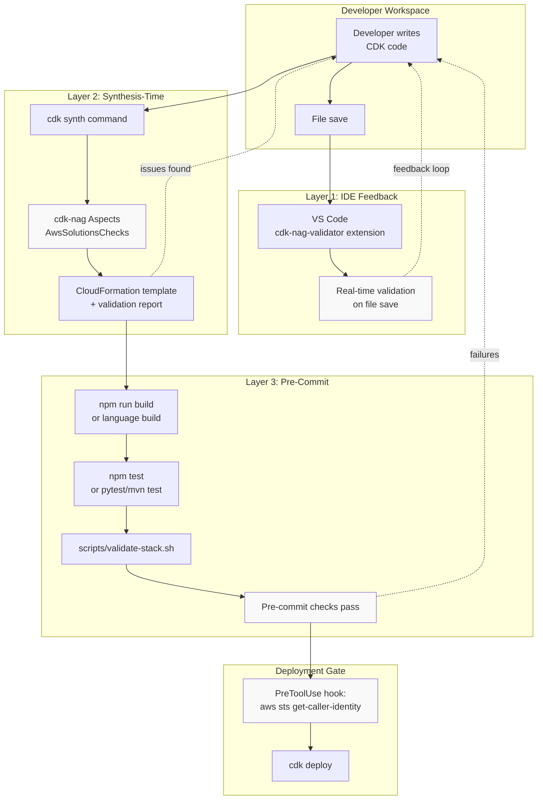
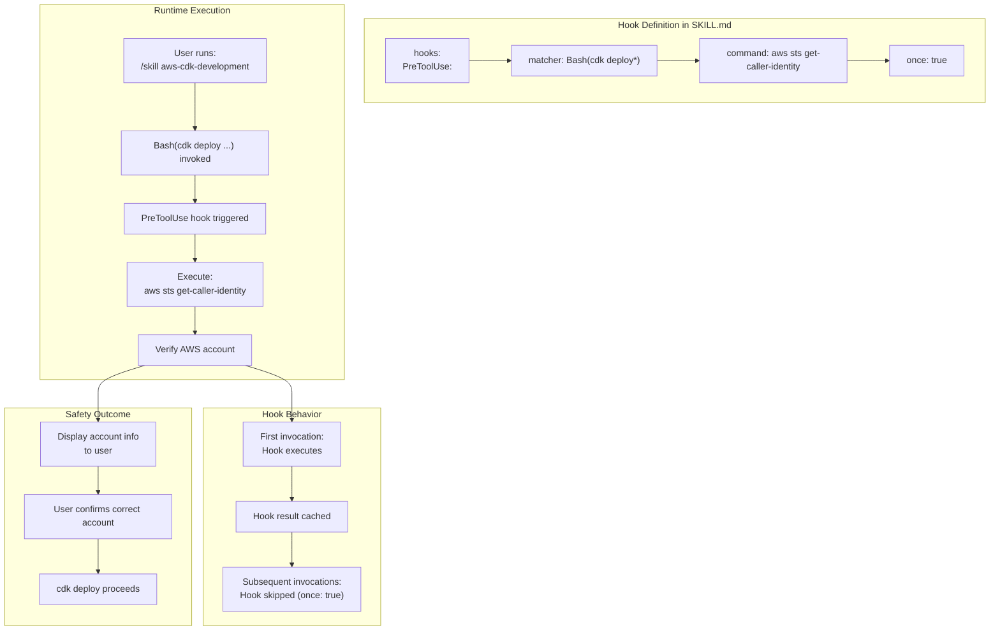
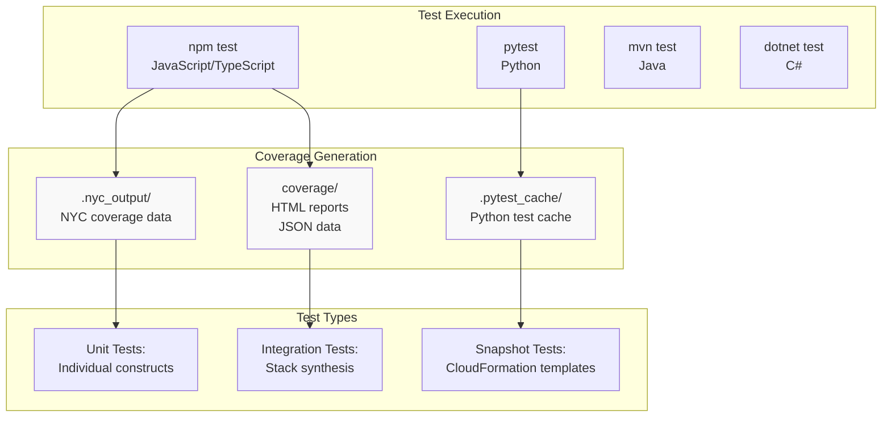
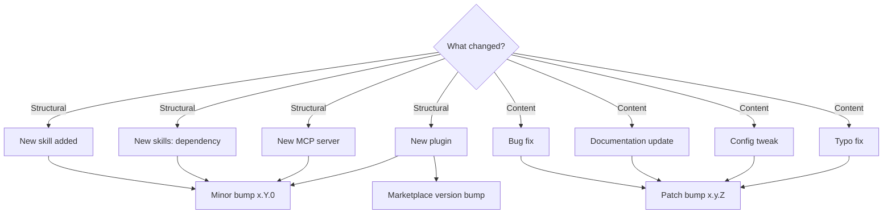
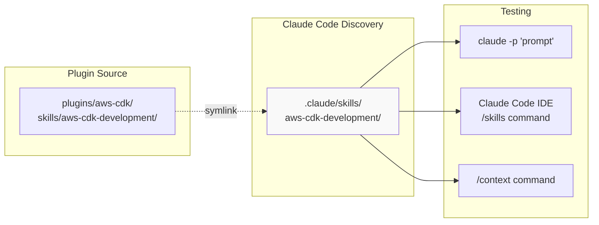

<!-- source: DeepWiki mcp.deepwiki.com · repo zxkane/aws-skills · page 5.3 Validation and Quality Assurance · fetched 2026-10-26 -->

# Validation and Quality Assurance

<details>
<summary>Relevant source files</summary>

The following files were used as context for generating this wiki page:

- [.gitignore](.gitignore)
- [CLAUDE.md](CLAUDE.md)
- [plugins/aws-cdk/skills/aws-cdk-development/SKILL.md](plugins/aws-cdk/skills/aws-cdk-development/SKILL.md)

</details>


This document describes the validation and quality assurance mechanisms used throughout the AWS Skills for Claude Code system. It covers the three-layer validation strategy for infrastructure code, lifecycle hooks for runtime safety, testing infrastructure, and quality gates that prevent defects from reaching production.

For information about local development workflows, see [Local Development Setup](#5.1). For version management policies, see [Version Management](#5.2).

## Purpose and Scope

The validation system enforces quality through multiple checkpoints:
- **Multi-layer validation** that catches issues at different stages (IDE → synthesis → pre-commit)
- **Lifecycle hooks** that verify execution context before destructive operations
- **Testing infrastructure** for unit and integration tests
- **Quality gates** that enforce mandatory checks before commits

This system is primarily implemented in the `aws-cdk` plugin but serves as a reference pattern for all plugins.

Sources: [plugins/aws-cdk/skills/aws-cdk-development/SKILL.md:132-200](), [CLAUDE.md:56-109]()

## Multi-Layer Validation Strategy

The system employs a progressive validation approach with three distinct layers, each catching different categories of issues:

### Validation Flow Diagram



Sources: [plugins/aws-cdk/skills/aws-cdk-development/SKILL.md:132-200]()

### Validation Layer Comparison

| Layer | Stage | Scope | Tools | Speed | Mandatory |
|-------|-------|-------|-------|-------|-----------|
| **Layer 1** | IDE | Single file | cdk-nag extension | Instant | Optional |
| **Layer 2** | Synthesis | Full stack | cdk-nag Aspects | Seconds | Required |
| **Layer 3** | Pre-commit | Full project | build + test + scripts | Minutes | Required |

Each layer provides progressively broader coverage with increasing execution time.

Sources: [plugins/aws-cdk/skills/aws-cdk-development/SKILL.md:136-200]()

## Layer 1: Real-Time IDE Feedback

Layer 1 provides immediate feedback during code authorship through IDE integration.

### cdk-nag Installation

```bash
npm install --save-dev cdk-nag
```

The `cdk-nag` package provides synthesis-time validation rules that check for AWS best practices, security issues, and common misconfigurations.

### VS Code Extension

For TypeScript/JavaScript CDK projects, developers can install the optional CDK NAG Validator extension:
- **Extension ID**: `alphacrack.cdk-nag-validator`
- **Trigger**: Validates on file save
- **Benefit**: Catches issues without running `cdk synth`

This extension is optional but recommended for faster feedback loops.

Sources: [plugins/aws-cdk/skills/aws-cdk-development/SKILL.md:136-157]()

## Layer 2: Synthesis-Time Validation

Layer 2 is the mandatory validation checkpoint that all CDK code must pass.

### Aspects Integration

```typescript
import { Aspects } from 'aws-cdk-lib';
import { AwsSolutionsChecks } from 'cdk-nag';

const app = new App();
Aspects.of(app).add(new AwsSolutionsChecks());
```

This integration runs automatically during `cdk synth` and validates the entire stack against `AwsSolutionsChecks` rules.

### Synthesis Execution

```bash
cdk synth  # cdk-nag runs automatically via Aspects
```

The synthesis process:
1. Constructs the CDK application
2. Applies all registered Aspects
3. Executes cdk-nag validation rules
4. Generates CloudFormation template
5. Reports any violations

### Suppression Rules

When specific violations are legitimate, they can be suppressed with documented justification:

```typescript
import { NagSuppressions } from 'cdk-nag';

NagSuppressions.addResourceSuppressions(resource, [
  {
    id: 'AwsSolutions-L1',
    reason: 'Lambda@Edge requires specific runtime for CloudFront compatibility'
  }
]);
```

**Critical**: Every suppression must include a `reason` field explaining why the exception is necessary.

Sources: [plugins/aws-cdk/skills/aws-cdk-development/SKILL.md:159-177]()

## Layer 3: Pre-Commit Checks

Layer 3 provides comprehensive project-level validation before code is committed.

### Validation Sequence

```mermaid
graph LR
    subgraph "Build Phase"
        Compile["npm run build<br/>TypeScript compilation<br/>or language-specific build"]
    end
    
    subgraph "Test Phase"
        Unit["Unit tests<br/>npm test"]
        Integration["Integration tests"]
        Coverage["Coverage tracking<br/>.nyc_output/"]
    end
    
    subgraph "Validation Phase"
        Script["scripts/validate-stack.sh"]
        LangDetect["Language detection"]
        TemplateAnalysis["Template size analysis"]
        ResourceCount["Resource count check"]
        SynthVerify["Synthesis verification"]
    end
    
    subgraph "Quality Gate"
        Pass["All checks passed"]
        Commit["Ready for commit"]
    end
    
    Compile --> Unit
    Unit --> Integration
    Integration --> Coverage
    Coverage --> Script
    
    Script --> LangDetect
    LangDetect --> TemplateAnalysis
    TemplateAnalysis --> ResourceCount
    ResourceCount --> SynthVerify
    
    SynthVerify --> Pass
    Pass --> Commit
```



Sources: [plugins/aws-cdk/skills/aws-cdk-development/SKILL.md:179-200]()

### Build Verification

The build phase ensures code compiles successfully:

```bash
npm run build  # TypeScript/JavaScript
# or
pytest         # Python
mvn test       # Java
dotnet build   # C#
go build       # Go
```

Build failures prevent further validation steps.

### Test Execution

Testing infrastructure includes:
- **Unit tests**: Test individual constructs in isolation
- **Integration tests**: Test stack synthesis and resource relationships
- **Snapshot tests**: Validate CloudFormation template structure

Test artifacts are stored in:
- `coverage/` - Code coverage reports
- `.nyc_output` - NYC coverage data
- `.pytest_cache/` - Python test cache

Sources: [plugins/aws-cdk/skills/aws-cdk-development/SKILL.md:186-189](), [.gitignore:68-70]()

### Validation Script

The `scripts/validate-stack.sh` script performs meta-level checks:

1. **Language Detection**: Identifies the CDK project language
2. **Template Analysis**: Checks CloudFormation template size limits
3. **Resource Count**: Validates resource count within AWS limits
4. **Synthesis Verification**: Confirms `cdk synth` succeeds

**Note**: Detailed anti-pattern checks are delegated to cdk-nag in Layer 2, keeping this script focused on structural validation.

Sources: [plugins/aws-cdk/skills/aws-cdk-development/SKILL.md:191-200]()

## Lifecycle Hooks for Runtime Safety

The hook system provides runtime safety checks before executing potentially destructive operations.

### Hook Architecture



Sources: [plugins/aws-cdk/skills/aws-cdk-development/SKILL.md:16-21](), [CLAUDE.md:71-76]()

### PreToolUse Hook Configuration

The hook is defined in the skill frontmatter:

```yaml
hooks:
  PreToolUse:
    - matcher: Bash(cdk deploy*)
      command: aws sts get-caller-identity --query Account --output text
      once: true
```

**Components**:
- `matcher`: Pattern matching tool invocations (wildcard `*` supported)
- `command`: Shell command to execute before the tool
- `once`: Boolean flag to execute hook only once per session

### Account Verification Workflow

The `aws sts get-caller-identity` command displays:
- AWS Account ID
- User/Role ARN
- User ID

This prevents accidental deployments to wrong AWS accounts by making the execution context explicit before each deployment session.

Sources: [plugins/aws-cdk/skills/aws-cdk-development/SKILL.md:16-21]()

## Testing Infrastructure

The testing infrastructure spans multiple languages and frameworks, with standardized artifact locations.

### Testing Artifacts and Locations



Sources: [.gitignore:68-70](), [plugins/aws-cdk/skills/aws-cdk-development/SKILL.md:226-232]()

### Test Strategy

The testing approach follows CDK best practices:

| Test Type | Purpose | Scope | Tools |
|-----------|---------|-------|-------|
| **Unit Tests** | Validate individual constructs | Single construct | Jest, pytest, JUnit |
| **Integration Tests** | Validate stack synthesis | Full stack | CDK test utilities |
| **Snapshot Tests** | Validate CloudFormation templates | Template structure | Jest snapshots, approval tests |

**Key testing patterns**:
- Test construct properties and relationships
- Verify resource creation and configuration
- Validate IAM policies and permissions
- Check resource naming and tagging

Sources: [plugins/aws-cdk/skills/aws-cdk-development/SKILL.md:226-232]()

### Coverage Tracking

Coverage artifacts are generated but ignored from version control:

```
coverage/           # HTML and JSON coverage reports
.nyc_output/        # NYC coverage data for JavaScript
.pytest_cache/      # Python test cache and results
```

These directories are listed in `.gitignore` to prevent committing generated artifacts.

Sources: [.gitignore:68-70]()

## Quality Gates and Pre-Commit Requirements

Quality gates ensure no code is committed without passing validation.

### Mandatory Version Bumping

Before committing any plugin modifications, version bumps are **mandatory**:

```json
{
  "plugins": [
    {
      "id": "aws-cdk@aws-skills",
      "version": "1.2.0"  // Must be bumped
    }
  ]
}
```

**Version bump decision tree**:



Sources: [CLAUDE.md:89-109]()

### Version Bump Rules

| Change Type | Version Component | Examples |
|-------------|------------------|----------|
| **Minor (x.Y.0)** | Structural changes | New skill, new `skills:` dependency, new MCP server, new plugin |
| **Patch (x.y.Z)** | Content changes | Bug fixes, doc updates, config tweaks, typo fixes |

**Locations to update**:
- `.claude-plugin/marketplace.json` - `plugins[].version` field
- `.claude-plugin/marketplace.json` - `metadata.version` (only for new plugins)

Sources: [CLAUDE.md:96-109]()

### GitHub Actions Integration

When GitHub Actions workflow files exist in `.github/workflows/`, all defined checks must pass before committing:

```
.github/workflows/
├── build.yml
├── test.yml
└── validate.yml
```

This ensures CI/CD pipeline compatibility and prevents pipeline failures after merge.

Sources: [plugins/aws-cdk/skills/aws-cdk-development/SKILL.md:294-296]()

## Local Testing Workflow

The local testing workflow uses symlinks for rapid iteration without plugin reinstallation.

### Symlink Structure



Sources: [CLAUDE.md:26-54]()

### Creating Symlinks

If symlinks break, recreate them:

```bash
cd .claude && rm -rf skills && mkdir skills
ln -s ../../plugins/aws-common/skills/aws-mcp-setup skills/
ln -s ../../plugins/aws-cdk/skills/aws-cdk-development skills/
ln -s ../../plugins/serverless-eda/skills/aws-serverless-eda skills/
ln -s ../../plugins/aws-agentic-ai/skills/aws-agentic-ai skills/
ln -s ../../plugins/aws-cost-ops/skills/aws-cost-operations skills/
```

### Verification Commands

**Interactive testing**:
```bash
cd /data/git/agentic/aws-skills
claude
/skills    # List all loaded skills
/context   # Show execution context
```

**Non-interactive testing**:
```bash
claude -p "List all available skills in this project"
claude -p "Read the frontmatter of aws-cdk-development skill"
```

Sources: [CLAUDE.md:26-54]()

## Summary

The validation and quality assurance system provides defense in depth through:

1. **Multi-layer validation**: Progressive quality gates from IDE to pre-commit
2. **Lifecycle hooks**: Runtime safety checks before destructive operations
3. **Testing infrastructure**: Comprehensive unit, integration, and snapshot tests
4. **Quality gates**: Mandatory version bumping and CI/CD integration
5. **Local testing**: Rapid iteration through symlink-based development

This system ensures that infrastructure code meets AWS best practices, passes security checks, and maintains high quality standards before reaching production environments.

Sources: [plugins/aws-cdk/skills/aws-cdk-development/SKILL.md:132-296](), [CLAUDE.md:26-109]()