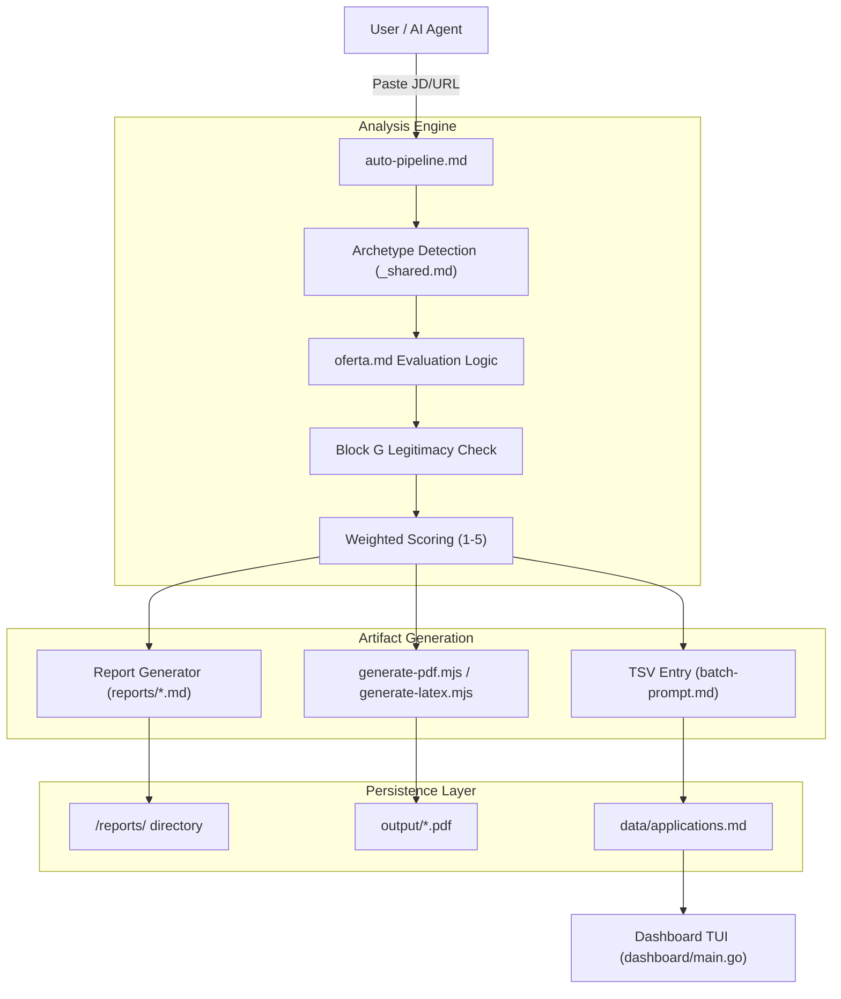
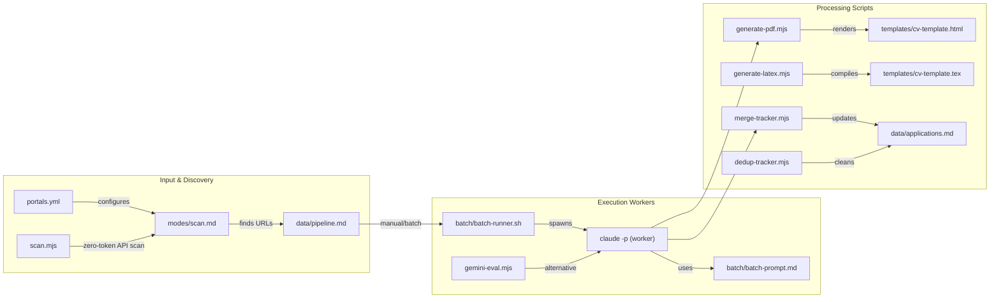

<!-- source: DeepWiki mcp.deepwiki.com · repo santifer/career-ops · page 1 Career-Ops Overview · fetched 2026-10-26 -->

# Career-Ops Overview

Relevant source files

The following files were used as context for generating this wiki page:

- [.agents/skills/career-ops/SKILL.md](.agents/skills/career-ops/SKILL.md)
- [.github/CODEOWNERS](.github/CODEOWNERS)
- [.github/PULL_REQUEST_TEMPLATE/sign-manifesto.md](.github/PULL_REQUEST_TEMPLATE/sign-manifesto.md)
- [.gitignore](.gitignore)
- [AGENTS.md](AGENTS.md)
- [ARCHITECTURE.md](ARCHITECTURE.md)
- [CLAUDE.md](CLAUDE.md)
- [DATA_CONTRACT.md](DATA_CONTRACT.md)
- [MAINTAINERS.md](MAINTAINERS.md)
- [MANIFESTO.md](MANIFESTO.md)
- [README.ar.md](README.ar.md)
- [README.cn.md](README.cn.md)
- [README.es.md](README.es.md)
- [README.fr.md](README.fr.md)
- [README.ja.md](README.ja.md)
- [README.ko-KR.md](README.ko-KR.md)
- [README.md](README.md)
- [README.pl.md](README.pl.md)
- [README.pt-BR.md](README.pt-BR.md)
- [README.ru.md](README.ru.md)
- [README.ua.md](README.ua.md)
- [README.zh-TW.md](README.zh-TW.md)
- [SIGNATURES.md](SIGNATURES.md)
- [dashboard/README.md](dashboard/README.md)
- [docs/ARCHITECTURE.md](docs/ARCHITECTURE.md)
- [docs/CUSTOMIZATION.md](docs/CUSTOMIZATION.md)
- [docs/REVIEWING.md](docs/REVIEWING.md)
- [docs/SCRIPTS.md](docs/SCRIPTS.md)
- [providers/README.md](providers/README.md)
- [test-all.mjs](test-all.mjs)
- [update-system.mjs](update-system.mjs)

Career-Ops is an AI-powered job search command center built on top of **Claude Code** and other AI coding CLIs. It transforms the manual, often overwhelming process of job hunting into a structured, automated pipeline. The system is designed for high-quality, targeted applications rather than "spray-and-pray" volume, using a sophisticated A-G scoring logic to ensure a genuine match between the candidate and the role.

The project was originally developed to manage a high-scale search involving 740+ evaluations and 100+ tailored CVs [README.md:41-41](), [AGENTS.md:3-5]().

## Core Philosophy: Quality via Automation

The system operates on three primary pillars:
1.  **Deep Evaluation**: Every job description (JD) is analyzed across weighted dimensions to produce a score from 1.0 to 5.0, plus a qualitative legitimacy assessment (Block G) and a negotiation prep block (Block H) [README.md:87-87](), [.agents/skills/career-ops/SKILL.md:45-46]().
2.  **Tailored Artifacts**: Instead of a generic resume, the system generates ATS-optimized PDFs or LaTeX documents customized specifically for the target JD using a keyword-injection engine [README.md:88-88](), [AGENTS.md:57-60]().
3.  **Data Integrity**: A flat-file "database" (`data/applications.md`) serves as the single source of truth, maintained by a suite of Node.js scripts to ensure consistency, deduplication, and status normalization [DATA_CONTRACT.md:31-31](), [AGENTS.md:13-14]().

Sources: [README.md:83-94](), [AGENTS.md:3-11](), [DATA_CONTRACT.md:1-53]()

## System Topology

The following diagram illustrates how a user interaction (pasting a URL) flows through the subsystems to produce structured data and documents.

### High-Level Data Flow (Natural Language to Code Space)

Sources: [README.md:85-92](), [AGENTS.md:72-104](), [DATA_CONTRACT.md:31-53]()

## Subsystem Interaction (Code Entity Space)

This diagram maps the logical functions to the specific files and scripts that execute them within the codebase.

### Code Entity Map

Sources: [AGENTS.md:49-70](), [DATA_CONTRACT.md:5-74](), [README.md:97-114](), [docs/SCRIPTS.md:9-54]()

## Major Subsystems

### 1. AI Agent Modes (`/modes`)
The intelligence of the system is contained in Markdown "skill" files. These files define how the AI behaves when specific commands are invoked.
*   **Evaluation**: `oferta.md` handles single analysis, including the 6-block A-F structure plus Block G [DATA_CONTRACT.md:51-51]().
*   **Discovery**: `scan.md` and `scan.mjs` find new roles based on `portals.yml` [AGENTS.md:69-69]().
*   **Action**: `apply.md` (form filling assistant) and `contacto.md` (LinkedIn outreach) handle external steps [DATA_CONTRACT.md:49-49]().
*   **Context**: `_shared.md` contains core rules, while `_profile.md` holds user-specific customizations (archetypes, narrative) to prevent overwrite during updates [AGENTS.md:16-16](), [DATA_CONTRACT.md:16-16]().

### 2. Batch Processing (`/batch`)
For high-volume processing, the system uses an orchestrator/worker architecture. `batch-runner.sh` manages multiple worker instances, each running the `batch-prompt.md` logic to evaluate dozens of offers in parallel and generate reports/PDFs automatically [README.md:90-90]().

### 3. Generation Engine
The system supports two output paths for CVs:
*   **HTML/PDF**: `generate-pdf.mjs` uses Playwright to render `templates/cv-template.html` [docs/SCRIPTS.md:16-16]().
*   **LaTeX**: `generate-latex.mjs` validates and compiles `templates/cv-template.tex` [docs/SCRIPTS.md:19-19]().
The choice is typically routed through the agent based on user preference or configuration [AGENTS.md:57-60]().

### 4. Data Management & TUI
The `data/` directory stores the pipeline state. Because this is a flat-file system, integrity scripts like `merge-tracker.mjs` and `dedup-tracker.mjs` are used to maintain the `applications.md` database [docs/SCRIPTS.md:14-15](). The **Dashboard TUI**, written in Go, provides a terminal interface for filtering and sorting this data [docs/SCRIPTS.md:53-53]().

### 5. Interview Intelligence (`/interview-prep`)
This subsystem accumulates STAR+Reflection stories in `story-bank.md` across multiple evaluations [DATA_CONTRACT.md:21-21](). The `deep.md` mode and `interview-prep` subcommands generate company-specific intelligence reports [AGENTS.md:48-50](), [DATA_CONTRACT.md:22-22]().

### 6. Multi-Agent & Updates
Career-Ops supports multiple agents (Claude, Gemini, Qwen, etc.) via a universal routing layer [AGENTS.md:141-146](). The `update-system.mjs` script ensures that core logic can be updated without touching user data by strictly enforcing the `DATA_CONTRACT.md` boundaries [update-system.mjs:6-7]().

## Child Pages

For detailed technical documentation on specific components, see the following pages:

*   **[Getting Started & Setup](#1.1)**: Installation (Node, Go, Playwright) and the initial onboarding flow (CV and Profile setup).
*   **[Configuration Reference](#1.2)**: Detailed breakdown of `profile.yml`, `portals.yml`, and the `DATA_CONTRACT.md` boundary.
*   **[Examples & Sample Files](#1.3)**: Walkthrough of sample CVs, evaluations, and proof point formats.

Sources: [README.md:95-130](), [AGENTS.md:72-134](), [DATA_CONTRACT.md:1-81](), [update-system.mjs:1-20]()

---

