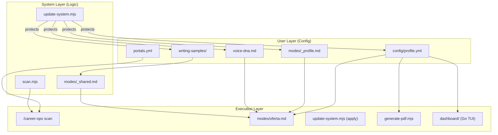
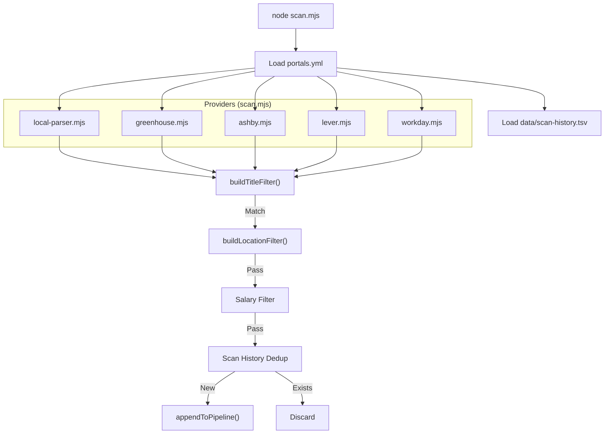
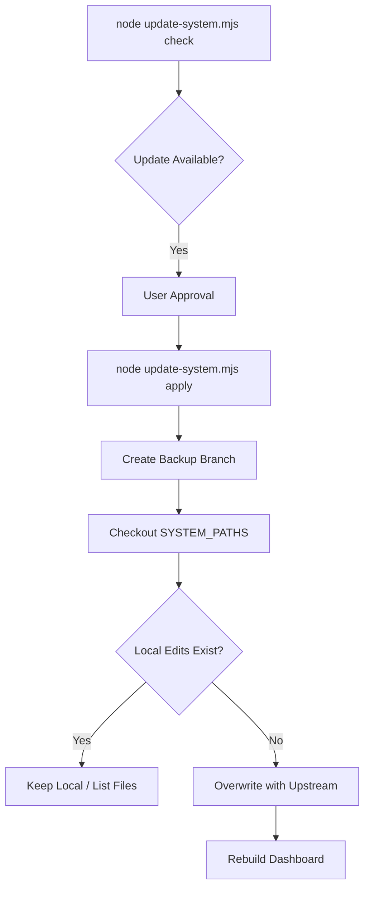

<!-- source: DeepWiki mcp.deepwiki.com · repo santifer/career-ops · page 1.2 Configuration Reference · fetched 2026-10-26 -->

# Configuration Reference

Relevant source files

The following files were used as context for generating this wiki page:

- [.agents/skills/career-ops/SKILL.md](.agents/skills/career-ops/SKILL.md)
- [.gitignore](.gitignore)
- [AGENTS.md](AGENTS.md)
- [CLAUDE.md](CLAUDE.md)
- [DATA_CONTRACT.md](DATA_CONTRACT.md)
- [cv-sync-check.mjs](cv-sync-check.mjs)
- [dedup-tracker.mjs](dedup-tracker.mjs)
- [docs/FAQ.md](docs/FAQ.md)
- [docs/RUNNING_ON_A_BUDGET.md](docs/RUNNING_ON_A_BUDGET.md)
- [docs/SCRIPTS.md](docs/SCRIPTS.md)
- [docs/SUPPORTED_CLIS.md](docs/SUPPORTED_CLIS.md)
- [merge-tracker.mjs](merge-tracker.mjs)
- [modes/_writing.md](modes/_writing.md)
- [modes/apply.md](modes/apply.md)
- [modes/contacto.md](modes/contacto.md)
- [modes/pipeline.md](modes/pipeline.md)
- [modes/scan.md](modes/scan.md)
- [normalize-statuses.mjs](normalize-statuses.mjs)
- [openai-tailor.mjs](openai-tailor.mjs)
- [scaffolder/bin/skill-entrypoints.mjs](scaffolder/bin/skill-entrypoints.mjs)
- [scan-ats-full.mjs](scan-ats-full.mjs)
- [scan.mjs](scan.mjs)
- [stats.mjs](stats.mjs)
- [templates/portals.example.yml](templates/portals.example.yml)
- [templates/states.yml](templates/states.yml)
- [test-all.mjs](test-all.mjs)
- [tests/merge-tracker.test.mjs](tests/merge-tracker.test.mjs)
- [tests/scan-ats-full-title-filter-full.test.mjs](tests/scan-ats-full-title-filter-full.test.mjs)
- [tests/scan-run-failure.test.mjs](tests/scan-run-failure.test.mjs)
- [tests/source-no-nul-bytes.test.mjs](tests/source-no-nul-bytes.test.mjs)
- [tests/states-alias-coverage.test.mjs](tests/states-alias-coverage.test.mjs)
- [tests/stats.test.mjs](tests/stats.test.mjs)
- [tests/validate-portals-title-filter-full.test.mjs](tests/validate-portals-title-filter-full.test.mjs)
- [update-system.mjs](update-system.mjs)
- [validate-portals.mjs](validate-portals.mjs)
- [verify-pipeline.mjs](verify-pipeline.mjs)

This page provides a detailed technical reference for the configuration layer of Career-Ops. The system uses a "Configuration-as-Data" approach where YAML and Markdown files define the candidate's identity, search parameters for discovery agents, and the state machine for the application pipeline.

## System Configuration Flow

The configuration files act as the primary context providers for the AI agents (`modes/`) and the data validation rules for the processing scripts. The architecture enforces a strict boundary between the **System Layer** (logic and templates) and the **User Layer** (personal data and customizations) to ensure safe updates.

### Configuration Ingestion Map
The following diagram illustrates how configuration files are ingested by different system components and how they relate to code entities.

**Configuration Ingestion Map**

Sources: [DATA_CONTRACT.md:5-24](), [AGENTS.md:11-23](), [scan.mjs:73-74]()

---

## 1. Candidate Profile (`config/profile.yml`)

The `config/profile.yml` file is the "Single Source of Truth" for the candidate's professional identity. It is utilized by the `oferta`, `auto-pipeline`, `pdf`, and `dashboard` components.

### Key Schema Entities

| Section | Code Impact | Description |
|:---|:---|:---|
| `candidate` | `modes/pdf.md` | Personal contact details (Name, LinkedIn, Portfolio) injected into templates. |
| `target_roles` | `modes/oferta.md` | Defines "North Star" roles and archetypes used to calculate match scores. |
| `narrative` | `modes/pdf.md` | Provides the `headline`, `exit_story`, and `superpowers` for CV personalization. |
| `compensation` | `modes/oferta.md` | Sets `target_range` and `minimum` for Block D (Comp Research). |
| `cv.output_format` | `modes/auto-pipeline.md` | Routes the generation pipeline to either `modes/pdf.md` (HTML) or `modes/latex.md`. |
| `location.country` | `scan.mjs` | Used by `country_eligibility_filter` to cross-reference JD body text [templates/portals.example.yml:112-117](). |

### Implementation Detail: The User Layer
As defined in `DATA_CONTRACT.md`, `config/profile.yml` is a core part of the **User Layer** [DATA_CONTRACT.md:12](). The system logic is designed to read from this file but never overwrite it during system updates [update-system.mjs:7]().

Sources: [DATA_CONTRACT.md:5-15](), [AGENTS.md:11-23](), [scan.mjs:74]()

---

## 2. Portal Scanner Configuration (`portals.yml`)

The `portals.yml` file (copied from `templates/portals.example.yml`) configures the discovery engine. It supports a 4-level discovery strategy: Local parsers, Playwright direct navigation, HTTP JSON APIs, and WebSearch [templates/portals.example.yml:4-9]().

### Discovery Strategy (Levels)
1.  **Level 0: Local Parser**: Executes a specific script (Node, Python, etc.) to extract jobs from SSR/static pages without LLM tokens [modes/scan.md:35-40]().
2.  **Level 1: Playwright**: Direct navigation and snapshots for SPAs (Ashby, Lever, Workday) [modes/scan.md:112-118]().
3.  **Level 2: HTTP JSON**: Uses `providers/` to fetch from ATS APIs (Greenhouse, Ashby, Lever) [templates/portals.example.yml:7]().
4.  **Level 3: WebSearch**: Broad discovery using `site:` filters [templates/portals.example.yml:8]().

### Filtering Logic
The scanner applies filters in a specific sequence: Title → Location → Salary → Content → Deduplication.

*   **Title Filter**: Uses `positive` and `negative` keywords. Compiled matchers are cached in a `WeakMap` to optimize high-volume scans [scan.mjs:110-123]().
*   **Location Filter**: Case-insensitive substring matching. `always_allow` takes precedence over `block` [templates/portals.example.yml:56-62]().
*   **Country Eligibility**: Reads JD body text to detect "US-based only" restrictions [templates/portals.example.yml:105-125]().
*   **Salary Filter**: Annualized compensation filtering based on structured data [templates/portals.example.yml:143-150]().

**Scanner Data Flow**

Sources: [templates/portals.example.yml:1-153](), [scan.mjs:4-38](), [modes/scan.md:5-21](), [scan-ats-full.mjs:44-51]()

---

## 3. Application States (`templates/states.yml`)

The `templates/states.yml` file defines the canonical state machine for the application tracker. This ensures consistency across the Markdown tracker, the SQLite index, and the Go dashboard.

### State Management
*   **Normalization**: `merge-tracker.mjs` and `normalize-statuses.mjs` map aliases (e.g., "Enviada" → "Applied") to canonical states [merge-tracker.mjs:143-150]().
*   **Validation**: All status changes are validated against `templates/states.yml` via `set-status.mjs` [docs/SCRIPTS.md:184-185]().
*   **Deduplication**: `dedup-tracker.mjs` uses a `STATUS_RANK` hierarchy to decide which entry to keep when duplicates are found [docs/SCRIPTS.md:99]().

Sources: [templates/states.yml:1-20](), [merge-tracker.mjs:140-150](), [docs/SCRIPTS.md:70-78]()

---

## 4. Data Contract and Update Safety (`DATA_CONTRACT.md`)

The `DATA_CONTRACT.md` file defines the technical boundary for the system. This separation allows users to pull the latest improvements to the AI logic and scripts without risking their personal data.

### Layer Separation

| Layer | Directories/Files | Update Policy |
|:---|:---|:---|
| **User** | `cv.md`, `config/`, `data/`, `reports/`, `output/`, `interview-prep/`, `portals.yml` | **NEVER** modified by updates [DATA_CONTRACT.md:5-53](). |
| **System** | `modes/`, `dashboard/`, `templates/`, `batch/`, `*.mjs`, `providers/` | **SAFE** to overwrite with upstream [DATA_CONTRACT.md:55-75](). |

### Implementation in `update-system.mjs`
The update script uses a hardcoded `SYSTEM_PATHS` list to identify which files are eligible for updates [update-system.mjs:64-211](). It enforces the data contract by only checking out and applying changes to these paths [update-system.mjs:6-8]().

**Update Logic Flow**

Sources: [DATA_CONTRACT.md:1-81](), [update-system.mjs:1-190](), [AGENTS.md:9-16]()

---

