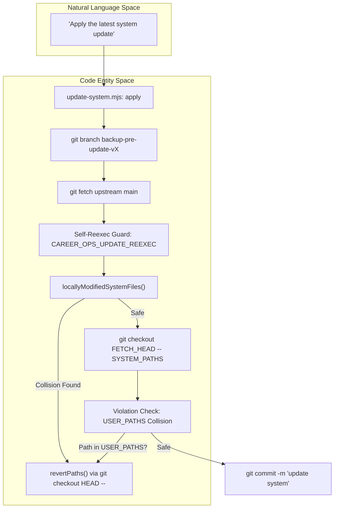
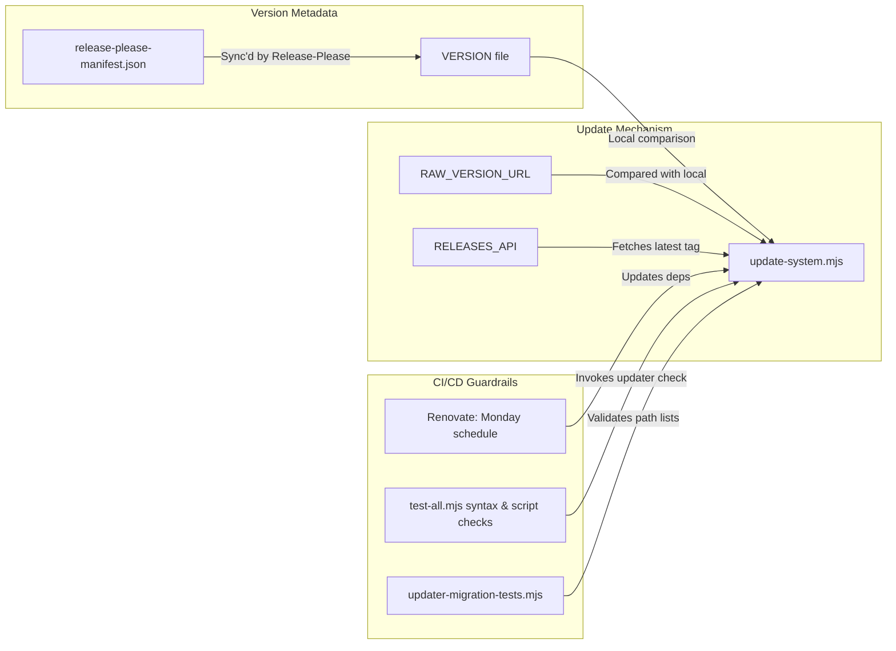

<!-- source: DeepWiki mcp.deepwiki.com · repo santifer/career-ops · page 10.3 System Update & Version Management · fetched 2026-10-26 -->

# System Update & Version Management

Relevant source files

The following files were used as context for generating this wiki page:

- [.agents/skills/career-ops/SKILL.md](.agents/skills/career-ops/SKILL.md)
- [.github/labeler.yml](.github/labeler.yml)
- [.gitignore](.gitignore)
- [.grok/skills/career-ops/SKILL.md](.grok/skills/career-ops/SKILL.md)
- [AGENTS.md](AGENTS.md)
- [CLAUDE.md](CLAUDE.md)
- [DATA_CONTRACT.md](DATA_CONTRACT.md)
- [config/local-paths.example.txt](config/local-paths.example.txt)
- [docs/SCRIPTS.md](docs/SCRIPTS.md)
- [scaffolder/README.md](scaffolder/README.md)
- [scaffolder/bin/cli.mjs](scaffolder/bin/cli.mjs)
- [test-all.mjs](test-all.mjs)
- [tests/gitignore-reconcile.test.mjs](tests/gitignore-reconcile.test.mjs)
- [tests/updater-local-paths.test.mjs](tests/updater-local-paths.test.mjs)
- [tests/updater-local-system-edits.test.mjs](tests/updater-local-system-edits.test.mjs)
- [tests/updater-rollback-behavior.test.mjs](tests/updater-rollback-behavior.test.mjs)
- [update-system.mjs](update-system.mjs)
- [updater-migration-tests.mjs](updater-migration-tests.mjs)
- [upgrade-tests.mjs](upgrade-tests.mjs)
- [validate-system-paths-coverage.mjs](validate-system-paths-coverage.mjs)

The Career-Ops system implements a robust update mechanism designed to evolve the AI agent's logic and tooling while strictly protecting personal user data. This is achieved through a rigid separation of concerns defined in the project's **Data Contract**.

## The Data Contract: System vs. User Layers

The system distinguishes between two layers to ensure that updates never overwrite candidate-specific information. This boundary is defined in `DATA_CONTRACT.md` and enforced by the `update-system.mjs` script.

### User Layer (Immutable by System)
The User Layer contains personal data, customizations, and work products. The update process is explicitly forbidden from reading, modifying, or deleting these files [update-system.mjs:7-8]().

| File/Path | Purpose |
|-----------|---------|
| `cv.md` | Candidate CV source of truth [AGENTS.md:13](), [DATA_CONTRACT.md:11]() |
| `config/profile.yml` | Identity, targets, and compensation ranges [AGENTS.md:13](), [DATA_CONTRACT.md:12]() |
| `modes/_profile.md` | Personal archetypes and negotiation scripts [AGENTS.md:13](), [DATA_CONTRACT.md:16]() |
| `data/` | Tracker, pipeline, and history databases [AGENTS.md:13](), [DATA_CONTRACT.md:31-41]() |
| `reports/` | Generated evaluation reports [AGENTS.md:13](), [DATA_CONTRACT.md:51]() |
| `interview-prep/` | Accumulated STAR+R stories and research [AGENTS.md:13](), [DATA_CONTRACT.md:21-23]() |

### System Layer (Auto-Updatable)
The System Layer contains the core logic, agent instructions, and utility scripts. These are safely replaced during the update process [update-system.mjs:6]().

| File/Path | Purpose |
|-----------|---------|
| `modes/*.md` | AI agent behavior and scoring logic [update-system.mjs:66-140]() |
| `*.mjs` | Node.js utility scripts [update-system.mjs:147-203]() |
| `dashboard/` | Go TUI application source [update-system.mjs:216]() |
| `batch/` | Batch processing orchestrator and templates [update-system.mjs:213-215]() |
| `AGENTS.md` | Universal routing layer for AI agents [update-system.mjs:144]() |

**Sources:** [update-system.mjs:63-221](), [AGENTS.md:9-16](), [DATA_CONTRACT.md:1-53]()

---

## Technical Implementation: update-system.mjs

The `update-system.mjs` script is the primary tool for managing the lifecycle of the system layer. It uses `git` for atomic operations and rollback capabilities.

### Command Reference
The script supports four primary operations [update-system.mjs:9-18]():
*   `check`: Compares local state against `RAW_VERSION_URL` [update-system.mjs:41]() and fetches the latest release metadata from `RELEASES_API` [update-system.mjs:42]().
*   `apply`: Executes the multi-step update workflow. It creates a backup branch [update-system.mjs:150-152](), checks for locally modified system files [update-system.mjs:207-209](), and performs the update.
*   `rollback`: Reverts the system to the state captured in the newest backup branch [update-system.mjs:16]().
*   `dismiss`: Silences update notifications for the current version by creating a `.update-dismissed` file [update-system.mjs:17]().

### Self-Reexec Pattern & Migration Safety
To handle updates where the `update-system.mjs` script itself has changed (e.g., new `SYSTEM_PATHS`), the script implements a self-reexecution pattern. This prevents `ERR_MODULE_NOT_FOUND` errors when moving between versions with different dependency structures [update-system.mjs:27-35]().

1.  **Stage 1**: The script first checkouts the target `update-system.mjs` from `FETCH_HEAD` [updater-migration-tests.mjs:134-135]().
2.  **Stage 2**: It re-executes itself using `process.execPath` with the `CAREER_OPS_UPDATE_REEXEC` environment variable set [updater-migration-tests.mjs:146-147]().
3.  **Stage 3**: The new version of the script reads the target manifest from the remote source to ensure it captures any newly introduced system files [updater-migration-tests.mjs:154-155](), [updater-migration-tests.mjs:162-163]().

### System Update Safety Workflow
This diagram illustrates the transition from natural language commands to the code-level execution of update safety checks.

Title: System Update Safety Workflow

**Sources:** [update-system.mjs:9-61](), [updater-migration-tests.mjs:128-211](), [tests/updater-rollback-behavior.test.mjs:82-128]()

---

## Versioning & Release Infrastructure

The project follows Semantic Versioning (SemVer) managed through automated tooling to ensure consistency between the code, the manifest, and the CLI.

### Release Components
*   **VERSION File**: A plain text file containing the current SemVer string (e.g., `1.13.0`), used by the update script to identify the local state [update-system.mjs:41]().
*   **Release-Please**: Automates version bumps and CHANGELOG updates. It synchronizes versions across the repository [docs/SCRIPTS.md:95]().
*   **Renovate**: Manages dependency updates on a weekly schedule, ensuring the system layer remains secure [docs/SCRIPTS.md:54]().

### Version Propagation and CI Guardrails
Title: Version Propagation and CI Guardrails

**Sources:** [update-system.mjs:40-61](), [test-all.mjs:1-34](), [updater-migration-tests.mjs:1-116]()

---

## CI Guardrails & Security

Automated testing and review processes ensure that updates do not violate the Data Contract or introduce script errors.

### updater-migration-tests.mjs
This specialized test suite protects cross-version migrations. It performs:
*   **Array Extraction**: Verifies that `SYSTEM_PATHS` and `USER_PATHS` arrays exist and are properly formatted [updater-migration-tests.mjs:34-42]().
*   **Required Coverage**: Ensures critical new files (e.g., `modes/patterns.md`, `.qwen/`) are included in the update manifest [updater-migration-tests.mjs:68-116]().
*   **Manifest Integrity**: Verifies that the target manifest materialized correctly before claiming success, preventing incomplete updates [updater-migration-tests.mjs:189-195]().

### Violation Check & Auto-Rollback
The updater includes a `locallyModifiedSystemFiles` check [update-system.mjs:207-209](). If a system file has been edited locally, the update will list the file and require a `--force` flag to overwrite it, preventing accidental loss of local hotfixes [update-system.mjs:12-15]().

### Comprehensive Testing (test-all.mjs)
The master test runner executes comprehensive checks before any PR is merged [test-all.mjs:4-7](). This includes:
*   **Syntax Validation**: Checks all `.mjs` files for syntax errors [test-all.mjs:7]().
*   **Data Contract Validation**: Ensures no personal data leaks into tracked files [test-all.mjs:7]().
*   **Path Verification**: Validates that all paths in the manifest exist on disk [updater-migration-tests.mjs:56-66]().

**Sources:** [updater-migration-tests.mjs:1-211](), [test-all.mjs:1-58](), [tests/updater-local-system-edits.test.mjs:1-10]()

---

