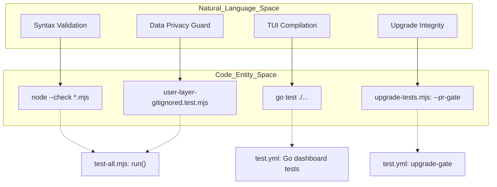
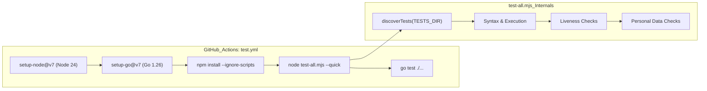

<!-- source: DeepWiki mcp.deepwiki.com · repo santifer/career-ops · page 12.1 Testing & CI Pipeline · fetched 2026-10-26 -->

# Testing & CI Pipeline

Relevant source files

The following files were used as context for generating this wiki page:

- [.agents/skills/career-ops/SKILL.md](.agents/skills/career-ops/SKILL.md)
- [.github/workflows/dependency-review.yml](.github/workflows/dependency-review.yml)
- [.github/workflows/gfi-claims.yml](.github/workflows/gfi-claims.yml)
- [.github/workflows/release.yml](.github/workflows/release.yml)
- [.github/workflows/sbom.yml](.github/workflows/sbom.yml)
- [.github/workflows/stale.yml](.github/workflows/stale.yml)
- [.github/workflows/test.yml](.github/workflows/test.yml)
- [.github/workflows/welcome.yml](.github/workflows/welcome.yml)
- [.gitignore](.gitignore)
- [.npmignore](.npmignore)
- [AGENTS.md](AGENTS.md)
- [CLAUDE.md](CLAUDE.md)
- [DATA_CONTRACT.md](DATA_CONTRACT.md)
- [docs/SCRIPTS.md](docs/SCRIPTS.md)
- [release-please-config.json](release-please-config.json)
- [test-all.mjs](test-all.mjs)
- [tests/cv-section-order.test.mjs](tests/cv-section-order.test.mjs)
- [tests/generate-pdf-batch.test.mjs](tests/generate-pdf-batch.test.mjs)
- [tests/generate-pdf-font-cache.test.mjs](tests/generate-pdf-font-cache.test.mjs)
- [tests/generate-pdf-page-budget.test.mjs](tests/generate-pdf-page-budget.test.mjs)
- [tests/helpers.mjs](tests/helpers.mjs)
- [tests/hermetic-git-env.test.mjs](tests/hermetic-git-env.test.mjs)
- [tests/user-layer-gitignored.test.mjs](tests/user-layer-gitignored.test.mjs)
- [update-system.mjs](update-system.mjs)

This page details the automated quality assurance and continuous integration infrastructure of the `career-ops` repository. The system employs a multi-layered testing strategy that validates everything from JavaScript syntax and Go compilation to complex AI agent behaviors, data privacy constraints, and upgrade path integrity.

## Master Test Runner (`test-all.mjs`)

The `test-all.mjs` script serves as the central orchestrator for all local and CI-based tests [test-all.mjs:4-7](). It is designed to be executed before any PR submission to ensure the integrity of the "System Layer" while respecting the "User Layer" boundaries defined in `DATA_CONTRACT.md` and `AGENTS.md` [test-all.mjs:268-280]().

### Execution Flow

The runner performs several distinct phases of validation:

1.  **Syntax Checks**: Iterates through all `.mjs` files in the root directory and validates them using `node --check` [test-all.mjs:132-140]().
2.  **Script Execution**: Runs core utility scripts (e.g., `verify-pipeline.mjs`, `normalize-statuses.mjs`, `merge-tracker.mjs`) in a hermetic sandbox to ensure they handle empty or missing data gracefully [test-all.mjs:147-178]().
3.  **Liveness Classification**: Imports `liveness-core.mjs` to unit test the regex-based job status detection logic against known "expired" and "active" HTML snippets [test-all.mjs:184-230]().
4.  **Dashboard Build**: Verifies that the Go-based TUI compiles correctly using `go build` [test-all.mjs:234-241](). This step can be skipped using the `--quick` flag [test-all.mjs:11]().
5.  **Data Contract Validation**: Ensures essential system files (like `CLAUDE.md`, `AGENTS.md`, and `modes/_shared.md`) exist and follow the structural requirements [test-all.mjs:248-265]().
6.  **Personal Data Leak Check**: Scans for PII (Personally Identifiable Information) patterns and verifies that all files listed in the `AGENTS.md` User Layer are correctly git-ignored to prevent accidental commits [test-all.mjs:284-302](), [tests/user-layer-gitignored.test.mjs:58-90]().

### Auto-Discovered Suites

Beyond the inline checks, `test-all.mjs` automatically discovers and executes any file matching `tests/**/*.test.mjs` [test-all.mjs:102-118](). These suites run in-process using shared counters from `tests/helpers.mjs` [tests/helpers.mjs:37-75]().

| Suite | Purpose |
| :--- | :--- |
| `user-layer-gitignored.test.mjs` | Compares `AGENTS.md` declarations against `.gitignore` [tests/user-layer-gitignored.test.mjs:8-13](). |
| `cv-section-order.test.mjs` | Validates the "6-second scan" layout of generated CVs. |
| `generate-pdf-page-budget.test.mjs`| Ensures PDF output stays within designated page counts. |
| `hermetic-git-env.test.mjs` | Validates that test scripts don't leak environment variables into the host repo [tests/helpers.mjs:58](). |

Sources: [test-all.mjs:1-302](), [tests/helpers.mjs:1-110](), [tests/user-layer-gitignored.test.mjs:1-153]()

---

## CI/CD Workflows

The repository uses GitHub Actions to enforce quality standards on every Pull Request.

### Test Workflow (`test.yml`)
This workflow runs on a matrix of `ubuntu-latest`, `macos-latest`, and `windows-latest` [test.yml:19-21]().
- **Node.js 24**: For running the `.mjs` test suite and linting [test.yml:30-38]().
- **Go 1.26**: For running Go unit tests in the `dashboard/` directory [test.yml:39-48]().
- **Visual Diffs**: A specialized `cv-visual` job runs Playwright in Ubuntu to detect regressions in CV rendering [test.yml:50-63]().

### Upgrade Regression Gate (`upgrade-tests.mjs`)
A critical CI job executes `upgrade-tests.mjs --pr-gate` [test.yml:88-89](). This script:
1. Seeds a temporary directory with the latest stable release.
2. Applies the current PR's changes using `update-system.mjs`.
3. Verifies that user data (like `cv.md` and `applications.md`) remains intact and that the system correctly migrates to the new version [update-system.mjs:1-20]().

### Release Engineering (`release.yml`)
Uses `release-please-action` to automate versioning and changelog generation based on conventional commits [release.yml:16-25](). It also handles publishing the `scaffolder` component to npm using OIDC trusted publishing [release.yml:37-46]().

Sources: [.github/workflows/test.yml:1-93](), [.github/workflows/release.yml:1-69](), [update-system.mjs:1-64]()

---

## Code Entity Mapping

The following diagrams illustrate how natural language testing requirements map to specific code entities and CI orchestration.

### Test Orchestration Mapping
"This diagram bridges high-level validation requirements to the specific JavaScript functions and shell commands that execute them."

Sources: [test-all.mjs:132-140](), [tests/user-layer-gitignored.test.mjs:1-15](), [.github/workflows/test.yml:46-48](), [.github/workflows/test.yml:73-89]()

### CI Pipeline Flow
"This diagram shows the sequence of operations in the GitHub Actions environment across the test matrix."

Sources: [.github/workflows/test.yml:22-48](), [test-all.mjs:109-118](), [test-all.mjs:132-140](), [test-all.mjs:184-230](), [test-all.mjs:284-302]()

---

