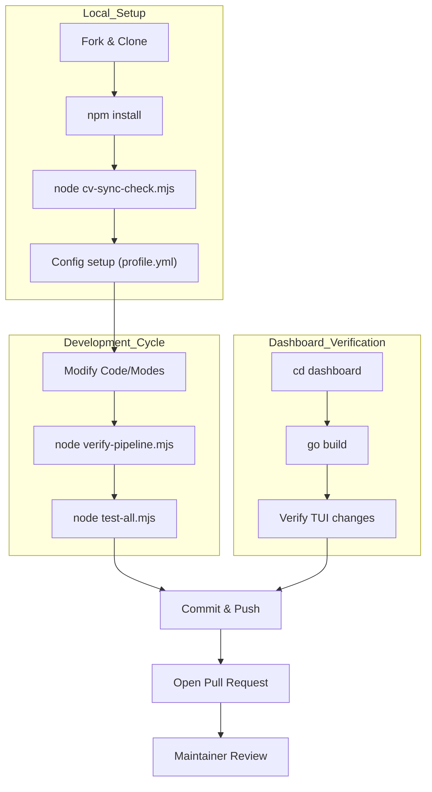
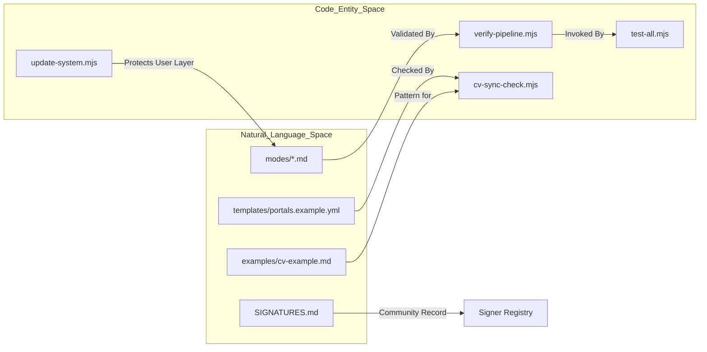

<!-- source: DeepWiki mcp.deepwiki.com · repo santifer/career-ops · page 13 Contributing & Community · fetched 2026-10-26 -->

# Contributing & Community

Relevant source files

The following files were used as context for generating this wiki page:

- [.all-contributorsrc](.all-contributorsrc)
- [.github/FUNDING.yml](.github/FUNDING.yml)
- [.github/ISSUE_TEMPLATE/bug_report.yml](.github/ISSUE_TEMPLATE/bug_report.yml)
- [.github/ISSUE_TEMPLATE/config.yml](.github/ISSUE_TEMPLATE/config.yml)
- [.github/ISSUE_TEMPLATE/feature_request.yml](.github/ISSUE_TEMPLATE/feature_request.yml)
- [.github/ISSUE_TEMPLATE/source-proposal.yml](.github/ISSUE_TEMPLATE/source-proposal.yml)
- [.github/PULL_REQUEST_TEMPLATE.md](.github/PULL_REQUEST_TEMPLATE.md)
- [.github/PULL_REQUEST_TEMPLATE/sign-manifesto.md](.github/PULL_REQUEST_TEMPLATE/sign-manifesto.md)
- [.github/SECURITY.md](.github/SECURITY.md)
- [.github/workflows/auto-triage-scan-output.yml](.github/workflows/auto-triage-scan-output.yml)
- [.github/workflows/no-user-data.yml](.github/workflows/no-user-data.yml)
- [CITATION.cff](CITATION.cff)
- [CODE_OF_CONDUCT.md](CODE_OF_CONDUCT.md)
- [CONTRIBUTING.md](CONTRIBUTING.md)
- [CONTRIBUTORS.md](CONTRIBUTORS.md)
- [GOVERNANCE.md](GOVERNANCE.md)
- [LEGAL_DISCLAIMER.md](LEGAL_DISCLAIMER.md)
- [MANIFESTO.md](MANIFESTO.md)
- [SECURITY.md](SECURITY.md)
- [SIGNATURES.md](SIGNATURES.md)
- [SUPPORT.md](SUPPORT.md)
- [TRADEMARK.md](TRADEMARK.md)
- [docs/CODEX.md](docs/CODEX.md)
- [docs/SETUP.md](docs/SETUP.md)
- [docs/SOURCE_INDEXING_LOG.md](docs/SOURCE_INDEXING_LOG.md)

This page outlines the protocols and technical workflows for contributing to the Career-Ops ecosystem. It covers the standard fork/PR process, development environment verification, governance models, and specific areas where community contributions are prioritized.

## Contribution Workflow

Career-Ops follows a standard GitHub flow. Contributors are encouraged to use AI-assisted engineering tools like `claude code` for development, as the project's prompt engineering and script structure are optimized for these environments [CONTRIBUTING.md:1-4]().

### Standard PR Process
1.  **Open an Issue**: Before coding a new feature or architecture change, discuss it in an issue to align with project direction [CONTRIBUTING.md:18-20]().
2.  **Fork**: Create a personal fork of the repository [CONTRIBUTING.md:37]().
3.  **Branch**: Create a feature branch (e.g., `feature/my-feature`) [CONTRIBUTING.md:38]().
4.  **Develop**: Implement changes following the project's minimal and simple philosophy [CONTRIBUTING.md:32]().
5.  **Verify**: Test changes with a fresh clone and run the full test suite [CONTRIBUTING.md:40]().
6.  **Submit**: Open a Pull Request referencing the original issue [CONTRIBUTING.md:42]().

### Development Health Checks
Before submitting a PR, contributors must ensure all local validations pass. The following scripts are essential for verification:

*   `node cv-sync-check.mjs`: Validates that the local configuration matches the CV structure [docs/SETUP.md:87]().
*   `node verify-pipeline.mjs`: Checks the health and schema integrity of the application tracker [docs/SETUP.md:88]().
*   `node test-all.mjs`: Master test runner required for all PRs; it validates syntax, SSRF guards, and data leak prevention [.github/PULL_REQUEST_TEMPLATE.md:23]().
*   `npm run build:dashboard`: Required if modifying the TUI in the `dashboard/` directory [docs/SETUP.md:95]().

### Contribution Lifecycle Diagram

The following diagram illustrates the transition from local environment setup to the upstream PR review.

**Code Contribution Flow**

Sources: [CONTRIBUTING.md:34-43](), [docs/SETUP.md:84-96](), [.github/PULL_REQUEST_TEMPLATE.md:23]()

---

## Targeted Contribution Areas

The project prioritizes contributions that enhance the tool's utility without compromising the "local-first" and "human-in-the-loop" philosophy [CONTRIBUTING.md:78-80]().

### Good First Contributions
These tasks are ideal for newcomers and help broaden the project's reach:
*   **Portal Expansion**: Adding target companies to `templates/portals.example.yml` [CONTRIBUTING.md:47]().
*   **Localization**: Translating skill modes (found in `modes/`) into new languages [CONTRIBUTING.md:48]().
*   **Documentation**: Improving guides or adding industry-specific advice [CONTRIBUTING.md:49]().
*   **Examples**: Adding fictional `cv.md` samples for various roles to the `examples/` folder [CONTRIBUTING.md:50]().

### Advanced Contributions
Larger architectural changes involve the core logic and TUI:
*   **Evaluation Logic**: Refining scoring dimensions or archetype detection in the Markdown modes [CONTRIBUTING.md:54]().
*   **Dashboard Features**: Enhancing the Go-based TUI in `dashboard/` [CONTRIBUTING.md:55]().
*   **Utility Scripts**: Improving the `.mjs` tools for data merging, deduplication, or PDF generation [CONTRIBUTING.md:57]().

### Unacceptable Contributions
To maintain ethical and legal standards, the project rejects PRs that:
*   **Scraping Violations**: Scrape platforms prohibiting automated access (e.g., LinkedIn) [CONTRIBUTING.md:91-92]().
*   **Spam Automation**: Enable auto-submission of applications without human review [CONTRIBUTING.md:78-80]().
*   **Centralized Infrastructure**: Add hosted proxies, aggregation services, or shared Workers to the core [CONTRIBUTING.md:80-82]().
*   **Privacy Violations**: Include real personal data (PII) like CVs, emails, or phone numbers [.github/PULL_REQUEST_TEMPLATE.md:22]().

Sources: [CONTRIBUTING.md:44-58](), [CONTRIBUTING.md:78-92](), [.github/PULL_REQUEST_TEMPLATE.md:18-25]()

---

## Technical Guidelines & Governance

### Data Contract & Privacy
The system enforces a strict boundary between the "System Layer" (code, modes, templates) and the "User Layer" (personal data).
*   **No User Data in PRs**: A GitHub Action (`no-user-data.yml`) hard-blocks any PR that modifies files like `cv.md`, `config/profile.yml`, or the `data/` directory [.github/workflows/no-user-data.yml:1-64]().
*   **Auto-Triage**: Automated scan results filed as issues by users' local cron jobs are automatically closed to protect user privacy [.github/workflows/auto-triage-scan-output.yml:1-87]().

### Contributor Ladder
Career-Ops promotes active contributors through a clear ladder of ownership [CONTRIBUTING.md:67-76]().

| Role | Requirement | Responsibilities |
| :--- | :--- | :--- |
| **First-time contributor** | Landed 1 PR | Welcome to the community [CONTRIBUTING.md:71](). |
| **Trusted contributor** | Solid merges | Fast-tracked PRs and tagged on related work [CONTRIBUTING.md:72](). |
| **Reviewer** | Invited | Help triage and review others' PRs [CONTRIBUTING.md:73](). |
| **Maintainer** | Steering role | Help steer the project direction [CONTRIBUTING.md:74](). |

### Trademark Policy
The "career-ops" name is a trademark. While the code is MIT, the brand is stewarded to prevent confusion [TRADEMARK.md:1-25]().
*   **Permitted**: "Based on career-ops", "Fork of career-ops" [TRADEMARK.md:32-34]().
*   **Restricted**: Commercial product names like "career-ops Cloud" or "Official career-ops" require written permission [TRADEMARK.md:48-55]().

### The Manifesto & Signatures
Users can sign the Career-Ops manifesto to show support. Signatures are tracked in `SIGNATURES.md` and are distinct from code contributions [SIGNATURES.md:1-37]().

**System Entity Mapping**

Sources: [CONTRIBUTING.md:34-43](), [SIGNATURES.md:1-37](), [.github/workflows/no-user-data.yml:33-47](), [docs/SETUP.md:84-90]()

---

## Community Resources

### Issue Templates & Support
*   **Bug Reports**: Used for reporting unexpected behavior.
*   **Feature Requests**: Used for proposing new capabilities.
*   **Discord**: The primary hub for setup help and community discussion [CONTRIBUTING.md:16]().
*   **Security**: Vulnerabilities must be reported via email to **hi@santifer.io** rather than public issues [SECURITY.md:3-14]().

### Funding
The project is maintained by Santiago Fernández de Valderrama and accepts support via GitHub Sponsors [.github/FUNDING.yml:1]().

Sources: [CONTRIBUTING.md:16](), [SECURITY.md:1-37](), [.github/FUNDING.yml:1](), [TRADEMARK.md:20-21]()

---

