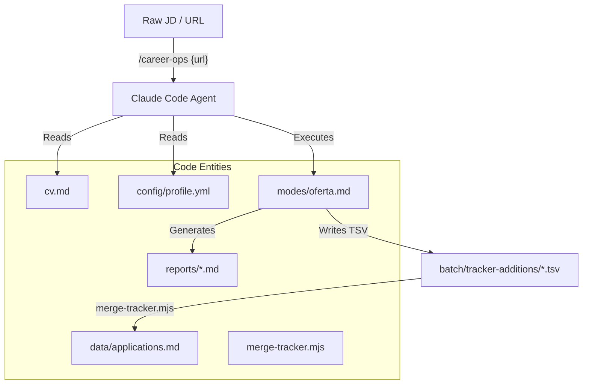
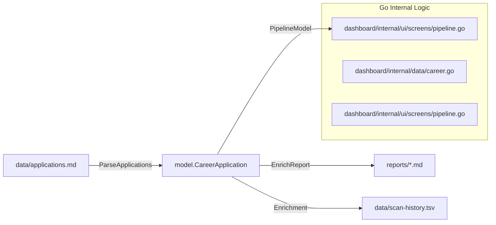

<!-- source: DeepWiki mcp.deepwiki.com · repo santifer/career-ops · page 14 Glossary · fetched 2026-10-26 -->

# Glossary

Relevant source files

The following files were used as context for generating this wiki page:

- [.agents/skills/career-ops/SKILL.md](.agents/skills/career-ops/SKILL.md)
- [.github/PULL_REQUEST_TEMPLATE/plugin-registry.md](.github/PULL_REQUEST_TEMPLATE/plugin-registry.md)
- [.github/workflows/plugin-registry-validate.yml](.github/workflows/plugin-registry-validate.yml)
- [.gitignore](.gitignore)
- [AGENTS.md](AGENTS.md)
- [CLAUDE.md](CLAUDE.md)
- [DATA_CONTRACT.md](DATA_CONTRACT.md)
- [README.ar.md](README.ar.md)
- [README.cn.md](README.cn.md)
- [README.es.md](README.es.md)
- [README.fr.md](README.fr.md)
- [README.ja.md](README.ja.md)
- [README.ko-KR.md](README.ko-KR.md)
- [README.md](README.md)
- [README.pl.md](README.pl.md)
- [README.pt-BR.md](README.pt-BR.md)
- [README.ru.md](README.ru.md)
- [README.ua.md](README.ua.md)
- [README.zh-TW.md](README.zh-TW.md)
- [analyze-patterns.mjs](analyze-patterns.mjs)
- [batch/batch-prompt.md](batch/batch-prompt.md)
- [config/profile.example.yml](config/profile.example.yml)
- [dashboard/internal/data/career.go](dashboard/internal/data/career.go)
- [dashboard/internal/data/career_test.go](dashboard/internal/data/career_test.go)
- [dashboard/internal/data/progress_metrics_test.go](dashboard/internal/data/progress_metrics_test.go)
- [dashboard/internal/ui/screens/pipeline.go](dashboard/internal/ui/screens/pipeline.go)
- [dashboard/internal/ui/screens/pipeline_pdf_test.go](dashboard/internal/ui/screens/pipeline_pdf_test.go)
- [dashboard/internal/ui/screens/pipeline_test.go](dashboard/internal/ui/screens/pipeline_test.go)
- [dashboard/internal/ui/screens/progress.go](dashboard/internal/ui/screens/progress.go)
- [dashboard/internal/ui/screens/viewer.go](dashboard/internal/ui/screens/viewer.go)
- [dashboard/internal/ui/screens/viewer_test.go](dashboard/internal/ui/screens/viewer_test.go)
- [dashboard/main.go](dashboard/main.go)
- [dedup-tracker.mjs](dedup-tracker.mjs)
- [docs/PLUGINS.md](docs/PLUGINS.md)
- [docs/PLUGIN_REVIEW.md](docs/PLUGIN_REVIEW.md)
- [docs/SCRIPTS.md](docs/SCRIPTS.md)
- [generate-pdf.mjs](generate-pdf.mjs)
- [merge-tracker.mjs](merge-tracker.mjs)
- [modes/_shared.md](modes/_shared.md)
- [modes/apply.md](modes/apply.md)
- [modes/auto-pipeline.md](modes/auto-pipeline.md)
- [modes/contacto.md](modes/contacto.md)
- [modes/followup.md](modes/followup.md)
- [modes/oferta.md](modes/oferta.md)
- [modes/patterns.md](modes/patterns.md)
- [modes/pdf.md](modes/pdf.md)
- [modes/pipeline.md](modes/pipeline.md)
- [modes/scan.md](modes/scan.md)
- [modes/tracker.md](modes/tracker.md)
- [modes/training.md](modes/training.md)
- [normalize-statuses.mjs](normalize-statuses.mjs)
- [plugins.mjs](plugins.mjs)
- [plugins/_engine.mjs](plugins/_engine.mjs)
- [plugins/_registry.mjs](plugins/_registry.mjs)
- [plugins/apify/index.mjs](plugins/apify/index.mjs)
- [plugins/gmail/index.mjs](plugins/gmail/index.mjs)
- [plugins/notion/index.mjs](plugins/notion/index.mjs)
- [scan-ats-full.mjs](scan-ats-full.mjs)
- [scan.mjs](scan.mjs)
- [stats.mjs](stats.mjs)
- [templates/cv-template.html](templates/cv-template.html)
- [templates/portals.example.yml](templates/portals.example.yml)
- [templates/states.yml](templates/states.yml)
- [test-all.mjs](test-all.mjs)
- [tests/merge-tracker.test.mjs](tests/merge-tracker.test.mjs)
- [tests/plugin-symlink-discovery.test.mjs](tests/plugin-symlink-discovery.test.mjs)
- [tests/scan-ats-full-title-filter-full.test.mjs](tests/scan-ats-full-title-filter-full.test.mjs)
- [tests/scan-run-failure.test.mjs](tests/scan-run-failure.test.mjs)
- [tests/source-no-nul-bytes.test.mjs](tests/source-no-nul-bytes.test.mjs)
- [tests/states-alias-coverage.test.mjs](tests/states-alias-coverage.test.mjs)
- [tests/stats.test.mjs](tests/stats.test.mjs)
- [tests/theme-style-dollar-pattern.test.mjs](tests/theme-style-dollar-pattern.test.mjs)
- [tests/theme-style.test.mjs](tests/theme-style.test.mjs)
- [tests/validate-portals-title-filter-full.test.mjs](tests/validate-portals-title-filter-full.test.mjs)
- [theme-style.mjs](theme-style.mjs)
- [update-system.mjs](update-system.mjs)
- [validate-plugin-registry.mjs](validate-plugin-registry.mjs)
- [validate-portals.mjs](validate-portals.mjs)
- [verify-pipeline.mjs](verify-pipeline.mjs)

This page provides a technical reference for domain-specific terms, abbreviations, and architectural concepts used within the `career-ops` codebase. It serves as an onboarding map for engineers to locate specific logic and data structures.

## Core System Concepts

### Archetype
A classification system used to categorize job offers into one of several predefined career profiles (e.g., AI Platform/LLMOps, Agentic/Automation, Technical AI PM, Solutions Architect). This classification influences the scoring weights, CV tailoring strategy, and interview story selection.
*   **Implementation**: Defined in `modes/_shared.md` and detected during the initial phase of an evaluation.
*   **Data Flow**: Detected during the first step of an evaluation to load specific proof points from `_profile.md`.
*   **Sources**: [modes/_shared.md:74-88](), [modes/oferta.md:5-10]()

### A-F Evaluation
The standardized 6-block reporting structure generated by the AI for every job description.
*   **Block A**: Role Summary (Metadata, TL;DR, Remote status, Legitimacy tier).
*   **Block B**: CV Match (Requirement mapping and gap mitigation).
*   **Block C**: Level Strategy (Seniority positioning and archetype fit).
*   **Block D**: Comp & Demand (Market research and salary targets).
*   **Block E**: Personalization Plan (Specific CV/LinkedIn edits and keyword injection).
*   **Block F**: Interview Prep (STAR+R stories and technical challenges).
*   **Block G**: Posting Legitimacy check that flags scams and ghost jobs.
*   **Sources**: [modes/oferta.md:12-88](), [README.md:87-87](), [modes/_shared.md:27-46](), [AGENTS.md:56-58]()

### STAR+R
An extension of the STAR (Situation, Task, Action, Result) interview technique that adds **Reflection**. The system uses this to signal seniority by extracting lessons learned, architectural trade-offs, or impact analysis from past experiences.
*   **Sources**: [modes/oferta.md:67-75](), [README.md:85-88](), [modes/_shared.md:65-66]()

---

## Data Entities & Files

| Term | File Path | Description |
| :--- | :--- | :--- |
| **Application Tracker** | `data/applications.md` | The flat-file Markdown database containing the history of all evaluations and their statuses. |
| **Story Bank** | `interview-prep/story-bank.md` | A persistent repository of STAR+R stories that accumulates new entries during every high-score evaluation. |
| **Scan History** | `data/scan-history.tsv` | A deduplication log used by the portal scanner to avoid re-processing the same job URLs. |
| **Profile Config** | `config/profile.yml` | User-specific identity data (name, target roles, salary range) used to hydrate prompts. |
| **Portals Config** | `portals.yml` | Configuration for the scanner, including discovery strategies (Playwright, API, WebSearch). |
| **Data Contract** | `DATA_CONTRACT.md` | Specification separating the "System Layer" (updatable) from the "User Layer" (protected). |

**Sources**: [DATA_CONTRACT.md:5-24](), [README.md:85-91](), [update-system.mjs:64-211](), [AGENTS.md:9-16]()

---

## Technical Workflows

### 1. Evaluation Pipeline
The transition from a raw Job Description (JD) to a structured report and tracker entry.

**Natural Language to Code Entity Space: Evaluation**

**Sources**: [modes/oferta.md:92-158](), [README.md:86-88](), [modes/_shared.md:115-116](), [merge-tracker.mjs:3-15]()

### 2. Data Integrity & Maintenance
Scripts used to keep the `applications.md` file consistent, deduplicated, and synchronized with batch results.

*   **Merge**: `merge-tracker.mjs` ingests TSV files from `batch/tracker-additions/` and handles fuzzy role matching to prevent duplicates. [merge-tracker.mjs:3-15]()
*   **Dedup**: `dedup-tracker.mjs` removes redundant entries by grouping by normalized company name and keeping the highest score. [docs/SCRIPTS.md:14-14]()
*   **Normalize**: `normalize-statuses.mjs` ensures all application states match the canonical IDs, strips markdown bolding, and moves notes. [docs/SCRIPTS.md:13-13]()
*   **Verify**: `verify-pipeline.mjs` runs a health check on the entire pipeline (broken links, non-canonical states, formatting errors). [docs/SCRIPTS.md:12-12]()

---

## Dashboard Terms (Go TUI)

### PipelineModel
The primary data structure in the Go dashboard (`dashboard/internal/ui/screens/pipeline.go`) that manages the state of the TUI, including filtering, sorting, and lazy-loading of report summaries.
*   **Sources**: [dashboard/internal/ui/screens/pipeline.go:139-162]()

### Report Enrichment
The process of lazy-loading metadata (Archetype, TL;DR, Remote, Comp) from Markdown reports into the Go TUI's cache to provide instant previews without re-parsing files on every scroll.
*   **Sources**: [dashboard/internal/ui/screens/pipeline.go:212-219]()

**Natural Language to Code Entity Space: Dashboard Data Flow**

**Sources**: [dashboard/internal/ui/screens/pipeline.go:139-162](), [dashboard/internal/data/career.go:50-120]()

---

## Canonical Application States

The system enforces a strict state machine for applications to ensure consistency between the Node.js scripts and the Go Dashboard.

| State ID | Label | Description |
| :--- | :--- | :--- |
| `evaluated` | Evaluated | Initial state after AI analysis. |
| `applied` | Applied | Application submitted to company. |
| `responded` | Responded | Recruiter or automated response received. |
| `interview` | Interview | Active interview stages. |
| `offer` | Offer | Financial offer received. |
| `rejected` | Rejected | Terminal state (Company side). |
| `discarded` | Discarded | Terminal state (Candidate side). |
| `skip` | SKIP | Filtered out by candidate or AI. |

**Sources**: [merge-tracker.mjs:140-140](), [docs/SCRIPTS.md:72-72]()