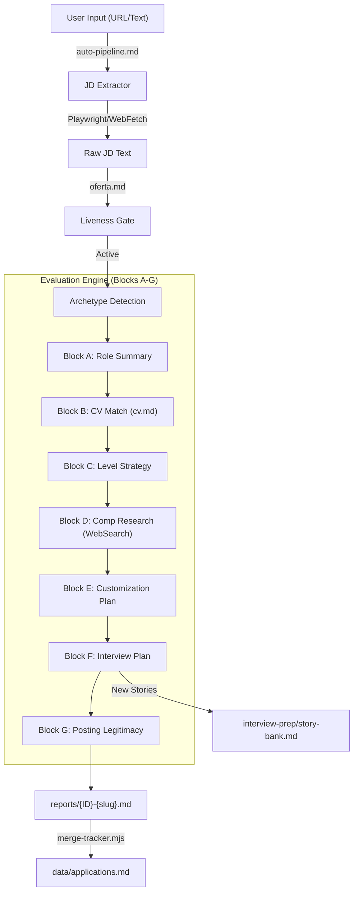
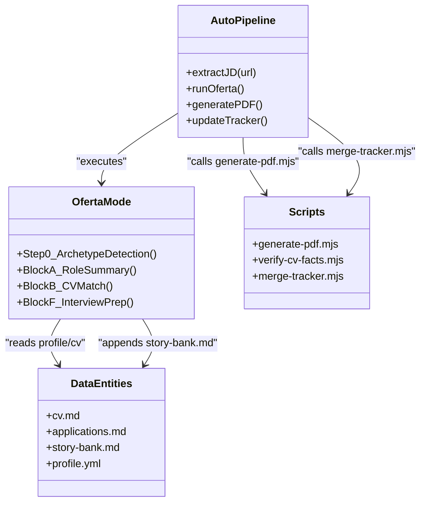

<!-- source: DeepWiki mcp.deepwiki.com · repo santifer/career-ops · page 2.1 Evaluation Modes (oferta, ofertas, auto-pipeline) · fetched 2026-10-26 -->

# Evaluation Modes (oferta, ofertas, auto-pipeline)

Relevant source files

The following files were used as context for generating this wiki page:

- [analyze-patterns.mjs](analyze-patterns.mjs)
- [batch/batch-prompt.md](batch/batch-prompt.md)
- [classify-tier.mjs](classify-tier.mjs)
- [config/cv-facts.example.json](config/cv-facts.example.json)
- [config/profile.example.yml](config/profile.example.yml)
- [generate-pdf.mjs](generate-pdf.mjs)
- [modes/_shared.md](modes/_shared.md)
- [modes/auto-pipeline.md](modes/auto-pipeline.md)
- [modes/followup.md](modes/followup.md)
- [modes/oferta.md](modes/oferta.md)
- [modes/patterns.md](modes/patterns.md)
- [modes/pdf.md](modes/pdf.md)
- [modes/tracker.md](modes/tracker.md)
- [modes/training.md](modes/training.md)
- [templates/cv-template.html](templates/cv-template.html)
- [tests/classify-tier-position.test.mjs](tests/classify-tier-position.test.mjs)
- [tests/cover-fact-gate.test.mjs](tests/cover-fact-gate.test.mjs)
- [tests/nonmetric-fact-gate.test.mjs](tests/nonmetric-fact-gate.test.mjs)
- [tests/theme-style-dollar-pattern.test.mjs](tests/theme-style-dollar-pattern.test.mjs)
- [tests/theme-style.test.mjs](tests/theme-style.test.mjs)
- [theme-style.mjs](theme-style.mjs)
- [verify-cv-facts.mjs](verify-cv-facts.mjs)

This page provides a technical deep dive into the core evaluation engine of `career-ops`. These modes transform raw job descriptions (JDs) into structured, actionable intelligence by mapping them against the candidate's profile, calculating strategic alignment, and preparing interview collateral.

## The Evaluation Workflow

The evaluation process is designed to be deterministic and comprehensive, moving from initial ingestion to long-term tracking. The system supports single-offer deep dives (`oferta`), comparative analysis (`ofertas`), and a fully automated end-to-end execution (`auto-pipeline`).

### Data Flow Overview

The following diagram illustrates how a Job Description is processed through the system entities, moving from raw input to structured reports and long-term storage.

**Diagram: JD Ingestion to Report Generation**

**Sources:** [modes/oferta.md:1-101](), [modes/auto-pipeline.md:1-100](), [modes/_shared.md:11-34]()

---

## 1. Core Evaluation: `modo: oferta`

The `oferta` mode is the atomic unit of evaluation. It follows a strict 7-block structure (A-G) to ensure no strategic dimension is overlooked.

### Liveness Gate
When a URL is provided, the system first verifies the posting is active using Playwright (`browser_navigate` + `browser_snapshot`). If the posting is closed (404, "position filled", or hard redirect), the evaluation stops immediately. If `scan.extractor: cli` is set in `config/profile.yml`, it runs `node browser-extract.mjs <url>` for a token-efficient distilled text extraction.
**Sources:** [modes/oferta.md:7-18](), [modes/auto-pipeline.md:22-32]()

### Blacklist Gate
Before Block A, the system checks `data/blacklist.md`. If the company matches, the agent stops and asks for an explicit override from the candidate before proceeding.
**Sources:** [modes/oferta.md:20-27](), [modes/auto-pipeline.md:34-39]()

### Step 0: Archetype Detection
The agent classifies the role into one of the 6 canonical archetypes defined in `_shared.md`.
*   **AI Platform / LLMOps:** Focus on reliability and pipelines [modes/oferta.md:44-44]().
*   **Agentic Workflows:** Focus on HITL and orchestration [modes/oferta.md:45-45]().
*   **Technical AI PM:** Focus on PRDs and discovery [modes/oferta.md:43-43]().
*   **AI Solutions Architect:** Focus on enterprise integration [modes/oferta.md:42-42]().
*   **AI Forward Deployed:** Focus on prototyping and delivery [modes/oferta.md:41-41]().
*   **AI Transformation Lead:** Focus on change management [modes/oferta.md:46-46]().

**Sources:** [modes/oferta.md:42-49](), [modes/_shared.md:107-115]()

### The 7-Block Structure

| Block | Name | Technical Implementation |
| :--- | :--- | :--- |
| **A** | **Role Summary** | Metadata table (Archetype, Domain, Seniority, Remote). Includes **Geo-mismatch** and **Work-authorization** checks [modes/oferta.md:49-89](). |
| **B** | **CV Match** | Maps requirements to `cv.md` and `article-digest.md`. Highlights gaps and mitigation [modes/oferta.md:91-112](). |
| **C** | **Level Strategy** | Strategy for selling seniority and handling downleveling [modes/oferta.md:114-119](). |
| **D** | **Comp Research** | Single-pass `WebSearch` for salary bands and funding signals (capped at 5 queries) [modes/oferta.md:29-39](), [modes/oferta.md:121-128](). |
| **E** | **Personalization** | Plan for tailoring the CV and outreach [modes/oferta.md:130-137](). |
| **F** | **Interview Prep** | STAR+R story generation. Appends new stories to `interview-prep/story-bank.md` [modes/oferta.md:139-161](). |
| **G** | **Legitimacy** | Evaluates if the posting is a "Ghost Job" based on freshness and description quality [modes/oferta.md:163-205](). |

**Sources:** [modes/oferta.md:49-205]()

---

## 2. Automation: `modo: auto-pipeline`

The `auto-pipeline` mode chains the evaluation with utility scripts to provide a zero-touch experience.

### JD Extraction Strategy
1.  **Playwright:** `browser_navigate` + `browser_snapshot` (preferred for SPAs like Lever/Ashby) [modes/auto-pipeline.md:13-14]().
2.  **WebFetch:** Fallback for static pages [modes/auto-pipeline.md:15-15]().
3.  **WebSearch:** Last resort for indexing secondary portals [modes/auto-pipeline.md:16-16]().

### Post-Evaluation Automation
If the calculated score is **>= 4.5**, the pipeline triggers **Step 4: Draft Application Answers**.
*   **Tone:** "I'm choosing you"—confident, selective, and direct [modes/auto-pipeline.md:76-85]().
*   **Fact Gate:** CV tailoring is validated by `node verify-cv-facts.mjs` to prevent hallucinated metrics [modes/pdf.md:44-47](), [verify-cv-facts.mjs:4-13]().

**Sources:** [modes/auto-pipeline.md:5-95](), [modes/pdf.md:44-47]()

---

## 3. Batch Processing: `batch-runner.sh`

For high-volume evaluation, `batch/batch-runner.sh` orchestrates multiple `claude` workers using `batch/batch-prompt.md`.

*   **Parallelization:** Uses `--parallel` to run multiple evaluations simultaneously [batch/batch-runner.sh:8-8]().
*   **State Management:** Tracks progress in `batch-state.tsv` and adds new entries to `batch/tracker-additions/` [batch/batch-runner.sh:10-10]().
*   **PDF Generation:** Triggers `generate-pdf.mjs` using the `--batch` flag to render all documents in one Chromium instance [generate-pdf.mjs:8-14]().

**Sources:** [batch/batch-runner.sh:1-20](), [batch/batch-prompt.md:1-15](), [generate-pdf.mjs:8-14]()

---

## 4. Technical Persistence & State

### Logic Flow: Entity Association
This diagram shows how the system names in the Markdown modes map to the file structure and data entities.

**Diagram: System Entity Mapping**

**Sources:** [modes/auto-pipeline.md:3-99](), [modes/oferta.md:1-161](), [generate-pdf.mjs:1-43]()

### Implementation Details
*   **Scoring System:** Global score (1-5) integrates Match, North Star, Comp, Culture, and Red Flags [modes/_shared.md:61-72]().
*   **Fact Verification:** `verify-cv-facts.mjs` uses `COUNT_CLAIM_RE` and `METRIC_NOUNS` to ensure generated numbers match `cv.md` or `article-digest.md` [verify-cv-facts.mjs:28-86]().
*   **Tracker Persistence:** The pipeline records results in `data/applications.md` with columns for Report and PDF marked as ✅ [modes/auto-pipeline.md:96-99]().

**Sources:** [modes/_shared.md:61-72](), [verify-cv-facts.mjs:28-86](), [modes/auto-pipeline.md:96-99]()

---

