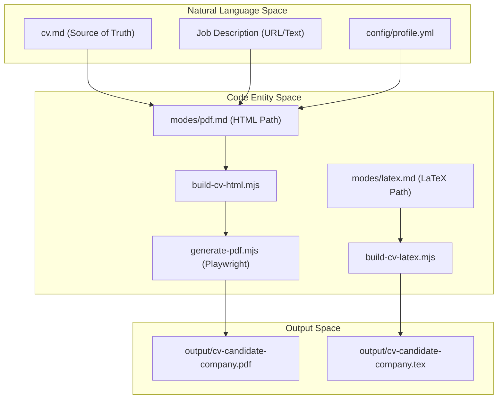
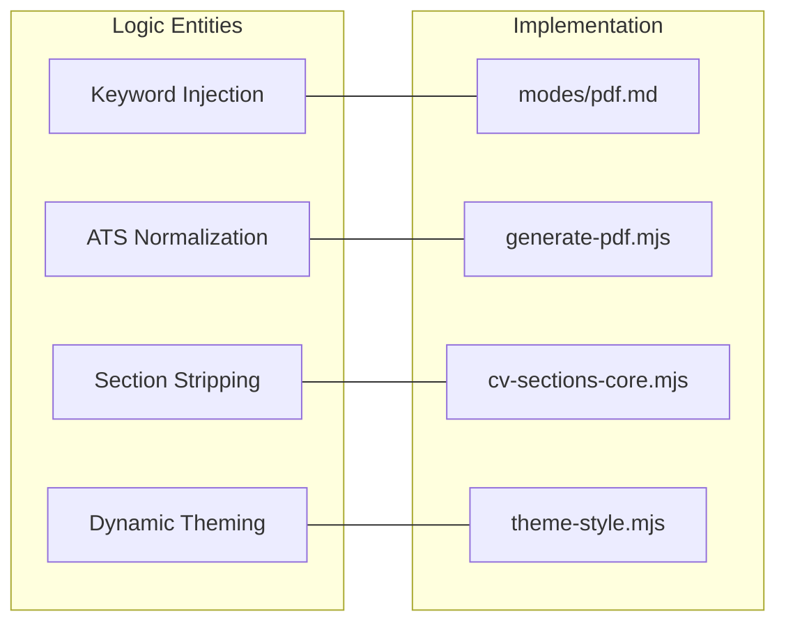

<!-- source: DeepWiki mcp.deepwiki.com · repo santifer/career-ops · page 3 PDF & LaTeX Generation Engine · fetched 2026-10-26 -->

# PDF & LaTeX Generation Engine

Relevant source files

The following files were used as context for generating this wiki page:

- [build-cv-html.mjs](build-cv-html.mjs)
- [build-cv-latex.mjs](build-cv-latex.mjs)
- [config/profile.example.yml](config/profile.example.yml)
- [cv-sections-core.mjs](cv-sections-core.mjs)
- [generate-latex.mjs](generate-latex.mjs)
- [generate-pdf.mjs](generate-pdf.mjs)
- [modes/_shared.md](modes/_shared.md)
- [modes/latex.md](modes/latex.md)
- [modes/pdf.md](modes/pdf.md)
- [templates/README.md](templates/README.md)
- [templates/cv-template.html](templates/cv-template.html)
- [templates/cv-template.tex](templates/cv-template.tex)
- [templates/resume-template.html](templates/resume-template.html)
- [tests/cv-dollar-pattern.test.mjs](tests/cv-dollar-pattern.test.mjs)
- [tests/cv-named-templates.test.mjs](tests/cv-named-templates.test.mjs)
- [tests/cv-numeric-scalars.test.mjs](tests/cv-numeric-scalars.test.mjs)
- [tests/cv-optional-sections.test.mjs](tests/cv-optional-sections.test.mjs)
- [tests/cv-partial-empty-fallbacks.test.mjs](tests/cv-partial-empty-fallbacks.test.mjs)
- [tests/theme-style-dollar-pattern.test.mjs](tests/theme-style-dollar-pattern.test.mjs)
- [tests/theme-style.test.mjs](tests/theme-style.test.mjs)
- [theme-style.mjs](theme-style.mjs)

The **PDF & LaTeX Generation Engine** is a specialized subsystem designed to transform a Markdown-based CV source of truth into an ATS-optimized, professionally designed document. It supports two primary output paths: a high-fidelity HTML-to-PDF pipeline using headless browser rendering, and a structured LaTeX-to-PDF pipeline for academic or Overleaf-compatible exports. It also handles the generation of tailored cover letters and provides optional visual design variants.

### System Overview

The engine follows a linear pipeline that begins with the raw `cv.md` and ends with a rendered PDF file. The choice of pipeline is governed by the `cv.output_format` setting in `config/profile.yml` [config/profile.example.yml:126]().

#### Generation Pipeline
1.  **Context Ingestion**: Loads the base `cv.md`, `config/profile.yml`, and the target Job Description (JD) [modes/pdf.md:14-15](), [modes/latex.md:7-9]().
2.  **Skill Gap Analysis**: Executes `jd-skill-gap.mjs` to classify requirements into `existing`, `supportedByResume`, and `gap` buckets before drafting [modes/pdf.md:17-20]().
3.  **Regional Formatting**: Detects company location to set paper size (`letter` for US/Canada, `a4` elsewhere) [modes/pdf.md:29-31]().
4.  **Template Synthesis**: Populates either `templates/cv-template.html` (via `build-cv-html.mjs`) or `templates/cv-template.tex` (via `build-cv-latex.mjs`) with structured JSON content [build-cv-html.mjs:5-12](), [build-cv-latex.mjs:118-126]().
5.  **ATS Normalization**: For HTML, `generate-pdf.mjs` cleans Unicode characters like smart quotes and em-dashes to prevent keyword corruption [generate-pdf.mjs:107-116]().
6.  **Rendering**: Executes Playwright for HTML [generate-pdf.mjs:33-36]() or Tectonic/pdfLaTeX for LaTeX [modes/latex.md:19-23]() to produce the final document.

#### Data Flow: From Source to Output
The following diagram illustrates how natural language CV data is processed by code entities into the final PDF.

**CV Transformation Flow**

Sources: [modes/pdf.md:14-43](), [modes/latex.md:5-20](), [build-cv-html.mjs:3-16](), [build-cv-latex.mjs:1-12]()

---

### Core Components

The engine is divided into four main functional areas.

#### CV & Resume HTML Templates & Fonts
The system uses a single-column, ATS-optimized layout defined in `templates/cv-template.html` [templates/cv-template.html:22-29](). It utilizes a CSS design system that suppresses ligatures (`font-variant-ligatures: none`) to ensure clean machine-readable parsing [templates/cv-template.html:31-44](). The template relies on a placeholder system (e.g., `{{NAME}}`, `{{EXPERIENCE}}`) and supports optional section stripping for empty arrays [cv-sections-core.mjs:4-16]().

For details, see [CV & Resume HTML Templates & Fonts](#3.1).

#### generate-pdf.mjs Script
This Node.js utility renders HTML into PDF using `playwright` [generate-pdf.mjs:36](). It includes `normalizeTextForATS`, which converts problematic Unicode (like `\u2014` em-dashes) into ASCII-safe equivalents [generate-pdf.mjs:148-154](). It also enforces a workspace boundary check to prevent path traversal [generate-pdf.mjs:72-101]().

For details, see [generate-pdf.mjs Script](#3.2).

#### LaTeX/Overleaf Export
The alternative pipeline uses `templates/cv-template.tex` to generate a professional LaTeX document [modes/latex.md:3](). The `build-cv-latex.mjs` script takes a JSON payload and handles LaTeX escaping for special characters like `&`, `%`, and `$` [build-cv-latex.mjs:119-133]().

For details, see [LaTeX/Overleaf Export](#3.3).

#### Cover Letter Generator
The cover letter pipeline (defined in `modes/cover.md`) generates tailored letters that adhere to `voice-dna.md` writing rules. It uses a dedicated `generate-cover-letter.mjs` script and the `templates/cover-letter-template.html` placeholder system.

For details, see [Cover Letter Generator](#3.4).

---

### Implementation Details

The engine bridges the gap between AI-generated text and a fixed document format through the following mapping:

**Component Mapping: Logic to Files**

Sources: [modes/pdf.md:38-40](), [generate-pdf.mjs:116-143](), [cv-sections-core.mjs:1-16](), [theme-style.mjs:42]()

#### Technical Specifications
| Feature | HTML Implementation | LaTeX Implementation |
| :--- | :--- | :--- |
| **Rendering Engine** | Playwright (Chromium) [generate-pdf.mjs:36]() | Tectonic / pdfLaTeX [modes/latex.md:23]() |
| **Typography** | Liberation Sans / System Stack [templates/cv-template.html:13]() | Computer Modern (Standard LaTeX) [modes/latex.md:28]() |
| **ATS Strategy** | Ligature suppression, Unicode normalization [generate-pdf.mjs:145-155]() | `\pdfgentounicode=1` [modes/latex.md:141]() |
| **Paper Formats** | A4 / Letter (Dynamic CSS) [build-cv-html.mjs:40]() | letterpaper [modes/latex.md:142]() |
| **Section Guard** | `cv-sections-core.mjs` (HTML) [cv-sections-core.mjs:110-117]() | `cv-sections-core.mjs` (Tex) [cv-sections-core.mjs:118-123]() |

Sources: [generate-pdf.mjs:145-155](), [templates/cv-template.html:11-44](), [build-cv-html.mjs:33-40](), [cv-sections-core.mjs:109-123](), [modes/latex.md:23-28]()

---

