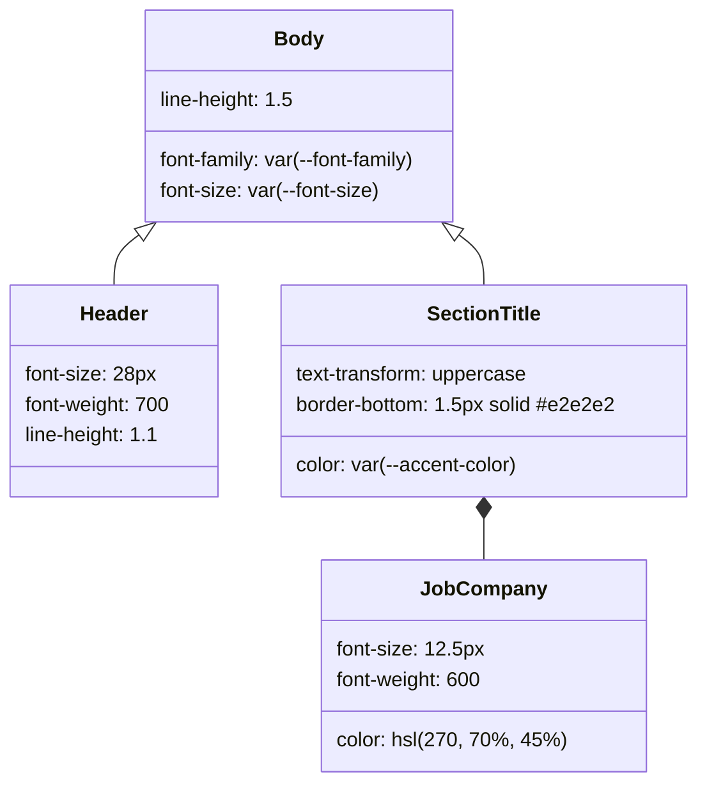

<!-- source: DeepWiki mcp.deepwiki.com · repo santifer/career-ops · page 3.1 CV & Resume HTML Templates & Fonts · fetched 2026-10-26 -->

# CV & Resume HTML Templates & Fonts

<details>
<summary>Relevant source files</summary>

The following files were used as context for generating this wiki page:

- [config/profile.example.yml](config/profile.example.yml)
- [cv-sections-core.mjs](cv-sections-core.mjs)
- [generate-latex.mjs](generate-latex.mjs)
- [generate-pdf.mjs](generate-pdf.mjs)
- [modes/_shared.md](modes/_shared.md)
- [modes/latex.md](modes/latex.md)
- [modes/pdf.md](modes/pdf.md)
- [templates/README.md](templates/README.md)
- [templates/cv-template.compact.html](templates/cv-template.compact.html)
- [templates/cv-template.executive.html](templates/cv-template.executive.html)
- [templates/cv-template.html](templates/cv-template.html)
- [templates/cv-template.jake.html](templates/cv-template.jake.html)
- [templates/cv-template.leadership.html](templates/cv-template.leadership.html)
- [templates/cv-template.modern.html](templates/cv-template.modern.html)
- [templates/cv-template.tex](templates/cv-template.tex)
- [templates/cv-template.zh-minimal.html](templates/cv-template.zh-minimal.html)
- [templates/resume-template.html](templates/resume-template.html)
- [tests/cv-named-templates.test.mjs](tests/cv-named-templates.test.mjs)
- [tests/cv-optional-sections.test.mjs](tests/cv-optional-sections.test.mjs)
- [tests/template-page-breaks.test.mjs](tests/template-page-breaks.test.mjs)
- [tests/theme-style-dollar-pattern.test.mjs](tests/theme-style-dollar-pattern.test.mjs)
- [tests/theme-style.test.mjs](tests/theme-style.test.mjs)
- [theme-style.mjs](theme-style.mjs)

</details>


The CV and Resume generation engine utilizes highly structured HTML templates designed for **ATS (Applicant Tracking System) compatibility** and rapid recruiter scanning. These templates act as the visual layer for data stored in `cv.md`, transforming Markdown content into professionally styled, single-column PDFs via the `generate-pdf.mjs` pipeline.

## CV vs. Resume Distinction

The system provides two primary templates to accommodate different market expectations:

*   **CV (`cv-template.html`)**: Designed for comprehensive career histories. It includes a dedicated "Certifications" section and is intended for multi-page documents common in academic or international contexts. [templates/cv-template.html:90](), [templates/resume-template.html:12]()
*   **Resume (`resume-template.html`)**: A variant optimized for the 1-2 page US/industry format. It omits the Certifications section to focus on recent, high-impact experience and impact metrics. [templates/resume-template.html:7-11]()

**Sources:** [templates/README.md:9-12](), [templates/resume-template.html:1-15]()

## Template Architecture

Both templates use a placeholder system that the `pdf` mode and `generate-pdf.mjs` script populate during execution.

### Placeholder System

| Placeholder | Description | Implementation Context |
|:---|:---|:---|
| `{{LANG}}` | Sets HTML `lang` attribute. Drives CJK fallback for `ja` or RTL for `ar`. | [templates/cv-template.html:2](), [modes/pdf.md:28]() |
| `{{PAGE_WIDTH}}` | CSS width (`8.5in` for letter, `210mm` for A4) based on company location. | [templates/cv-template.html:66](), [modes/pdf.md:29-31]() |
| `{{NAME}}` | Candidate name from `config/profile.yml`. | [templates/cv-template.html:6](), [modes/pdf.md:41]() |
| `{{SUMMARY_TEXT}}` | Professional Summary tailored with JD keywords and exit narrative. | [templates/cv-template.html:151](), [modes/pdf.md:35]() |
| `{{COMPETENCIES}}` | Flex-grid of keyword phrases as `<span class="competency-tag">`. | [templates/cv-template.html:168](), [modes/pdf.md:38]() |
| `{{EXPERIENCE}}` | Work history HTML with bullets reordered by JD relevance. | [templates/cv-template.html:186](), [modes/pdf.md:37]() |

**Sources:** [modes/pdf.md:28-43](), [templates/cv-template.html:1-162]()

### ATS Optimization & Ligature Suppression

A critical feature for machine readability is the suppression of ligatures. Headless Chromium often substitutes letter pairs (like "fi", "fl") with single Unicode glyphs (U+FB01), which causes ATS keyword searches for "verification" to fail if the parser sees "verification".

*   **Ligature Disable**: Both templates set `font-variant-ligatures: none` and `font-feature-settings: "liga" 0` on all elements. [templates/cv-template.html:42-43](), [templates/resume-template.html:69-70]()
*   **Unicode Normalization**: The `generate-pdf.mjs` script further cleanses the HTML by converting em-dashes (`—`) to hyphens (`-`) and smart quotes to ASCII equivalents to prevent "mojibake" in legacy ATS parsers. [generate-pdf.mjs:107-115]()

**Sources:** [templates/cv-template.html:35-44](), [generate-pdf.mjs:107-155]()

## Dynamic Theming & Customization

The system supports visual overrides via `config/profile.yml` without modifying the underlying templates.

*   **Design Tokens**: Users can define `accent_color`, `font_family`, `font_size`, and `margin` in their profile. [config/profile.example.yml:119-123]()
*   **Injection Mechanism**: `theme-style.mjs` parses these tokens and `generate-pdf.mjs` injects them as a `:root` CSS block into the HTML before rendering. [generate-pdf.mjs:42](), [tests/theme-style.test.mjs:13-15]()
*   **Optional Sections**: Sections like `Projects` or `Awards` are stripped entirely from the output if the data payload is empty, preventing bare headers. This is handled by `cv-sections-core.mjs` using marker sentinels like `<!-- PROJECTS -->`. [cv-sections-core.mjs:4-16](), [templates/README.md:31]()
*   **The END Sentinel**: Templates must include an `<!-- END -->` (HTML) or `%%%% END %%%%` (LaTeX) marker after the final section (usually Skills) to prevent the stripping logic from truncating the document tail. [cv-sections-core.mjs:32-56](), [templates/README.md:33-35]()

**Sources:** [theme-style.mjs:1-50](), [cv-sections-core.mjs:1-107](), [config/profile.example.yml:115-158]()

## Layout & Design Strategy

The layout is optimized for the **"6-second recruiter scan"**, placing high-impact keyword-dense information at the top.

*   **Single Column Layout**: Strictly avoids sidebars or parallel columns to ensure linear text extraction by ATS. [templates/README.md:27]()
*   **CSS Design Tokens**:
    *   **Fonts**: Base templates use `Liberation Sans` stack for extraction safety. [templates/cv-template.html:13]()
    *   **Color Scheme**: Cyan primary (`hsl(187, 74%, 32%)`) for section titles and Purple (`hsl(270, 70%, 45%)`) for company/project titles. [templates/cv-template.html:12](), [templates/cv-template.html:202]()
*   **Section Ordering**: Configurable via `cv.sections` in `profile.yml`. Default: 1. Summary, 2. Competencies, 3. Experience, 4. Projects, 5. Education, 6. Certifications, 7. Awards, 8. Skills. [config/profile.example.yml:139-152]()

### Data Flow: Markdown to Styled HTML

The following diagram illustrates how the system bridges the gap between raw Markdown data and the final rendered HTML structure.

**CV Transformation Map**
```mermaid
graph TD
    subgraph "NaturalLanguageSpace (cv.md & profile.yml)"
        MD_Name["profile.yml: candidate.full_name"]
        MD_Summary["> Summary Block"]
        MD_Exp["## Work Experience"]
        MD_Keywords["JD Keywords (Extracted)"]
    end

    subgraph "CodeEntitySpace (templates/cv-template.html)"
        H1_Tag["header h1"]
        Summary_Div["class='summary-text'"]
        Job_Section["class='job'"]
        
        MD_Name -->|Injected into {{NAME}}| H1_Tag
        MD_Summary -->|Tailored with Keywords| Summary_Div
        MD_Exp -->|Reordered Bullets| Job_Section
        MD_Keywords -->|Injected into| Summary_Div
    end

    subgraph "CSSDesignTokens (theme-style.mjs)"
        Accent["--accent-color"]
        FFamily["--font-family"]
        FSize["--font-size"]
    end

    H1_Tag -.-> FFamily
    Summary_Div -.-> FSize
    Job_Section -.-> Accent
```
**Sources:** [modes/pdf.md:14-43](), [templates/cv-template.html:72-148](), [theme-style.mjs:40-60]()

---

## Template Variants

The system includes several named variants for specific professional styles, selectable via the `--template` flag or `cv.template` config. [config/profile.example.yml:131-137]()

| Variant | Purpose | File |
|:---|:---|:---|
| `compact` | High information density for senior roles. | `templates/cv-template.compact.html` |
| `modern` | Clean, contemporary aesthetic with DM Sans. | `templates/cv-template.modern.html` |
| `jake` | Inspired by the popular Overleaf "Jake's Resume". | `templates/cv-template.jake.html` |
| `executive` | Formal layout for leadership positions. | `templates/cv-template.executive.html` |
| `zh-minimal` | Restrained technical CV for the Chinese market. | `templates/cv-template.zh-minimal.html` |

**Sources:** [templates/README.md:10](), [config/profile.example.yml:131-137]()

### Style Entity Relationship

**Style Entity Relationship**

**Sources:** [templates/cv-template.html:11-216](), [theme-style.mjs:42-55]()

---

