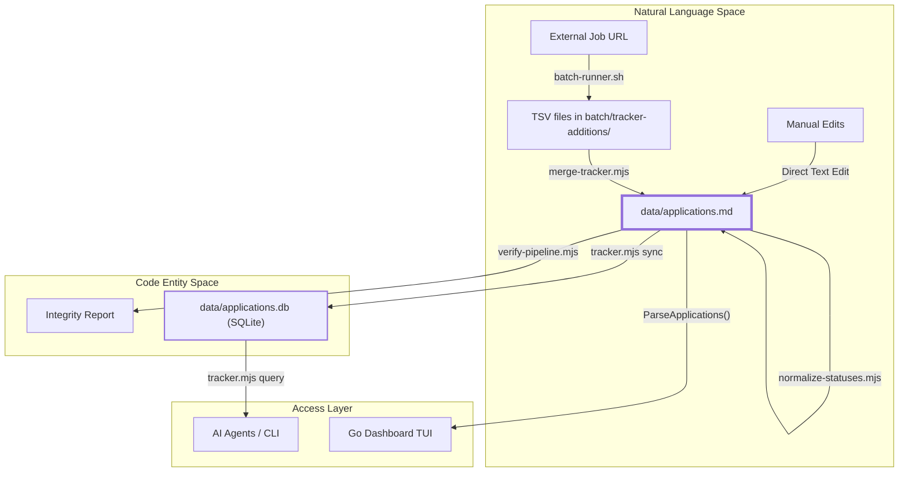
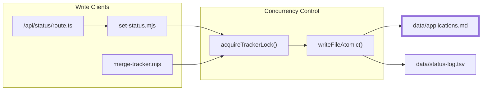

<!-- source: DeepWiki mcp.deepwiki.com · repo santifer/career-ops · page 5 Application Tracker & Data Layer · fetched 2026-10-26 -->

# Application Tracker & Data Layer

Relevant source files

The following files were used as context for generating this wiki page:

- [dedup-tracker.mjs](dedup-tracker.mjs)
- [lib/local-today.mjs](lib/local-today.mjs)
- [merge-tracker.mjs](merge-tracker.mjs)
- [normalize-statuses.mjs](normalize-statuses.mjs)
- [set-status-tests.mjs](set-status-tests.mjs)
- [set-status.mjs](set-status.mjs)
- [stats.mjs](stats.mjs)
- [templates/states.yml](templates/states.yml)
- [tests/fixtures/three-city-board.mjs](tests/fixtures/three-city-board.mjs)
- [tests/merge-tracker-url-dedup.test.mjs](tests/merge-tracker-url-dedup.test.mjs)
- [tests/merge-tracker.test.mjs](tests/merge-tracker.test.mjs)
- [tests/scan-company-role-dedup.test.mjs](tests/scan-company-role-dedup.test.mjs)
- [tests/scan-run-failure.test.mjs](tests/scan-run-failure.test.mjs)
- [tests/scan-url-dedup.test.mjs](tests/scan-url-dedup.test.mjs)
- [tests/source-no-nul-bytes.test.mjs](tests/source-no-nul-bytes.test.mjs)
- [tests/states-alias-coverage.test.mjs](tests/states-alias-coverage.test.mjs)
- [tests/stats.test.mjs](tests/stats.test.mjs)
- [tests/tracker-busy-timeout.test.mjs](tests/tracker-busy-timeout.test.mjs)
- [tracker-aliases.json](tracker-aliases.json)
- [tracker-columns-tests.mjs](tracker-columns-tests.mjs)
- [tracker-parse.mjs](tracker-parse.mjs)
- [tracker.mjs](tracker.mjs)
- [url-key.mjs](url-key.mjs)
- [verify-pipeline.mjs](verify-pipeline.mjs)
- [web/src/app/api/status/route.ts](web/src/app/api/status/route.ts)
- [web/src/lib/core/run-registry.ts](web/src/lib/core/run-registry.ts)
- [web/src/lib/core/tracker-lock.ts](web/src/lib/core/tracker-lock.ts)
- [web/src/lib/status-cli.mjs](web/src/lib/status-cli.mjs)
- [web/src/lib/tracker-table.mjs](web/src/lib/tracker-table.mjs)
- [web/tests/lib/status-cli.test.mjs](web/tests/lib/status-cli.test.mjs)
- [web/tests/lib/tracker-lock.test.mjs](web/tests/lib/tracker-lock.test.mjs)

The `data/` directory serves as the persistent storage layer for the entire career-ops ecosystem. Unlike traditional systems that rely on heavy databases, career-ops uses a **flat-file database** approach, primarily centered around `data/applications.md`. This Markdown-based architecture ensures that the data is human-readable, version-controllable via Git, and easily editable by both AI agents and manual user intervention.

## The Markdown Database Schema

The core of the data layer is `applications.md`. It uses a pipe-delimited Markdown table to track every job offer through its lifecycle [merge-tracker.mjs:29-34](). While the system defaults to a 9-column schema, it dynamically detects columns by header name to support user-customized layouts (e.g., adding a "Location" column) [verify-pipeline.mjs:77-92]().

### Canonical Table Structure
The standard table structure used by the dashboard and maintenance scripts includes the following fields [tracker.mjs:54-55]():

| Column | Name | Description |
| :--- | :--- | :--- |
| 1 | `#` | Sequential ID (Number) [tracker.mjs:95]() |
| 2 | `Date` | Date of the latest status change (YYYY-MM-DD) [tracker.mjs:97]() |
| 3 | `Company` | The name of the hiring organization [tracker.mjs:98]() |
| 4 | `Role` | The specific job title [tracker.mjs:99]() |
| 5 | `Score` | AI-generated match score (e.g., `4.2/5`) [tracker.mjs:100]() |
| 6 | `Status` | Canonical state (see State Machine below) [tracker.mjs:101]() |
| 7 | `PDF` | Indicator if a tailored CV exists (Unicode ✅) [tracker.mjs:102]() |
| 8 | `Report` | Markdown link to the evaluation file in `reports/` [tracker.mjs:103]() |
| 9 | `Notes` | Optional free-text for context [tracker.mjs:104]() |

**Sources:** [merge-tracker.mjs:5-8](), [verify-pipeline.mjs:77-115](), [tracker.mjs:54-55](), [tracker.mjs:94-105]()

## Canonical Status State Machine

To maintain data integrity and enable dashboard filtering, the `Status` column adheres to a predefined set of canonical states. These are defined in `templates/states.yml` and enforced across the Node.js toolchain [tracker.mjs:123-141]().

### State Hierarchy & Aliases
The system maps various natural language inputs (aliases) to a single canonical label. Scripts like `dedup-tracker.mjs` use a `STATUS_RANK` to determine which status is "more advanced" in the pipeline to prevent data loss during deduplication [dedup-tracker.mjs:45-76]().

| ID | Label | Common Aliases | Rank |
| :--- | :--- | :--- | :--- |
| `evaluated` | Evaluated | evaluada, condicional, hold | 2 |
| `applied` | Applied | aplicado, enviada, sent | 3 |
| `responded` | Responded | respondido | 4 |
| `interview` | Interview | entrevista | 5 |
| `offer` | Offer | oferta | 6 |
| `hired` | Hired | contratado, accepted | 7 |
| `rejected` | Rejected | rechazado, rechazada | 1 |
| `discarded` | Discarded | cerrada, cancelada, duplicado | 0 |
| `skip` | SKIP | no aplicar, monitor, geo blocker | 0 |

**Sources:** [dedup-tracker.mjs:45-76](), [normalize-statuses.mjs:29-87](), [verify-pipeline.mjs:52-67](), [tracker.mjs:123-141]()

## Data Flow & Maintenance Architecture

The data layer is managed by a suite of Node.js scripts that ensure the flat-file remains consistent even when multiple batch processes or manual edits occur.

### System Data Flow
The following diagram illustrates how job data moves from external URLs into the canonical `applications.md` file and the derived SQLite index.

**Data Ingestion & Normalization Flow**

**Sources:** [merge-tracker.mjs:1-15](), [tracker.mjs:4-17](), [verify-pipeline.mjs:1-15](), [dedup-tracker.mjs:1-10]()

### State Transition Integrity
State changes are gated by `set-status.mjs`, which serves as the canonical write path for status updates [set-status.mjs:4-9](). It records every change in `status-log.tsv` for velocity analysis [set-status.mjs:61-69]().

**Write Path & Concurrency Control**

**Sources:** [set-status.mjs:4-9](), [set-status.mjs:61-69](), [tracker-utils.mjs:25]()

## SQLite Derived Index (`tracker.mjs`)

As the Markdown tracker grows to hundreds of rows, structural degradation can occur (e.g., pipe-character corruption). `tracker.mjs` implements a **SQLite derived index** (RFC #918) to provide schema-validated, model-independent results for AI agents [tracker.mjs:4-17]().

*   **Losslessness:** The index is built from `applications.md` and can be regenerated at any time. Writes continue to target the Markdown file [tracker.mjs:6-10]().
*   **Auto-Resync:** The index automatically resyncs if the Markdown file's `mtime` is newer than the database [tracker.mjs:33-34]().
*   **Corruption Detection:** The sync process repairs common issues like "Mojibake" placeholder corruption [tracker.mjs:158-161]().

**Sources:** [tracker.mjs:4-35](), [tracker.mjs:158-161]()

## Maintenance Scripts Overview

### [merge-tracker.mjs](#5.1)
The primary entry point for batch data. It monitors `batch/tracker-additions/` for TSV files and merges them into the Markdown table [merge-tracker.mjs:38-41](). It uses a filesystem locking mechanism (`acquireTrackerLock`) to prevent race conditions [merge-tracker.mjs:122-137]().
*   **Details:** See [merge-tracker.mjs](#5.1).

### [dedup-tracker.mjs](#5.2)
Handles fuzzy deduplication by grouping entries by normalized company and role title clusters [dedup-tracker.mjs:5-8](). It uses `STATUS_RANK` to ensure that advanced application states (like "Interview") are never overwritten by new "Evaluated" rows [dedup-tracker.mjs:47-76]().
*   **Details:** See [dedup-tracker.mjs](#5.2).

### [normalize-statuses.mjs & verify-pipeline.mjs](#5.3)
These scripts handle data hygiene and safety.
*   **normalize-statuses.mjs**: Strips Markdown bolding and moves legacy status metadata (like "DUPLICADO") into the Notes column [normalize-statuses.mjs:3-9]().
*   **verify-pipeline.mjs**: A diagnostic tool checking for broken report links, non-canonical statuses, and pending TSVs [verify-pipeline.mjs:3-19]().
*   **Details:** See [normalize-statuses.mjs & verify-pipeline.mjs](#5.3).

### [Pattern Analysis & Follow-up Cadence Scripts](#5.4)
Advanced analytics operating on the tracker data.
*   **analyze-patterns.mjs**: Performs funnel analysis to detect tech stack gaps and archetype-based rejection patterns.
*   **followup-cadence.mjs**: Calculates follow-up urgency based on the last contact date and current status [stats.mjs:134-138]().
*   **Details:** See [Pattern Analysis & Follow-up Cadence Scripts](#5.4).

### [tracker.mjs SQLite Index](#5.5)
The technical implementation of the SQLite index, providing a robust query interface for agents and tools [tracker.mjs:24-32]().
*   **Details:** See [tracker.mjs SQLite Index](#5.5).

### [set-status.mjs & Tracker Write Path](#5.6)
Covers the canonical gatekeeper for status updates and the status-log.tsv ledger [set-status.mjs:1-90]().
*   **Details:** See [set-status.mjs & Tracker Write Path](#5.6).

**Sources:** [merge-tracker.mjs:1-15](), [dedup-tracker.mjs:1-10](), [normalize-statuses.mjs:1-12](), [verify-pipeline.mjs:1-21](), [tracker.mjs:1-35](), [set-status.mjs:1-90]()

---

