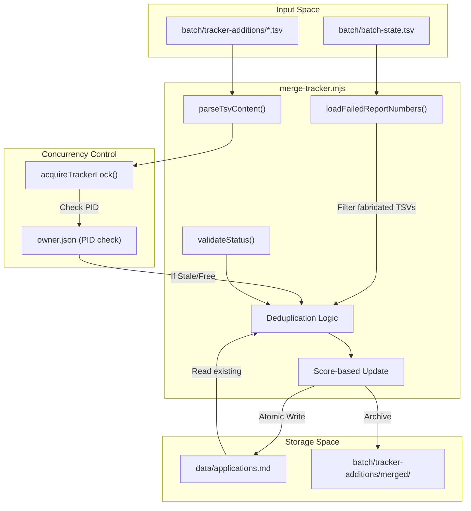
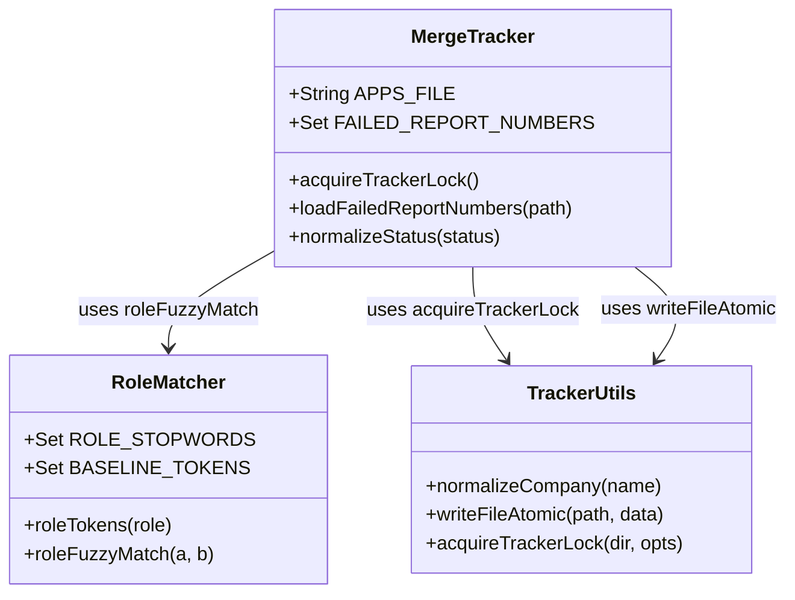

<!-- source: DeepWiki mcp.deepwiki.com · repo santifer/career-ops · page 5.1 merge-tracker.mjs · fetched 2026-10-26 -->

# merge-tracker.mjs

Relevant source files

The following files were used as context for generating this wiki page:

- [dedup-tracker.mjs](dedup-tracker.mjs)
- [merge-tracker.mjs](merge-tracker.mjs)
- [normalize-statuses.mjs](normalize-statuses.mjs)
- [role-matcher.mjs](role-matcher.mjs)
- [stats.mjs](stats.mjs)
- [templates/states.yml](templates/states.yml)
- [tests/merge-tracker.test.mjs](tests/merge-tracker.test.mjs)
- [tests/scan-run-failure.test.mjs](tests/scan-run-failure.test.mjs)
- [tests/source-no-nul-bytes.test.mjs](tests/source-no-nul-bytes.test.mjs)
- [tests/states-alias-coverage.test.mjs](tests/states-alias-coverage.test.mjs)
- [tests/stats.test.mjs](tests/stats.test.mjs)
- [verify-pipeline.mjs](verify-pipeline.mjs)

`merge-tracker.mjs` is the primary synchronization utility responsible for ingesting new job application data from the batch processing subsystem into the central `applications.md` database [merge-tracker.mjs:1-15](). It handles complex TSV parsing, fuzzy deduplication of company and role names, filesystem locking for concurrency safety, and score-based update logic to ensure the tracker remains the single source of truth for all career operations.

### Core Logic and Data Flow

The script operates by reading "addition" files from `batch/tracker-additions/`, comparing them against the existing entries in `applications.md`, and either appending new rows or updating existing ones based on a hierarchy of matching rules.

#### High-Level Data Flow
The following diagram illustrates how data moves from the batch worker output into the final Markdown table, including the locking mechanism and the authority check against `batch-state.tsv`.

**Data Ingestion Pipeline**

Sources: [merge-tracker.mjs:38-45](), [merge-tracker.mjs:56-72](), [merge-tracker.mjs:122-137](), [merge-tracker.mjs:295-310]()

### Implementation Details

#### 1. Flexible TSV/Markdown Parsing
The script is resilient to variations in batch worker output and manual edits. It supports three primary formats [merge-tracker.mjs:5-9]():
*   **9-column TSV**: Includes an explicit `notes` field.
*   **8-column TSV**: Standard output without notes.
*   **Pipe-delimited**: Raw Markdown table rows (`| col | col | ... |`).

A key feature is the **Header-Aware Column Mapping** [merge-tracker.mjs:296-310](). Instead of relying on fixed positions, the script detects column indices by searching for a header row. This allows users to add custom columns (e.g., "Location" or "Via") without breaking the merge logic [verify-pipeline.mjs:85-96]().

#### 2. Status Validation & Normalization
To maintain data integrity, incoming statuses are validated against canonical states [merge-tracker.mjs:12]().
*   **Canonical States**: The script checks against standard labels like `Evaluated`, `Applied`, `Interview`, and `Hired` [merge-tracker.mjs:140-140]().
*   **Normalization**: It strips Markdown bolding (`**`) and trailing dates from status fields using `normalizeStatus()` [normalize-statuses.mjs:42-104]().
*   **Spanish/International Aliases**: It maps localized terms (e.g., "entrevista" → "Interview", "başvuruldu" → "Applied") to canonical IDs defined in `templates/states.yml` [templates/states.yml:16-74]().

#### 3. Fuzzy Deduplication and Score Updates
`merge-tracker.mjs` prevents duplicate entries using a multi-tiered approach:
*   **Company Normalization**: `normalizeCompany()` strips punctuation and branding (e.g., "Google (L3)" → "google") [tracker-utils.mjs:25-25]().
*   **Fuzzy Role Matching**: Shared logic in `role-matcher.mjs` tokenizes titles, removes common `ROLE_STOPWORDS` (senior, remote, etc.), and requires a Jaccard overlap [role-matcher.mjs:129-150]().
*   **Score-based Update**: If a duplicate is found with a higher fit score, the script updates the existing row in-place and re-points the report link [merge-tracker.mjs:10-11]().
*   **Fabricated Row Protection**: The script loads `FAILED_REPORT_NUMBERS` from `batch-state.tsv`. If a report number maps to a "failed" batch worker row, it is rejected even if the TSV is well-formed [merge-tracker.mjs:56-72]().

#### 4. Concurrency and Atomic Writes
To prevent data loss during simultaneous merges (common in parallel batch runs), the script implements a filesystem lock [merge-tracker.mjs:81-81]().
*   **acquireTrackerLock()**: Acquires a lock for the specific tracker file path with configurable timeouts and retries [merge-tracker.mjs:124-129]().
*   **Atomic Writes**: Updates are performed using `writeFileAtomic()`, which writes to a temporary file and renames it, ensuring the tracker is never corrupted by a partial write [merge-tracker.mjs:25-25]().

### System Entity Mapping

This diagram maps the logical operations of the script to the specific functions and variables defined in the source code.

**Logic to Code Entity Mapping**

Sources: [merge-tracker.mjs:22-25](), [merge-tracker.mjs:56-72](), [role-matcher.mjs:29-50](), [role-matcher.mjs:129-150]()

### CLI Usage and Flags

| Flag | Description |
| :--- | :--- |
| `--dry-run` | Processes additions and logs intended changes without writing to disk [merge-tracker.mjs:73](). |
| `--verify` | Invokes `verify-pipeline.mjs` health checks after the merge completes [merge-tracker.mjs:74](). |
| `--migrate` | Triggers path migration logic for report links [merge-tracker.mjs:75](). |
| `--backfill-urls` | Attempts to populate missing posting URLs in the tracker [merge-tracker.mjs:77](). |

### Execution Flow
1.  **Lock Acquisition**: Calls `acquireTrackerLock()` to prevent concurrent writes [merge-tracker.mjs:124-137]().
2.  **Failed Report Loading**: Reads `batch-state.tsv` to identify fabricated reports that should not be merged [merge-tracker.mjs:72]().
3.  **Read and Parse**: Reads `applications.md` and detects the column layout using `resolveColumns` [merge-tracker.mjs:296-310]().
4.  **Merge Loop**: Iterates through files in `batch/tracker-additions/`, applying `roleFuzzyMatch` and checking FIT scores [merge-tracker.mjs:10-11]().
5.  **Insertion**: New entries are inserted immediately after the Markdown header separator (`SEPARATOR_ROW_RE`) to keep recent entries at the top [merge-tracker.mjs:24-24]().
6.  **Cleanup**: Moves processed TSVs to the `merged/` subdirectory and releases the lock [merge-tracker.mjs:41-41](), [merge-tracker.mjs:130-130]().

Sources: [merge-tracker.mjs:1-80](), [merge-tracker.mjs:122-140](), [merge-tracker.mjs:295-315]()

---

