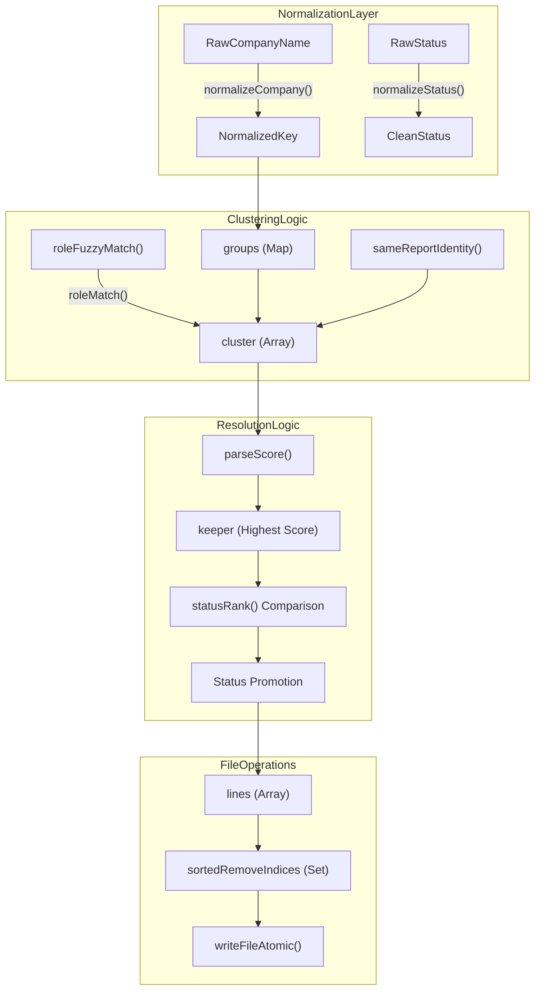
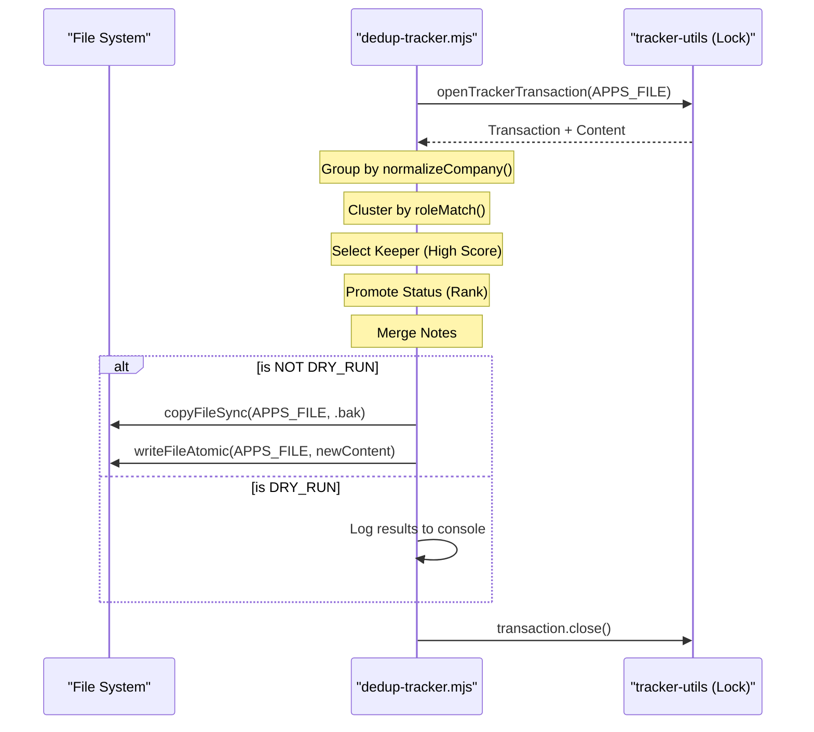

<!-- source: DeepWiki mcp.deepwiki.com · repo santifer/career-ops · page 5.2 dedup-tracker.mjs · fetched 2026-10-26 -->

# dedup-tracker.mjs

Relevant source files

The following files were used as context for generating this wiki page:

- [dedup-tracker.mjs](dedup-tracker.mjs)
- [merge-tracker.mjs](merge-tracker.mjs)
- [normalize-statuses.mjs](normalize-statuses.mjs)
- [stats.mjs](stats.mjs)
- [templates/states.yml](templates/states.yml)
- [tests/merge-tracker.test.mjs](tests/merge-tracker.test.mjs)
- [tests/scan-run-failure.test.mjs](tests/scan-run-failure.test.mjs)
- [tests/source-no-nul-bytes.test.mjs](tests/source-no-nul-bytes.test.mjs)
- [tests/states-alias-coverage.test.mjs](tests/states-alias-coverage.test.mjs)
- [tests/stats.test.mjs](tests/stats.test.mjs)
- [verify-pipeline.mjs](verify-pipeline.mjs)

`dedup-tracker.mjs` is a maintenance utility designed to ensure the integrity and cleanliness of the `applications.md` flat-file database [dedup-tracker.mjs:2-10](). It identifies redundant job entries by comparing normalized company names and performing exact or fuzzy role matching. The script prioritizes data retention by selecting the highest-scoring evaluation as the "keeper" while promoting its status if a discarded duplicate reached a more advanced stage in the recruitment pipeline [dedup-tracker.mjs:5-8]().

## Core Logic & Hierarchy

The script operates on a predefined hierarchy of application statuses. This allows it to safely merge entries without losing progress (e.g., if one entry is marked "Evaluated" with a high score but a duplicate is already at the "Interview" stage, the final entry will keep the high score but advance to "Interview") [dedup-tracker.mjs:6-8]().

### STATUS_RANK Hierarchy
The `STATUS_RANK` object defines the "advancement" of an application. Higher values represent a more advanced stage in the pipeline [dedup-tracker.mjs:47-76](). It includes English canonicals from `states.yml`, Spanish aliases, and specific logic where `Hired` (Rank 7) outranks all other states to ensure accepted job records are never lost to reposts [dedup-tracker.mjs:57-76]().

| Status (Canonical/Alias) | Rank | Description |
| :--- | :--- | :--- |
| `skip` / `discarded` / `no_aplicar` | 0 | Entry point or explicit rejection of interest [dedup-tracker.mjs:49-50](). |
| `rejected` / `rechazado` | 1 | Terminal state (Company rejected candidate) [dedup-tracker.mjs:51](). |
| `evaluated` / `evaluada` | 2 | Initial AI evaluation complete [dedup-tracker.mjs:52](). |
| `applied` / `aplicado` | 3 | Application submitted [dedup-tracker.mjs:53](). |
| `responded` / `respondido` | 4 | Initial contact from recruiter [dedup-tracker.mjs:54](). |
| `interview` / `entrevista` | 5 | Interview process active [dedup-tracker.mjs:55](). |
| `offer` / `oferta` | 6 | Job offer received [dedup-tracker.mjs:56](). |
| `hired` / `accepted` | 7 | Job landed; highest priority [dedup-tracker.mjs:59-61](). |

**Sources:** [dedup-tracker.mjs:47-76](), [templates/states.yml:16-74]()

## Data Flow: Deduplication Pipeline

The script follows a multi-stage process to identify, merge, and prune entries.

### 1. Normalization & Grouping
The script first normalizes company names via `normalizeCompany` to ensure consistent grouping regardless of whitespace or casing [dedup-tracker.mjs:17-18](), [dedup-tracker.mjs:234](). It then groups all entries by these normalized company keys [dedup-tracker.mjs:234-239]().

### 2. Two-Tier Clustering
Within each company group, the script performs a secondary clustering check:
*   **Exact Identity:** If two rows share the same bracketed report number (e.g., `[123]`) or the same tracker number and exact role title, they are treated as exact duplicates [dedup-tracker.mjs:154-159]().
*   **Fuzzy Role Match:** If exact identity isn't found, it uses `roleFuzzyMatch` (via `roleMatch`) to check for similar titles [dedup-tracker.mjs:19-22](), [dedup-tracker.mjs:246]().
*   **Advanced Status Protection:** If an entry is already at the "Applied" stage or later (`isAdvancedStatus`), fuzzy matching is insufficient to trigger deduplication. The script treats these as distinct openings to avoid losing user history unless the identity is exact [dedup-tracker.mjs:120-122](), [dedup-tracker.mjs:200-213]().

### 3. Keeper Selection & Status Promotion
For every cluster of duplicates:
1.  **Selection:** The entry with the highest numeric score is selected as the `keeper` [dedup-tracker.mjs:265-266]().
2.  **Status Promotion:** The script iterates through discarded entries. If any discarded entry has a `statusRank` higher than the `keeper`, the `keeper`'s status is updated to that higher value [dedup-tracker.mjs:268-277]().
3.  **Note Merging:** Unique notes from discarded entries are appended to the `keeper`'s notes field [dedup-tracker.mjs:280-287]().
4.  **In-place Modification:** The `keeper` line in the `lines` array is updated using `rebuildRow` [dedup-tracker.mjs:289-298]().

### 4. Reverse-Order Deletion
To maintain array index integrity, the script collects all indices marked for deletion, sorts them in descending order, and removes them from the array [dedup-tracker.mjs:313-316]().

### Entity Mapping: Logic to Code
The following diagram maps the deduplication concepts to the specific functions and variables in the implementation.

**Deduplication Logic Mapping**

**Sources:** [dedup-tracker.mjs:88-108](), [dedup-tracker.mjs:154-159](), [dedup-tracker.mjs:195-222](), [dedup-tracker.mjs:234-239](), [dedup-tracker.mjs:265-298]()

## Implementation Details

### File Path Resolution & Locking
The script uses `resolveTrackerPath` to find `applications.md` and `openTrackerTransaction` to acquire a filesystem lock, preventing concurrent writes from other scripts like `merge-tracker.mjs` [dedup-tracker.mjs:17-19](), [dedup-tracker.mjs:321-329]().

### Backup Mechanism
Before writing any changes, the script creates a `.bak` backup of the tracker file if it is not a dry run [dedup-tracker.mjs:339-341]().

### CLI Arguments
*   `--dry-run`: Performs all calculations and logs intended changes without modifying the file or creating a backup [dedup-tracker.mjs:40](), [dedup-tracker.mjs:338-341]().
*   `--help` / `-h`: Displays usage information [dedup-tracker.mjs:33-34]().

**System Execution Flow**

**Sources:** [dedup-tracker.mjs:17-20](), [dedup-tracker.mjs:40](), [dedup-tracker.mjs:321-347](), [tracker-utils.mjs:17-19]()

---

