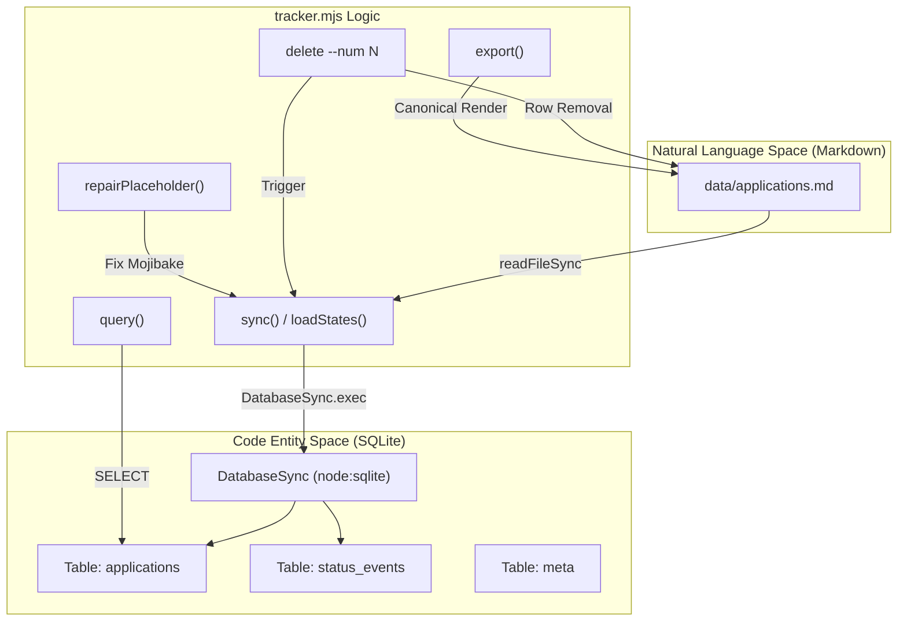
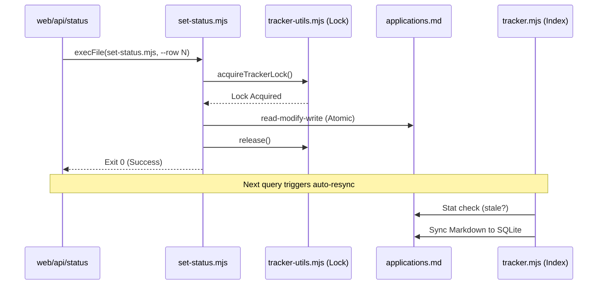

<!-- source: DeepWiki mcp.deepwiki.com · repo santifer/career-ops · page 5.5 tracker.mjs SQLite Index · fetched 2026-10-26 -->

# tracker.mjs SQLite Index

<details>
<summary>Relevant source files</summary>

The following files were used as context for generating this wiki page:

- [lib/local-today.mjs](lib/local-today.mjs)
- [set-status-tests.mjs](set-status-tests.mjs)
- [set-status.mjs](set-status.mjs)
- [tests/tracker-busy-timeout.test.mjs](tests/tracker-busy-timeout.test.mjs)
- [tracker-parse.mjs](tracker-parse.mjs)
- [tracker.mjs](tracker.mjs)
- [web/src/app/api/status/route.ts](web/src/app/api/status/route.ts)
- [web/src/lib/core/run-registry.ts](web/src/lib/core/run-registry.ts)
- [web/src/lib/core/tracker-lock.ts](web/src/lib/core/tracker-lock.ts)
- [web/src/lib/status-cli.mjs](web/src/lib/status-cli.mjs)
- [web/tests/lib/status-cli.test.mjs](web/tests/lib/status-cli.test.mjs)
- [web/tests/lib/tracker-lock.test.mjs](web/tests/lib/tracker-lock.test.mjs)

</details>


The `tracker.mjs` script implements a **SQLite-based derived index** over the `applications.md` Markdown flat-file database (RFC #918). It provides a high-performance, schema-validated query layer designed to solve structural degradation and "column drift" common in large Markdown tables. While `applications.md` remains the authoritative source of truth, the SQLite index allows agents and tools to perform model-independent queries with a round-trip losslessness guarantee.

### Purpose and Scope
*   **Performance:** Accelerates queries over hundreds of application rows that would otherwise require expensive Markdown parsing. [tracker.mjs:12-15]()
*   **Integrity:** Detects encoding corruption (e.g., Mojibake) and structural shifts during synchronization. [tracker.mjs:15-17]()
*   **Model Independence:** Ensures that different LLMs (Claude, Gemini, etc.) receive identical, validated data instead of varied results from grepping raw Markdown. [tracker.mjs:8-10]()
*   **Lossless Round-trip:** Guaranteed `Markdown → DB → Markdown` consistency, ensuring that re-exporting the DB produces a canonical version of the original table. [tracker.mjs:30-31]()

---

### Data Flow and Architecture

The system operates as a unidirectional sync from Markdown to SQLite for reading, while writes continue to target the Markdown file via `merge-tracker.mjs`, `set-status.mjs`, or manual edits. The index automatically detects when the source Markdown file is newer than the database and triggers a re-sync.

#### System Component Diagram
This diagram illustrates how `tracker.mjs` bridges the "Natural Language Space" (Markdown) to the "Code Entity Space" (SQLite/Logic).


**Sources:** [tracker.mjs:6-11](), [tracker.mjs:93-119](), [tracker.mjs:161-165]()

---

### Implementation Details

#### 1. The SQLite Schema
The index uses `node:sqlite` (available in Node.js >= 22.5) to maintain three primary tables. The `openDb` function ensures a `busy_timeout` of 5000ms to prevent `SQLITE_BUSY` errors during concurrent access from the CLI, Go TUI, or Web UI.

| Table | Purpose | Key Columns |
| :--- | :--- | :--- |
| `applications` | Main index of all applications. | `id`, `pos`, `company`, `role`, `status`, `score`, `report` |
| `status_events` | Historical log of status changes observed across syncs. | `app_id`, `status`, `date` |
| `meta` | Sync metadata to track staleness (mtime, hash). | `key`, `value` |

**Sources:** [tracker.mjs:91-121](), [tests/tracker-busy-timeout.test.mjs:3-9]()

#### 2. Synchronization and Validation
The `sync` command performs several critical normalization steps:
*   **Status Canonicalization:** Resolves raw status strings to canonical labels defined in `templates/states.yml` using `loadStates()` and `normalizeStatus()`. [tracker.mjs:125-153]()
*   **Placeholder Repair:** The `repairPlaceholder()` function detects and fixes Mojibake (e.g., `鈥?`) caused by UTF-8/GBK encoding round-trip errors in em-dash cells. [tracker.mjs:161-165]()
*   **Stale Read Protection:** The `query` and `history` commands check the `mtime` of `applications.md` against the `meta` table; if the Markdown is newer, an auto-resync is triggered. [tracker.mjs:33-35]()

#### 3. Write Path and Concurrency
While `tracker.mjs` handles the index, the primary write path for status updates is `set-status.mjs`. This script enforces the **shared tracker lock** to prevent lost updates when multiple processes (CLI, Web API) attempt to modify the Markdown table simultaneously.


**Sources:** [set-status.mjs:4-9](), [web/src/app/api/status/route.ts:20-26](), [web/src/lib/core/tracker-lock.ts:8-15]()

---

### Key Commands and Workflows

#### Safe Row Removal (`delete --num N`)
Unlike manual Markdown editing, which can lead to off-by-one errors or broken table syntax, the `delete` command provides a safe workflow:
1.  Locates the row by the `#` (ID) column in the Markdown file. [tracker.mjs:31]()
2.  Removes the specific line from `applications.md`.
3.  Immediately triggers a re-sync to update the SQLite index.
4.  Supports a `--dry-run` flag to preview the deletion. [tracker.mjs:31]()

#### Agent Queries
Agents use the `query` command to fetch structured, schema-validated data. This prevents the LLM from having to "reason" about Markdown table pipes and alignment.
```bash
node tracker.mjs query --status Applied --limit 5 --json
```
**Sources:** [tracker.mjs:27-28]()

#### Status Transition Ledger
Every status change via `set-status.mjs` appends a line to `status-log.tsv`. The `tracker.mjs history --id N` command can then query the `status_events` table to show the lifecycle of a specific application. [set-status.mjs:61-68](), [tracker.mjs:29]()

---

### Data Integrity and Losslessness
The `tracker-parse.mjs` module provides the shared header-aware column mapping used by `tracker.mjs`. By resolving columns by header name (e.g., "Company", "Score") rather than fixed indices, the system remains robust even if a user adds custom columns like "Location" to the Markdown table. [tracker-parse.mjs:2-9](), [tracker-parse.mjs:153-156]()

**Sources:** [tracker.mjs:42](), [tracker-parse.mjs:1-13]()

---

