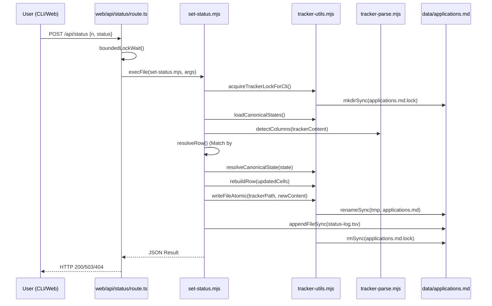
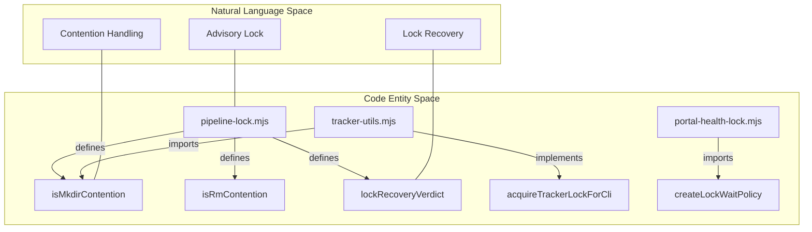

<!-- source: DeepWiki mcp.deepwiki.com · repo santifer/career-ops · page 5.6 set-status.mjs & Tracker Write Path · fetched 2026-10-26 -->

# set-status.mjs & Tracker Write Path

Relevant source files

The following files were used as context for generating this wiki page:

- [followup-seed.mjs](followup-seed.mjs)
- [lib/local-today.mjs](lib/local-today.mjs)
- [pipeline-lock.mjs](pipeline-lock.mjs)
- [portal-health-lock.mjs](portal-health-lock.mjs)
- [set-status-tests.mjs](set-status-tests.mjs)
- [set-status.mjs](set-status.mjs)
- [test/pipeline-lock.test.mjs](test/pipeline-lock.test.mjs)
- [tests/lock-rm-contention.test.mjs](tests/lock-rm-contention.test.mjs)
- [tests/ollama-profile-context.test.mjs](tests/ollama-profile-context.test.mjs)
- [tests/pipeline-lock-mkdir-eperm.test.mjs](tests/pipeline-lock-mkdir-eperm.test.mjs)
- [tests/rename-contention.test.mjs](tests/rename-contention.test.mjs)
- [tests/with-followups-lock.test.mjs](tests/with-followups-lock.test.mjs)
- [tracker-parse.mjs](tracker-parse.mjs)
- [tracker-utils.mjs](tracker-utils.mjs)
- [web/src/app/api/status/route.ts](web/src/app/api/status/route.ts)
- [web/src/lib/core/run-registry.ts](web/src/lib/core/run-registry.ts)
- [web/src/lib/core/tracker-lock.ts](web/src/lib/core/tracker-lock.ts)
- [web/src/lib/status-cli.mjs](web/src/lib/status-cli.mjs)
- [web/tests/lib/status-cli.test.mjs](web/tests/lib/status-cli.test.mjs)
- [web/tests/lib/tracker-lock.test.mjs](web/tests/lib/tracker-lock.test.mjs)

The tracker write path ensures that all modifications to `data/applications.md` and its associated ledgers are atomic, validated, and concurrency-safe. The central component of this path is `set-status.mjs`, which serves as the canonical gatekeeper for application state changes.

## Purpose and Scope

`set-status.mjs` provides a unified interface for updating application statuses and notes. By funneling all writes through a single script, the system enforces:
1.  **State Integrity**: Statuses must match the canonical state machine defined in `templates/states.yml` [set-status.mjs:42-43]().
2.  **Concurrency Control**: Advisory filesystem locks prevent "lost update" races when multiple processes (CLI, Web UI, or Batch Workers) attempt to write to the tracker simultaneously [set-status.mjs:47-50]().
3.  **Audit Logging**: Every status change is recorded in `data/status-log.tsv` with a timestamp and source attribution [set-status.mjs:61-64]().
4.  **Data Consistency**: The script ensures that Markdown table formatting remains intact, preventing column shifts caused by literal pipes or newlines [tracker-utils.mjs:83-92]().

Sources: [set-status.mjs:1-90](), [tracker-utils.mjs:1-9]().

---

## Technical Data Flow

The following diagram illustrates how a status update request moves from various entry points through the validation layer to the final filesystem write.

### Status Update Sequence

Sources: [set-status.mjs:98-128](), [web/src/app/api/status/route.ts:71-100](), [tracker-utils.mjs:47-56](), [tracker-utils.mjs:98-116]().

---

## Implementation Details

### Row Resolution Logic
`set-status.mjs` supports multiple ways to identify a row:
*   **Exact ID**: Using `--row N` matches the `#` column directly [set-status.mjs:14]().
*   **Report Link**: Using `--report N` matches the row linking to report #N [set-status.mjs:15]().
*   **Company Match**: Matching by normalized company name. If multiple rows exist for the same company, `--role` must be provided for fuzzy disambiguation via `role-matcher.mjs` [set-status.mjs:21-23]().

### The Write Path Guard
To prevent accidental updates, the script includes a **report-number-mismatch guard**. If a user provides a numeric argument (e.g., `node set-status.mjs 97 ...`), the script checks if `97` refers to the row ID or a report ID. If they differ, it fails unless `--row`, `--report`, or `--force` is used [set-status.mjs:25-40]().

### Atomic Writes and Sanitization
*   **`cell(v)`**: Replaces newlines with spaces and literal pipes (`|`) with slashes (` / `) to prevent table corruption [tracker-utils.mjs:93-95]().
*   **`rebuildRow(parts)`**: Corrects `split('|')` artifacts to ensure the trailing pipe style is preserved [tracker-utils.mjs:52-56]().
*   **`writeFileAtomic`**: Writes to a temporary file first, then uses `renameSync` to overwrite the target, ensuring the tracker is never left in a partially-written state [tracker-utils.mjs:48]().

Sources: [set-status.mjs:13-40](), [tracker-utils.mjs:52-56](), [tracker-utils.mjs:93-95]().

---

## Concurrency and Locking

The system uses an **advisory directory-based lock** protocol. A directory (e.g., `applications.md.lock`) is used because `mkdir` is an atomic operation across POSIX and Windows systems [pipeline-lock.mjs:11-13]().

### Lock Recovery and Safety
| Feature | Implementation |
| :--- | :--- |
| **Owner Metadata** | `owner.json` stores PID, start time, and a unique token [pipeline-lock.mjs:14-16](). |
| **Stale Detection** | Checks if the owner PID is still alive; falls back to age after `OWNERLESS_GRACE_MS` [pipeline-lock.mjs:17-22](). |
| **Recovery Guard** | A second directory `.lock.recover` prevents two processes from reclaiming a stale lock simultaneously [pipeline-lock.mjs:23-28](). |
| **Windows Contention** | `isMkdirContention` and `isRmContention` handle `EPERM`/`EACCES` errors specific to Windows when files are mid-flight [pipeline-lock.mjs:128-142](). |

### Entity Mapping: Concurrency Primitives

Sources: [pipeline-lock.mjs:11-28](), [tracker-utils.mjs:21-25](), [portal-health-lock.mjs:34-37]().

---

## Web API Integration

The route `web/src/app/api/status/route.ts` does not perform direct filesystem writes. Instead, it delegates to `set-status.mjs` via `child_process.execFile` [web/src/app/api/status/route.ts:20-22]().

### API Constraints
*   **Timeouts**: The API enforces a `SET_STATUS_TIMEOUT_MS` (30s). To prevent the browser from hanging, it overrides the CLI's lock wait time to 10s via the `CAREER_OPS_TRACKER_LOCK_TIMEOUT_MS` environment variable [web/src/app/api/status/route.ts:31-45]().
*   **Response Mapping**: CLI exit codes are mapped to HTTP status codes:
    *   Exit 2 (Not Found) → 404
    *   Exit 3 (Ambiguous) → 409
    *   Exit 4 (Lock Timeout) → 503 [web/src/app/api/status/route.ts:56]().
*   **JSON Parsing**: Since the CLI might output warnings before the JSON result, `parseCliJson` scans the output from the end to find the last valid JSON object [web/src/lib/status-cli.mjs:23-37]().

Sources: [web/src/app/api/status/route.ts:20-67](), [web/src/lib/status-cli.mjs:23-37]().

---

## Status Ledger (status-log.tsv)

Every successful status change appends a line to `data/status-log.tsv`. This file is used by `funnel-velocity.mjs` to calculate time-in-stage metrics.

**Column Schema:**
1.  `tracker#`: The unique ID of the application row.
2.  `date`: The date of the transition (defaults to `localToday()`).
3.  `from`: The previous state (canonical label or `-`).
4.  `to`: The new state (canonical label).
5.  `source`: Attribution (e.g., `set-status`, `web`, `batch`) [set-status.mjs:61-64]().

Sources: [set-status.mjs:61-89](), [lib/local-today.mjs:1-5]().

---

