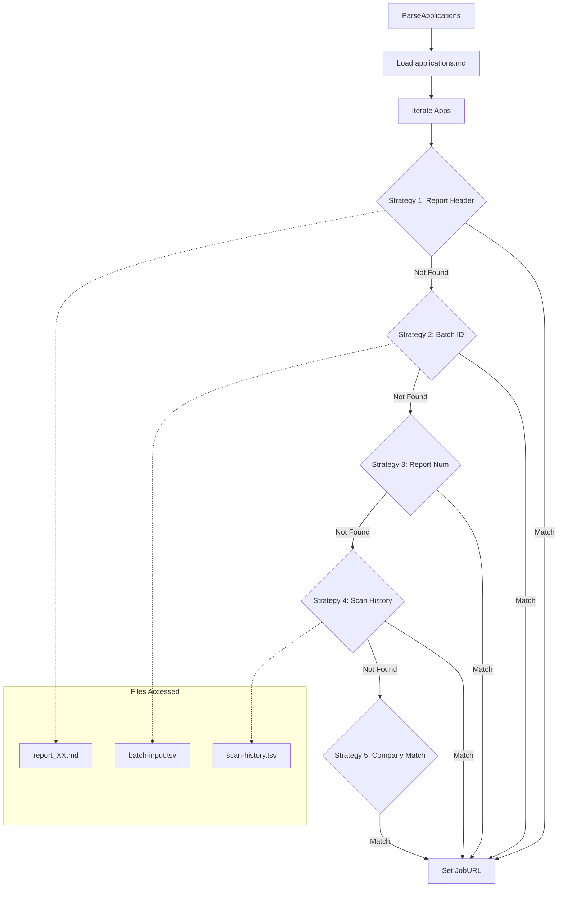
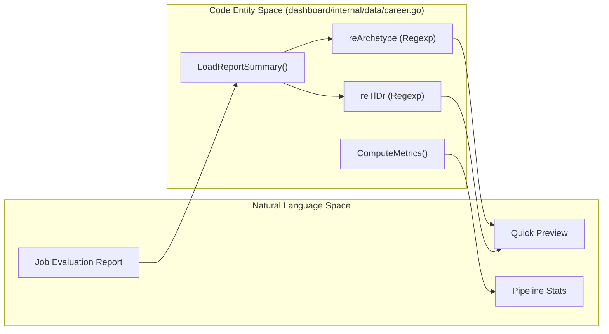

<!-- source: DeepWiki mcp.deepwiki.com · repo santifer/career-ops · page 6.2 Dashboard Data Layer · fetched 2026-10-26 -->

# Dashboard Data Layer

Relevant source files

The following files were used as context for generating this wiki page:

- [dashboard/internal/data/career.go](dashboard/internal/data/career.go)
- [dashboard/internal/data/career_test.go](dashboard/internal/data/career_test.go)
- [dashboard/internal/data/derive.go](dashboard/internal/data/derive.go)
- [dashboard/internal/data/derive_test.go](dashboard/internal/data/derive_test.go)
- [dashboard/internal/data/progress_metrics_test.go](dashboard/internal/data/progress_metrics_test.go)
- [dashboard/internal/data/stats.go](dashboard/internal/data/stats.go)
- [dashboard/internal/data/stats_test.go](dashboard/internal/data/stats_test.go)
- [dashboard/internal/i18n/catalog.go](dashboard/internal/i18n/catalog.go)
- [dashboard/internal/i18n/i18n_test.go](dashboard/internal/i18n/i18n_test.go)
- [dashboard/internal/model/career.go](dashboard/internal/model/career.go)
- [dashboard/internal/ui/screens/pipeline.go](dashboard/internal/ui/screens/pipeline.go)
- [dashboard/internal/ui/screens/pipeline_pdf_test.go](dashboard/internal/ui/screens/pipeline_pdf_test.go)
- [dashboard/internal/ui/screens/pipeline_test.go](dashboard/internal/ui/screens/pipeline_test.go)
- [dashboard/internal/ui/screens/pipeline_width_test.go](dashboard/internal/ui/screens/pipeline_width_test.go)
- [dashboard/internal/ui/screens/progress.go](dashboard/internal/ui/screens/progress.go)
- [dashboard/internal/ui/screens/sort_test.go](dashboard/internal/ui/screens/sort_test.go)
- [dashboard/internal/ui/screens/stats.go](dashboard/internal/ui/screens/stats.go)
- [dashboard/internal/ui/screens/stats_test.go](dashboard/internal/ui/screens/stats_test.go)
- [dashboard/internal/ui/screens/timeago_test.go](dashboard/internal/ui/screens/timeago_test.go)
- [dashboard/internal/ui/screens/viewer.go](dashboard/internal/ui/screens/viewer.go)
- [dashboard/internal/ui/screens/viewer_test.go](dashboard/internal/ui/screens/viewer_test.go)
- [dashboard/main.go](dashboard/main.go)

The Dashboard Data Layer is the Go-based engine responsible for transforming the flat-file Markdown database (`applications.md`) into structured data for the TUI. It handles parsing, complex URL enrichment strategies, metric computation, and status normalization according to the system's canonical state machine.

## Data Models

The system uses primary structures defined in `dashboard/internal/model/career.go` to represent application data and aggregate performance.

### CareerApplication
Represents a single row from the tracker, enriched with metadata from associated report files and derived fields from free-text notes.
[dashboard/internal/model/career.go:4-30]()

| Field | Type | Description |
| :--- | :--- | :--- |
| `Number` | `int` | Sequential ID based on the tracker column. [dashboard/internal/data/career.go:98-101]() |
| `Date` | `string` | Date of evaluation/application. |
| `Company` | `string` | Target organization name. |
| `Score` | `float64` | Numeric value parsed from the "Score" column (e.g., 4.5). [dashboard/internal/data/career.go:113-115]() |
| `Status` | `string` | Normalized state (e.g., "Applied", "Interview"). |
| `JobURL` | `string` | Original job posting URL (resolved via enrichment). [dashboard/internal/data/career.go:137-189]() |
| `Location` | `string` | Derived "City, ST" or International city. [dashboard/internal/data/derive.go:50-55]() |
| `WorkMode` | `string` | "Remote", "Hybrid", or "Full". [dashboard/internal/data/derive.go:19]() |
| `PayMax` | `float64` | Top of `PayRange` in dollars for sorting. [dashboard/internal/data/derive.go:124-146]() |
| `PostedOn` | `string` | ISO date when the req went live. [dashboard/internal/data/derive.go:23]() |
| `LastContact` | `string` | Max ISO date found in notes. [dashboard/internal/data/derive.go:24]() |

### PipelineMetrics & ProgressMetrics
These models hold aggregate statistics displayed in the dashboard header and the dedicated progress screen.
[dashboard/internal/model/career.go:33-40]()
[dashboard/internal/model/career.go:43-63]()

| Model | Field | Description |
| :--- | :--- | :--- |
| `PipelineMetrics` | `Total` | Total entries in the tracker. |
| `PipelineMetrics` | `AvgScore` | Arithmetic mean of all numerical scores. |
| `ProgressMetrics` | `FunnelStages` | Slice of `FunnelStage` for conversion analysis. |
| `ProgressMetrics` | `WeeklyActivity` | Application counts grouped by ISO week. |

Sources: [dashboard/internal/model/career.go:1-63](), [dashboard/internal/data/career.go:98-115]()

## Application Parsing

The `ParseApplications` function is the entry point for data ingestion. It searches for `applications.md` in the root or `data/` directory and iterates through the Markdown table. [dashboard/internal/data/career.go:54-64]()

### Table Ingestion Logic
The parser is header-aware, mapping columns by name rather than fixed position to support user-customized trackers. [dashboard/internal/data/career.go:70-74]()

### Field Mapping
| Column Name | Model Field | Logic |
| :--- | :--- | :--- |
| `num` | `Number` | Parsed as `int`. [dashboard/internal/data/career.go:99-101]() |
| `date` | `Date` | Raw string. [dashboard/internal/data/career.go:104]() |
| `company` | `Company` | Raw string. [dashboard/internal/data/career.go:105]() |
| `score` | `Score` | Parsed via `reScoreValue` regex `(\d+\.?\d*)/5`. [dashboard/internal/data/career.go:113-115]() |
| `status` | `Status` | Raw string. [dashboard/internal/data/career.go:107]() |
| `pdf` | `HasPDF` | Boolean check for the `✅` Unicode checkmark. [dashboard/internal/data/career.go:108]() |
| `report` | `ReportPath` | Resolved via `resolveReportPath` for relative links. [dashboard/internal/data/career.go:123-126]() |

Sources: [dashboard/internal/data/career.go:54-135](), [dashboard/internal/data/career_test.go:153-187]()

## Note Field Derivation (derive.go)

The `deriveNoteFields` function extracts structured data from the free-text `Notes` column and the `Role` title. [dashboard/internal/data/derive.go:150-151]()

### Extraction Logic
*   **Location Parsing:** Uses `reCityState` for US "City, ST" (e.g., "Charlotte, NC") and `reCityIntl` for international cities (e.g., "Berlin", "Zurich", "London"). [dashboard/internal/data/derive.go:50-55]()
*   **Currency Recognition:** Detects pay ranges for `USD`, `EUR`, `GBP`, `CHF`, `PLN`, `zł`, and others using `reMoneySpan`. [dashboard/internal/data/derive.go:26-80]()
*   **Pay Ceiling:** The `payCeiling` function converts strings like "$140-210K" or "€130-170K" into a raw float (e.g., `210000.0`) for sorting, regardless of currency. [dashboard/internal/data/derive.go:126-146]()
*   **Work Mode:** Infers "Hybrid", "Remote", or "Full" based on keywords like "Remote US", "Hybrid", or "Onsite". [dashboard/internal/data/derive_test.go:20-168]()
*   **Last Contact:** Extracts the most recent ISO date from notes (e.g., "Rejected 2026-06-04") or falls back to the application date. [dashboard/internal/data/derive.go:28]()

Sources: [dashboard/internal/data/derive.go:1-151](), [dashboard/internal/data/derive_test.go:9-242]()

## 5-Tier URL Enrichment Strategy

Because `applications.md` does not store job URLs directly, the data layer employs a 5-tier strategy in `ParseApplications` to resolve the original posting URL. [dashboard/internal/data/career.go:137-142]()

### Resolution Hierarchy
1.  **Report Header:** Scans the first 1000 bytes of the report for a `**URL:**` field. [dashboard/internal/data/career.go:162-165]()
2.  **Batch ID Lookup:** Scans the report for `**Batch ID:**` and looks up the ID in `batch/batch-input.tsv`. [dashboard/internal/data/career.go:168-173]()
3.  **Report Number Mapping:** Matches `ReportNumber` against `batch-state.tsv` (legacy). [dashboard/internal/data/career.go:176-181]()
4.  **Scan History:** Matches `Company` + `Role` against `data/scan-history.tsv`. [dashboard/internal/data/career.go:185]()
5.  **Company Fallback:** Searches `batch-input.tsv` for any entry matching the company name. [dashboard/internal/data/career.go:188]()

### Data Flow: URL Resolution

Sources: [dashboard/internal/data/career.go:137-191]()

## Status Management

The data layer enforces consistency through normalization and atomic writes.

### NormalizeStatus
Converts raw strings from the tracker into canonical labels. It strips Markdown bolding, removes dates, and maps aliases. [dashboard/internal/data/career.go:348-369]()

### UpdateApplicationStatus
Writes status updates back to disk. It uses a shared lock mechanism (`acquireTrackerLock`) to prevent lost-update races with other Node.js or CLI tools. [dashboard/internal/data/career_test.go:36-63]() It ensures no substring corruption occurs when rewriting the status column (e.g., not changing "Applied Materials" if status is "Applied"). [dashboard/internal/data/career_test.go:101-151]()

### StatusPriority
Determines sorting order via the `STATUS_RANK` map. [dashboard/internal/data/career.go:406-424]()

Sources: [dashboard/internal/data/career.go:237-424](), [dashboard/internal/data/career_test.go:36-151]()

## Report Summary Loading

Reports are lazy-loaded via `LoadReportSummary`, which parses the report file using regex. [dashboard/internal/data/career.go:312-346]()

| Metadata | Regex Pattern |
| :--- | :--- |
| **Archetype** | `reArchetype` / `reArchetypeColon` / `reArchetypeYAML` |
| **TL;DR** | `reTlDr` / `reTlDrColon` |
| **Remote** | `reRemote` |
| **Comp** | `reComp` |

### Code Entity Association

Sources: [dashboard/internal/data/career.go:18-31](), [dashboard/internal/data/career.go:312-346]()

## Metrics Computation

The data layer provides calculation functions for both the main dashboard and the analytics screens:
1. **ComputeMetrics**: Generates `PipelineMetrics` (average scores, actionable counts). [dashboard/internal/data/career.go:371-404]()
2. **ComputeProgressMetrics**: Generates `ProgressMetrics` including funnel rates (Response, Interview, Offer) and weekly trends. [dashboard/internal/data/career.go:426-538]()

Sources: [dashboard/internal/data/career.go:371-538](), [dashboard/internal/model/career.go:33-63]()

---

