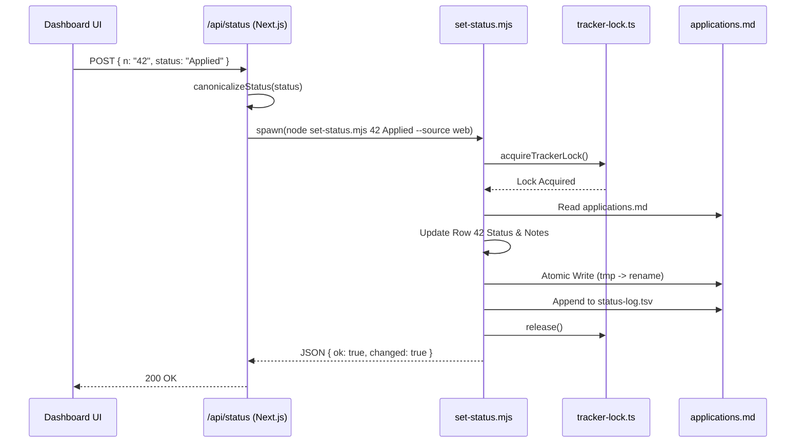
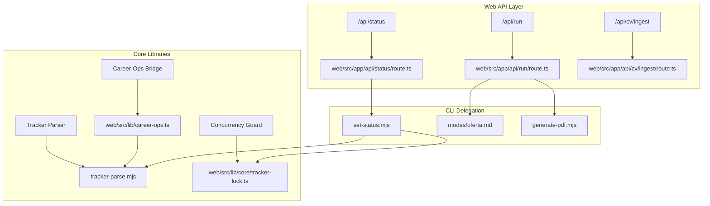

<!-- source: DeepWiki mcp.deepwiki.com · repo santifer/career-ops · page 7.1 Web API Routes & Core Libraries · fetched 2026-10-26 -->

# Web API Routes & Core Libraries

Relevant source files

The following files were used as context for generating this wiki page:

- [lib/local-today.mjs](lib/local-today.mjs)
- [set-status-tests.mjs](set-status-tests.mjs)
- [set-status.mjs](set-status.mjs)
- [tracker-parse.mjs](tracker-parse.mjs)
- [web/src/app/api/apply/prefill/route.ts](web/src/app/api/apply/prefill/route.ts)
- [web/src/app/api/assistant/route.ts](web/src/app/api/assistant/route.ts)
- [web/src/app/api/cv/ingest/route.ts](web/src/app/api/cv/ingest/route.ts)
- [web/src/app/api/explore/ai/route.ts](web/src/app/api/explore/ai/route.ts)
- [web/src/app/api/followups/cadence/route.ts](web/src/app/api/followups/cadence/route.ts)
- [web/src/app/api/followups/log/route.ts](web/src/app/api/followups/log/route.ts)
- [web/src/app/api/followups/override/route.ts](web/src/app/api/followups/override/route.ts)
- [web/src/app/api/followups/route.ts](web/src/app/api/followups/route.ts)
- [web/src/app/api/run/route.ts](web/src/app/api/run/route.ts)
- [web/src/app/api/status/route.ts](web/src/app/api/status/route.ts)
- [web/src/app/followups/page.tsx](web/src/app/followups/page.tsx)
- [web/src/components/followups/cadence-settings.tsx](web/src/components/followups/cadence-settings.tsx)
- [web/src/components/followups/followups-view.tsx](web/src/components/followups/followups-view.tsx)
- [web/src/lib/apply/agent-interpret.ts](web/src/lib/apply/agent-interpret.ts)
- [web/src/lib/apply/drive.ts](web/src/lib/apply/drive.ts)
- [web/src/lib/career-ops.ts](web/src/lib/career-ops.ts)
- [web/src/lib/claude-invocation.mjs](web/src/lib/claude-invocation.mjs)
- [web/src/lib/clis.ts](web/src/lib/clis.ts)
- [web/src/lib/core/followups-lock.ts](web/src/lib/core/followups-lock.ts)
- [web/src/lib/core/run-registry.ts](web/src/lib/core/run-registry.ts)
- [web/src/lib/core/tracker-lock.ts](web/src/lib/core/tracker-lock.ts)
- [web/src/lib/cv-envelope.mjs](web/src/lib/cv-envelope.mjs)
- [web/src/lib/followups-server.ts](web/src/lib/followups-server.ts)
- [web/src/lib/followups.ts](web/src/lib/followups.ts)
- [web/src/lib/origin-guard.mjs](web/src/lib/origin-guard.mjs)
- [web/src/lib/page-formats.mjs](web/src/lib/page-formats.mjs)
- [web/src/lib/pdf-paths.mjs](web/src/lib/pdf-paths.mjs)
- [web/src/lib/pdf-render.mjs](web/src/lib/pdf-render.mjs)
- [web/src/lib/report-files.mjs](web/src/lib/report-files.mjs)
- [web/src/lib/run-cli-support.mjs](web/src/lib/run-cli-support.mjs)
- [web/src/lib/run-prompts.mjs](web/src/lib/run-prompts.mjs)
- [web/src/lib/status-cli.mjs](web/src/lib/status-cli.mjs)
- [web/src/proxy.ts](web/src/proxy.ts)
- [web/tests/lib/claude-invocation.test.mjs](web/tests/lib/claude-invocation.test.mjs)
- [web/tests/lib/clis-coverage.test.mjs](web/tests/lib/clis-coverage.test.mjs)
- [web/tests/lib/clis-permissions.test.mjs](web/tests/lib/clis-permissions.test.mjs)
- [web/tests/lib/followups-lock.test.mjs](web/tests/lib/followups-lock.test.mjs)
- [web/tests/lib/origin-guard.test.mjs](web/tests/lib/origin-guard.test.mjs)
- [web/tests/lib/pdf-paths.test.mjs](web/tests/lib/pdf-paths.test.mjs)
- [web/tests/lib/pdf-render.test.mjs](web/tests/lib/pdf-render.test.mjs)
- [web/tests/lib/run-cli-support.test.mjs](web/tests/lib/run-cli-support.test.mjs)
- [web/tests/lib/run-prompts.test.mjs](web/tests/lib/run-prompts.test.mjs)
- [web/tests/lib/status-cli.test.mjs](web/tests/lib/status-cli.test.mjs)
- [web/tests/lib/tracker-lock.test.mjs](web/tests/lib/tracker-lock.test.mjs)

The `web/` application is a Next.js service that acts as a local-first orchestration layer for the `career-ops` engine. It provides a RESTful API and Server-Side Events (SSE) streaming to bridge the browser-based Dashboard with the core Node.js scripts and AI agent modes. The architecture is designed to ensure that writes performed via the Web UI are byte-identical to those performed via the CLI, maintaining a single source of truth in the user's flat-file data layer.

## API Route Architecture & Delegation

The Web API follows a delegation pattern where complex business logic and file mutations are handed off to the core scripts (e.g., `set-status.mjs`, `merge-tracker.mjs`). This prevents logic drift between the CLI and Web interfaces [web/src/lib/run-prompts.mjs:4-10]().

### Status Updates (`/api/status`)
The `/api/status` route handles updates to the `Status` and `Notes` columns in `data/applications.md`. It delegates to `set-status.mjs` to leverage the shared tracker lock and transition ledger (`status-log.tsv`) [web/src/app/api/status/route.ts:20-26]().

*   **Concurrency**: Uses `acquireTrackerLockForCli` from `tracker-utils.mjs` to prevent lost-update races [set-status.mjs:98-101]().
*   **Validation**: Validates states against `templates/states.yml` before execution [web/src/app/api/status/route.ts:128-131]().
*   **Ledger**: Automatically appends a row to `status-log.tsv` with `--source web` for funnel analytics [set-status.mjs:61-64]().

### Command Execution (`/api/run`)
The `/api/run` route is the primary entry point for long-running AI agent tasks, such as job evaluations (`oferta`), PDF tailoring, and portal repairs [web/src/app/api/run/route.ts:45-46]().

*   **Streaming**: Supports SSE to stream live agent thoughts and tool executions to the dashboard.
*   **Prompt Building**: Uses `buildPrompt` to construct context-rich instructions, including durable user notes from the profile [web/src/lib/run-prompts.mjs:54-55]().
*   **PDF Pipeline**: For `kind: "pdf"`, the agent tailors content which is then rendered by the backend using Playwright, ensuring the agent never needs direct filesystem write access for the PDF artifact [web/src/lib/run-prompts.mjs:63-72]().

### Job Discovery (`/api/explore` & `/api/explore/ai`)
These routes facilitate the "Reverse ATS" scanning process.
*   **`/api/explore`**: Triggers `scan-ats-full.mjs` to discover new job postings across public ATS directories.
*   **`/api/explore/ai`**: Uses AI to categorize and filter discovered roles based on the candidate's profile.

## Core Libraries & System Bridge

The `web/src/lib/` directory contains the bridge between the Next.js runtime and the `career-ops` filesystem.

### `career-ops.ts`
The primary utility for resolving paths and reading core data structures.
*   **`careerOpsRoot()`**: Resolves the user's data directory, supporting `CAREER_OPS_ROOT` environment overrides for development [web/src/lib/career-ops.ts:16-20]().
*   **`readInbox()`**: Parses `data/pipeline.md` using a labeled-segment strategy to handle optional columns like Location and Compensation [web/src/lib/career-ops.ts:67-82]().
*   **`readApplications()`**: Loads the tracker table using `tracker-table.mjs`, which shares `HEADER_ALIASES` with the CLI tools [web/src/lib/career-ops.ts:147-151]().

### `clis.ts` & `claude-invocation.mjs`
Manages the detection and invocation of supported AI runtimes (Claude Code, Gemini CLI, etc.).
*   **`KNOWN`**: A registry of CLI specifications including binary names, install URLs, and argument builders [web/src/lib/clis.ts:59-72]().
*   **`claudeCliArgs`**: Configures the Claude CLI with specific tool restrictions (e.g., denying `Bash` for PDF tailoring) and enabling `stream-json` output [web/src/lib/claude-invocation.mjs:121]().

### `tracker-parse.mjs`
A shared module used by both Web and CLI to ensure consistent parsing of the Markdown tracker table.
*   **`HEADER_ALIASES`**: A JSON-backed map of localized or synonymous header names (e.g., "Empresa" -> "company") [tracker-parse.mjs:35-46]().
*   **`isHeaderRow`**: Identifies the table header by checking for a minimum set of required fields [tracker-parse.mjs:126-129]().

## Data Flow: Web Update Path

This diagram illustrates how a status change in the Web UI flows through the system to the flat-file database.

**Tracker Update Sequence**

*Sources: [web/src/app/api/status/route.ts:107-140](), [set-status.mjs:98-101](), [web/src/lib/core/tracker-lock.ts:1-10]()*

## System Entities & Code Mapping

The following diagram maps high-level system responsibilities to their specific code implementations.

**Entity to Code Mapping**

*Sources: [web/src/lib/career-ops.ts:4-7](), [web/src/app/api/status/route.ts:4-6](), [set-status.mjs:92-96]()*

## Security & Protection Layers

### Origin Guard (`origin-guard.mjs`)
Protects against Cross-Site Request Forgery (CSRF) and Server-Side Request Forgery (SSRF) by validating that incoming requests originate from the local dashboard and not an external actor.

### Shell Safety (`isShellSafeCompanyName`)
Prevents command injection when company names (which may contain special characters from ATS listings) are interpolated into shell commands for portal repairs [web/src/lib/run-prompts.mjs:27-38]().

### Stream Parsing (`stream-parse.mjs`)
Handles the sanitization and parsing of Server-Sent Events. It ensures that diagnostic messages or warnings printed to `stdout` by the CLI do not corrupt the JSON document being sent to the client [web/src/lib/status-cli.mjs:23-38]().

## Concurrency Management

The system uses a filesystem-based locking mechanism defined in `tracker-lock.ts` (and shared with `tracker-utils.mjs`). This is critical because `atomicWrite` only ensures the file is not corrupted during the write itself; it does not protect the **read-modify-write** cycle [web/tests/lib/tracker-lock.test.mjs:3-7]().

| Feature | Implementation | Purpose |
| :--- | :--- | :--- |
| **Tracker Lock** | `acquireTrackerLock` | Prevents lost updates when two agents/users edit the tracker simultaneously. |
| **Run Registry** | `run-registry.ts` | Tracks active CLI processes to prevent racing between row deletions and status updates. |
| **Atomic Writes** | `atomicWrite` | Writes to a `.tmp` file and renames it to ensure the tracker is never left in a partial state. |

*Sources: [web/src/lib/core/tracker-lock.ts:1-10](), [web/src/lib/core/run-registry.ts:17](), [web/tests/lib/tracker-lock.test.mjs:73-88]()*

---

