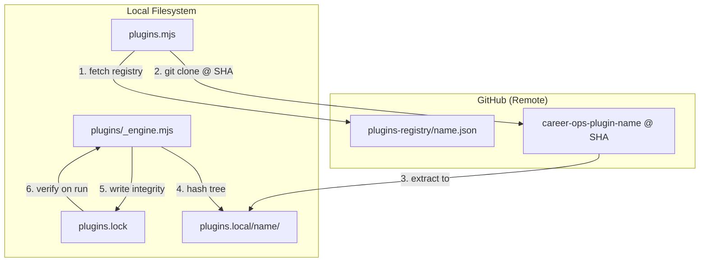
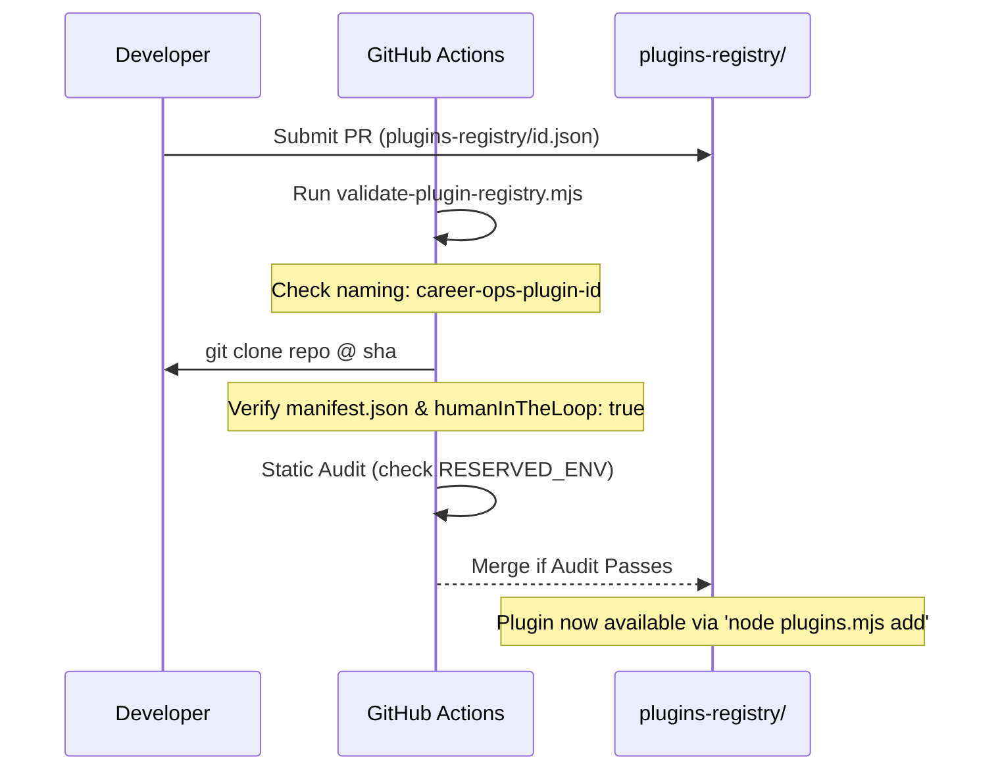

<!-- source: DeepWiki mcp.deepwiki.com · repo santifer/career-ops · page 9.2 Plugin Registry & Community Plugins · fetched 2026-10-26 -->

# Plugin Registry & Community Plugins

Relevant source files

The following files were used as context for generating this wiki page:

- [.github/PULL_REQUEST_TEMPLATE/plugin-registry.md](.github/PULL_REQUEST_TEMPLATE/plugin-registry.md)
- [.github/workflows/codeql.yml](.github/workflows/codeql.yml)
- [.github/workflows/gh-events-feed.yml](.github/workflows/gh-events-feed.yml)
- [.github/workflows/labeler.yml](.github/workflows/labeler.yml)
- [.github/workflows/ledger-bot.yml](.github/workflows/ledger-bot.yml)
- [.github/workflows/manifesto-guestbook.yml](.github/workflows/manifesto-guestbook.yml)
- [.github/workflows/plugin-registry-validate.yml](.github/workflows/plugin-registry-validate.yml)
- [.github/workflows/signature-ci.yml](.github/workflows/signature-ci.yml)
- [.github/workflows/web-ci.yml](.github/workflows/web-ci.yml)
- [docs/PLUGINS.md](docs/PLUGINS.md)
- [docs/PLUGIN_REVIEW.md](docs/PLUGIN_REVIEW.md)
- [plugins.mjs](plugins.mjs)
- [plugins/_engine.mjs](plugins/_engine.mjs)
- [plugins/_registry.mjs](plugins/_registry.mjs)
- [plugins/apify/index.mjs](plugins/apify/index.mjs)
- [plugins/gmail/index.mjs](plugins/gmail/index.mjs)
- [plugins/notion/index.mjs](plugins/notion/index.mjs)
- [tests/plugin-symlink-discovery.test.mjs](tests/plugin-symlink-discovery.test.mjs)
- [validate-plugin-registry.mjs](validate-plugin-registry.mjs)

The `career-ops` plugin system utilizes a curated registry to bridge the gap between the local-first core and the broader ecosystem of community-developed integrations. This registry acts as a security and quality gateway, ensuring that external code is audited, pinned to specific commits, and categorized by trust levels before it reaches a user's machine.

## Registry Architecture & Format

The registry is a collection of JSON manifests stored in the `plugins-registry/` directory [plugins-registry/:](). Each file represents an approved community plugin and defines its identity, source, and versioning.

### JSON Registry Format
Each entry in the registry must follow a strict schema defined in `validate-plugin-registry.mjs` [validate-plugin-registry.mjs:1-50]().

| Field | Type | Description |
| :--- | :--- | :--- |
| `id` | `string` | Unique identifier (kebab-case). Must match the repo name suffix. |
| `version` | `string` | SemVer version of the plugin. |
| `description` | `string` | A single-line summary of the plugin's utility. |
| `repo` | `string` | The full GitHub URL of the plugin repository. |
| `sha` | `string` | The exact git commit SHA that has been audited and approved. |
| `author` | `string` | The GitHub handle of the maintainer. |
| `supersedesBundled` | `boolean` | If `true`, this plugin takes precedence over a bundled version of the same ID. |

### Data Flow: From Registry to Local Execution

The following diagram illustrates how the `plugins/_engine.mjs` and `plugins.mjs` CLI interact with the registry to install and verify plugins.

**Registry Installation & Verification Flow**

**Sources:** [plugins.mjs:10-80](), [plugins/_engine.mjs:31-33](), [docs/PLUGINS.md:13-19]()

---

## The Trust Badge System

To provide transparency regarding the origin and safety of code, `career-ops` assigns trust badges to every plugin during discovery [docs/PLUGINS.md:25-33]().

| Badge | Code Entity / Path | Security Model |
| :--- | :--- | :--- |
| `📦 bundled` | `plugins/` | Reviewed in-tree by core maintainers. Auto-updates with the system [docs/PLUGINS.md:29](). |
| `✓ approved` | `plugins-registry/*.json` | Community code audited at a specific `sha`. Installed via `node plugins.mjs add` [docs/PLUGINS.md:30](). |
| `❓ community-unverified` | `plugins.local/` | Local code not found in the registry. The user is responsible for auditing [docs/PLUGINS.md:31](). |
| `⚠️ off-registry` | `plugins.lock` mismatch | A previously approved plugin whose local files no longer match the pinned `sha` [docs/PLUGINS.md:32](). |

**Sources:** [docs/PLUGINS.md:25-36](), [plugins/_engine.mjs:18-21]()

---

## Plugin Registration Workflow

Publishing a plugin to the community requires a structured submission process to ensure supply-chain security.

### 1. Development & Naming
Plugins must be developed in public GitHub repositories using the naming convention `career-ops-plugin-<name>` [docs/PLUGINS.md:57-61](). Scaffolding can be generated using:
`node plugins.mjs new <name>` [docs/PLUGINS.md:39-41]().

### 2. The Registry PR
A Pull Request must be opened against the `career-ops` repository adding a new JSON file to `plugins-registry/`.
*   **Template:** Must use the `.github/PULL_REQUEST_TEMPLATE/plugin-registry.md` template [.github/PULL_REQUEST_TEMPLATE/plugin-registry.md:1-20]().
*   **Gate:** A registry PR may add or bump exactly **one** plugin file per PR [.github/workflows/plugin-registry-validate.yml:62-63]().

### 3. CI Validation (`plugin-registry-validate.yml`)
The CI pipeline performs several checks to ensure the integrity of the submission:
1.  **Shape Gate:** Validates the JSON schema of the registry entry [validate-plugin-registry.mjs:37]().
2.  **Deep Audit:** Clones the plugin at the specified `sha`, checks for the presence of `manifest.json` and `index.mjs`, and performs a static analysis for forbidden patterns (e.g., accessing reserved env vars like `ANTHROPIC_API_KEY`) [.github/workflows/plugin-registry-validate.yml:41-43](), [plugins/_engine.mjs:44-51]().

**Plugin Audit & Registration Logic**

**Sources:** [.github/workflows/plugin-registry-validate.yml:1-63](), [plugins/_engine.mjs:151-165](), [docs/PLUGINS.md:55-72]()

---

## Community Plugin Catalog

The registry currently includes several approved plugins that extend the core capabilities:

| Plugin ID | Hook Types | Description |
| :--- | :--- | :--- |
| `tavily` | `search` | Web search and company research using Tavily AI [docs/PLUGINS.md:113](). |
| `google-calendar` | `ingest` | Detects interview events in Google Calendar [docs/PLUGINS.md:114](). |
| `linkedin-alerts` | `ingest` | Parses LinkedIn job alert emails from Gmail [docs/PLUGINS.md:115](). |
| `obsidian` | `export` | Mirrors tracker data into Obsidian Markdown notes [docs/PLUGINS.md:117](). |
| `outlook-interviews`| `ingest` | Extracts interview details from MS Outlook/Graph [docs/PLUGINS.md:116](). |
| `their-stack` | `search` | Job discovery based on company technology stacks. |
| `serper` | `search` | Google Search API integration for discovery. |

**Sources:** [docs/PLUGINS.md:111-118](), [plugins-registry/:]()

---

## Developing & Publishing Successors

To prevent the core from becoming bloated with integration-specific features, `career-ops` encourages the "Successor Pattern."

If a user wishes to improve a bundled plugin (e.g., `gmail` or `notion`), they should not submit a PR to the core. Instead, they should:
1.  Fork the bundled code into a new repository `career-ops-plugin-<id>` [docs/PLUGINS.md:84]().
2.  Set `"supersedesBundled": true` in their registry manifest [docs/PLUGINS.md:86]().
3.  Once the registry PR is merged, the engine will prioritize the community version over the bundled one [docs/PLUGINS.md:87-89]().

This ensures that stable, reference implementations remain in the core while community innovation happens in independent repositories.

**Sources:** [docs/PLUGINS.md:79-96](), [plugins/_engine.mjs:31-33]()

---

