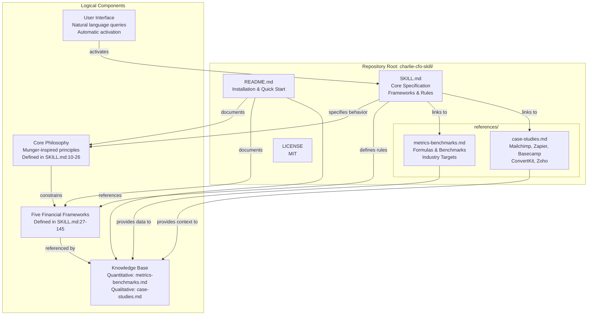
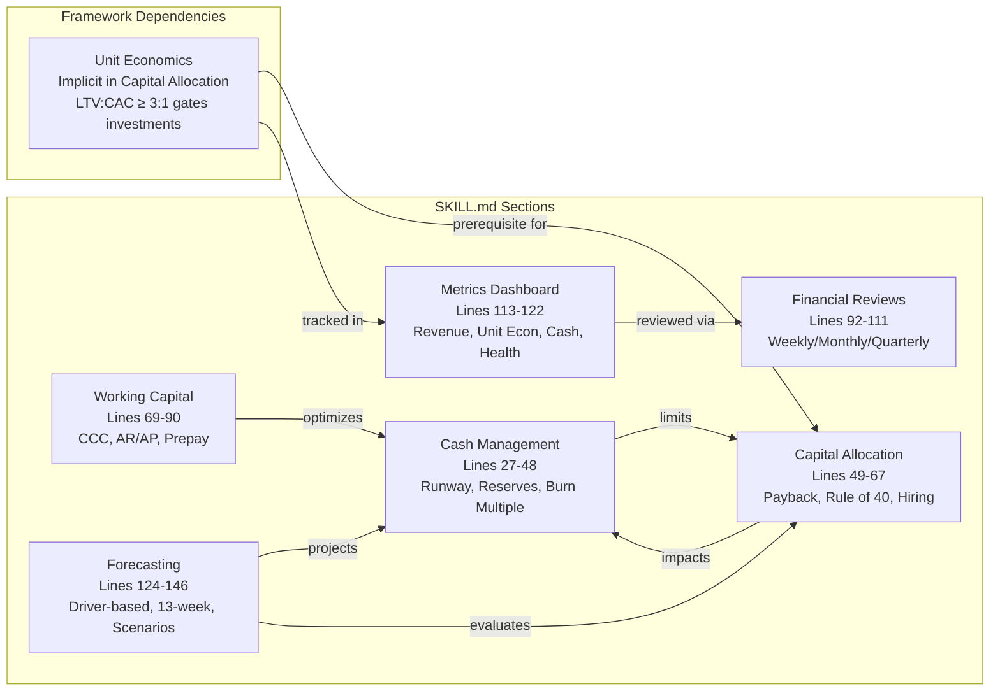
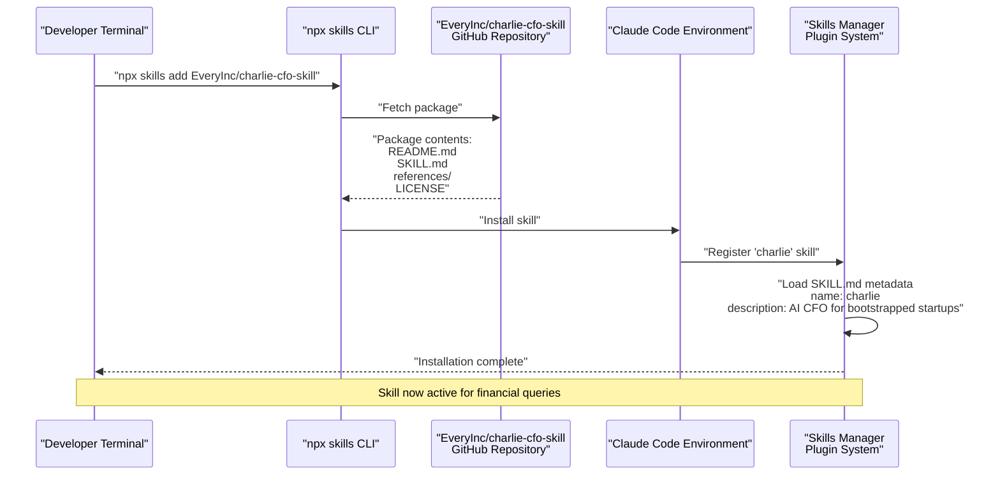

<!-- source: DeepWiki mcp.deepwiki.com · repo EveryInc/charlie-cfo-skill · page 1 Charlie CFO Skill Overview · fetched 2026-10-26 -->

# Charlie CFO Skill Overview

Relevant source files

The following files were used as context for generating this wiki page:

- [README.md](README.md)
- [SKILL.md](SKILL.md)

## Purpose and Scope

This document provides a high-level introduction to the Charlie CFO Skill system, an AI-powered financial advisor for bootstrapped, high-growth startups. It covers the skill's purpose, core components, installation architecture, and how it integrates into the Claude Code environment.

For detailed information on specific topics, see:
- Installation procedures: [Installation and Setup](#1.1)
- Query processing mechanics: [How Charlie Activates and Processes Queries](#1.2)
- Philosophical foundations: [Core Philosophy and Mental Models](#2)
- Financial frameworks: [The Five Financial Frameworks](#3)
- Reference documentation: [Reference Materials](#5)
- Technical architecture: [System Architecture and Design](#6)

## What is Charlie CFO Skill?

Charlie CFO Skill is a Claude Code skill that provides financial frameworks, benchmarks, and decision-making guidance specifically designed for bootstrapped startups. Named after Charlie Munger, the skill embodies the principle that capital discipline is a competitive advantage.

The skill provides structured guidance across five financial domains:

| Domain | Capabilities |
|--------|--------------|
| **Cash Management** | Runway calculations, reserve structures (Operating/Contingency/Growth), burn analysis |
| **Unit Economics** | LTV:CAC ratios, CAC payback periods, gross margin targets |
| **Capital Allocation** | Hiring ROI frameworks, Rule of 40 analysis, investment payback evaluation |
| **Working Capital** | Cash conversion cycle optimization, AR/AP management, prepay discount strategies |
| **Forecasting** | Driver-based planning, scenario modeling, 13-week cash flow projections |

**Sources:** [README.md:7-15](), [SKILL.md:6-8]()

## System Architecture and File Structure

The Charlie CFO Skill is packaged as a repository with the following core components:

**Diagram: Repository Structure and Component Mapping**

The skill's file structure maps directly to its logical architecture:

- **README.md** [README.md:1-58](): User-facing documentation including installation instructions, philosophy summary, and usage examples
- **SKILL.md** [SKILL.md:1-162](): Core specification file containing the complete framework definitions, decision rules, benchmarks, and review rhythms. This is the authoritative source for Charlie's behavior
- **references/metrics-benchmarks.md** [SKILL.md:160](): Detailed metric formulas, calculation methodologies, and industry benchmarks (referenced but not included in provided files)
- **references/case-studies.md** [SKILL.md:161](): Case studies of five bootstrapped companies (Mailchimp, Zapier, Basecamp, ConvertKit, Zoho) with synthesized patterns (referenced but not included in provided files)

**Sources:** [README.md:1-58](), [SKILL.md:1-162]()

## Core Components

### 1. Philosophy Layer

The skill is built on a Munger-inspired philosophy of capital discipline defined in [SKILL.md:10-26](). Three core mental models constrain all framework decisions:

| Principle | Definition | Impact |
|-----------|------------|--------|
| **Profit as Constraint** | "Profit is a constraint, not a goal. Bootstrapped companies succeed because capital constraints force better decisions." [SKILL.md:12]() | Every expenditure evaluated against direct cost, opportunity cost, and runway impact |
| **Unit Economics as Survival** | LTV ≥ 3x CAC, CAC payback < 12 months [SKILL.md:16-17]() | Treated as non-negotiable thresholds; violations create "death spiral" |
| **Revenue Per Employee** | $110-150K at $1-5M ARR, scaling to $400K+ at maturity [SKILL.md:22-24]() | Efficiency scorecard; bootstrapped companies run 40-70% higher than VC-backed peers |

**Sources:** [SKILL.md:10-26]()

### 2. Five Financial Frameworks

Each framework is defined in SKILL.md with specific rules, targets, and decision criteria:

**Diagram: Framework Integration in SKILL.md**

The frameworks are not independent—they form an integrated decision system with explicit dependencies:

- **Unit Economics** (defined implicitly throughout [SKILL.md:14-18]() and explicitly in dashboard [SKILL.md:118]()) acts as a gating function for Capital Allocation decisions
- **Cash Management** [SKILL.md:27-48]() defines runway targets (24-36 months minimum) and reserve structures that constrain spending decisions
- **Capital Allocation** [SKILL.md:49-67]() requires <12 month payback periods and applies the four-question hiring framework
- **Working Capital** [SKILL.md:69-90]() optimizes cash through CCC management, targeting negative cash conversion cycles for SaaS
- **Financial Reviews** [SKILL.md:92-111]() establishes weekly (60-90 min), monthly (full close in 5-7 days), and quarterly (strategic recalibration) rhythms
- **Forecasting** [SKILL.md:124-146]() uses driver-based planning with MRR buildup models and maintains three scenarios (base, moderate downside, severe downside)

**Sources:** [SKILL.md:27-146]()

### 3. Knowledge Base

The skill references two external knowledge documents that provide both quantitative and qualitative grounding:

| Document | Content Type | Purpose |
|----------|--------------|---------|
| **metrics-benchmarks.md** [SKILL.md:160]() | Quantitative | Metric formulas (LTV, CAC, NRR, DSO, CCC, etc.), calculation methodologies, industry benchmarks, performance targets, spending allocations by ARR stage, Rule of 40 matrix |
| **case-studies.md** [SKILL.md:161]() | Qualitative | Five detailed bootstrapped company stories (Mailchimp $12B exit, Zapier $5B valuation, Basecamp 25+ years profitable, ConvertKit crisis turnaround, Zoho $1B+ zero funding) with synthesized common patterns |

**Sources:** [SKILL.md:160-161](), [README.md:45-48]()

## Installation and Distribution Architecture

**Diagram: Installation Flow via NPX**

The skill is distributed through a standard NPX-based installation flow:

1. **Command invocation**: Developer runs `npx skills add EveryInc/charlie-cfo-skill` [README.md:19-21]()
2. **Package fetch**: NPX retrieves the repository from GitHub at `github.com/EveryInc/charlie-cfo-skill`
3. **Skill registration**: The Claude Code environment's Skills Manager reads the metadata from [SKILL.md:1-4](), specifically:
   - `name: charlie` [SKILL.md:2]()
   - `description: Your AI CFO for bootstrapped startups...` [SKILL.md:3]()
4. **Activation ready**: The skill automatically activates on financial queries

**Sources:** [README.md:17-21](), [SKILL.md:1-4]()

## Automatic Activation on Financial Queries

Once installed, Charlie activates automatically when users ask financial questions. The skill definition specifies activation triggers in [SKILL.md:3]():

**Example activation queries** [README.md:27-31]():
- "Should we make this hire?"
- "How much runway do we need?"
- "What metrics should I track?"
- "How do I forecast revenue?"
- "What's a healthy LTV:CAC ratio?"

The Claude Code environment uses NLP intent recognition to route these queries to the `charlie` skill based on the description field: `"Use for questions like 'should we make this hire?', 'how much runway do we need?', 'what metrics should I track?', 'how do I forecast revenue?', or any strategic financial decision at a self-funded company."` [SKILL.md:3]()

For detailed query processing mechanics, see [How Charlie Activates and Processes Queries](#1.2).

**Sources:** [README.md:24-31](), [SKILL.md:3]()

## Target Audience and Use Cases

Charlie is designed for bootstrapped, high-growth startups in the following scenarios:

| Stakeholder | Primary Use Cases |
|-------------|-------------------|
| **Founders** | Strategic decisions (hiring, investments, growth vs. profitability trade-offs), understanding financial health, runway management |
| **CFOs** | Framework application, metric tracking dashboard setup, financial review rhythm implementation, forecasting model design |
| **Operators** | Evaluating department spending, understanding unit economics requirements, working capital optimization |

The skill explicitly targets **bootstrapped companies** with different constraints than VC-backed startups:

- Prioritizes profitability and runway extension over growth-at-all-costs [SKILL.md:12]()
- Enforces stricter efficiency metrics (40-70% higher revenue per employee) [SKILL.md:25-26]()
- Requires lower spending ratios (~95% of ARR vs. 107% for VC-backed) [SKILL.md:154]()
- Emphasizes cash conversion cycle optimization and annual prepay strategies [SKILL.md:69-90]()

**Sources:** [README.md:1-5](), [SKILL.md:3](), [SKILL.md:148-155]()

## Key Differentiators

Charlie differs from generic financial advice tools in several ways:

1. **Philosophy-Constrained Frameworks**: All five frameworks are constrained by Munger-inspired principles [SKILL.md:10-26](), ensuring consistent capital discipline across all decisions

2. **Hard Thresholds as Survival Requirements**: Metrics like LTV:CAC ≥ 3:1 and CAC payback < 12 months are treated as non-negotiable survival thresholds, not aspirational goals [SKILL.md:14-18]()

3. **Bootstrapped-Specific Benchmarks**: Spending allocations, revenue per employee targets, and efficiency metrics are calibrated for self-funded companies [SKILL.md:20-26](), [SKILL.md:148-155]()

4. **Integrated Framework Dependencies**: Unit Economics explicitly gates Capital Allocation decisions—investments cannot be approved without satisfying unit economics constraints first [SKILL.md:14-18](), [SKILL.md:49-67]()

5. **Case Study Grounding**: Advice is enriched with real-world examples from successful bootstrapped companies (Mailchimp, Zapier, Basecamp, ConvertKit, Zoho) [README.md:48](), [SKILL.md:161]()

**Sources:** [SKILL.md:10-26](), [SKILL.md:148-155](), [README.md:45-48]()

## Licensing and Open Source

The Charlie CFO Skill is released under the MIT License [README.md:56-58](), making it freely available for use, modification, and distribution. The repository is hosted at `https://github.com/EveryInc/charlie-cfo-skill`.

For detailed licensing terms, see [License and Legal](#7).

**Sources:** [README.md:56-58]()

## Relationship to Every Platform

The skill is published by EveryInc as part of the Every subscription platform [README.md:50-54](). Every provides:
- The Claude Code environment where Charlie runs
- The Skills infrastructure and NPX-based distribution
- AI-focused content, apps, and training bundled with skill access

Trial access: `https://every.to/subscribe` [README.md:54]()

**Sources:** [README.md:50-54]()

## Navigation to Detailed Documentation

This overview provides the foundational understanding of Charlie CFO Skill. For deeper dives into specific topics, navigate to:

| Topic | Wiki Page |
|-------|-----------|
| Installation procedures and setup | [Installation and Setup](#1.1) |
| Query processing pipeline | [How Charlie Activates and Processes Queries](#1.2) |
| Philosophical foundations | [Core Philosophy and Mental Models](#2) |
| Individual framework details | [The Five Financial Frameworks](#3) |
| Hiring decision guide | [Evaluating Hiring Decisions](#4.1) |
| Metric formulas and benchmarks | [Metrics and Benchmarks Reference](#5.1) |
| Bootstrapped company case studies | [Bootstrapped Company Case Studies](#5.2) |
| Framework integration architecture | [Framework Integration and Dependencies](#6.1) |

---

