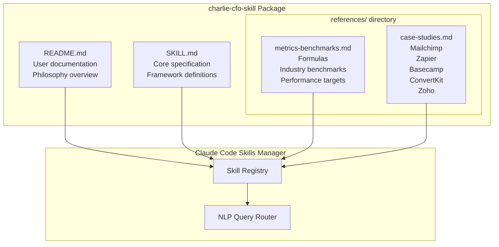
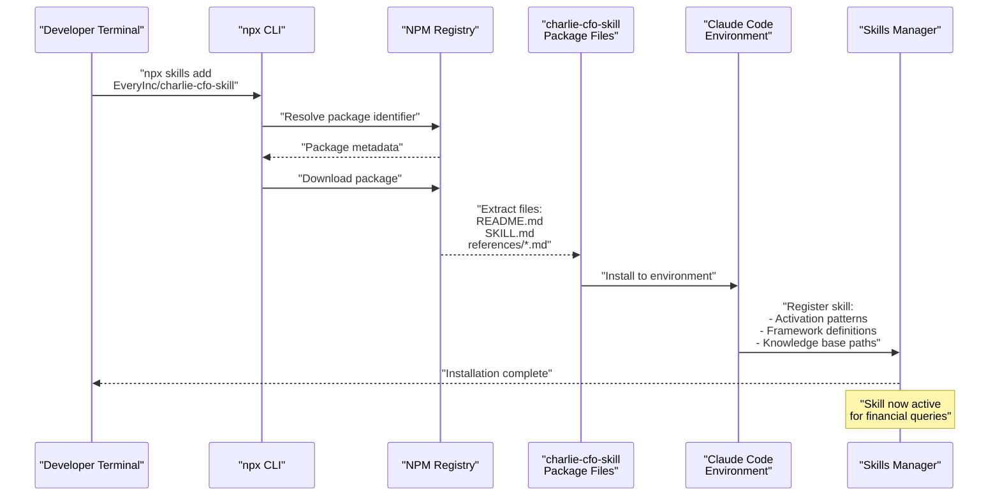
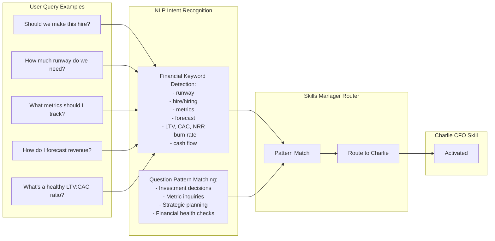
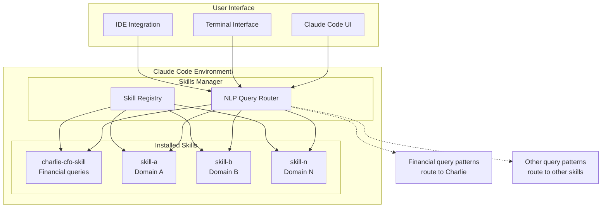

<!-- source: DeepWiki mcp.deepwiki.com · repo EveryInc/charlie-cfo-skill · page 1.1 Installation and Setup · fetched 2026-10-26 -->

# Installation and Setup

<details>
<summary>Relevant source files</summary>

The following files were used as context for generating this wiki page:

- [README.md](README.md)

</details>


**Purpose**: This document provides step-by-step instructions for installing the Charlie CFO Skill into your Claude Code environment, explains the package structure that gets installed, and details the automatic activation mechanism. For information on how Charlie processes queries once activated, see [How Charlie Activates and Processes Queries](#1.2).

---

## Prerequisites

Charlie CFO Skill operates within the Claude Code environment, which requires an active Every subscription. The skill is distributed as an NPM-style package and installed via the `npx skills` CLI tool.

| Requirement | Description | Notes |
|-------------|-------------|-------|
| **Every Subscription** | Paid subscription to Every platform | Provides access to Claude Code environment |
| **Claude Code** | AI development platform with Skills Manager | Hosts installed skills and routes queries |
| **NPX** | Node Package Executor | Standard with Node.js installations |
| **Terminal Access** | Command-line interface | For running installation commands |

**Sources**: [README.md:1-58]()

---

## Installation Command

The installation process uses a single NPX command that pulls the skill package from the registry and integrates it into your Claude Code environment:

```bash
npx skills add EveryInc/charlie-cfo-skill
```

This command:
1. Resolves the package identifier `EveryInc/charlie-cfo-skill` against the NPM registry
2. Downloads the skill package including all reference materials
3. Registers the skill with Claude Code's Skills Manager
4. Configures automatic activation for financial query patterns

**Sources**: [README.md:17-21]()

---

## Package Structure

The Charlie CFO Skill package contains four primary components that get installed into your Claude Code environment:



**Diagram 1: Installed Package Structure and Integration**

**Sources**: [README.md:1-58]()

---

## File Components

### Core Documentation Files

| File Path | Purpose | Content Type |
|-----------|---------|--------------|
| `README.md` | User-facing documentation | Philosophy, key principles, quick-start examples |
| `SKILL.md` | Skill specification | Framework definitions, decision rules, activation patterns |

### Reference Knowledge Base

| File Path | Purpose | Usage |
|-----------|---------|-------|
| `references/metrics-benchmarks.md` | Quantitative foundation | Calculation formulas (LTV, CAC, NRR, DSO, CCC), performance targets (LTV:CAC ≥ 3:1, runway 24-36 months), spending benchmarks by ARR stage, Rule of 40 matrix |
| `references/case-studies.md` | Qualitative wisdom | Five bootstrapped company case studies (Mailchimp, Zapier, Basecamp, ConvertKit, Zoho), common success patterns, strategic examples |

**Sources**: [README.md:43-48]()

---

## Installation Flow

The following diagram shows the complete installation pipeline from command execution to skill activation:



**Diagram 2: Installation Process Flow**

**Sources**: [README.md:17-21]()

---

## Activation Mechanism

Charlie activates automatically when Claude Code's NLP layer detects financial intent in user queries. No explicit invocation is required.

### Query Pattern Recognition

The Skills Manager uses NLP intent recognition to route queries to Charlie based on financial keywords and question patterns:



**Diagram 3: Automatic Activation via Query Pattern Recognition**

### Example Activation Queries

The following table shows example queries that automatically activate Charlie:

| Query Category | Example Query | Activates Charlie? |
|----------------|---------------|-------------------|
| **Hiring Decisions** | "Should we make this hire?" | ✓ Yes |
| **Cash Management** | "How much runway do we need?" | ✓ Yes |
| **Metrics** | "What metrics should I track?" | ✓ Yes |
| **Forecasting** | "How do I forecast revenue?" | ✓ Yes |
| **Unit Economics** | "What's a healthy LTV:CAC ratio?" | ✓ Yes |
| **General Development** | "How do I write a React component?" | ✗ No (routes to different skill) |

**Sources**: [README.md:24-31]()

---

## Post-Installation Verification

After installation completes, verify Charlie is properly activated by asking a test financial question through your Claude Code interface:

### Verification Test

**Test Query**: 
```
What's the minimum acceptable LTV:CAC ratio for a SaaS startup?
```

**Expected Response Indicators**:
- Reference to LTV:CAC ≥ 3:1 threshold
- Citation of benchmark data from `metrics-benchmarks.md`
- Explanation rooted in unit economics framework
- Possible case study example (e.g., Mailchimp CAC < $100)

If the response includes these elements, Charlie is correctly installed and activated.

---

## Integration with Claude Code Environment

Charlie operates as one skill within Claude Code's multi-skill ecosystem. The Skills Manager handles:



**Diagram 4: Multi-Skill Ecosystem Integration**

### Skill Isolation

Each skill operates independently:
- **Query routing**: NLP layer routes queries to the most appropriate skill based on intent
- **Knowledge isolation**: Each skill maintains its own reference materials
- **No cross-contamination**: Charlie only activates for financial queries; other query types route elsewhere

**Sources**: [README.md:1-58]()

---

## Repository and License

Charlie CFO Skill is open-source software published by EveryInc:

| Property | Value |
|----------|-------|
| **Repository** | `github.com/EveryInc/charlie-cfo-skill` |
| **Publisher** | EveryInc |
| **License** | MIT License |
| **Package Name** | `EveryInc/charlie-cfo-skill` |

The MIT License permits modification and redistribution while the skill remains maintained in the public GitHub repository.

**Sources**: [README.md:56-58]()

---

## Troubleshooting Installation

### Common Issues

| Issue | Cause | Resolution |
|-------|-------|------------|
| **"Package not found"** | NPX cannot resolve package identifier | Verify NPX version, check network connectivity |
| **"Skills Manager not available"** | Not using Claude Code environment | Ensure Every subscription is active and Claude Code is accessible |
| **Charlie doesn't activate** | Query pattern not recognized as financial | Rephrase query with explicit financial terms (e.g., "runway", "LTV:CAC", "hire") |

### Installation Location

The skill package is installed into the Claude Code environment's Skills Manager registry, not your local file system. Files are accessible to Claude Code but are not stored as traditional npm packages in `node_modules/`.

---

## Next Steps

After successful installation:
1. Review [How Charlie Activates and Processes Queries](#1.2) to understand the query processing pipeline
2. Explore the [Five Financial Frameworks](#3) to learn what guidance Charlie provides
3. Consult the [Metrics and Benchmarks Reference](#5.1) for calculation formulas and targets

**Sources**: [README.md:1-58]()

---

