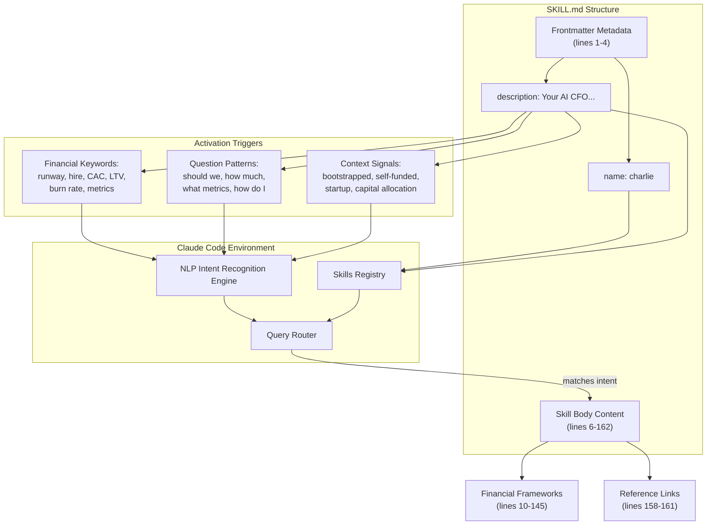
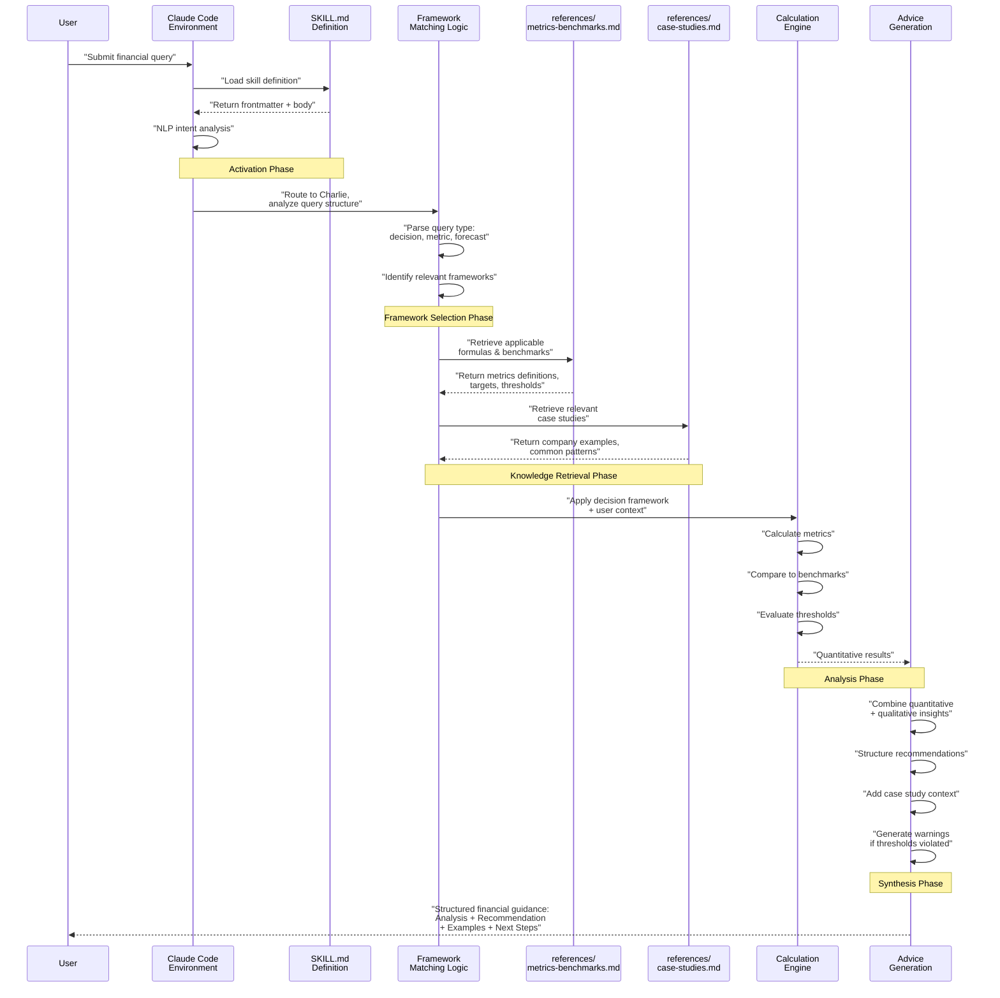
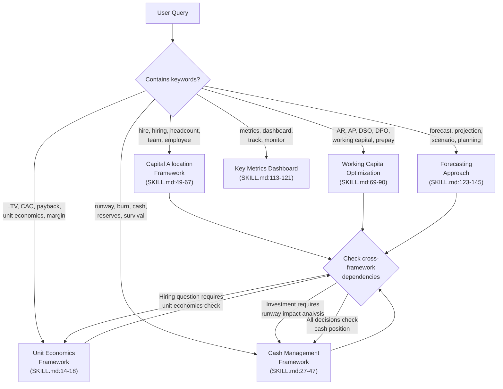
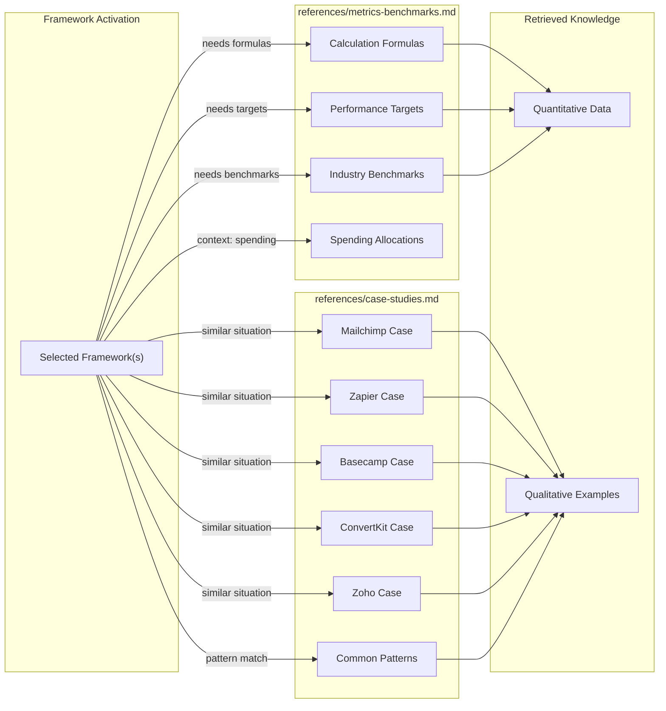
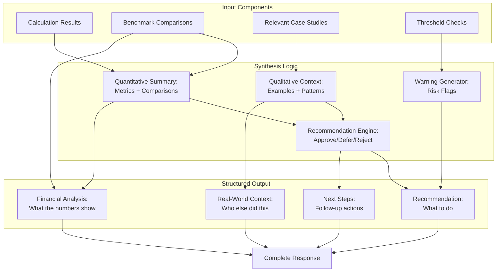
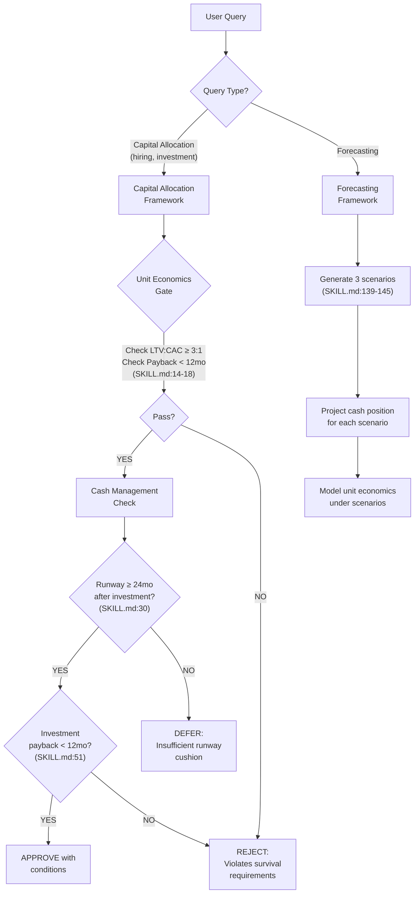

<!-- source: DeepWiki mcp.deepwiki.com · repo EveryInc/charlie-cfo-skill · page 1.2 How Charlie Activates and Processes Queries · fetched 2026-10-26 -->

# How Charlie Activates and Processes Queries

Relevant source files

The following files were used as context for generating this wiki page:

- [README.md](README.md)
- [SKILL.md](SKILL.md)

## Purpose and Scope

This document explains the technical mechanisms by which Charlie CFO Skill activates in response to user queries and processes them into actionable financial guidance. It covers the automatic activation system, NLP intent recognition, query processing pipeline, framework selection logic, knowledge retrieval patterns, and response generation.

For information about installing Charlie, see [Installation and Setup](#1.1). For details on the underlying philosophy and frameworks Charlie applies, see [Core Philosophy and Mental Models](#2) and [The Five Financial Frameworks](#3).

## Activation Mechanism

Charlie uses Claude Code's skill system to automatically activate when users ask financial questions. The activation is controlled through the skill definition file rather than manual invocation.

### Skill Definition Structure

The skill definition is specified in [SKILL.md:1-4](), which contains frontmatter metadata that Claude's environment uses for automatic routing:

| Field | Value | Purpose |
|-------|-------|---------|
| `name` | `charlie` | Unique skill identifier in Claude's skill registry |
| `description` | Multi-line description of capabilities and example queries | NLP intent matching specification |

The `description` field [SKILL.md:3]() serves as the primary activation trigger. It contains:

1. **Identity and purpose**: "Your AI CFO for bootstrapped startups"
2. **Capability list**: Cash management, runway calculations, unit economics, capital allocation, etc.
3. **Example query patterns**: "should we make this hire?", "how much runway do we need?", "what metrics should I track?"
4. **Context specifiers**: "bootstrapped startups", "self-funded company", "strategic financial decision"

When a user query is received by Claude Code, the environment's NLP system matches the query intent against all installed skills' description fields. Financial terms, decision patterns, and context keywords trigger routing to Charlie.

**Sources**: [SKILL.md:1-4](), [README.md:25-31]()

### Example Activation Patterns

The following user queries demonstrate automatic activation:

| Query | Trigger Mechanism | Activated Frameworks |
|-------|-------------------|---------------------|
| "Should we make this hire?" | Pattern match: "should we", "hire" | Capital Allocation, Cash Management |
| "How much runway do we need?" | Keyword: "runway" | Cash Management |
| "What's a healthy LTV:CAC ratio?" | Keyword: "LTV:CAC" | Unit Economics |
| "How do I forecast revenue?" | Pattern: "how do I", keyword: "forecast revenue" | Forecasting |
| "What metrics should I track?" | Pattern: "what metrics" | All frameworks (dashboard) |

**Sources**: [README.md:27-31](), [SKILL.md:3]()

## Query Processing Pipeline

Once activated, Charlie processes queries through a multi-stage pipeline that analyzes intent, retrieves relevant knowledge, performs calculations, and generates structured guidance.

### Complete Processing Sequence

**Sources**: [SKILL.md:1-162](), Diagram 3 from system architecture overview

### Pipeline Stages in Detail

#### Stage 1: Intent Analysis and Framework Selection

The framework matching logic examines the query to determine which of the five financial frameworks apply. This is implemented through the structured content in [SKILL.md:10-145]().

**Decision tree for framework selection**:

**Sources**: [SKILL.md:10-162]()

#### Stage 2: Knowledge Retrieval

Charlie retrieves relevant information from two reference documents based on the selected frameworks:

| Reference Document | Content Type | Usage Pattern |
|-------------------|--------------|---------------|
| `references/metrics-benchmarks.md` | Quantitative formulas, targets, industry benchmarks | Provides calculation methods and validation thresholds |
| `references/case-studies.md` | Qualitative examples from 5 bootstrapped companies | Provides context, patterns, and precedents |

**Retrieval logic**:

**Sources**: [SKILL.md:158-161](), [README.md:45-48]()

#### Stage 3: Calculation and Analysis

The calculation engine applies formulas from the metrics reference document and compares results to benchmark thresholds defined in [SKILL.md:14-18, 29-47, 49-67, 69-90]().

**Example: Hiring Decision Calculation Flow**

When processing "Should we make this hire?":

1. **Retrieve salary input** from user context
2. **Apply Capital Allocation framework** [SKILL.md:59-64]():
   - Will hire directly contribute to revenue?
   - Time-to-productivity analysis
   - Opportunity cost calculation
   - Team productivity impact
3. **Calculate runway impact** [SKILL.md:29-47]():
   - Current burn rate
   - Projected burn with new hire
   - New runway calculation
   - Check against 24-36 month minimum [SKILL.md:30-32]()
4. **Validate unit economics** [SKILL.md:14-18]():
   - Current LTV:CAC ratio
   - Projected impact if sales/marketing hire
   - Check against 3:1 minimum threshold
5. **Check payback requirement** [SKILL.md:51]():
   - Expected revenue contribution
   - Payback period calculation
   - Validate <12 month target

**Threshold violation handling**:

| Metric | Threshold | Source | Violation Action |
|--------|-----------|--------|------------------|
| LTV:CAC ratio | ≥ 3:1 | [SKILL.md:16]() | Generate warning: "Death spiral risk" [SKILL.md:18]() |
| CAC payback | < 12 months | [SKILL.md:17]() | Generate warning: "Violates survival requirement" |
| Runway | ≥ 24 months | [SKILL.md:30]() | Generate alert: "Minimum threshold" |
| Runway | < 12 months | [SKILL.md:32]() | Generate critical warning: "Lost control" |
| Payback period | < 12 months | [SKILL.md:51]() | Reject investment if violated |
| Customer concentration | ≤ 10% per customer | [SKILL.md:121]() | Generate risk warning |

**Sources**: [SKILL.md:14-18](), [SKILL.md:27-67](), [SKILL.md:113-121]()

#### Stage 4: Advice Generation and Response Structuring

The final stage synthesizes quantitative analysis with qualitative insights to produce structured guidance.

**Response structure**:

**Example response components for "Should we hire a sales rep at $120K?**:

| Component | Content | Source |
|-----------|---------|--------|
| **Analysis** | Salary: $120K Current burn: $50K/mo → $60K/mo Runway: 36 months → 30 months Expected contribution: $300K ARR in 12 months Payback: 4.8 months | [SKILL.md:59-64](), [SKILL.md:29-47]() |
| **Recommendation** | ✓ APPROVE Meets <12 month payback requirement Maintains >24 month runway threshold Direct revenue contribution | [SKILL.md:51](), [SKILL.md:30]() |
| **Context** | Similar to Zapier's "hire when it hurts" principle ConvertKit turned around with direct sales focus | `references/case-studies.md` |
| **Next Steps** | 1. Define 90-day ramp plan 2. Set pipeline targets 3. Update 13-week cash forecast 4. Monitor progress weekly | [SKILL.md:92-98](), [SKILL.md:133-137]() |

**Sources**: [SKILL.md:1-162](), Diagram 2 from system architecture overview

## Framework Cross-Dependencies

Charlie enforces hard dependencies between frameworks to prevent inconsistent advice. These dependencies are encoded in the skill logic through conditional checks.

### Dependency Rules

**Key enforcement points**:

1. **Unit Economics gates Capital Allocation** [SKILL.md:14-18]() - LTV:CAC and payback thresholds must be satisfied before approving growth investments
2. **Cash Management constrains all decisions** [SKILL.md:29-32]() - Every decision checks runway impact
3. **Forecasting integrates all frameworks** [SKILL.md:123-145]() - Scenarios model combined effects

**Sources**: [SKILL.md:14-18](), [SKILL.md:27-67](), [SKILL.md:123-145](), Diagram 4 from system architecture overview

## Query-to-Framework Mapping Reference

The following table maps common query patterns to their primary and secondary frameworks:

| Query Pattern | Primary Framework | Secondary Frameworks | Key Thresholds Checked |
|---------------|-------------------|----------------------|------------------------|
| "Should we hire..." | Capital Allocation [SKILL.md:49-67]() | Cash Management, Unit Economics | Payback <12mo, Runway ≥24mo, LTV:CAC ≥3:1 |
| "How much runway..." | Cash Management [SKILL.md:27-47]() | - | 24-36 month target |
| "What's our LTV:CAC..." | Unit Economics [SKILL.md:14-18]() | - | ≥3:1 minimum, 7-8x best-in-class |
| "Should we invest in..." | Capital Allocation [SKILL.md:49-67]() | Cash Management | Payback <12mo, Runway impact |
| "How should we forecast..." | Forecasting [SKILL.md:123-145]() | All frameworks | 3-scenario requirement |
| "Can we afford annual prepay..." | Working Capital [SKILL.md:69-90]() | Cash Management | 15-20% discount offer |
| "What metrics to track..." | Dashboard [SKILL.md:113-121]() | All frameworks | All threshold values |
| "Is our burn rate..." | Cash Management [SKILL.md:42-47]() | Unit Economics | Burn multiple <1.5x, ideally negative |

**Sources**: [SKILL.md:1-162](), [README.md:25-31]()

## Performance and Timing Characteristics

The query processing pipeline is synchronous and completes in a single interaction. Response time depends on:

1. **Query complexity** - Number of frameworks activated
2. **Calculation depth** - Number of metrics to compute
3. **Reference retrieval** - Number of case studies matched
4. **Context length** - Amount of user-provided financial data

Charlie prioritizes comprehensive analysis over speed, as financial decisions require complete context rather than rapid responses.

**Sources**: Diagram 3 from system architecture overview

---

